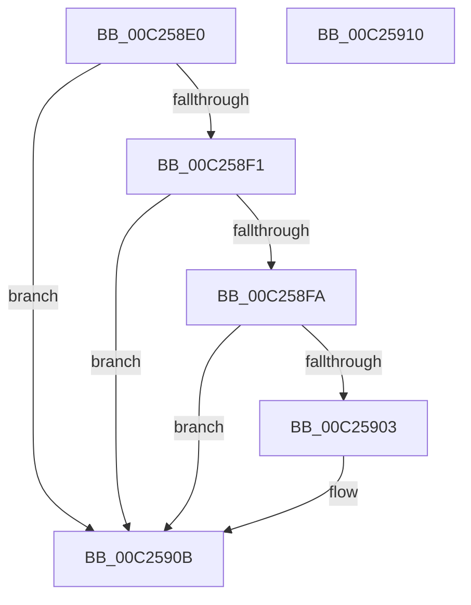

# HalpAcpiIBMExaMatch

- RVA: `0x00C258E0`–`0x00C25911` (길이 `49` bytes)
- VA: `0x0000000140C258E0`
- 실행 섹션: `INIT`
- PDB 이름 있음: `예`; PDB Function 태그: `아니요`
- unwind 정보 RVA: `0x0005C788`
- 디코드: `18`개 명령, `49/49` bytes 표시
- 미해석 바이트: `0` (있으면 어셈블리에 `.byte`로 보존)

> 이 문서는 커널 이미지의 기계어와 PDB 기호를 분석해 생성했습니다. 4번과 5번은 함수 원형과 자료형을 바이너리 사용 방식에서 추정한 C 해석이며 원본 소스 복구 결과는 아닙니다.

## 1. Dependencies

- 직접 호출 지점: **2**; 고유 호출 대상: **2**
- 직접 호출자로 확인된 함수: **0**
- RIP 상대 이미지 참조: **0**

### Outgoing calls
- `0x00C258E7` → [HalpInterruptModel](../../text/4A/HalpInterruptModel_function_004ACA38.md) (function, `0x004ACA38`)
- `0x00C25906` → [HalpAcpiIBMVigilMatch](HalpAcpiIBMVigilMatch_function_00C25920.md) (function, `0x00C25920`)

### Direct callers
- 이 함수 시작 RVA로 연결되는 직접 call은 확인되지 않았습니다. 간접 호출은 완전히 역산할 수 없습니다.

### Static image references
- 디코드된 RIP-relative 메모리 참조가 없습니다.

## 2. Other-region calls and transfers

- 다른 실행 섹션으로 향하는 call: **1**
  - `0x00C258E7` → [HalpInterruptModel](../../text/4A/HalpInterruptModel_function_004ACA38.md) (`INIT` → `.text`)
- 별도 외부 분기/꼬리 이동을 확인하지 못했습니다.

## 3. Assembly (complete function range)

```asm
00C258E0  48 83 EC 28                     sub rsp, 0x28
00C258E4  4C 8B C1                        mov r8, rcx
00C258E7  E8 4C 71 88 FF                  call 0x1404aca38
00C258EC  83 F8 01                        cmp eax, 1
00C258EF  75 1A                           jne 0x140c2590b
00C258F1  8A 42 13                        mov al, byte ptr [rdx + 0x13]
00C258F4  2C 30                           sub al, 0x30
00C258F6  3C 09                           cmp al, 9
00C258F8  77 11                           ja 0x140c2590b
00C258FA  8A 42 14                        mov al, byte ptr [rdx + 0x14]
00C258FD  2C 30                           sub al, 0x30
00C258FF  3C 09                           cmp al, 9
00C25901  77 08                           ja 0x140c2590b
00C25903  49 8B C8                        mov rcx, r8
00C25906  E8 15 00 00 00                  call 0x140c25920
00C2590B  48 83 C4 28                     add rsp, 0x28
00C2590F  C3                              ret
00C25910  CC                              int3
```

## 4. C-style interpretation (structured pseudocode)

```c
__int64 __fastcall HalpAcpiIBMExaMatch(__int64 a1, __int64 a2)
{
    __int64 result;
    __int64 v_rsp;

    v_rsp = (v_rsp) - (40);
    result = HalpInterruptModel(a1, a2, a1, a4);
    if (((unsigned int)(result)) != 1) goto loc_00C2590B;
    result = (unsigned __int8)((*(unsigned __int8 *)(a2 + 19)) - (48));
    if (((unsigned __int8)(result)) > 9) goto loc_00C2590B;
    result = (unsigned __int8)((*(unsigned __int8 *)(a2 + 20)) - (48));
    if (((unsigned __int8)(result)) <= 9) {
        a1 = a1;
        result = HalpAcpiIBMVigilMatch(a1, a2, a1, a4);
    }
    v_rsp = (v_rsp) + (40);
    return result;
}
```

## 5. (Beta) C Style

```c
int64_t HalpAcpiIBMExaMatch(int64_t Arg1, int64_t Arg2)
{
    int64_t result;
    int64_t local_rsp;

    local_rsp = (local_rsp) - (40);
    result = HalpInterruptModel(Arg1, Arg2, Arg1, a4);
    if (((uint32_t)(result)) != 1) goto loc_00C2590B;
    result = (uint8_t)((*(uint8_t *)(Arg2 + 0x13)) - (48));
    if (((uint8_t)(result)) > 9) goto loc_00C2590B;
    result = (uint8_t)((*(uint8_t *)(Arg2 + 0x14)) - (48));
    if (((uint8_t)(result)) <= 9) {
        Arg1 = Arg1;
        result = HalpAcpiIBMVigilMatch(Arg1, Arg2, Arg1, a4);
    }
    local_rsp = (local_rsp) + (40);
    return result;
}
```

## 6. Execution-region graph

[열기: 2D/3D 그래프와 함수 탐색 컨트롤 패널](../../../control-panel.html?section=init&rva=0x00C258E0&view=graph)

- 2D 그래프는 위에서 아래로 흐르고, 3D 그래프는 빈 공간을 드래그해 회전합니다. Shift+드래그는 이동, 휠은 확대·축소, 함수 노드 선택은 대상 보고서 이동입니다.

### Static fallback


