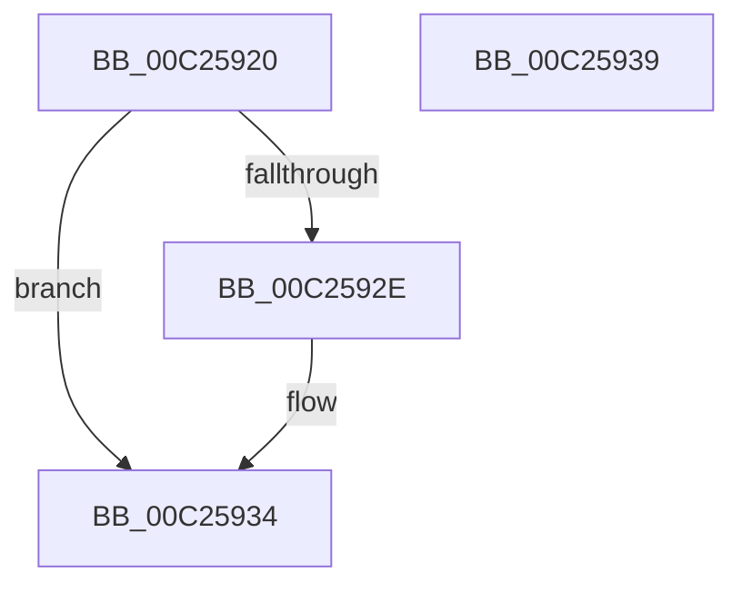

# HalpAcpiIBMVigilMatch

- RVA: `0x00C25920`–`0x00C2593A` (길이 `26` bytes)
- VA: `0x0000000140C25920`
- 실행 섹션: `INIT`
- PDB 이름 있음: `예`; PDB Function 태그: `아니요`
- unwind 정보 RVA: `0x0005C788`
- 디코드: `8`개 명령, `26/26` bytes 표시
- 미해석 바이트: `0` (있으면 어셈블리에 `.byte`로 보존)

> 이 문서는 커널 이미지의 기계어와 PDB 기호를 분석해 생성했습니다. 4번과 5번은 함수 원형과 자료형을 바이너리 사용 방식에서 추정한 C 해석이며 원본 소스 복구 결과는 아닙니다.

## 1. Dependencies

- 직접 호출 지점: **1**; 고유 호출 대상: **1**
- 직접 호출자로 확인된 함수: **1**
- RIP 상대 이미지 참조: **1**

### Outgoing calls
- `0x00C25924` → [HalpInterruptModel](../../text/4A/HalpInterruptModel_function_004ACA38.md) (function, `0x004ACA38`)

### Direct callers
- [HalpAcpiIBMExaMatch](HalpAcpiIBMExaMatch_function_00C258E0.md) at `0x00C25906`

### Static image references
- `0x00C2592E` → RVA `0x00E10204` (`.data`; write)

## 2. Other-region calls and transfers

- 다른 실행 섹션으로 향하는 call: **1**
  - `0x00C25924` → [HalpInterruptModel](../../text/4A/HalpInterruptModel_function_004ACA38.md) (`INIT` → `.text`)
- 별도 외부 분기/꼬리 이동을 확인하지 못했습니다.

## 3. Assembly (complete function range)

```asm
00C25920  48 83 EC 28                     sub rsp, 0x28
00C25924  E8 0F 71 88 FF                  call 0x1404aca38
00C25929  83 F8 01                        cmp eax, 1
00C2592C  75 06                           jne 0x140c25934
00C2592E  88 05 D0 A8 1E 00               mov byte ptr [rip + 0x1ea8d0], al
00C25934  48 83 C4 28                     add rsp, 0x28
00C25938  C3                              ret
00C25939  CC                              int3
```

## 4. C-style interpretation (structured pseudocode)

```c
__int64 __fastcall HalpAcpiIBMVigilMatch(void)
{
    __int64 result;
    __int64 v_rsp;

    v_rsp = (v_rsp) - (40);
    result = HalpInterruptModel(a1, a2, a3, a4);
    if (((unsigned int)(result)) == 1) {
        *(unsigned __int8 *)(v_rip + 2009296) = (unsigned __int8)(result);
    }
    v_rsp = (v_rsp) + (40);
    return result;
}
```

## 5. (Beta) C Style

```c
void HalpAcpiIBMVigilMatch(void)
{
    int64_t result;
    int64_t local_rsp;

    local_rsp = (local_rsp) - (40);
    result = HalpInterruptModel(a1, a2, a3, a4);
    if (((uint32_t)(result)) == 1) {
        *(uint8_t *)(v_rip + 0x1EA8D0) = (uint8_t)(result);
    }
    local_rsp = (local_rsp) + (40);
    return result;
}
```

## 6. Execution-region graph

[열기: 2D/3D 그래프와 함수 탐색 컨트롤 패널](../../../control-panel.html?section=init&rva=0x00C25920&view=graph)

- 2D 그래프는 위에서 아래로 흐르고, 3D 그래프는 빈 공간을 드래그해 회전합니다. Shift+드래그는 이동, 휠은 확대·축소, 함수 노드 선택은 대상 보고서 이동입니다.

### Static fallback


