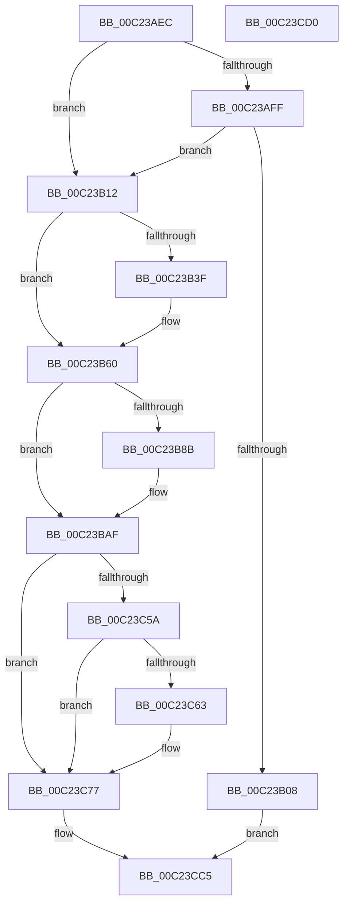

# HalpAcpiInitializePmRegisters

- RVA: `0x00C23AEC`–`0x00C23CD1` (길이 `485` bytes)
- VA: `0x0000000140C23AEC`
- 실행 섹션: `INIT`
- PDB 이름 있음: `예`; PDB Function 태그: `아니요`
- unwind 정보 RVA: `0x0006E5F8`
- 디코드: `107`개 명령, `485/485` bytes 표시
- 미해석 바이트: `0` (있으면 어셈블리에 `.byte`로 보존)

> 이 문서는 커널 이미지의 기계어와 PDB 기호를 분석해 생성했습니다. 4번과 5번은 함수 원형과 자료형을 바이너리 사용 방식에서 추정한 C 해석이며 원본 소스 복구 결과는 아닙니다.

## 1. Dependencies

- 직접 호출 지점: **11**; 고유 호출 대상: **3**
- 직접 호출자로 확인된 함수: **1**
- RIP 상대 이미지 참조: **10**

### Outgoing calls
- `0x00C23B36` → [HalpAcpiSetupPmRegisterLegacy](HalpAcpiSetupPmRegisterLegacy_function_00C23E20.md) (function, `0x00C23E20`)
- `0x00C23B5A` → [KeBugCheckEx](../../text/4F/KeBugCheckEx_function_004FD660.md) (function, `0x004FD660`)
- `0x00C23B82` → [HalpAcpiSetupPmRegisterLegacy](HalpAcpiSetupPmRegisterLegacy_function_00C23E20.md) (function, `0x00C23E20`)
- `0x00C23BA9` → [KeBugCheckEx](../../text/4F/KeBugCheckEx_function_004FD660.md) (function, `0x004FD660`)
- `0x00C23BD5` → [HalpAcpiSetupPmRegisterLegacy](HalpAcpiSetupPmRegisterLegacy_function_00C23E20.md) (function, `0x00C23E20`)
- `0x00C23BFC` → [HalpAcpiSetupPmRegisterLegacy](HalpAcpiSetupPmRegisterLegacy_function_00C23E20.md) (function, `0x00C23E20`)
- `0x00C23C23` → [HalpAcpiSetupPmRegisterLegacy](HalpAcpiSetupPmRegisterLegacy_function_00C23E20.md) (function, `0x00C23E20`)
- `0x00C23C4F` → [HalpAcpiSetupPmRegisterLegacy](HalpAcpiSetupPmRegisterLegacy_function_00C23E20.md) (function, `0x00C23E20`)
- `0x00C23C72` → [HalpAcpiSetupPmRegister](HalpAcpiSetupPmRegister_function_00C23CD8.md) (function, `0x00C23CD8`)
- `0x00C23C99` → [HalpAcpiSetupPmRegisterLegacy](HalpAcpiSetupPmRegisterLegacy_function_00C23E20.md) (function, `0x00C23E20`)
- `0x00C23CC0` → [HalpAcpiSetupPmRegisterLegacy](HalpAcpiSetupPmRegisterLegacy_function_00C23E20.md) (function, `0x00C23E20`)

### Direct callers
- [HalpSetupAcpiPhase0](HalpSetupAcpiPhase0_function_00C23EDC.md) at `0x00C23FC7`

### Static image references
- `0x00C23B17` → RVA `0x00F8FE60` (`.data`; read)
- `0x00C23B3F` → RVA `0x00025978` (`.rdata`; read)
- `0x00C23B65` → RVA `0x00F8FE90` (`.data`; read)
- `0x00C23BB4` → RVA `0x00F8FEC0` (`.data`; read)
- `0x00C23BDF` → RVA `0x00F8FEF0` (`.data`; read)
- `0x00C23C06` → RVA `0x00F8FF20` (`.data`; read)
- `0x00C23C2D` → RVA `0x00F8FF50` (`.data`; read)
- `0x00C23C69` → RVA `0x00F8FFE0` (`.data`; read)
- `0x00C23C7C` → RVA `0x00F8FF80` (`.data`; read)
- `0x00C23CA3` → RVA `0x00F8FFB0` (`.data`; read)

## 2. Other-region calls and transfers

- 다른 실행 섹션으로 향하는 call: **2**
  - `0x00C23B5A` → [KeBugCheckEx](../../text/4F/KeBugCheckEx_function_004FD660.md) (`INIT` → `.text`)
  - `0x00C23BA9` → [KeBugCheckEx](../../text/4F/KeBugCheckEx_function_004FD660.md) (`INIT` → `.text`)
- 별도 외부 분기/꼬리 이동을 확인하지 못했습니다.

## 3. Assembly (complete function range)

```asm
00C23AEC  48 89 5C 24 08                  mov qword ptr [rsp + 8], rbx
00C23AF1  57                              push rdi
00C23AF2  48 83 EC 30                     sub rsp, 0x30
00C23AF6  80 79 08 05                     cmp byte ptr [rcx + 8], 5
00C23AFA  48 8B D9                        mov rbx, rcx
00C23AFD  72 13                           jb 0x140c23b12
00C23AFF  F7 41 70 00 00 10 00            test dword ptr [rcx + 0x70], 0x100000
00C23B06  74 0A                           je 0x140c23b12
00C23B08  B8 BB 00 00 C0                  mov eax, 0xc00000bb
00C23B0D  E9 B3 01 00 00                  jmp 0x140c23cc5
00C23B12  44 0F B6 49 58                  movzx r9d, byte ptr [rcx + 0x58]
00C23B17  48 8D 05 42 C3 36 00            lea rax, [rip + 0x36c342]
00C23B1E  8B 51 38                        mov edx, dword ptr [rcx + 0x38]
00C23B21  4C 8D 81 94 00 00 00            lea r8, [rcx + 0x94]
00C23B28  48 89 44 24 28                  mov qword ptr [rsp + 0x28], rax
00C23B2D  BF 02 00 00 00                  mov edi, 2
00C23B32  89 7C 24 20                     mov dword ptr [rsp + 0x20], edi
00C23B36  E8 E5 02 00 00                  call 0x140c23e20
00C23B3B  85 C0                           test eax, eax
00C23B3D  79 21                           jns 0x140c23b60
00C23B3F  4C 8D 0D 32 1E 40 FF            lea r9, [rip - 0xbfe1ce]
00C23B46  48 C7 44 24 20 C2 00 00 00      mov qword ptr [rsp + 0x20], 0xc2
00C23B4F  45 33 C0                        xor r8d, r8d
00C23B52  8D 4F 5A                        lea ecx, [rdi + 0x5a]
00C23B55  BA 00 82 00 00                  mov edx, 0x8200
00C23B5A  E8 01 9B 8D FF                  call 0x1404fd660
00C23B5F  CC                              int3
00C23B60  44 0F B6 4B 59                  movzx r9d, byte ptr [rbx + 0x59]
00C23B65  48 8D 05 24 C3 36 00            lea rax, [rip + 0x36c324]
00C23B6C  8B 53 40                        mov edx, dword ptr [rbx + 0x40]
00C23B6F  4C 8D 83 AC 00 00 00            lea r8, [rbx + 0xac]
00C23B76  48 89 44 24 28                  mov qword ptr [rsp + 0x28], rax
00C23B7B  48 8B CB                        mov rcx, rbx
00C23B7E  89 7C 24 20                     mov dword ptr [rsp + 0x20], edi
00C23B82  E8 99 02 00 00                  call 0x140c23e20
00C23B87  85 C0                           test eax, eax
00C23B89  79 24                           jns 0x140c23baf
00C23B8B  B9 5C 00 00 00                  mov ecx, 0x5c
00C23B90  48 C7 44 24 20 D1 00 00 00      mov qword ptr [rsp + 0x20], 0xd1
00C23B99  4C 8D 0D D8 1D 40 FF            lea r9, [rip - 0xbfe228]
00C23BA0  BA 00 82 00 00                  mov edx, 0x8200
00C23BA5  44 8D 41 A5                     lea r8d, [rcx - 0x5b]
00C23BA9  E8 B2 9A 8D FF                  call 0x1404fd660
00C23BAE  CC                              int3
00C23BAF  44 0F B6 4B 5B                  movzx r9d, byte ptr [rbx + 0x5b]
00C23BB4  48 8D 05 05 C3 36 00            lea rax, [rip + 0x36c305]
00C23BBB  8B 53 4C                        mov edx, dword ptr [rbx + 0x4c]
00C23BBE  4C 8D 83 D0 00 00 00            lea r8, [rbx + 0xd0]
00C23BC5  48 89 44 24 28                  mov qword ptr [rsp + 0x28], rax
00C23BCA  48 8B CB                        mov rcx, rbx
00C23BCD  C7 44 24 20 04 00 00 00         mov dword ptr [rsp + 0x20], 4
00C23BD5  E8 46 02 00 00                  call 0x140c23e20
00C23BDA  44 0F B6 4B 58                  movzx r9d, byte ptr [rbx + 0x58]
00C23BDF  48 8D 05 0A C3 36 00            lea rax, [rip + 0x36c30a]
00C23BE6  8B 53 3C                        mov edx, dword ptr [rbx + 0x3c]
00C23BE9  4C 8D 83 A0 00 00 00            lea r8, [rbx + 0xa0]
00C23BF0  48 89 44 24 28                  mov qword ptr [rsp + 0x28], rax
00C23BF5  48 8B CB                        mov rcx, rbx
00C23BF8  89 7C 24 20                     mov dword ptr [rsp + 0x20], edi
00C23BFC  E8 1F 02 00 00                  call 0x140c23e20
00C23C01  44 0F B6 4B 59                  movzx r9d, byte ptr [rbx + 0x59]
00C23C06  48 8D 05 13 C3 36 00            lea rax, [rip + 0x36c313]
00C23C0D  8B 53 44                        mov edx, dword ptr [rbx + 0x44]
00C23C10  4C 8D 83 B8 00 00 00            lea r8, [rbx + 0xb8]
00C23C17  48 89 44 24 28                  mov qword ptr [rsp + 0x28], rax
00C23C1C  48 8B CB                        mov rcx, rbx
00C23C1F  89 7C 24 20                     mov dword ptr [rsp + 0x20], edi
00C23C23  E8 F8 01 00 00                  call 0x140c23e20
00C23C28  44 0F B6 4B 5A                  movzx r9d, byte ptr [rbx + 0x5a]
00C23C2D  48 8D 05 1C C3 36 00            lea rax, [rip + 0x36c31c]
00C23C34  8B 53 48                        mov edx, dword ptr [rbx + 0x48]
00C23C37  4C 8D 83 C4 00 00 00            lea r8, [rbx + 0xc4]
00C23C3E  48 89 44 24 28                  mov qword ptr [rsp + 0x28], rax
00C23C43  BF 01 00 00 00                  mov edi, 1
00C23C48  48 8B CB                        mov rcx, rbx
00C23C4B  89 7C 24 20                     mov dword ptr [rsp + 0x20], edi
00C23C4F  E8 CC 01 00 00                  call 0x140c23e20
00C23C54  40 38 7B 08                     cmp byte ptr [rbx + 8], dil
00C23C58  76 1D                           jbe 0x140c23c77
00C23C5A  F7 43 70 00 04 00 00            test dword ptr [rbx + 0x70], 0x400
00C23C61  74 14                           je 0x140c23c77
00C23C63  4C 8D 43 74                     lea r8, [rbx + 0x74]
00C23C67  8B D7                           mov edx, edi
00C23C69  4C 8D 0D 70 C3 36 00            lea r9, [rip + 0x36c370]
00C23C70  8B CF                           mov ecx, edi
00C23C72  E8 61 00 00 00                  call 0x140c23cd8
00C23C77  44 0F B6 4B 5C                  movzx r9d, byte ptr [rbx + 0x5c]
00C23C7C  48 8D 05 FD C2 36 00            lea rax, [rip + 0x36c2fd]
00C23C83  8B 53 50                        mov edx, dword ptr [rbx + 0x50]
00C23C86  4C 8D 83 DC 00 00 00            lea r8, [rbx + 0xdc]
00C23C8D  48 89 44 24 28                  mov qword ptr [rsp + 0x28], rax
00C23C92  48 8B CB                        mov rcx, rbx
00C23C95  89 7C 24 20                     mov dword ptr [rsp + 0x20], edi
00C23C99  E8 82 01 00 00                  call 0x140c23e20
00C23C9E  44 0F B6 4B 5D                  movzx r9d, byte ptr [rbx + 0x5d]
00C23CA3  48 8D 05 06 C3 36 00            lea rax, [rip + 0x36c306]
00C23CAA  8B 53 54                        mov edx, dword ptr [rbx + 0x54]
00C23CAD  4C 8D 83 E8 00 00 00            lea r8, [rbx + 0xe8]
00C23CB4  48 89 44 24 28                  mov qword ptr [rsp + 0x28], rax
00C23CB9  48 8B CB                        mov rcx, rbx
00C23CBC  89 7C 24 20                     mov dword ptr [rsp + 0x20], edi
00C23CC0  E8 5B 01 00 00                  call 0x140c23e20
00C23CC5  48 8B 5C 24 40                  mov rbx, qword ptr [rsp + 0x40]
00C23CCA  48 83 C4 30                     add rsp, 0x30
00C23CCE  5F                              pop rdi
00C23CCF  C3                              ret
00C23CD0  CC                              int3
```

## 4. C-style interpretation (structured pseudocode)

```c
__int64 __fastcall HalpAcpiInitializePmRegisters(__int64 a1)
{
    __int64 result;
    __int64 v_rsp;
    unsigned __int64 v_stack_m10;
    unsigned int v_stack_m18;
    unsigned __int64 v_stack_p8;

    v_stack_p8 = v_rbx;
    v_rsp = (v_rsp) - (48);
    if ((*(unsigned __int8 *)(a1 + 8)) < 5) goto loc_00C23B12;
    if (((*(unsigned int *)(a1 + 112)) & (0x100000ULL)) == 0) goto loc_00C23B12;
    goto loc_00C23CC5;
loc_00C23B12:
    v_stack_m10 = v_rip + 3588930;
    v_stack_m18 = 2;
    result = HalpAcpiSetupPmRegisterLegacy(a1, (unsigned int)(*(unsigned int *)(a1 + 56)), a1 + 148, *(unsigned __int8 *)(a1 + 88));
    if (sign_flag) {
        a4 = v_rip - 12575182;
        v_stack_m18 = 194;
        a3 = 0;
        a1 = 2 + 90;
        a2 = 0x8200ULL;
        result = KeBugCheckEx(a1, a2, a3, a4);
    }
    v_stack_m10 = v_rip + 3588900;
    v_stack_m18 = 2;
    result = HalpAcpiSetupPmRegisterLegacy(a1, (unsigned int)(*(unsigned int *)(a1 + 64)), a1 + 172, *(unsigned __int8 *)(a1 + 89));
    if (sign_flag) {
        a1 = 92;
        v_stack_m18 = 209;
        a4 = v_rip - 12575272;
        a2 = 0x8200ULL;
        a3 = a1 - 91;
        result = KeBugCheckEx(a1, a2, a3, a4);
    }
    v_stack_m10 = v_rip + 3588869;
    v_stack_m18 = 4;
    result = HalpAcpiSetupPmRegisterLegacy(a1, (unsigned int)(*(unsigned int *)(a1 + 76)), a1 + 208, *(unsigned __int8 *)(a1 + 91));
    v_stack_m10 = v_rip + 3588874;
    v_stack_m18 = 2;
    result = HalpAcpiSetupPmRegisterLegacy(a1, (unsigned int)(*(unsigned int *)(a1 + 60)), a1 + 160, *(unsigned __int8 *)(a1 + 88));
    v_stack_m10 = v_rip + 3588883;
    v_stack_m18 = 2;
    result = HalpAcpiSetupPmRegisterLegacy(a1, (unsigned int)(*(unsigned int *)(a1 + 68)), a1 + 184, *(unsigned __int8 *)(a1 + 89));
    v_stack_m10 = v_rip + 3588892;
    v_stack_m18 = 1;
    result = HalpAcpiSetupPmRegisterLegacy(a1, (unsigned int)(*(unsigned int *)(a1 + 72)), a1 + 196, *(unsigned __int8 *)(a1 + 90));
    if ((*(unsigned __int8 *)(a1 + 8)) <= 1) goto loc_00C23C77;
    if (((*(unsigned int *)(a1 + 112)) & (0x400ULL)) != 0) {
        a3 = a1 + 116;
        a2 = 1;
        a4 = v_rip + 3588976;
        a1 = 1;
        result = HalpAcpiSetupPmRegister(a1, a2, a3, a4);
    }
    v_stack_m10 = v_rip + 3588861;
    v_stack_m18 = 1;
    result = HalpAcpiSetupPmRegisterLegacy(a1, (unsigned int)(*(unsigned int *)(a1 + 80)), a1 + 220, *(unsigned __int8 *)(a1 + 92));
    v_stack_m10 = v_rip + 3588870;
    v_stack_m18 = 1;
    result = HalpAcpiSetupPmRegisterLegacy(a1, (unsigned int)(*(unsigned int *)(a1 + 84)), a1 + 232, *(unsigned __int8 *)(a1 + 93));
loc_00C23CC5:
    v_rsp = (v_rsp) + (48);
    return result;
}
```

## 5. (Beta) C Style

```c
int64_t HalpAcpiInitializePmRegisters(void *Arg1)
{
    uint8_t *arg1 = (uint8_t *)Arg1;

    int64_t result;
    int64_t local_rsp;
    uint64_t v_stack_m10;
    uint32_t v_stack_m18;
    uint64_t v_stack_p8;

    v_stack_p8 = local_rbx;
    local_rsp = (local_rsp) - (48);
    if ((*(uint8_t *)(arg1 + 0x8)) < 5) goto loc_00C23B12;
    if (((*(uint32_t *)(arg1 + 0x70)) & (0x100000ULL)) == 0) goto loc_00C23B12;
    goto loc_00C23CC5;
loc_00C23B12:
    v_stack_m10 = v_rip + 3588930;
    v_stack_m18 = 2;
    result = HalpAcpiSetupPmRegisterLegacy(Arg1, (uint32_t)(*(uint32_t *)(arg1 + 0x38)), Arg1 + 148, *(uint8_t *)(arg1 + 0x58));
    if (sign_flag) {
        a4 = v_rip - 12575182;
        v_stack_m18 = 194;
        a3 = 0;
        Arg1 = 2 + 90;
        a2 = 0x8200ULL;
        result = KeBugCheckEx(Arg1, a2, a3, a4);
    }
    v_stack_m10 = v_rip + 3588900;
    v_stack_m18 = 2;
    result = HalpAcpiSetupPmRegisterLegacy(Arg1, (uint32_t)(*(uint32_t *)(arg1 + 0x40)), Arg1 + 172, *(uint8_t *)(arg1 + 0x59));
    if (sign_flag) {
        Arg1 = 92;
        v_stack_m18 = 209;
        a4 = v_rip - 12575272;
        a2 = 0x8200ULL;
        a3 = Arg1 - 91;
        result = KeBugCheckEx(Arg1, a2, a3, a4);
    }
    v_stack_m10 = v_rip + 3588869;
    v_stack_m18 = 4;
    result = HalpAcpiSetupPmRegisterLegacy(Arg1, (uint32_t)(*(uint32_t *)(arg1 + 0x4C)), Arg1 + 208, *(uint8_t *)(arg1 + 0x5B));
    v_stack_m10 = v_rip + 3588874;
    v_stack_m18 = 2;
    result = HalpAcpiSetupPmRegisterLegacy(Arg1, (uint32_t)(*(uint32_t *)(arg1 + 0x3C)), Arg1 + 160, *(uint8_t *)(arg1 + 0x58));
    v_stack_m10 = v_rip + 3588883;
    v_stack_m18 = 2;
    result = HalpAcpiSetupPmRegisterLegacy(Arg1, (uint32_t)(*(uint32_t *)(arg1 + 0x44)), Arg1 + 184, *(uint8_t *)(arg1 + 0x59));
    v_stack_m10 = v_rip + 3588892;
    v_stack_m18 = 1;
    result = HalpAcpiSetupPmRegisterLegacy(Arg1, (uint32_t)(*(uint32_t *)(arg1 + 0x48)), Arg1 + 196, *(uint8_t *)(arg1 + 0x5A));
    if ((*(uint8_t *)(arg1 + 0x8)) <= 1) goto loc_00C23C77;
    if (((*(uint32_t *)(arg1 + 0x70)) & (0x400ULL)) != 0) {
        a3 = Arg1 + 116;
        a2 = 1;
        a4 = v_rip + 3588976;
        Arg1 = 1;
        result = HalpAcpiSetupPmRegister(Arg1, a2, a3, a4);
    }
    v_stack_m10 = v_rip + 3588861;
    v_stack_m18 = 1;
    result = HalpAcpiSetupPmRegisterLegacy(Arg1, (uint32_t)(*(uint32_t *)(arg1 + 0x50)), Arg1 + 220, *(uint8_t *)(arg1 + 0x5C));
    v_stack_m10 = v_rip + 3588870;
    v_stack_m18 = 1;
    result = HalpAcpiSetupPmRegisterLegacy(Arg1, (uint32_t)(*(uint32_t *)(arg1 + 0x54)), Arg1 + 232, *(uint8_t *)(arg1 + 0x5D));
loc_00C23CC5:
    local_rsp = (local_rsp) + (48);
    return result;
}
```

### 관측된 메모리 오프셋

구조체 형식이 확인되지 않은 접근은 인자 기준의 오프셋으로만 기록했습니다.

| 기준 인자 | 오프셋 표현 | 폭 (bit) | 접근 |
|---|---:|---:|---|
| `Arg1` | `+ 0x8` | `8` | `R` |
| `Arg1` | `+ 0x38` | `32` | `R` |
| `Arg1` | `+ 0x3C` | `32` | `R` |
| `Arg1` | `+ 0x40` | `32` | `R` |
| `Arg1` | `+ 0x44` | `32` | `R` |
| `Arg1` | `+ 0x48` | `32` | `R` |
| `Arg1` | `+ 0x4C` | `32` | `R` |
| `Arg1` | `+ 0x50` | `32` | `R` |
| `Arg1` | `+ 0x54` | `32` | `R` |
| `Arg1` | `+ 0x58` | `8` | `R` |
| `Arg1` | `+ 0x59` | `8` | `R` |
| `Arg1` | `+ 0x5A` | `8` | `R` |
| `Arg1` | `+ 0x5B` | `8` | `R` |
| `Arg1` | `+ 0x5C` | `8` | `R` |
| `Arg1` | `+ 0x5D` | `8` | `R` |
| `Arg1` | `+ 0x70` | `32` | `R` |
| `Arg1` | `+ 0x74` | `64` | `R` |
| `Arg1` | `+ 0x94` | `64` | `R` |
| `Arg1` | `+ 0xA0` | `64` | `R` |
| `Arg1` | `+ 0xAC` | `64` | `R` |
| `Arg1` | `+ 0xB8` | `64` | `R` |
| `Arg1` | `+ 0xC4` | `64` | `R` |
| `Arg1` | `+ 0xD0` | `64` | `R` |
| `Arg1` | `+ 0xDC` | `64` | `R` |
| `Arg1` | `+ 0xE8` | `64` | `R` |

## 6. Execution-region graph

[열기: 2D/3D 그래프와 함수 탐색 컨트롤 패널](../../../control-panel.html?section=init&rva=0x00C23AEC&view=graph)

- 2D 그래프는 위에서 아래로 흐르고, 3D 그래프는 빈 공간을 드래그해 회전합니다. Shift+드래그는 이동, 휠은 확대·축소, 함수 노드 선택은 대상 보고서 이동입니다.

### Static fallback


