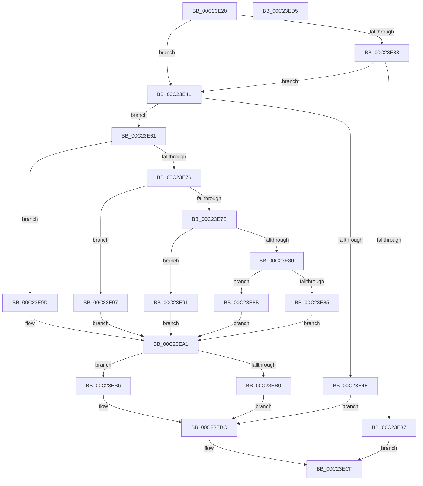

# HalpAcpiSetupPmRegisterLegacy

- RVA: `0x00C23E20`–`0x00C23ED6` (길이 `182` bytes)
- VA: `0x0000000140C23E20`
- 실행 섹션: `INIT`
- PDB 이름 있음: `예`; PDB Function 태그: `아니요`
- unwind 정보 RVA: `0x000BE840`
- 디코드: `59`개 명령, `182/182` bytes 표시
- 미해석 바이트: `0` (있으면 어셈블리에 `.byte`로 보존)

> 이 문서는 커널 이미지의 기계어와 PDB 기호를 분석해 생성했습니다. 4번과 5번은 함수 원형과 자료형을 바이너리 사용 방식에서 추정한 C 해석이며 원본 소스 복구 결과는 아닙니다.

## 1. Dependencies

- 직접 호출 지점: **1**; 고유 호출 대상: **1**
- 직접 호출자로 확인된 함수: **1**
- RIP 상대 이미지 참조: **0**

### Outgoing calls
- `0x00C23ECA` → [HalpAcpiSetupPmRegister](HalpAcpiSetupPmRegister_function_00C23CD8.md) (function, `0x00C23CD8`)

### Direct callers
- [HalpAcpiInitializePmRegisters](HalpAcpiInitializePmRegisters_function_00C23AEC.md) at `0x00C23B36`
- [HalpAcpiInitializePmRegisters](HalpAcpiInitializePmRegisters_function_00C23AEC.md) at `0x00C23B82`
- [HalpAcpiInitializePmRegisters](HalpAcpiInitializePmRegisters_function_00C23AEC.md) at `0x00C23BD5`
- [HalpAcpiInitializePmRegisters](HalpAcpiInitializePmRegisters_function_00C23AEC.md) at `0x00C23BFC`
- [HalpAcpiInitializePmRegisters](HalpAcpiInitializePmRegisters_function_00C23AEC.md) at `0x00C23C23`
- [HalpAcpiInitializePmRegisters](HalpAcpiInitializePmRegisters_function_00C23AEC.md) at `0x00C23C4F`
- [HalpAcpiInitializePmRegisters](HalpAcpiInitializePmRegisters_function_00C23AEC.md) at `0x00C23C99`
- [HalpAcpiInitializePmRegisters](HalpAcpiInitializePmRegisters_function_00C23AEC.md) at `0x00C23CC0`

### Static image references
- 디코드된 RIP-relative 메모리 참조가 없습니다.

## 2. Other-region calls and transfers

- 다른 실행 섹션으로 향하는 call: **0**
- 별도 외부 분기/꼬리 이동을 확인하지 못했습니다.

## 3. Assembly (complete function range)

```asm
00C23E20  40 55                           push rbp
00C23E22  48 8B EC                        mov rbp, rsp
00C23E25  48 83 EC 30                     sub rsp, 0x30
00C23E29  8A 41 08                        mov al, byte ptr [rcx + 8]
00C23E2C  45 8B D1                        mov r10d, r9d
00C23E2F  3C 05                           cmp al, 5
00C23E31  73 0E                           jae 0x140c23e41
00C23E33  85 D2                           test edx, edx
00C23E35  75 0A                           jne 0x140c23e41
00C23E37  B8 01 00 00 C0                  mov eax, 0xc0000001
00C23E3C  E9 8E 00 00 00                  jmp 0x140c23ecf
00C23E41  33 C9                           xor ecx, ecx
00C23E43  48 89 4D F0                     mov qword ptr [rbp - 0x10], rcx
00C23E47  89 4D F8                        mov dword ptr [rbp - 8], ecx
00C23E4A  3C 05                           cmp al, 5
00C23E4C  72 13                           jb 0x140c23e61
00C23E4E  F2 41 0F 10 00                  movsd xmm0, qword ptr [r8]
00C23E53  41 8B 40 08                     mov eax, dword ptr [r8 + 8]
00C23E57  F2 0F 11 45 F0                  movsd qword ptr [rbp - 0x10], xmm0
00C23E5C  89 45 F8                        mov dword ptr [rbp - 8], eax
00C23E5F  EB 5B                           jmp 0x140c23ebc
00C23E61  88 4D F2                        mov byte ptr [rbp - 0xe], cl
00C23E64  89 55 F4                        mov dword ptr [rbp - 0xc], edx
00C23E67  41 0F B6 D2                     movzx edx, r10b
00C23E6B  8B CA                           mov ecx, edx
00C23E6D  C6 45 F0 01                     mov byte ptr [rbp - 0x10], 1
00C23E71  83 E9 01                        sub ecx, 1
00C23E74  74 27                           je 0x140c23e9d
00C23E76  83 E9 01                        sub ecx, 1
00C23E79  74 1C                           je 0x140c23e97
00C23E7B  83 E9 02                        sub ecx, 2
00C23E7E  74 11                           je 0x140c23e91
00C23E80  83 F9 04                        cmp ecx, 4
00C23E83  74 06                           je 0x140c23e8b
00C23E85  C6 45 F3 00                     mov byte ptr [rbp - 0xd], 0
00C23E89  EB 16                           jmp 0x140c23ea1
00C23E8B  C6 45 F3 04                     mov byte ptr [rbp - 0xd], 4
00C23E8F  EB 10                           jmp 0x140c23ea1
00C23E91  C6 45 F3 03                     mov byte ptr [rbp - 0xd], 3
00C23E95  EB 0A                           jmp 0x140c23ea1
00C23E97  C6 45 F3 02                     mov byte ptr [rbp - 0xd], 2
00C23E9B  EB 04                           jmp 0x140c23ea1
00C23E9D  C6 45 F3 01                     mov byte ptr [rbp - 0xd], 1
00C23EA1  42 8D 04 CD 00 00 00 00         lea eax, [r9*8]
00C23EA9  3D FF 00 00 00                  cmp eax, 0xff
00C23EAE  76 06                           jbe 0x140c23eb6
00C23EB0  C6 45 F1 FF                     mov byte ptr [rbp - 0xf], 0xff
00C23EB4  EB 06                           jmp 0x140c23ebc
00C23EB6  C0 E2 03                        shl dl, 3
00C23EB9  88 55 F1                        mov byte ptr [rbp - 0xf], dl
00C23EBC  4C 8B 4D 38                     mov r9, qword ptr [rbp + 0x38]
00C23EC0  4C 8D 45 F0                     lea r8, [rbp - 0x10]
00C23EC4  8B 55 30                        mov edx, dword ptr [rbp + 0x30]
00C23EC7  41 8B CA                        mov ecx, r10d
00C23ECA  E8 09 FE FF FF                  call 0x140c23cd8
00C23ECF  48 83 C4 30                     add rsp, 0x30
00C23ED3  5D                              pop rbp
00C23ED4  C3                              ret
00C23ED5  CC                              int3
```

## 4. C-style interpretation (structured pseudocode)

```c
__int64 __fastcall HalpAcpiSetupPmRegisterLegacy(__int64 a1, int a2, __int64 a3, __int64 a4, unsigned int a5, __int64 a6)
{
    __int64 result;
    __int64 v_rsp;
    unsigned int v_stack_m10;
    unsigned int v_stack_m14;
    unsigned __int8 v_stack_m15;
    unsigned __int8 v_stack_m16;
    unsigned __int8 v_stack_m17;
    unsigned __int64 v_stack_m18;

    v_rsp = (v_rsp) - (48);
    if (((unsigned __int8)(*(unsigned __int8 *)(a1 + 8))) >= 5) goto loc_00C23E41;
    if (a2 != 0) goto loc_00C23E41;
    goto loc_00C23ECF;
loc_00C23E41:
    a1 = 0;
    v_stack_m18 = 0;
    v_stack_m10 = 0;
    if (((unsigned __int8)((unsigned int)(0xC0000001ULL))) < 5) goto loc_00C23E61;
    v_stack_m18 = v_xmm0;
    v_stack_m10 = (unsigned int)((unsigned int)(*(unsigned int *)(a3 + 8)));
    goto loc_00C23EBC;
loc_00C23E61:
    v_stack_m16 = 0;
    v_stack_m14 = a2;
    v_stack_m18 = 1;
    a1 = (unsigned int)(((unsigned int)((unsigned int)((unsigned __int8)((unsigned int)((unsigned int)(a4)))))) - (1));
    if (condition_is_equal) goto loc_00C23E9D;
    a1 = (unsigned int)((a1) - (1));
    if (condition_is_equal) goto loc_00C23E97;
    a1 = (unsigned int)((a1) - (2));
    if (condition_is_equal) goto loc_00C23E91;
    if (((unsigned int)(a1)) == 4) goto loc_00C23E8B;
    v_stack_m15 = 0;
    goto loc_00C23EA1;
loc_00C23E8B:
    v_stack_m15 = 4;
    goto loc_00C23EA1;
loc_00C23E91:
    v_stack_m15 = 3;
    goto loc_00C23EA1;
loc_00C23E97:
    v_stack_m15 = 2;
    goto loc_00C23EA1;
loc_00C23E9D:
    v_stack_m15 = 1;
loc_00C23EA1:
    if (((unsigned int)(a4 * 8)) <= 255) goto loc_00C23EB6;
    v_stack_m17 = 255;
    goto loc_00C23EBC;
loc_00C23EB6:
    a2 = (unsigned __int8)(((unsigned __int8)((unsigned int)((unsigned int)(a4)))) << (3));
    v_stack_m17 = (unsigned __int8)(a2);
loc_00C23EBC:
    result = HalpAcpiSetupPmRegister((unsigned int)((unsigned int)((unsigned int)((unsigned int)(a4)))), (unsigned int)(a5), v_stack_m18, a6);
loc_00C23ECF:
    v_rsp = (v_rsp) + (48);
    return result;
}
```

## 5. (Beta) C Style

```c
int64_t HalpAcpiSetupPmRegisterLegacy(void *Arg1, int32_t Arg2, void *Arg3, int64_t Arg4, uint32_t Arg5, int64_t Arg6)
{
    uint8_t *arg1 = (uint8_t *)Arg1;
    uint8_t *arg3 = (uint8_t *)Arg3;

    int64_t result;
    int64_t local_rsp;
    uint32_t v_stack_m10;
    uint32_t v_stack_m14;
    uint8_t v_stack_m15;
    uint8_t v_stack_m16;
    uint8_t v_stack_m17;
    uint64_t v_stack_m18;

    local_rsp = (local_rsp) - (48);
    if (((uint8_t)(*(uint8_t *)(arg1 + 0x8))) >= 5) goto loc_00C23E41;
    if (Arg2 != 0) goto loc_00C23E41;
    goto loc_00C23ECF;
loc_00C23E41:
    Arg1 = 0;
    v_stack_m18 = 0;
    v_stack_m10 = 0;
    if (((uint8_t)((uint32_t)(0xC0000001ULL))) < 5) goto loc_00C23E61;
    v_stack_m18 = v_xmm0;
    v_stack_m10 = (uint32_t)((uint32_t)(*(uint32_t *)(arg3 + 0x8)));
    goto loc_00C23EBC;
loc_00C23E61:
    v_stack_m16 = 0;
    v_stack_m14 = Arg2;
    v_stack_m18 = 1;
    Arg1 = (uint32_t)(((uint32_t)((uint32_t)((uint8_t)((uint32_t)((uint32_t)(Arg4)))))) - (1));
    if (condition_is_equal) goto loc_00C23E9D;
    Arg1 = (uint32_t)((Arg1) - (1));
    if (condition_is_equal) goto loc_00C23E97;
    Arg1 = (uint32_t)((Arg1) - (2));
    if (condition_is_equal) goto loc_00C23E91;
    if (((uint32_t)(Arg1)) == 4) goto loc_00C23E8B;
    v_stack_m15 = 0;
    goto loc_00C23EA1;
loc_00C23E8B:
    v_stack_m15 = 4;
    goto loc_00C23EA1;
loc_00C23E91:
    v_stack_m15 = 3;
    goto loc_00C23EA1;
loc_00C23E97:
    v_stack_m15 = 2;
    goto loc_00C23EA1;
loc_00C23E9D:
    v_stack_m15 = 1;
loc_00C23EA1:
    if (((uint32_t)(Arg4 * 8)) <= 255) goto loc_00C23EB6;
    v_stack_m17 = 255;
    goto loc_00C23EBC;
loc_00C23EB6:
    Arg2 = (uint8_t)(((uint8_t)((uint32_t)((uint32_t)(Arg4)))) << (3));
    v_stack_m17 = (uint8_t)(Arg2);
loc_00C23EBC:
    result = HalpAcpiSetupPmRegister((uint32_t)((uint32_t)((uint32_t)((uint32_t)(Arg4)))), (uint32_t)(Arg5), v_stack_m18, Arg6);
loc_00C23ECF:
    local_rsp = (local_rsp) + (48);
    return result;
}
```

### 관측된 메모리 오프셋

구조체 형식이 확인되지 않은 접근은 인자 기준의 오프셋으로만 기록했습니다.

| 기준 인자 | 오프셋 표현 | 폭 (bit) | 접근 |
|---|---:|---:|---|
| `Arg1` | `+ 0x8` | `8` | `R` |
| `Arg3` | `+ 0x0` | `64` | `R` |
| `Arg3` | `+ 0x8` | `32` | `R` |

## 6. Execution-region graph

[열기: 2D/3D 그래프와 함수 탐색 컨트롤 패널](../../../control-panel.html?section=init&rva=0x00C23E20&view=graph)

- 2D 그래프는 위에서 아래로 흐르고, 3D 그래프는 빈 공간을 드래그해 회전합니다. Shift+드래그는 이동, 휠은 확대·축소, 함수 노드 선택은 대상 보고서 이동입니다.

### Static fallback


