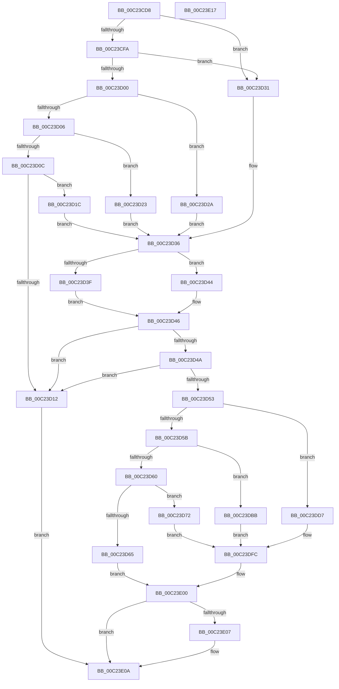

# HalpAcpiSetupPmRegister

- RVA: `0x00C23CD8`–`0x00C23E18` (길이 `320` bytes)
- VA: `0x0000000140C23CD8`
- 실행 섹션: `INIT`
- PDB 이름 있음: `예`; PDB Function 태그: `아니요`
- unwind 정보 RVA: `0x0005CAAC`
- 디코드: `92`개 명령, `320/320` bytes 표시
- 미해석 바이트: `0` (있으면 어셈블리에 `.byte`로 보존)

> 이 문서는 커널 이미지의 기계어와 PDB 기호를 분석해 생성했습니다. 4번과 5번은 함수 원형과 자료형을 바이너리 사용 방식에서 추정한 C 해석이며 원본 소스 복구 결과는 아닙니다.

## 1. Dependencies

- 직접 호출 지점: **1**; 고유 호출 대상: **1**
- 직접 호출자로 확인된 함수: **2**
- RIP 상대 이미지 참조: **5**

### Outgoing calls
- `0x00C23DE1` → [HalMapIoSpace](../../text/4F/HalMapIoSpace_function_004FCD40.md) (function, `0x004FCD40`)

### Direct callers
- [HalpAcpiInitializePmRegisters](HalpAcpiInitializePmRegisters_function_00C23AEC.md) at `0x00C23C72`
- [HalpAcpiSetupPmRegisterLegacy](HalpAcpiSetupPmRegisterLegacy_function_00C23E20.md) at `0x00C23ECA`

### Static image references
- `0x00C23DA3` → RVA `0x0048FDC0` (`HalAdjustResourceList`; read)
- `0x00C23DC3` → RVA `0x0041DBB0` (`HalpAcpiPmRegisterReadPort`; read)
- `0x00C23DCE` → RVA `0x003FE630` (`HalpAcpiPmRegisterWritePort`; read)
- `0x00C23DEA` → RVA `0x0055BD90` (`HalpAcpiPmRegisterReadRegister`; read)
- `0x00C23DF5` → RVA `0x0055BDE0` (`HalpAcpiPmRegisterWriteRegister`; read)

## 2. Other-region calls and transfers

- 다른 실행 섹션으로 향하는 call: **1**
  - `0x00C23DE1` → [HalMapIoSpace](../../text/4F/HalMapIoSpace_function_004FCD40.md) (`INIT` → `.text`)
- 별도 외부 분기/꼬리 이동을 확인하지 못했습니다.

## 3. Assembly (complete function range)

```asm
00C23CD8  48 89 5C 24 08                  mov qword ptr [rsp + 8], rbx
00C23CDD  57                              push rdi
00C23CDE  48 83 EC 20                     sub rsp, 0x20
00C23CE2  49 8B F9                        mov rdi, r9
00C23CE5  33 DB                           xor ebx, ebx
00C23CE7  4D 8B C8                        mov r9, r8
00C23CEA  44 8B C1                        mov r8d, ecx
00C23CED  89 57 18                        mov dword ptr [rdi + 0x18], edx
00C23CF0  45 0F B6 51 03                  movzx r10d, byte ptr [r9 + 3]
00C23CF5  45 85 D2                        test r10d, r10d
00C23CF8  74 37                           je 0x140c23d31
00C23CFA  41 83 EA 01                     sub r10d, 1
00C23CFE  74 31                           je 0x140c23d31
00C23D00  41 83 EA 01                     sub r10d, 1
00C23D04  74 24                           je 0x140c23d2a
00C23D06  41 83 EA 01                     sub r10d, 1
00C23D0A  74 17                           je 0x140c23d23
00C23D0C  41 83 FA 01                     cmp r10d, 1
00C23D10  74 0A                           je 0x140c23d1c
00C23D12  BB 01 00 00 C0                  mov ebx, 0xc0000001
00C23D17  E9 EE 00 00 00                  jmp 0x140c23e0a
00C23D1C  B8 08 00 00 00                  mov eax, 8
00C23D21  EB 13                           jmp 0x140c23d36
00C23D23  B8 04 00 00 00                  mov eax, 4
00C23D28  EB 0C                           jmp 0x140c23d36
00C23D2A  B8 02 00 00 00                  mov eax, 2
00C23D2F  EB 05                           jmp 0x140c23d36
00C23D31  B8 01 00 00 00                  mov eax, 1
00C23D36  41 0F B6 49 01                  movzx ecx, byte ptr [r9 + 1]
00C23D3B  84 C9                           test cl, cl
00C23D3D  74 05                           je 0x140c23d44
00C23D3F  C1 E9 03                        shr ecx, 3
00C23D42  EB 02                           jmp 0x140c23d46
00C23D44  8B C8                           mov ecx, eax
00C23D46  3B C2                           cmp eax, edx
00C23D48  72 C8                           jb 0x140c23d12
00C23D4A  89 4F 1C                        mov dword ptr [rdi + 0x1c], ecx
00C23D4D  49 39 59 04                     cmp qword ptr [r9 + 4], rbx
00C23D51  74 BF                           je 0x140c23d12
00C23D53  41 0F B6 09                     movzx ecx, byte ptr [r9]
00C23D57  85 C9                           test ecx, ecx
00C23D59  74 7C                           je 0x140c23dd7
00C23D5B  83 E9 01                        sub ecx, 1
00C23D5E  74 5B                           je 0x140c23dbb
00C23D60  83 E9 01                        sub ecx, 1
00C23D63  74 0D                           je 0x140c23d72
00C23D65  83 E9 01                        sub ecx, 1
00C23D68  BB BB 00 00 C0                  mov ebx, 0xc00000bb
00C23D6D  E9 8E 00 00 00                  jmp 0x140c23e00
00C23D72  48 8D 57 10                     lea rdx, [rdi + 0x10]
00C23D76  21 1A                           and dword ptr [rdx], ebx
00C23D78  41 8B 49 08                     mov ecx, dword ptr [r9 + 8]
00C23D7C  83 E1 1F                        and ecx, 0x1f
00C23D7F  89 0A                           mov dword ptr [rdx], ecx
00C23D81  41 8B 41 04                     mov eax, dword ptr [r9 + 4]
00C23D85  C1 E8 0B                        shr eax, 0xb
00C23D88  25 E0 00 00 00                  and eax, 0xe0
00C23D8D  0B C1                           or eax, ecx
00C23D8F  89 02                           mov dword ptr [rdx], eax
00C23D91  41 0F B7 41 04                  movzx eax, word ptr [r9 + 4]
00C23D96  66 89 47 14                     mov word ptr [rdi + 0x14], ax
00C23D9A  41 0F B7 41 0A                  movzx eax, word ptr [r9 + 0xa]
00C23D9F  66 89 47 16                     mov word ptr [rdi + 0x16], ax
00C23DA3  48 8D 05 16 C0 86 FF            lea rax, [rip - 0x793fea]
00C23DAA  48 89 47 20                     mov qword ptr [rdi + 0x20], rax
00C23DAE  48 8D 05 0B C0 86 FF            lea rax, [rip - 0x793ff5]
00C23DB5  48 89 57 08                     mov qword ptr [rdi + 8], rdx
00C23DB9  EB 41                           jmp 0x140c23dfc
00C23DBB  41 8B 41 04                     mov eax, dword ptr [r9 + 4]
00C23DBF  48 89 47 08                     mov qword ptr [rdi + 8], rax
00C23DC3  48 8D 05 E6 9D 7F FF            lea rax, [rip - 0x80621a]
00C23DCA  48 89 47 20                     mov qword ptr [rdi + 0x20], rax
00C23DCE  48 8D 05 5B A8 7D FF            lea rax, [rip - 0x8257a5]
00C23DD5  EB 25                           jmp 0x140c23dfc
00C23DD7  49 8B 49 04                     mov rcx, qword ptr [r9 + 4]
00C23DDB  49 8B D0                        mov rdx, r8
00C23DDE  45 33 C0                        xor r8d, r8d
00C23DE1  E8 5A 8F 8D FF                  call 0x1404fcd40
00C23DE6  48 89 47 08                     mov qword ptr [rdi + 8], rax
00C23DEA  48 8D 05 9F 7F 93 FF            lea rax, [rip - 0x6c8061]
00C23DF1  48 89 47 20                     mov qword ptr [rdi + 0x20], rax
00C23DF5  48 8D 05 E4 7F 93 FF            lea rax, [rip - 0x6c801c]
00C23DFC  48 89 47 28                     mov qword ptr [rdi + 0x28], rax
00C23E00  48 83 7F 08 00                  cmp qword ptr [rdi + 8], 0
00C23E05  74 03                           je 0x140c23e0a
00C23E07  C6 07 01                        mov byte ptr [rdi], 1
00C23E0A  8B C3                           mov eax, ebx
00C23E0C  48 8B 5C 24 30                  mov rbx, qword ptr [rsp + 0x30]
00C23E11  48 83 C4 20                     add rsp, 0x20
00C23E15  5F                              pop rdi
00C23E16  C3                              ret
00C23E17  CC                              int3
```

## 4. C-style interpretation (structured pseudocode)

```c
__int64 __fastcall HalpAcpiSetupPmRegister(int a1, int a2, __int64 a3, __int64 a4)
{
    __int64 result;
    __int64 v_r10;
    __int64 v_rbx;
    __int64 v_rsp;
    unsigned __int64 v_stack_p8;

    v_stack_p8 = v_rbx;
    v_rsp = (v_rsp) - (32);
    v_rbx = 0;
    *(unsigned int *)(a4 + 24) = a2;
    if ((unsigned int)(*(unsigned __int8 *)(a3 + 3)) == 0) goto loc_00C23D31;
    v_r10 = (unsigned int)((*(unsigned __int8 *)(a3 + 3)) - (1));
    if (condition_is_equal) goto loc_00C23D31;
    v_r10 = (unsigned int)((v_r10) - (1));
    if (condition_is_equal) goto loc_00C23D2A;
    v_r10 = (unsigned int)((v_r10) - (1));
    if (condition_is_equal) goto loc_00C23D23;
    if (((unsigned int)(v_r10)) == 1) goto loc_00C23D1C;
loc_00C23D12:
    goto loc_00C23E0A;
loc_00C23D1C:
    goto loc_00C23D36;
loc_00C23D23:
    goto loc_00C23D36;
loc_00C23D2A:
    goto loc_00C23D36;
loc_00C23D31:
loc_00C23D36:
    if ((unsigned __int8)(*(unsigned __int8 *)(a3 + 1)) == 0) goto loc_00C23D44;
    a1 = (unsigned int)((*(unsigned __int8 *)(a3 + 1)) >> (3));
    goto loc_00C23D46;
loc_00C23D44:
loc_00C23D46:
    if (1 < a2) goto loc_00C23D12;
    *(unsigned int *)(a4 + 28) = 1;
    if ((*(unsigned __int64 *)(a3 + 4)) == ((unsigned int)(0xC0000001ULL))) goto loc_00C23D12;
    if ((unsigned int)(*(unsigned __int8 *)(a3)) == 0) goto loc_00C23DD7;
    a1 = (unsigned int)((*(unsigned __int8 *)(a3)) - (1));
    if (condition_is_equal) goto loc_00C23DBB;
    a1 = (unsigned int)((a1) - (1));
    if (condition_is_equal) goto loc_00C23D72;
    a1 = (unsigned int)((a1) - (1));
    goto loc_00C23E00;
loc_00C23D72:
    a1 = (unsigned int)(((unsigned int)(*(unsigned int *)(a3 + 8))) & (31));
    *(unsigned int *)(a4 + 16) = a1;
    result = (unsigned int)(((unsigned int)(*(unsigned int *)(a3 + 4))) >> (11));
    result = (unsigned int)((result) & (224));
    result = (unsigned int)((result) | (a1));
    *(unsigned int *)(a4 + 16) = (unsigned int)(result);
    *(unsigned __int16 *)(a4 + 20) = (unsigned __int16)(*(unsigned __int16 *)(a3 + 4));
    *(unsigned __int16 *)(a4 + 22) = (unsigned __int16)(*(unsigned __int16 *)(a3 + 10));
    *(unsigned __int64 *)(a4 + 32) = v_rip - 7946218;
    *(unsigned __int64 *)(a4 + 8) = a4 + 16;
    goto loc_00C23DFC;
loc_00C23DBB:
    *(unsigned __int64 *)(a4 + 8) = (unsigned int)(*(unsigned int *)(a3 + 4));
    *(unsigned __int64 *)(a4 + 32) = v_rip - 8413722;
    goto loc_00C23DFC;
loc_00C23DD7:
    a3 = 0;
    result = HalMapIoSpace(*(unsigned __int64 *)(a3 + 4), (unsigned int)(a1), a3, a3);
    *(unsigned __int64 *)(a4 + 8) = result;
    *(unsigned __int64 *)(a4 + 32) = v_rip - 7110753;
loc_00C23DFC:
    *(unsigned __int64 *)(a4 + 40) = v_rip - 7110684;
loc_00C23E00:
    if ((*(unsigned __int64 *)(a4 + 8)) != 0) {
        *(unsigned __int8 *)(a4) = 1;
    }
    v_rsp = (v_rsp) + (32);
    return (unsigned int)((unsigned int)((unsigned int)(0xC00000BBULL)));
}
```

## 5. (Beta) C Style

```c
int64_t HalpAcpiSetupPmRegister(int32_t Arg1, int32_t Arg2, void *Arg3, void *Arg4)
{
    uint8_t *arg3 = (uint8_t *)Arg3;
    uint8_t *arg4 = (uint8_t *)Arg4;

    int64_t result;
    int64_t local_r10;
    int64_t local_rbx;
    int64_t local_rsp;
    uint64_t v_stack_p8;

    v_stack_p8 = local_rbx;
    local_rsp = (local_rsp) - (32);
    local_rbx = 0;
    *(uint32_t *)(arg4 + 0x18) = Arg2;
    if ((uint32_t)(*(uint8_t *)(arg3 + 0x3)) == 0) goto loc_00C23D31;
    local_r10 = (uint32_t)((*(uint8_t *)(arg3 + 0x3)) - (1));
    if (condition_is_equal) goto loc_00C23D31;
    local_r10 = (uint32_t)((local_r10) - (1));
    if (condition_is_equal) goto loc_00C23D2A;
    local_r10 = (uint32_t)((local_r10) - (1));
    if (condition_is_equal) goto loc_00C23D23;
    if (((uint32_t)(local_r10)) == 1) goto loc_00C23D1C;
loc_00C23D12:
    goto loc_00C23E0A;
loc_00C23D1C:
    goto loc_00C23D36;
loc_00C23D23:
    goto loc_00C23D36;
loc_00C23D2A:
    goto loc_00C23D36;
loc_00C23D31:
loc_00C23D36:
    if ((uint8_t)(*(uint8_t *)(arg3 + 0x1)) == 0) goto loc_00C23D44;
    Arg1 = (uint32_t)((*(uint8_t *)(arg3 + 0x1)) >> (3));
    goto loc_00C23D46;
loc_00C23D44:
loc_00C23D46:
    if (1 < Arg2) goto loc_00C23D12;
    *(uint32_t *)(arg4 + 0x1C) = 1;
    if ((*(uint64_t *)(arg3 + 0x4)) == ((uint32_t)(0xC0000001ULL))) goto loc_00C23D12;
    if ((uint32_t)(*(uint8_t *)(arg3)) == 0) goto loc_00C23DD7;
    Arg1 = (uint32_t)((*(uint8_t *)(arg3)) - (1));
    if (condition_is_equal) goto loc_00C23DBB;
    Arg1 = (uint32_t)((Arg1) - (1));
    if (condition_is_equal) goto loc_00C23D72;
    Arg1 = (uint32_t)((Arg1) - (1));
    goto loc_00C23E00;
loc_00C23D72:
    Arg1 = (uint32_t)(((uint32_t)(*(uint32_t *)(arg3 + 0x8))) & (31));
    *(uint32_t *)(arg4 + 0x10) = Arg1;
    result = (uint32_t)(((uint32_t)(*(uint32_t *)(arg3 + 0x4))) >> (11));
    result = (uint32_t)((result) & (224));
    result = (uint32_t)((result) | (Arg1));
    *(uint32_t *)(arg4 + 0x10) = (uint32_t)(result);
    *(uint16_t *)(arg4 + 0x14) = (uint16_t)(*(uint16_t *)(arg3 + 0x4));
    *(uint16_t *)(arg4 + 0x16) = (uint16_t)(*(uint16_t *)(arg3 + 0xA));
    *(uint64_t *)(arg4 + 0x20) = v_rip - 7946218;
    *(void **)(arg4 + 0x8) = Arg4 + 16;
    goto loc_00C23DFC;
loc_00C23DBB:
    *(uint64_t *)(arg4 + 0x8) = (uint32_t)(*(uint32_t *)(arg3 + 0x4));
    *(uint64_t *)(arg4 + 0x20) = v_rip - 8413722;
    goto loc_00C23DFC;
loc_00C23DD7:
    Arg3 = 0;
    result = HalMapIoSpace(*(uint64_t *)(arg3 + 0x4), (uint32_t)(Arg1), Arg3, Arg3);
    *(uint64_t *)(arg4 + 0x8) = result;
    *(uint64_t *)(arg4 + 0x20) = v_rip - 7110753;
loc_00C23DFC:
    *(uint64_t *)(arg4 + 0x28) = v_rip - 7110684;
loc_00C23E00:
    if ((*(uint64_t *)(arg4 + 0x8)) != 0) {
        *(uint8_t *)(arg4) = 1;
    }
    local_rsp = (local_rsp) + (32);
    return (uint32_t)((uint32_t)((uint32_t)(0xC00000BBULL)));
}
```

### 관측된 메모리 오프셋

구조체 형식이 확인되지 않은 접근은 인자 기준의 오프셋으로만 기록했습니다.

| 기준 인자 | 오프셋 표현 | 폭 (bit) | 접근 |
|---|---:|---:|---|
| `Arg3` | `+ 0x0` | `8` | `R` |
| `Arg3` | `+ 0x1` | `8` | `R` |
| `Arg3` | `+ 0x3` | `8` | `R` |
| `Arg3` | `+ 0x4` | `16` | `R` |
| `Arg3` | `+ 0x4` | `32` | `R` |
| `Arg3` | `+ 0x4` | `64` | `R` |
| `Arg3` | `+ 0x8` | `32` | `R` |
| `Arg3` | `+ 0xA` | `16` | `R` |
| `Arg4` | `+ 0x0` | `8` | `W` |
| `Arg4` | `+ 0x0` | `32` | `R/W` |
| `Arg4` | `+ 0x0` | `32` | `W` |
| `Arg4` | `+ 0x8` | `64` | `R` |
| `Arg4` | `+ 0x8` | `64` | `W` |
| `Arg4` | `+ 0x10` | `64` | `R` |
| `Arg4` | `+ 0x14` | `16` | `W` |
| `Arg4` | `+ 0x16` | `16` | `W` |
| `Arg4` | `+ 0x18` | `32` | `W` |
| `Arg4` | `+ 0x1C` | `32` | `W` |
| `Arg4` | `+ 0x20` | `64` | `W` |
| `Arg4` | `+ 0x28` | `64` | `W` |

## 6. Execution-region graph

[열기: 2D/3D 그래프와 함수 탐색 컨트롤 패널](../../../control-panel.html?section=init&rva=0x00C23CD8&view=graph)

- 2D 그래프는 위에서 아래로 흐르고, 3D 그래프는 빈 공간을 드래그해 회전합니다. Shift+드래그는 이동, 휠은 확대·축소, 함수 노드 선택은 대상 보고서 이동입니다.

### Static fallback


