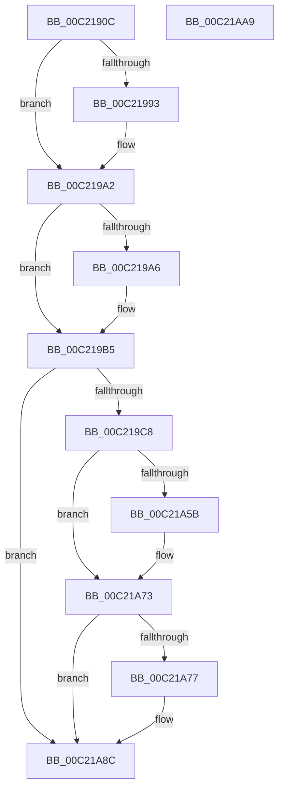

# HalpAllocateNumaConfigData

- RVA: `0x00C2190C`–`0x00C21AAA` (길이 `414` bytes)
- VA: `0x0000000140C2190C`
- 실행 섹션: `INIT`
- PDB 이름 있음: `예`; PDB Function 태그: `아니요`
- unwind 정보 RVA: `0x000C466C`
- 디코드: `123`개 명령, `414/414` bytes 표시
- 미해석 바이트: `0` (있으면 어셈블리에 `.byte`로 보존)

> 이 문서는 커널 이미지의 기계어와 PDB 기호를 분석해 생성했습니다. 4번과 5번은 함수 원형과 자료형을 바이너리 사용 방식에서 추정한 C 해석이며 원본 소스 복구 결과는 아닙니다.

## 1. Dependencies

- 직접 호출 지점: **2**; 고유 호출 대상: **2**
- 직접 호출자로 확인된 함수: **2**
- RIP 상대 이미지 참조: **4**

### Outgoing calls
- `0x00C219B7` → [HalpMmAllocateMemoryInternal](../../text/54/HalpMmAllocateMemoryInternal_function_00544990.md) (function, `0x00544990`)
- `0x00C219D0` → [memset](../../text/6C/memset_function_006C6C40.md) (function, `0x006C6C40`)

### Direct callers
- [HalpInitializeConfigurationFromMadt](HalpInitializeConfigurationFromMadt_function_00C21D54.md) at `0x00C21E36`
- [HalpNumaInitializeStaticConfiguration](HalpNumaInitializeStaticConfiguration_function_00C220D8.md) at `0x00C221AB`

### Static image references
- `0x00C219E0` → RVA `0x00F90658` (`.data`; write)
- `0x00C21A69` → RVA `0x00F90608` (`.data`; write)
- `0x00C21A7B` → RVA `0x00F8F9E0` (`.data`; write)
- `0x00C21A85` → RVA `0x00F8F9D8` (`.data`; write)

## 2. Other-region calls and transfers

- 다른 실행 섹션으로 향하는 call: **2**
  - `0x00C219B7` → [HalpMmAllocateMemoryInternal](../../text/54/HalpMmAllocateMemoryInternal_function_00544990.md) (`INIT` → `.text`)
  - `0x00C219D0` → [memset](../../text/6C/memset_function_006C6C40.md) (`INIT` → `.text`)
- 별도 외부 분기/꼬리 이동을 확인하지 못했습니다.

## 3. Assembly (complete function range)

```asm
00C2190C  48 8B C4                        mov rax, rsp
00C2190F  48 89 58 08                     mov qword ptr [rax + 8], rbx
00C21913  48 89 68 18                     mov qword ptr [rax + 0x18], rbp
00C21917  48 89 70 20                     mov qword ptr [rax + 0x20], rsi
00C2191B  89 50 10                        mov dword ptr [rax + 0x10], edx
00C2191E  57                              push rdi
00C2191F  41 54                           push r12
00C21921  41 55                           push r13
00C21923  41 56                           push r14
00C21925  41 57                           push r15
00C21927  48 83 EC 20                     sub rsp, 0x20
00C2192B  44 8D 2C 95 00 00 00 00         lea r13d, [rdx*4]
00C21933  8B E9                           mov ebp, ecx
00C21935  44 8D 24 8D 00 00 00 00         lea r12d, [rcx*4]
00C2193D  0F AF E9                        imul ebp, ecx
00C21940  44 8B F9                        mov r15d, ecx
00C21943  41 8D 45 4F                     lea eax, [r13 + 0x4f]
00C21947  41 8B F0                        mov esi, r8d
00C2194A  41 8D 55 07                     lea edx, [r13 + 7]
00C2194E  41 B8 F8 FF FF FF               mov r8d, 0xfffffff8
00C21954  41 8D 4C 24 07                  lea ecx, [r12 + 7]
00C21959  41 23 C0                        and eax, r8d
00C2195C  41 8D 5C 24 07                  lea ebx, [r12 + 7]
00C21961  83 C0 07                        add eax, 7
00C21964  03 ED                           add ebp, ebp
00C21966  41 03 C5                        add eax, r13d
00C21969  41 8B F9                        mov edi, r9d
00C2196C  41 23 C0                        and eax, r8d
00C2196F  03 D0                           add edx, eax
00C21971  41 8D 44 24 07                  lea eax, [r12 + 7]
00C21976  41 23 D0                        and edx, r8d
00C21979  03 C2                           add eax, edx
00C2197B  BA 01 00 00 00                  mov edx, 1
00C21980  41 23 C0                        and eax, r8d
00C21983  03 C8                           add ecx, eax
00C21985  41 23 C8                        and ecx, r8d
00C21988  03 D9                           add ebx, ecx
00C2198A  41 23 D8                        and ebx, r8d
00C2198D  03 DD                           add ebx, ebp
00C2198F  85 F6                           test esi, esi
00C21991  74 0F                           je 0x140c219a2
00C21993  03 F2                           add esi, edx
00C21995  83 C3 07                        add ebx, 7
00C21998  8B C6                           mov eax, esi
00C2199A  41 23 D8                        and ebx, r8d
00C2199D  C1 E0 04                        shl eax, 4
00C219A0  03 D8                           add ebx, eax
00C219A2  85 FF                           test edi, edi
00C219A4  74 0F                           je 0x140c219b5
00C219A6  03 FA                           add edi, edx
00C219A8  83 C3 07                        add ebx, 7
00C219AB  8B C7                           mov eax, edi
00C219AD  41 23 D8                        and ebx, r8d
00C219B0  C1 E0 04                        shl eax, 4
00C219B3  03 D8                           add ebx, eax
00C219B5  8B CB                           mov ecx, ebx
00C219B7  E8 D4 2F 92 FF                  call 0x140544990
00C219BC  4C 8B F0                        mov r14, rax
00C219BF  48 85 C0                        test rax, rax
00C219C2  0F 84 C4 00 00 00               je 0x140c21a8c
00C219C8  44 8B C3                        mov r8d, ebx
00C219CB  33 D2                           xor edx, edx
00C219CD  48 8B C8                        mov rcx, rax
00C219D0  E8 6B 52 AA FF                  call 0x1406c6c40
00C219D5  49 8D 4E 4F                     lea rcx, [r14 + 0x4f]
00C219D9  41 8B D4                        mov edx, r12d
00C219DC  48 83 E1 F8                     and rcx, 0xfffffffffffffff8
00C219E0  4C 89 35 71 EC 36 00            mov qword ptr [rip + 0x36ec71], r14
00C219E7  49 89 0E                        mov qword ptr [r14], rcx
00C219EA  49 8D 45 07                     lea rax, [r13 + 7]
00C219EE  48 03 C1                        add rax, rcx
00C219F1  45 89 7E 40                     mov dword ptr [r14 + 0x40], r15d
00C219F5  48 83 E0 F8                     and rax, 0xfffffffffffffff8
00C219F9  49 8D 4D 07                     lea rcx, [r13 + 7]
00C219FD  48 03 C8                        add rcx, rax
00C21A00  49 89 46 08                     mov qword ptr [r14 + 8], rax
00C21A04  48 83 E1 F8                     and rcx, 0xfffffffffffffff8
00C21A08  49 8D 45 07                     lea rax, [r13 + 7]
00C21A0C  48 03 C1                        add rax, rcx
00C21A0F  49 89 4E 10                     mov qword ptr [r14 + 0x10], rcx
00C21A13  48 83 E0 F8                     and rax, 0xfffffffffffffff8
00C21A17  49 8D 4C 24 07                  lea rcx, [r12 + 7]
00C21A1C  49 89 46 18                     mov qword ptr [r14 + 0x18], rax
00C21A20  4D 8D 44 24 07                  lea r8, [r12 + 7]
00C21A25  48 83 C2 07                     add rdx, 7
00C21A29  48 03 C2                        add rax, rdx
00C21A2C  48 83 E0 F8                     and rax, 0xfffffffffffffff8
00C21A30  48 03 C8                        add rcx, rax
00C21A33  49 89 46 20                     mov qword ptr [r14 + 0x20], rax
00C21A37  48 83 E1 F8                     and rcx, 0xfffffffffffffff8
00C21A3B  8B C5                           mov eax, ebp
00C21A3D  4C 03 C1                        add r8, rcx
00C21A40  49 89 4E 28                     mov qword ptr [r14 + 0x28], rcx
00C21A44  49 83 E0 F8                     and r8, 0xfffffffffffffff8
00C21A48  4D 89 46 30                     mov qword ptr [r14 + 0x30], r8
00C21A4C  4C 03 C0                        add r8, rax
00C21A4F  8B 44 24 58                     mov eax, dword ptr [rsp + 0x58]
00C21A53  41 89 46 44                     mov dword ptr [r14 + 0x44], eax
00C21A57  85 F6                           test esi, esi
00C21A59  74 18                           je 0x140c21a73
00C21A5B  49 83 C0 07                     add r8, 7
00C21A5F  8B C6                           mov eax, esi
00C21A61  49 83 E0 F8                     and r8, 0xfffffffffffffff8
00C21A65  48 C1 E0 04                     shl rax, 4
00C21A69  4C 89 05 98 EB 36 00            mov qword ptr [rip + 0x36eb98], r8
00C21A70  4C 03 C0                        add r8, rax
00C21A73  85 FF                           test edi, edi
00C21A75  74 15                           je 0x140c21a8c
00C21A77  49 8D 40 07                     lea rax, [r8 + 7]
00C21A7B  89 3D 5F DF 36 00               mov dword ptr [rip + 0x36df5f], edi
00C21A81  48 83 E0 F8                     and rax, 0xfffffffffffffff8
00C21A85  48 89 05 4C DF 36 00            mov qword ptr [rip + 0x36df4c], rax
00C21A8C  48 8B 5C 24 50                  mov rbx, qword ptr [rsp + 0x50]
00C21A91  48 8B 6C 24 60                  mov rbp, qword ptr [rsp + 0x60]
00C21A96  48 8B 74 24 68                  mov rsi, qword ptr [rsp + 0x68]
00C21A9B  48 83 C4 20                     add rsp, 0x20
00C21A9F  41 5F                           pop r15
00C21AA1  41 5E                           pop r14
00C21AA3  41 5D                           pop r13
00C21AA5  41 5C                           pop r12
00C21AA7  5F                              pop rdi
00C21AA8  C3                              ret
00C21AA9  CC                              int3
```

## 4. C-style interpretation (structured pseudocode)

```c
__int64 __fastcall HalpAllocateNumaConfigData(__int64 a1, __int64 a2, int a3, int a4)
{
    __int64 result;
    __int64 v_rbp;
    __int64 v_rbx;
    __int64 v_rdi;
    __int64 v_rsi;
    __int64 v_rsp;
    unsigned int v_stack_p10;
    unsigned __int64 v_stack_p18;
    unsigned __int64 v_stack_p20;
    unsigned __int64 v_stack_p8;

    *(unsigned __int64 *)(v_rsp + 8) = v_rbx;
    *(unsigned __int64 *)(v_rsp + 24) = v_rbp;
    *(unsigned __int64 *)(v_rsp + 32) = v_rsi;
    *(unsigned int *)(v_rsp + 16) = (unsigned int)(a2);
    v_rsp = (v_rsp) - (32);
    v_rbp = (unsigned int)(((unsigned int)((unsigned int)(a1))) * ((unsigned int)(a1)));
    result = (unsigned int)((a2 * 4 + 79) & ((unsigned int)((unsigned int)(0xFFFFFFF8ULL))));
    result = (unsigned int)((result) + (7));
    v_rbp = (unsigned int)((v_rbp) + ((unsigned int)(v_rbp)));
    result = (unsigned int)((result) + ((unsigned int)(a2 * 4)));
    result = (unsigned int)((result) & ((unsigned int)((unsigned int)(0xFFFFFFF8ULL))));
    a2 = (unsigned int)((a2 * 4 + 7) + ((unsigned int)(result)));
    a2 = (unsigned int)((a2) & ((unsigned int)((unsigned int)(0xFFFFFFF8ULL))));
    result = (unsigned int)((a1 * 4 + 7) + ((unsigned int)(a2)));
    result = (unsigned int)((result) & ((unsigned int)((unsigned int)(0xFFFFFFF8ULL))));
    a1 = (unsigned int)((a1 * 4 + 7) + ((unsigned int)(result)));
    a1 = (unsigned int)((a1) & ((unsigned int)((unsigned int)(0xFFFFFFF8ULL))));
    v_rbx = (unsigned int)((a1 * 4 + 7) + ((unsigned int)(a1)));
    v_rbx = (unsigned int)((v_rbx) & ((unsigned int)((unsigned int)(0xFFFFFFF8ULL))));
    v_rbx = (unsigned int)((v_rbx) + ((unsigned int)(v_rbp)));
    v_rsi = (unsigned int)(a3);
    if ((unsigned int)((unsigned int)(a3)) != 0) {
        v_rsi = (unsigned int)(((unsigned int)(a3)) + (1));
        v_rbx = (unsigned int)((v_rbx) + (7));
        result = (unsigned int)(v_rsi);
        v_rbx = (unsigned int)((v_rbx) & ((unsigned int)((unsigned int)(0xFFFFFFF8ULL))));
        result = (unsigned int)((result) << (4));
        v_rbx = (unsigned int)((v_rbx) + ((unsigned int)(result)));
    }
    v_rdi = (unsigned int)(a4);
    if ((unsigned int)((unsigned int)(a4)) != 0) {
        v_rdi = (unsigned int)(((unsigned int)(a4)) + (1));
        v_rbx = (unsigned int)((v_rbx) + (7));
        result = (unsigned int)(v_rdi);
        v_rbx = (unsigned int)((v_rbx) & ((unsigned int)((unsigned int)(0xFFFFFFF8ULL))));
        result = (unsigned int)((result) << (4));
        v_rbx = (unsigned int)((v_rbx) + ((unsigned int)(result)));
    }
    result = HalpMmAllocateMemoryInternal((unsigned int)((unsigned int)(v_rbx)), 1, (unsigned int)(0xFFFFFFF8ULL), a4);
    if (result == 0) goto loc_00C21A8C;
    a2 = 0;
    result = memset(result, a2, (unsigned int)((unsigned int)(v_rbx)), a4);
    a1 = (result + 79) & (-8);
    *(unsigned __int64 *)(v_rip + 3599473) = result;
    *(unsigned __int64 *)(result) = a1;
    result = (a2 * 4 + 7) + (a1);
    *(unsigned int *)(result + 64) = (unsigned int)((unsigned int)((unsigned int)(a1)));
    result = (result) & (-8);
    a1 = (a2 * 4 + 7) + (result);
    *(unsigned __int64 *)(result + 8) = result;
    a1 = (a1) & (-8);
    result = (a2 * 4 + 7) + (a1);
    *(unsigned __int64 *)(result + 16) = a1;
    result = (result) & (-8);
    *(unsigned __int64 *)(result + 24) = result;
    a2 = ((unsigned int)((unsigned int)(a1 * 4))) + (7);
    result = (result) + (a2);
    result = (result) & (-8);
    a1 = (a1 * 4 + 7) + (result);
    *(unsigned __int64 *)(result + 32) = result;
    a1 = (a1) & (-8);
    a3 = (a1 * 4 + 7) + (a1);
    *(unsigned __int64 *)(result + 40) = a1;
    a3 = (a3) & (-8);
    *(unsigned __int64 *)(result + 48) = a3;
    a3 = (a3) + ((unsigned int)((unsigned int)(v_rbp)));
    *(unsigned int *)(result + 68) = (unsigned int)((unsigned int)(v_stack_p10));
    result = (unsigned int)(v_stack_p10);
    if ((unsigned int)(v_rsi) != 0) {
        a3 = (a3) + (7);
        result = (unsigned int)(v_rsi);
        a3 = (a3) & (-8);
        result = (result) << (4);
        *(unsigned __int64 *)(v_rip + 3599256) = a3;
        a3 = (a3) + (result);
    }
    if ((unsigned int)(v_rdi) != 0) {
        result = a3 + 7;
        *(unsigned int *)(v_rip + 3596127) = (unsigned int)(v_rdi);
        result = (result) & (-8);
        *(unsigned __int64 *)(v_rip + 3596108) = result;
    }
    v_rsp = (v_rsp) + (32);
    return result;
}
```

## 5. (Beta) C Style

```c
int64_t HalpAllocateNumaConfigData(int64_t Arg1, int64_t Arg2, int32_t Arg3, int32_t Arg4)
{
    int64_t result;
    int64_t local_rbp;
    int64_t local_rbx;
    int64_t local_rdi;
    int64_t local_rsi;
    int64_t local_rsp;
    uint32_t v_stack_p10;
    uint64_t v_stack_p18;
    uint64_t v_stack_p20;
    uint64_t v_stack_p8;

    *(uint64_t *)(local_rsp + 0x8) = local_rbx;
    *(uint64_t *)(local_rsp + 0x18) = local_rbp;
    *(uint64_t *)(local_rsp + 0x20) = local_rsi;
    *(uint32_t *)(local_rsp + 0x10) = (uint32_t)(Arg2);
    local_rsp = (local_rsp) - (32);
    local_rbp = (uint32_t)(((uint32_t)((uint32_t)(Arg1))) * ((uint32_t)(Arg1)));
    result = (uint32_t)((Arg2 * 4 + 79) & ((uint32_t)((uint32_t)(0xFFFFFFF8ULL))));
    result = (uint32_t)((result) + (7));
    local_rbp = (uint32_t)((local_rbp) + ((uint32_t)(local_rbp)));
    result = (uint32_t)((result) + ((uint32_t)(Arg2 * 4)));
    result = (uint32_t)((result) & ((uint32_t)((uint32_t)(0xFFFFFFF8ULL))));
    Arg2 = (uint32_t)((Arg2 * 4 + 7) + ((uint32_t)(result)));
    Arg2 = (uint32_t)((Arg2) & ((uint32_t)((uint32_t)(0xFFFFFFF8ULL))));
    result = (uint32_t)((Arg1 * 4 + 7) + ((uint32_t)(Arg2)));
    result = (uint32_t)((result) & ((uint32_t)((uint32_t)(0xFFFFFFF8ULL))));
    Arg1 = (uint32_t)((Arg1 * 4 + 7) + ((uint32_t)(result)));
    Arg1 = (uint32_t)((Arg1) & ((uint32_t)((uint32_t)(0xFFFFFFF8ULL))));
    local_rbx = (uint32_t)((Arg1 * 4 + 7) + ((uint32_t)(Arg1)));
    local_rbx = (uint32_t)((local_rbx) & ((uint32_t)((uint32_t)(0xFFFFFFF8ULL))));
    local_rbx = (uint32_t)((local_rbx) + ((uint32_t)(local_rbp)));
    local_rsi = (uint32_t)(Arg3);
    if ((uint32_t)((uint32_t)(Arg3)) != 0) {
        local_rsi = (uint32_t)(((uint32_t)(Arg3)) + (1));
        local_rbx = (uint32_t)((local_rbx) + (7));
        result = (uint32_t)(local_rsi);
        local_rbx = (uint32_t)((local_rbx) & ((uint32_t)((uint32_t)(0xFFFFFFF8ULL))));
        result = (uint32_t)((result) << (4));
        local_rbx = (uint32_t)((local_rbx) + ((uint32_t)(result)));
    }
    local_rdi = (uint32_t)(Arg4);
    if ((uint32_t)((uint32_t)(Arg4)) != 0) {
        local_rdi = (uint32_t)(((uint32_t)(Arg4)) + (1));
        local_rbx = (uint32_t)((local_rbx) + (7));
        result = (uint32_t)(local_rdi);
        local_rbx = (uint32_t)((local_rbx) & ((uint32_t)((uint32_t)(0xFFFFFFF8ULL))));
        result = (uint32_t)((result) << (4));
        local_rbx = (uint32_t)((local_rbx) + ((uint32_t)(result)));
    }
    result = HalpMmAllocateMemoryInternal((uint32_t)((uint32_t)(local_rbx)), 1, (uint32_t)(0xFFFFFFF8ULL), Arg4);
    if (result == 0) goto loc_00C21A8C;
    Arg2 = 0;
    result = memset(result, Arg2, (uint32_t)((uint32_t)(local_rbx)), Arg4);
    Arg1 = (result + 79) & (-8);
    *(uint64_t *)(v_rip + 0x36EC71) = result;
    *(uint64_t *)(result) = Arg1;
    result = (Arg2 * 4 + 7) + (Arg1);
    *(uint32_t *)(result + 0x40) = (uint32_t)((uint32_t)((uint32_t)(Arg1)));
    result = (result) & (-8);
    Arg1 = (Arg2 * 4 + 7) + (result);
    *(uint64_t *)(result + 0x8) = result;
    Arg1 = (Arg1) & (-8);
    result = (Arg2 * 4 + 7) + (Arg1);
    *(uint64_t *)(result + 0x10) = Arg1;
    result = (result) & (-8);
    *(uint64_t *)(result + 0x18) = result;
    Arg2 = ((uint32_t)((uint32_t)(Arg1 * 4))) + (7);
    result = (result) + (Arg2);
    result = (result) & (-8);
    Arg1 = (Arg1 * 4 + 7) + (result);
    *(uint64_t *)(result + 0x20) = result;
    Arg1 = (Arg1) & (-8);
    Arg3 = (Arg1 * 4 + 7) + (Arg1);
    *(uint64_t *)(result + 0x28) = Arg1;
    Arg3 = (Arg3) & (-8);
    *(uint64_t *)(result + 0x30) = Arg3;
    Arg3 = (Arg3) + ((uint32_t)((uint32_t)(local_rbp)));
    *(uint32_t *)(result + 0x44) = (uint32_t)((uint32_t)(v_stack_p10));
    result = (uint32_t)(v_stack_p10);
    if ((uint32_t)(local_rsi) != 0) {
        Arg3 = (Arg3) + (7);
        result = (uint32_t)(local_rsi);
        Arg3 = (Arg3) & (-8);
        result = (result) << (4);
        *(uint64_t *)(v_rip + 0x36EB98) = Arg3;
        Arg3 = (Arg3) + (result);
    }
    if ((uint32_t)(local_rdi) != 0) {
        result = Arg3 + 7;
        *(uint32_t *)(v_rip + 0x36DF5F) = (uint32_t)(local_rdi);
        result = (result) & (-8);
        *(uint64_t *)(v_rip + 0x36DF4C) = result;
    }
    local_rsp = (local_rsp) + (32);
    return result;
}
```

## 6. Execution-region graph

[열기: 2D/3D 그래프와 함수 탐색 컨트롤 패널](../../../control-panel.html?section=init&rva=0x00C2190C&view=graph)

- 2D 그래프는 위에서 아래로 흐르고, 3D 그래프는 빈 공간을 드래그해 회전합니다. Shift+드래그는 이동, 휠은 확대·축소, 함수 노드 선택은 대상 보고서 이동입니다.

### Static fallback


