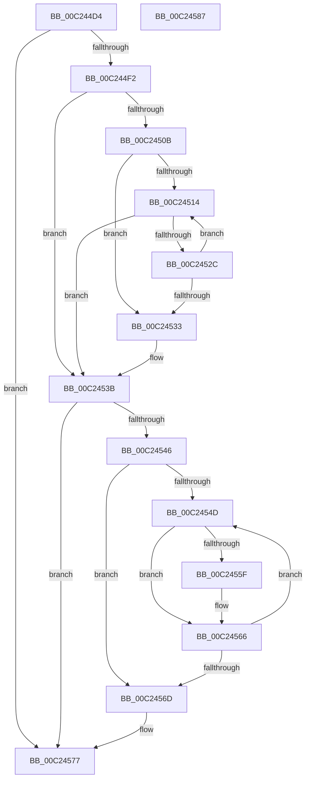

# HalpAuditAcpiTables

- RVA: `0x00C244D4`–`0x00C24588` (길이 `180` bytes)
- VA: `0x0000000140C244D4`
- 실행 섹션: `INIT`
- PDB 이름 있음: `예`; PDB Function 태그: `아니요`
- unwind 정보 RVA: `0x000A9ACC`
- 디코드: `58`개 명령, `180/180` bytes 표시
- 미해석 바이트: `0` (있으면 어셈블리에 `.byte`로 보존)

> 이 문서는 커널 이미지의 기계어와 PDB 기호를 분석해 생성했습니다. 4번과 5번은 함수 원형과 자료형을 바이너리 사용 방식에서 추정한 C 해석이며 원본 소스 복구 결과는 아닙니다.

## 1. Dependencies

- 직접 호출 지점: **5**; 고유 호출 대상: **4**
- 직접 호출자로 확인된 함수: **1**
- RIP 상대 이미지 참조: **1**

### Outgoing calls
- `0x00C244FB` → [HalpAuditEnumerateRsdts](HalpAuditEnumerateRsdts_function_00C24638.md) (function, `0x00C24638`)
- `0x00C24521` → [HalpAuditQuerySlicAddresses](HalpAuditQuerySlicAddresses_function_00C24820.md) (function, `0x00C24820`)
- `0x00C24536` → [HalpAuditSlicTables](HalpAuditSlicTables_function_00C24A94.md) (function, `0x00C24A94`)
- `0x00C24561` → [ExFreePoolWithTag](../../poolcode/B8/ExFreePoolWithTag_function_00B82870.md) (function, `0x00B82870`)
- `0x00C24572` → [ExFreePoolWithTag](../../poolcode/B8/ExFreePoolWithTag_function_00B82870.md) (function, `0x00B82870`)

### Direct callers
- [HalpAcpiInitSystem](../../pagelk/B5/HalpAcpiInitSystem_function_00B5D390.md) at `0x00B5D3E2`

### Static image references
- `0x00C2453B` → RVA `0x00E0A83C` (`.data`; write)

## 2. Other-region calls and transfers

- 다른 실행 섹션으로 향하는 call: **2**
  - `0x00C24561` → [ExFreePoolWithTag](../../poolcode/B8/ExFreePoolWithTag_function_00B82870.md) (`INIT` → `POOLCODE`)
  - `0x00C24572` → [ExFreePoolWithTag](../../poolcode/B8/ExFreePoolWithTag_function_00B82870.md) (`INIT` → `POOLCODE`)
- 별도 외부 분기/꼬리 이동을 확인하지 못했습니다.

## 3. Assembly (complete function range)

```asm
00C244D4  4C 8B DC                        mov r11, rsp
00C244D7  49 89 5B 10                     mov qword ptr [r11 + 0x10], rbx
00C244DB  49 89 73 18                     mov qword ptr [r11 + 0x18], rsi
00C244DF  57                              push rdi
00C244E0  48 83 EC 20                     sub rsp, 0x20
00C244E4  8B 81 08 01 00 00               mov eax, dword ptr [rcx + 0x108]
00C244EA  A8 01                           test al, 1
00C244EC  0F 85 85 00 00 00               jne 0x140c24577
00C244F2  49 83 63 08 00                  and qword ptr [r11 + 8], 0
00C244F7  49 8D 53 08                     lea rdx, [r11 + 8]
00C244FB  E8 38 01 00 00                  call 0x140c24638
00C24500  48 8B 5C 24 30                  mov rbx, qword ptr [rsp + 0x30]
00C24505  8B F8                           mov edi, eax
00C24507  85 C0                           test eax, eax
00C24509  78 30                           js 0x140c2453b
00C2450B  33 FF                           xor edi, edi
00C2450D  33 F6                           xor esi, esi
00C2450F  39 73 04                        cmp dword ptr [rbx + 4], esi
00C24512  76 1F                           jbe 0x140c24533
00C24514  8B CE                           mov ecx, esi
00C24516  48 C1 E1 05                     shl rcx, 5
00C2451A  48 83 C1 08                     add rcx, 8
00C2451E  48 03 CB                        add rcx, rbx
00C24521  E8 FA 02 00 00                  call 0x140c24820
00C24526  8B F8                           mov edi, eax
00C24528  85 C0                           test eax, eax
00C2452A  78 0F                           js 0x140c2453b
00C2452C  FF C6                           inc esi
00C2452E  3B 73 04                        cmp esi, dword ptr [rbx + 4]
00C24531  72 E1                           jb 0x140c24514
00C24533  48 8B CB                        mov rcx, rbx
00C24536  E8 59 05 00 00                  call 0x140c24a94
00C2453B  89 3D FB 62 1E 00               mov dword ptr [rip + 0x1e62fb], edi
00C24541  48 85 DB                        test rbx, rbx
00C24544  74 31                           je 0x140c24577
00C24546  33 FF                           xor edi, edi
00C24548  39 7B 04                        cmp dword ptr [rbx + 4], edi
00C2454B  76 20                           jbe 0x140c2456d
00C2454D  8B C7                           mov eax, edi
00C2454F  48 FF C0                        inc rax
00C24552  48 C1 E0 05                     shl rax, 5
00C24556  48 8B 0C 18                     mov rcx, qword ptr [rax + rbx]
00C2455A  48 85 C9                        test rcx, rcx
00C2455D  74 07                           je 0x140c24566
00C2455F  33 D2                           xor edx, edx
00C24561  E8 0A E3 F5 FF                  call 0x140b82870
00C24566  FF C7                           inc edi
00C24568  3B 7B 04                        cmp edi, dword ptr [rbx + 4]
00C2456B  72 E0                           jb 0x140c2454d
00C2456D  33 D2                           xor edx, edx
00C2456F  48 8B CB                        mov rcx, rbx
00C24572  E8 F9 E2 F5 FF                  call 0x140b82870
00C24577  48 8B 5C 24 38                  mov rbx, qword ptr [rsp + 0x38]
00C2457C  48 8B 74 24 40                  mov rsi, qword ptr [rsp + 0x40]
00C24581  48 83 C4 20                     add rsp, 0x20
00C24585  5F                              pop rdi
00C24586  C3                              ret
00C24587  CC                              int3
```

## 4. C-style interpretation (structured pseudocode)

```c
__int64 __fastcall HalpAuditAcpiTables(__int64 a1)
{
    __int64 result;
    __int64 v_rdi;
    __int64 v_rsi;
    __int64 v_rsp;
    unsigned __int64 v_stack_p10;
    unsigned __int64 v_stack_p18;
    unsigned __int64 v_stack_p8;

    *(unsigned __int64 *)(v_rsp + 16) = v_rbx;
    *(unsigned __int64 *)(v_rsp + 24) = v_rsi;
    v_rsp = (v_rsp) - (32);
    if ((((unsigned __int8)((unsigned int)(*(unsigned int *)(a1 + 264)))) & (1)) != 0) goto loc_00C24577;
    result = HalpAuditEnumerateRsdts(a1, v_rsp + 8, a3, a4);
    if (sign_flag) goto loc_00C2453B;
    v_rdi = 0;
    v_rsi = 0;
    if ((*(unsigned int *)(v_stack_p8 + 4)) <= 0) goto loc_00C24533;
loc_00C24514:
    a1 = (0) << (5);
    a1 = (a1) + (8);
    a1 = (a1) + (v_stack_p8);
    result = HalpAuditQuerySlicAddresses(a1, v_rsp + 8, a3, a4);
    if (sign_flag) goto loc_00C2453B;
    v_rsi = (unsigned int)((v_rsi) + 1);
    if (((unsigned int)(v_rsi)) < (*(unsigned int *)(v_stack_p8 + 4))) goto loc_00C24514;
loc_00C24533:
    result = HalpAuditSlicTables(v_stack_p8, v_rsp + 8, a3, a4);
loc_00C2453B:
    *(unsigned int *)(v_rip + 1991419) = (unsigned int)((unsigned int)((unsigned int)(result)));
    if (v_stack_p8 == 0) goto loc_00C24577;
    v_rdi = 0;
    if ((*(unsigned int *)(v_stack_p8 + 4)) <= 0) goto loc_00C2456D;
loc_00C2454D:
    result = (0) + 1;
    result = (result) << (5);
    if (*(unsigned __int64 *)(result + v_stack_p8 * 1) != 0) {
        a2 = 0;
        result = ExFreePoolWithTag(*(unsigned __int64 *)(result + v_stack_p8 * 1), a2, a3, a4);
    }
    v_rdi = (unsigned int)((v_rdi) + 1);
    if (((unsigned int)(v_rdi)) < (*(unsigned int *)(v_stack_p8 + 4))) goto loc_00C2454D;
loc_00C2456D:
    a2 = 0;
    result = ExFreePoolWithTag(v_stack_p8, a2, a3, a4);
loc_00C24577:
    v_rsp = (v_rsp) + (32);
    return result;
}
```

## 5. (Beta) C Style

```c
int64_t HalpAuditAcpiTables(void *Arg1)
{
    uint8_t *arg1 = (uint8_t *)Arg1;

    int64_t result;
    int64_t local_rdi;
    int64_t local_rsi;
    int64_t local_rsp;
    uint64_t v_stack_p10;
    uint64_t v_stack_p18;
    uint64_t v_stack_p8;

    *(uint64_t *)(local_rsp + 0x10) = local_rbx;
    *(uint64_t *)(local_rsp + 0x18) = local_rsi;
    local_rsp = (local_rsp) - (32);
    if ((((uint8_t)((uint32_t)(*(uint32_t *)(arg1 + 0x108)))) & (1)) != 0) goto loc_00C24577;
    result = HalpAuditEnumerateRsdts(Arg1, local_rsp + 8, a3, a4);
    if (sign_flag) goto loc_00C2453B;
    local_rdi = 0;
    local_rsi = 0;
    if ((*(uint32_t *)(v_stack_p8 + 0x4)) <= 0) goto loc_00C24533;
loc_00C24514:
    Arg1 = (0) << (5);
    Arg1 = (Arg1) + (8);
    Arg1 = (Arg1) + (v_stack_p8);
    result = HalpAuditQuerySlicAddresses(Arg1, local_rsp + 8, a3, a4);
    if (sign_flag) goto loc_00C2453B;
    local_rsi = (uint32_t)((local_rsi) + 1);
    if (((uint32_t)(local_rsi)) < (*(uint32_t *)(v_stack_p8 + 0x4))) goto loc_00C24514;
loc_00C24533:
    result = HalpAuditSlicTables(v_stack_p8, local_rsp + 8, a3, a4);
loc_00C2453B:
    *(uint32_t *)(v_rip + 0x1E62FB) = (uint32_t)((uint32_t)((uint32_t)(result)));
    if (v_stack_p8 == 0) goto loc_00C24577;
    local_rdi = 0;
    if ((*(uint32_t *)(v_stack_p8 + 0x4)) <= 0) goto loc_00C2456D;
loc_00C2454D:
    result = (0) + 1;
    result = (result) << (5);
    if (*(uint64_t *)(result + v_stack_p8 * 1) != 0) {
        a2 = 0;
        result = ExFreePoolWithTag(*(uint64_t *)(result + v_stack_p8 * 1), a2, a3, a4);
    }
    local_rdi = (uint32_t)((local_rdi) + 1);
    if (((uint32_t)(local_rdi)) < (*(uint32_t *)(v_stack_p8 + 0x4))) goto loc_00C2454D;
loc_00C2456D:
    a2 = 0;
    result = ExFreePoolWithTag(v_stack_p8, a2, a3, a4);
loc_00C24577:
    local_rsp = (local_rsp) + (32);
    return result;
}
```

### 관측된 메모리 오프셋

구조체 형식이 확인되지 않은 접근은 인자 기준의 오프셋으로만 기록했습니다.

| 기준 인자 | 오프셋 표현 | 폭 (bit) | 접근 |
|---|---:|---:|---|
| `Arg1` | `+ 0x108` | `32` | `R` |

## 6. Execution-region graph

[열기: 2D/3D 그래프와 함수 탐색 컨트롤 패널](../../../control-panel.html?section=init&rva=0x00C244D4&view=graph)

- 2D 그래프는 위에서 아래로 흐르고, 3D 그래프는 빈 공간을 드래그해 회전합니다. Shift+드래그는 이동, 휠은 확대·축소, 함수 노드 선택은 대상 보고서 이동입니다.

### Static fallback


