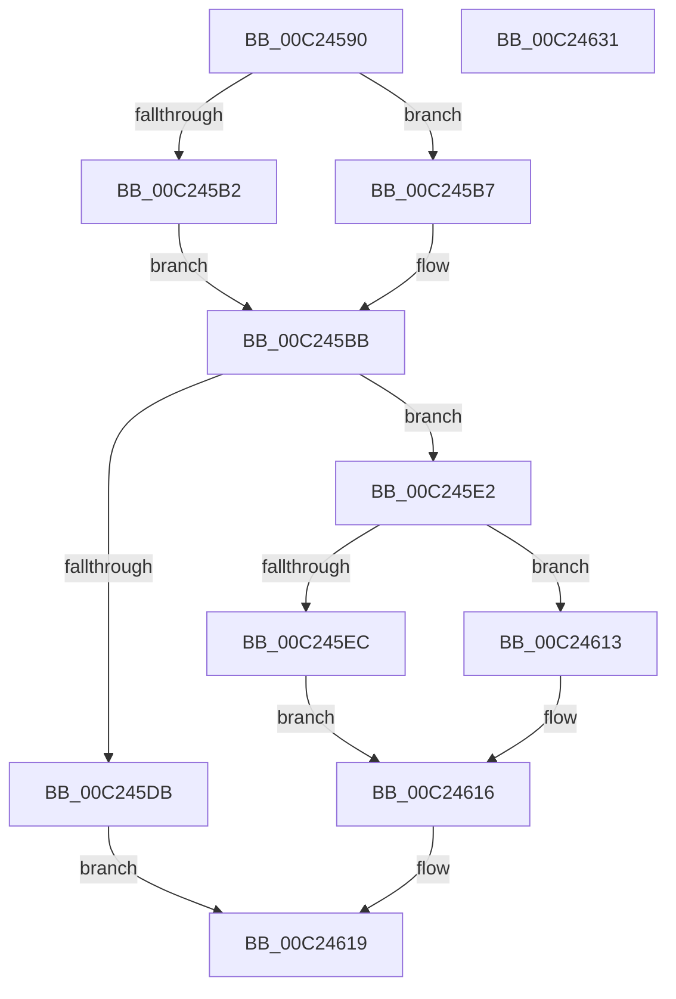

# HalpAuditAllocateRsdtArrayTable

- RVA: `0x00C24590`–`0x00C24632` (길이 `162` bytes)
- VA: `0x0000000140C24590`
- 실행 섹션: `INIT`
- PDB 이름 있음: `예`; PDB Function 태그: `아니요`
- unwind 정보 RVA: `0x0006F978`
- 디코드: `50`개 명령, `162/162` bytes 표시
- 미해석 바이트: `0` (있으면 어셈블리에 `.byte`로 보존)

> 이 문서는 커널 이미지의 기계어와 PDB 기호를 분석해 생성했습니다. 4번과 5번은 함수 원형과 자료형을 바이너리 사용 방식에서 추정한 C 해석이며 원본 소스 복구 결과는 아닙니다.

## 1. Dependencies

- 직접 호출 지점: **3**; 고유 호출 대상: **3**
- 직접 호출자로 확인된 함수: **2**
- RIP 상대 이미지 참조: **0**

### Outgoing calls
- `0x00C245CE` → [ExAllocatePool2](../../poolcode/B8/ExAllocatePool2_function_00B820F0.md) (function, `0x00B820F0`)
- `0x00C24602` → [memcpy](../../text/6C/memcpy_function_006C6840.md) (function, `0x006C6840`)
- `0x00C2460C` → [ExFreePoolWithTag](../../poolcode/B8/ExFreePoolWithTag_function_00B82870.md) (function, `0x00B82870`)

### Direct callers
- [HalpAuditEnumerateRsdts](HalpAuditEnumerateRsdts_function_00C24638.md) at `0x00C24660`
- [HalpAuditEnumerateRsdtsInRange](HalpAuditEnumerateRsdtsInRange_function_00C2472C.md) at `0x00C2479C`

### Static image references
- 디코드된 RIP-relative 메모리 참조가 없습니다.

## 2. Other-region calls and transfers

- 다른 실행 섹션으로 향하는 call: **3**
  - `0x00C245CE` → [ExAllocatePool2](../../poolcode/B8/ExAllocatePool2_function_00B820F0.md) (`INIT` → `POOLCODE`)
  - `0x00C24602` → [memcpy](../../text/6C/memcpy_function_006C6840.md) (`INIT` → `.text`)
  - `0x00C2460C` → [ExFreePoolWithTag](../../poolcode/B8/ExFreePoolWithTag_function_00B82870.md) (`INIT` → `POOLCODE`)
- 별도 외부 분기/꼬리 이동을 확인하지 못했습니다.

## 3. Assembly (complete function range)

```asm
00C24590  48 89 5C 24 08                  mov qword ptr [rsp + 8], rbx
00C24595  48 89 74 24 10                  mov qword ptr [rsp + 0x10], rsi
00C2459A  48 89 7C 24 18                  mov qword ptr [rsp + 0x18], rdi
00C2459F  41 56                           push r14
00C245A1  48 83 EC 20                     sub rsp, 0x20
00C245A5  48 8B 39                        mov rdi, qword ptr [rcx]
00C245A8  33 DB                           xor ebx, ebx
00C245AA  4C 8B F1                        mov r14, rcx
00C245AD  48 85 FF                        test rdi, rdi
00C245B0  75 05                           jne 0x140c245b7
00C245B2  8D 7B 04                        lea edi, [rbx + 4]
00C245B5  EB 04                           jmp 0x140c245bb
00C245B7  8B 3F                           mov edi, dword ptr [rdi]
00C245B9  03 FF                           add edi, edi
00C245BB  8B D7                           mov edx, edi
00C245BD  B9 00 01 00 00                  mov ecx, 0x100
00C245C2  C1 E2 05                        shl edx, 5
00C245C5  41 B8 48 61 6C 41               mov r8d, 0x416c6148
00C245CB  83 C2 08                        add edx, 8
00C245CE  E8 1D DB F5 FF                  call 0x140b820f0
00C245D3  48 8B F0                        mov rsi, rax
00C245D6  48 85 C0                        test rax, rax
00C245D9  75 07                           jne 0x140c245e2
00C245DB  BB 17 00 00 C0                  mov ebx, 0xc0000017
00C245E0  EB 37                           jmp 0x140c24619
00C245E2  89 38                           mov dword ptr [rax], edi
00C245E4  49 8B 3E                        mov rdi, qword ptr [r14]
00C245E7  48 85 FF                        test rdi, rdi
00C245EA  74 27                           je 0x140c24613
00C245EC  8B 47 04                        mov eax, dword ptr [rdi + 4]
00C245EF  48 8D 57 08                     lea rdx, [rdi + 8]
00C245F3  89 46 04                        mov dword ptr [rsi + 4], eax
00C245F6  48 8D 4E 08                     lea rcx, [rsi + 8]
00C245FA  44 8B 47 04                     mov r8d, dword ptr [rdi + 4]
00C245FE  49 C1 E0 05                     shl r8, 5
00C24602  E8 39 22 AA FF                  call 0x1406c6840
00C24607  33 D2                           xor edx, edx
00C24609  48 8B CF                        mov rcx, rdi
00C2460C  E8 5F E2 F5 FF                  call 0x140b82870
00C24611  EB 03                           jmp 0x140c24616
00C24613  89 58 04                        mov dword ptr [rax + 4], ebx
00C24616  49 89 36                        mov qword ptr [r14], rsi
00C24619  48 8B 74 24 38                  mov rsi, qword ptr [rsp + 0x38]
00C2461E  8B C3                           mov eax, ebx
00C24620  48 8B 5C 24 30                  mov rbx, qword ptr [rsp + 0x30]
00C24625  48 8B 7C 24 40                  mov rdi, qword ptr [rsp + 0x40]
00C2462A  48 83 C4 20                     add rsp, 0x20
00C2462E  41 5E                           pop r14
00C24630  C3                              ret
00C24631  CC                              int3
```

## 4. C-style interpretation (structured pseudocode)

```c
__int64 __fastcall HalpAuditAllocateRsdtArrayTable(__int64 a1)
{
    __int64 result;
    __int64 v_rbx;
    __int64 v_rdi;
    __int64 v_rsp;
    unsigned __int64 v_stack_p10;
    unsigned __int64 v_stack_p18;
    unsigned __int64 v_stack_p8;

    v_stack_p8 = v_rbx;
    v_stack_p10 = v_rsi;
    v_stack_p18 = v_rdi;
    v_rsp = (v_rsp) - (32);
    v_rbx = 0;
    if (*(unsigned __int64 *)(a1) != 0) goto loc_00C245B7;
    goto loc_00C245BB;
loc_00C245B7:
    v_rdi = (unsigned int)(((unsigned int)(*(unsigned int *)(v_rbx + 4))) + ((unsigned int)((unsigned int)(*(unsigned int *)(v_rbx + 4)))));
loc_00C245BB:
    a2 = (unsigned int)(((unsigned int)((unsigned int)(v_rdi))) << (5));
    a2 = (unsigned int)((a2) + (8));
    result = ExAllocatePool2(256, a2, (unsigned int)(0x416C6148ULL), a4);
    if (result != 0) goto loc_00C245E2;
    goto loc_00C24619;
loc_00C245E2:
    *(unsigned int *)(result) = (unsigned int)(v_rdi);
    if (*(unsigned __int64 *)(a1) == 0) goto loc_00C24613;
    *(unsigned int *)(result + 4) = (unsigned int)((unsigned int)(*(unsigned int *)(*(unsigned __int64 *)(a1) + 4)));
    a3 = ((unsigned int)(*(unsigned int *)(*(unsigned __int64 *)(a1) + 4))) << (5);
    result = memcpy(result + 8, *(unsigned __int64 *)(a1) + 8, a3, a4);
    a2 = 0;
    result = ExFreePoolWithTag(*(unsigned __int64 *)(a1), a2, a3, a4);
    goto loc_00C24616;
loc_00C24613:
    *(unsigned int *)(result + 4) = (unsigned int)((unsigned int)(0xC0000017ULL));
loc_00C24616:
    *(unsigned __int64 *)(a1) = result;
loc_00C24619:
    v_rsp = (v_rsp) + (32);
    return (unsigned int)((unsigned int)((unsigned int)(0xC0000017ULL)));
}
```

## 5. (Beta) C Style

```c
int64_t HalpAuditAllocateRsdtArrayTable(void *Arg1)
{
    uint8_t *arg1 = (uint8_t *)Arg1;

    int64_t result;
    int64_t local_rbx;
    int64_t local_rdi;
    int64_t local_rsp;
    uint64_t v_stack_p10;
    uint64_t v_stack_p18;
    uint64_t v_stack_p8;

    v_stack_p8 = local_rbx;
    v_stack_p10 = local_rsi;
    v_stack_p18 = local_rdi;
    local_rsp = (local_rsp) - (32);
    local_rbx = 0;
    if (*(uint64_t *)(arg1) != 0) goto loc_00C245B7;
    goto loc_00C245BB;
loc_00C245B7:
    local_rdi = (uint32_t)(((uint32_t)(*(uint32_t *)(local_rbx + 0x4))) + ((uint32_t)((uint32_t)(*(uint32_t *)(local_rbx + 0x4)))));
loc_00C245BB:
    a2 = (uint32_t)(((uint32_t)((uint32_t)(local_rdi))) << (5));
    a2 = (uint32_t)((a2) + (8));
    result = ExAllocatePool2(256, a2, (uint32_t)(0x416C6148ULL), a4);
    if (result != 0) goto loc_00C245E2;
    goto loc_00C24619;
loc_00C245E2:
    *(uint32_t *)(result) = (uint32_t)(local_rdi);
    if (*(uint64_t *)(arg1) == 0) goto loc_00C24613;
    *(uint32_t *)(result + 0x4) = (uint32_t)((uint32_t)(*(uint32_t *)(*(uint64_t *)(arg1) + 0x4)));
    a3 = ((uint32_t)(*(uint32_t *)(*(uint64_t *)(arg1) + 0x4))) << (5);
    result = memcpy(result + 8, *(uint64_t *)(arg1) + 8, a3, a4);
    a2 = 0;
    result = ExFreePoolWithTag(*(uint64_t *)(arg1), a2, a3, a4);
    goto loc_00C24616;
loc_00C24613:
    *(uint32_t *)(result + 0x4) = (uint32_t)((uint32_t)(0xC0000017ULL));
loc_00C24616:
    *(uint64_t *)(arg1) = result;
loc_00C24619:
    local_rsp = (local_rsp) + (32);
    return (uint32_t)((uint32_t)((uint32_t)(0xC0000017ULL)));
}
```

### 관측된 메모리 오프셋

구조체 형식이 확인되지 않은 접근은 인자 기준의 오프셋으로만 기록했습니다.

| 기준 인자 | 오프셋 표현 | 폭 (bit) | 접근 |
|---|---:|---:|---|
| `Arg1` | `+ 0x0` | `64` | `R` |
| `Arg1` | `+ 0x0` | `64` | `W` |

## 6. Execution-region graph

[열기: 2D/3D 그래프와 함수 탐색 컨트롤 패널](../../../control-panel.html?section=init&rva=0x00C24590&view=graph)

- 2D 그래프는 위에서 아래로 흐르고, 3D 그래프는 빈 공간을 드래그해 회전합니다. Shift+드래그는 이동, 휠은 확대·축소, 함수 노드 선택은 대상 보고서 이동입니다.

### Static fallback


