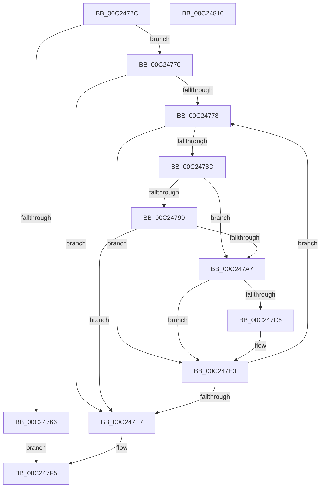

# HalpAuditEnumerateRsdtsInRange

- RVA: `0x00C2472C`–`0x00C24817` (길이 `235` bytes)
- VA: `0x0000000140C2472C`
- 실행 섹션: `INIT`
- PDB 이름 있음: `예`; PDB Function 태그: `아니요`
- unwind 정보 RVA: `0x0005FEF8`
- 디코드: `76`개 명령, `235/235` bytes 표시
- 미해석 바이트: `0` (있으면 어셈블리에 `.byte`로 보존)

> 이 문서는 커널 이미지의 기계어와 PDB 기호를 분석해 생성했습니다. 4번과 5번은 함수 원형과 자료형을 바이너리 사용 방식에서 추정한 C 해석이며 원본 소스 복구 결과는 아닙니다.

## 1. Dependencies

- 직접 호출 지점: **4**; 고유 호출 대상: **4**
- 직접 호출자로 확인된 함수: **1**
- RIP 상대 이미지 참조: **0**

### Outgoing calls
- `0x00C24759` → [MmMapIoSpaceEx](../../text/32/MmMapIoSpaceEx_function_00327830.md) (function, `0x00327830`)
- `0x00C2479C` → [HalpAuditAllocateRsdtArrayTable](HalpAuditAllocateRsdtArrayTable_function_00C24590.md) (function, `0x00C24590`)
- `0x00C247BB` → [HalpAuditSelectRsdtOrXsdt](HalpAuditSelectRsdtOrXsdt_function_00C249C4.md) (function, `0x00C249C4`)
- `0x00C247F0` → [MiUnmapContiguousMemory](../../text/3F/MiUnmapContiguousMemory_function_003F7908.md) (function, `0x003F7908`)

### Direct callers
- [HalpAuditEnumerateRsdts](HalpAuditEnumerateRsdts_function_00C24638.md) at `0x00C246C0`
- [HalpAuditEnumerateRsdts](HalpAuditEnumerateRsdts_function_00C24638.md) at `0x00C246DD`

### Static image references
- 디코드된 RIP-relative 메모리 참조가 없습니다.

## 2. Other-region calls and transfers

- 다른 실행 섹션으로 향하는 call: **2**
  - `0x00C24759` → [MmMapIoSpaceEx](../../text/32/MmMapIoSpaceEx_function_00327830.md) (`INIT` → `.text`)
  - `0x00C247F0` → [MiUnmapContiguousMemory](../../text/3F/MiUnmapContiguousMemory_function_003F7908.md) (`INIT` → `.text`)
- 별도 외부 분기/꼬리 이동을 확인하지 못했습니다.

## 3. Assembly (complete function range)

```asm
00C2472C  48 8B C4                        mov rax, rsp
00C2472F  48 89 58 08                     mov qword ptr [rax + 8], rbx
00C24733  48 89 68 10                     mov qword ptr [rax + 0x10], rbp
00C24737  48 89 70 18                     mov qword ptr [rax + 0x18], rsi
00C2473B  48 89 78 20                     mov qword ptr [rax + 0x20], rdi
00C2473F  41 54                           push r12
00C24741  41 56                           push r14
00C24743  41 57                           push r15
00C24745  48 83 EC 20                     sub rsp, 0x20
00C24749  45 8A E0                        mov r12b, r8b
00C2474C  8B F2                           mov esi, edx
00C2474E  8B D2                           mov edx, edx
00C24750  41 B8 04 02 00 00               mov r8d, 0x204
00C24756  4D 8B F1                        mov r14, r9
00C24759  E8 D2 30 70 FF                  call 0x140327830
00C2475E  4C 8B F8                        mov r15, rax
00C24761  48 85 C0                        test rax, rax
00C24764  75 0A                           jne 0x140c24770
00C24766  BB 01 00 00 C0                  mov ebx, 0xc0000001
00C2476B  E9 85 00 00 00                  jmp 0x140c247f5
00C24770  33 DB                           xor ebx, ebx
00C24772  33 FF                           xor edi, edi
00C24774  85 F6                           test esi, esi
00C24776  74 6F                           je 0x140c247e7
00C24778  8B EF                           mov ebp, edi
00C2477A  48 B8 52 53 44 20 50 54 52 20   movabs rax, 0x2052545020445352
00C24784  49 03 EF                        add rbp, r15
00C24787  48 39 45 00                     cmp qword ptr [rbp], rax
00C2478B  75 53                           jne 0x140c247e0
00C2478D  49 8B 0E                        mov rcx, qword ptr [r14]
00C24790  8B 41 04                        mov eax, dword ptr [rcx + 4]
00C24793  FF C0                           inc eax
00C24795  39 01                           cmp dword ptr [rcx], eax
00C24797  73 0E                           jae 0x140c247a7
00C24799  49 8B CE                        mov rcx, r14
00C2479C  E8 EF FD FF FF                  call 0x140c24590
00C247A1  8B D8                           mov ebx, eax
00C247A3  85 C0                           test eax, eax
00C247A5  78 40                           js 0x140c247e7
00C247A7  49 8B 16                        mov rdx, qword ptr [r14]
00C247AA  48 8B CD                        mov rcx, rbp
00C247AD  8B 42 04                        mov eax, dword ptr [rdx + 4]
00C247B0  48 83 C2 08                     add rdx, 8
00C247B4  48 C1 E0 05                     shl rax, 5
00C247B8  48 03 D0                        add rdx, rax
00C247BB  E8 04 02 00 00                  call 0x140c249c4
00C247C0  8B D8                           mov ebx, eax
00C247C2  85 C0                           test eax, eax
00C247C4  78 1A                           js 0x140c247e0
00C247C6  8B 4A 0C                        mov ecx, dword ptr [rdx + 0xc]
00C247C9  8B C1                           mov eax, ecx
00C247CB  83 C8 08                        or eax, 8
00C247CE  83 E1 F7                        and ecx, 0xfffffff7
00C247D1  45 84 E4                        test r12b, r12b
00C247D4  0F 45 C8                        cmovne ecx, eax
00C247D7  89 4A 0C                        mov dword ptr [rdx + 0xc], ecx
00C247DA  49 8B 06                        mov rax, qword ptr [r14]
00C247DD  FF 40 04                        inc dword ptr [rax + 4]
00C247E0  83 C7 10                        add edi, 0x10
00C247E3  3B FE                           cmp edi, esi
00C247E5  72 91                           jb 0x140c24778
00C247E7  48 8B D6                        mov rdx, rsi
00C247EA  41 B0 01                        mov r8b, 1
00C247ED  49 8B CF                        mov rcx, r15
00C247F0  E8 13 31 7D FF                  call 0x1403f7908
00C247F5  48 8B 6C 24 48                  mov rbp, qword ptr [rsp + 0x48]
00C247FA  8B C3                           mov eax, ebx
00C247FC  48 8B 5C 24 40                  mov rbx, qword ptr [rsp + 0x40]
00C24801  48 8B 74 24 50                  mov rsi, qword ptr [rsp + 0x50]
00C24806  48 8B 7C 24 58                  mov rdi, qword ptr [rsp + 0x58]
00C2480B  48 83 C4 20                     add rsp, 0x20
00C2480F  41 5F                           pop r15
00C24811  41 5E                           pop r14
00C24813  41 5C                           pop r12
00C24815  C3                              ret
00C24816  CC                              int3
```

## 4. C-style interpretation (structured pseudocode)

```c
__int64 __fastcall HalpAuditEnumerateRsdtsInRange(__int64 a1, int a2, unsigned __int8 a3, __int64 a4)
{
    __int64 result;
    __int64 v_rbp;
    __int64 v_rbx;
    __int64 v_rdi;
    __int64 v_rsp;
    unsigned __int64 v_stack_p10;
    unsigned __int64 v_stack_p18;
    unsigned __int64 v_stack_p20;
    unsigned __int64 v_stack_p8;

    *(unsigned __int64 *)(v_rsp + 8) = v_rbx;
    *(unsigned __int64 *)(v_rsp + 16) = v_rbp;
    *(unsigned __int64 *)(v_rsp + 24) = v_rsi;
    *(unsigned __int64 *)(v_rsp + 32) = v_rdi;
    v_rsp = (v_rsp) - (32);
    result = MmMapIoSpaceEx(a1, (unsigned int)(a2), 516, a4);
    if (result != 0) goto loc_00C24770;
    goto loc_00C247F5;
loc_00C24770:
    v_rbx = 0;
    v_rdi = 0;
    if ((unsigned int)((unsigned int)(a2)) == 0) goto loc_00C247E7;
loc_00C24778:
    v_rbp = (0) + (result);
    if ((*(unsigned __int64 *)(v_rbp)) != result) goto loc_00C247E0;
    result = (unsigned int)(((unsigned int)(*(unsigned int *)(*(unsigned __int64 *)(a4) + 4))) + 1);
    if ((*(unsigned int *)(*(unsigned __int64 *)(a4))) >= ((unsigned int)(result))) goto loc_00C247A7;
    result = HalpAuditAllocateRsdtArrayTable(a4, (unsigned int)(a2), 516, a4);
    if (sign_flag) goto loc_00C247E7;
loc_00C247A7:
    a2 = (*(unsigned __int64 *)(a4)) + (8);
    result = ((unsigned int)(*(unsigned int *)(*(unsigned __int64 *)(a4) + 4))) << (5);
    a2 = (a2) + (result);
    result = HalpAuditSelectRsdtOrXsdt(v_rbp, a2, 516, a4);
    if (!(sign_flag)) {
        a1 = *(unsigned int *)(a2 + 12);
        result = (unsigned int)(a1);
        result = (unsigned int)((result) | (8));
        a1 = (unsigned int)((a1) & (0xFFFFFFF7ULL));
        if (a3 != 0) { a1 = (unsigned int)(result); }
        *(unsigned int *)(a2 + 12) = (unsigned int)(a1);
        result = *(unsigned __int64 *)(a4);
    }
    v_rdi = (unsigned int)((v_rdi) + (16));
    if (((unsigned int)(v_rdi)) < ((unsigned int)((unsigned int)(a2)))) goto loc_00C24778;
loc_00C247E7:
    result = MiUnmapContiguousMemory(result, (unsigned int)(a2), 1, a4);
loc_00C247F5:
    v_rsp = (v_rsp) + (32);
    return (unsigned int)((unsigned int)((unsigned int)((unsigned int)(result))));
}
```

## 5. (Beta) C Style

```c
int64_t HalpAuditEnumerateRsdtsInRange(int64_t Arg1, int32_t Arg2, uint8_t Arg3, void *Arg4)
{
    uint8_t *arg4 = (uint8_t *)Arg4;

    int64_t result;
    int64_t local_rbp;
    int64_t local_rbx;
    int64_t local_rdi;
    int64_t local_rsp;
    uint64_t v_stack_p10;
    uint64_t v_stack_p18;
    uint64_t v_stack_p20;
    uint64_t v_stack_p8;

    *(uint64_t *)(local_rsp + 0x8) = local_rbx;
    *(uint64_t *)(local_rsp + 0x10) = local_rbp;
    *(uint64_t *)(local_rsp + 0x18) = local_rsi;
    *(uint64_t *)(local_rsp + 0x20) = local_rdi;
    local_rsp = (local_rsp) - (32);
    result = MmMapIoSpaceEx(Arg1, (uint32_t)(Arg2), 516, Arg4);
    if (result != 0) goto loc_00C24770;
    goto loc_00C247F5;
loc_00C24770:
    local_rbx = 0;
    local_rdi = 0;
    if ((uint32_t)((uint32_t)(Arg2)) == 0) goto loc_00C247E7;
loc_00C24778:
    local_rbp = (0) + (result);
    if ((*(uint64_t *)(local_rbp)) != result) goto loc_00C247E0;
    result = (uint32_t)(((uint32_t)(*(uint32_t *)(*(uint64_t *)(arg4) + 0x4))) + 1);
    if ((*(uint32_t *)(*(uint64_t *)(arg4))) >= ((uint32_t)(result))) goto loc_00C247A7;
    result = HalpAuditAllocateRsdtArrayTable(Arg4, (uint32_t)(Arg2), 516, Arg4);
    if (sign_flag) goto loc_00C247E7;
loc_00C247A7:
    Arg2 = (*(uint64_t *)(arg4)) + (8);
    result = ((uint32_t)(*(uint32_t *)(*(uint64_t *)(arg4) + 0x4))) << (5);
    Arg2 = (Arg2) + (result);
    result = HalpAuditSelectRsdtOrXsdt(local_rbp, Arg2, 516, Arg4);
    if (!(sign_flag)) {
        Arg1 = *(uint32_t *)(Arg2 + 0xC);
        result = (uint32_t)(Arg1);
        result = (uint32_t)((result) | (8));
        Arg1 = (uint32_t)((Arg1) & (0xFFFFFFF7ULL));
        if (Arg3 != 0) { Arg1 = (uint32_t)(result); }
        *(uint32_t *)(Arg2 + 0xC) = (uint32_t)(Arg1);
        result = *(uint64_t *)(arg4);
    }
    local_rdi = (uint32_t)((local_rdi) + (16));
    if (((uint32_t)(local_rdi)) < ((uint32_t)((uint32_t)(Arg2)))) goto loc_00C24778;
loc_00C247E7:
    result = MiUnmapContiguousMemory(result, (uint32_t)(Arg2), 1, Arg4);
loc_00C247F5:
    local_rsp = (local_rsp) + (32);
    return (uint32_t)((uint32_t)((uint32_t)((uint32_t)(result))));
}
```

### 관측된 메모리 오프셋

구조체 형식이 확인되지 않은 접근은 인자 기준의 오프셋으로만 기록했습니다.

| 기준 인자 | 오프셋 표현 | 폭 (bit) | 접근 |
|---|---:|---:|---|
| `Arg4` | `+ 0x0` | `64` | `R` |

## 6. Execution-region graph

[열기: 2D/3D 그래프와 함수 탐색 컨트롤 패널](../../../control-panel.html?section=init&rva=0x00C2472C&view=graph)

- 2D 그래프는 위에서 아래로 흐르고, 3D 그래프는 빈 공간을 드래그해 회전합니다. Shift+드래그는 이동, 휠은 확대·축소, 함수 노드 선택은 대상 보고서 이동입니다.

### Static fallback


