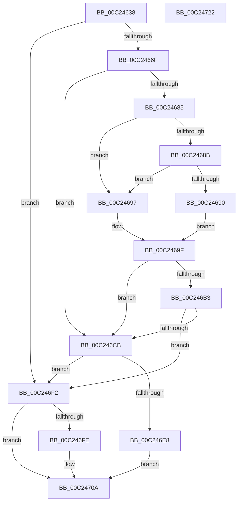

# HalpAuditEnumerateRsdts

- RVA: `0x00C24638`–`0x00C24723` (길이 `235` bytes)
- VA: `0x0000000140C24638`
- 실행 섹션: `INIT`
- PDB 이름 있음: `예`; PDB Function 태그: `아니요`
- unwind 정보 RVA: `0x000C4CB0`
- 디코드: `73`개 명령, `235/235` bytes 표시
- 미해석 바이트: `0` (있으면 어셈블리에 `.byte`로 보존)

> 이 문서는 커널 이미지의 기계어와 PDB 기호를 분석해 생성했습니다. 4번과 5번은 함수 원형과 자료형을 바이너리 사용 방식에서 추정한 C 해석이며 원본 소스 복구 결과는 아닙니다.

## 1. Dependencies

- 직접 호출 지점: **6**; 고유 호출 대상: **5**
- 직접 호출자로 확인된 함수: **1**
- RIP 상대 이미지 참조: **0**

### Outgoing calls
- `0x00C24660` → [HalpAuditAllocateRsdtArrayTable](HalpAuditAllocateRsdtArrayTable_function_00C24590.md) (function, `0x00C24590`)
- `0x00C2467B` → [MmMapIoSpaceEx](../../text/32/MmMapIoSpaceEx_function_00327830.md) (function, `0x00327830`)
- `0x00C246AA` → [MiUnmapContiguousMemory](../../text/3F/MiUnmapContiguousMemory_function_003F7908.md) (function, `0x003F7908`)
- `0x00C246C0` → [HalpAuditEnumerateRsdtsInRange](HalpAuditEnumerateRsdtsInRange_function_00C2472C.md) (function, `0x00C2472C`)
- `0x00C246DD` → [HalpAuditEnumerateRsdtsInRange](HalpAuditEnumerateRsdtsInRange_function_00C2472C.md) (function, `0x00C2472C`)
- `0x00C24703` → [ExFreePoolWithTag](../../poolcode/B8/ExFreePoolWithTag_function_00B82870.md) (function, `0x00B82870`)

### Direct callers
- [HalpAuditAcpiTables](HalpAuditAcpiTables_function_00C244D4.md) at `0x00C244FB`

### Static image references
- 디코드된 RIP-relative 메모리 참조가 없습니다.

## 2. Other-region calls and transfers

- 다른 실행 섹션으로 향하는 call: **3**
  - `0x00C2467B` → [MmMapIoSpaceEx](../../text/32/MmMapIoSpaceEx_function_00327830.md) (`INIT` → `.text`)
  - `0x00C246AA` → [MiUnmapContiguousMemory](../../text/3F/MiUnmapContiguousMemory_function_003F7908.md) (`INIT` → `.text`)
  - `0x00C24703` → [ExFreePoolWithTag](../../poolcode/B8/ExFreePoolWithTag_function_00B82870.md) (`INIT` → `POOLCODE`)
- 별도 외부 분기/꼬리 이동을 확인하지 못했습니다.

## 3. Assembly (complete function range)

```asm
00C24638  48 8B C4                        mov rax, rsp
00C2463B  48 89 58 10                     mov qword ptr [rax + 0x10], rbx
00C2463F  48 89 70 18                     mov qword ptr [rax + 0x18], rsi
00C24643  48 89 78 20                     mov qword ptr [rax + 0x20], rdi
00C24647  48 89 48 08                     mov qword ptr [rax + 8], rcx
00C2464B  41 56                           push r14
00C2464D  48 83 EC 20                     sub rsp, 0x20
00C24651  33 DB                           xor ebx, ebx
00C24653  48 8D 48 08                     lea rcx, [rax + 8]
00C24657  48 21 58 08                     and qword ptr [rax + 8], rbx
00C2465B  4C 8B F2                        mov r14, rdx
00C2465E  33 F6                           xor esi, esi
00C24660  E8 2B FF FF FF                  call 0x140c24590
00C24665  8B C8                           mov ecx, eax
00C24667  85 C0                           test eax, eax
00C24669  0F 88 83 00 00 00               js 0x140c246f2
00C2466F  8D 53 08                        lea edx, [rbx + 8]
00C24672  B9 40 07 00 00                  mov ecx, 0x740
00C24677  44 8D 43 04                     lea r8d, [rbx + 4]
00C2467B  E8 B0 31 70 FF                  call 0x140327830
00C24680  48 85 C0                        test rax, rax
00C24683  74 46                           je 0x140c246cb
00C24685  8B 10                           mov edx, dword ptr [rax]
00C24687  85 D2                           test edx, edx
00C24689  75 0C                           jne 0x140c24697
00C2468B  39 58 04                        cmp dword ptr [rax + 4], ebx
00C2468E  75 07                           jne 0x140c24697
00C24690  BF 01 00 00 C0                  mov edi, 0xc0000001
00C24695  EB 08                           jmp 0x140c2469f
00C24697  8B 70 04                        mov esi, dword ptr [rax + 4]
00C2469A  48 8B DA                        mov rbx, rdx
00C2469D  33 FF                           xor edi, edi
00C2469F  41 B0 01                        mov r8b, 1
00C246A2  BA 08 00 00 00                  mov edx, 8
00C246A7  48 8B C8                        mov rcx, rax
00C246AA  E8 59 32 7D FF                  call 0x1403f7908
00C246AF  85 FF                           test edi, edi
00C246B1  78 18                           js 0x140c246cb
00C246B3  4C 8D 4C 24 30                  lea r9, [rsp + 0x30]
00C246B8  41 B0 01                        mov r8b, 1
00C246BB  8B D6                           mov edx, esi
00C246BD  48 8B CB                        mov rcx, rbx
00C246C0  E8 67 00 00 00                  call 0x140c2472c
00C246C5  8B C8                           mov ecx, eax
00C246C7  85 C0                           test eax, eax
00C246C9  78 27                           js 0x140c246f2
00C246CB  4C 8D 4C 24 30                  lea r9, [rsp + 0x30]
00C246D0  45 33 C0                        xor r8d, r8d
00C246D3  BA 00 00 02 00                  mov edx, 0x20000
00C246D8  B9 00 00 0E 00                  mov ecx, 0xe0000
00C246DD  E8 4A 00 00 00                  call 0x140c2472c
00C246E2  8B C8                           mov ecx, eax
00C246E4  85 C0                           test eax, eax
00C246E6  78 0A                           js 0x140c246f2
00C246E8  48 8B 44 24 30                  mov rax, qword ptr [rsp + 0x30]
00C246ED  49 89 06                        mov qword ptr [r14], rax
00C246F0  EB 18                           jmp 0x140c2470a
00C246F2  48 8B 44 24 30                  mov rax, qword ptr [rsp + 0x30]
00C246F7  8B D9                           mov ebx, ecx
00C246F9  48 85 C0                        test rax, rax
00C246FC  74 0C                           je 0x140c2470a
00C246FE  33 D2                           xor edx, edx
00C24700  48 8B C8                        mov rcx, rax
00C24703  E8 68 E1 F5 FF                  call 0x140b82870
00C24708  8B CB                           mov ecx, ebx
00C2470A  48 8B 5C 24 38                  mov rbx, qword ptr [rsp + 0x38]
00C2470F  8B C1                           mov eax, ecx
00C24711  48 8B 74 24 40                  mov rsi, qword ptr [rsp + 0x40]
00C24716  48 8B 7C 24 48                  mov rdi, qword ptr [rsp + 0x48]
00C2471B  48 83 C4 20                     add rsp, 0x20
00C2471F  41 5E                           pop r14
00C24721  C3                              ret
00C24722  CC                              int3
```

## 4. C-style interpretation (structured pseudocode)

```c
__int64 __fastcall HalpAuditEnumerateRsdts(__int64 a1, __int64 a2)
{
    __int64 result;
    __int64 v_rbx;
    __int64 v_rdi;
    __int64 v_rsi;
    __int64 v_rsp;
    unsigned __int64 v_stack_p10;
    unsigned __int64 v_stack_p18;
    unsigned __int64 v_stack_p20;
    unsigned __int64 v_stack_p8;

    *(unsigned __int64 *)(v_rsp + 16) = v_rbx;
    *(unsigned __int64 *)(v_rsp + 24) = v_rsi;
    *(unsigned __int64 *)(v_rsp + 32) = v_rdi;
    *(unsigned __int64 *)(v_rsp + 8) = a1;
    v_rsp = (v_rsp) - (32);
    v_rbx = 0;
    v_rsi = 0;
    result = HalpAuditAllocateRsdtArrayTable(v_rsp + 8, a2, a3, a4);
    if (sign_flag) goto loc_00C246F2;
    result = MmMapIoSpaceEx((unsigned int)(0x740ULL), v_rbx + 8, v_rbx + 4, a4);
    if (result == 0) goto loc_00C246CB;
    if ((unsigned int)((unsigned int)(*(unsigned int *)(result))) != 0) goto loc_00C24697;
    if ((*(unsigned int *)(result + 4)) != 0) goto loc_00C24697;
    goto loc_00C2469F;
loc_00C24697:
    v_rdi = 0;
loc_00C2469F:
    result = MiUnmapContiguousMemory(result, 8, 1, a4);
    if (sign_flag) goto loc_00C246CB;
    result = HalpAuditEnumerateRsdtsInRange((unsigned int)(*(unsigned int *)(result)), (unsigned int)((unsigned int)((unsigned int)(*(unsigned int *)(result + 4)))), 1, v_stack_p8);
    if (sign_flag) goto loc_00C246F2;
loc_00C246CB:
    a3 = 0;
    result = HalpAuditEnumerateRsdtsInRange((unsigned int)(0xE0000ULL), (unsigned int)(0x20000ULL), a3, v_stack_p8);
    if (sign_flag) goto loc_00C246F2;
    *(unsigned __int64 *)(a2) = v_stack_p8;
    goto loc_00C2470A;
loc_00C246F2:
    result = v_stack_p8;
    if (v_stack_p8 != 0) {
        a2 = 0;
        a1 = v_stack_p8;
        result = ExFreePoolWithTag(a1, a2, a3, v_stack_p8);
        a1 = (unsigned int)((unsigned int)((unsigned int)((unsigned int)((unsigned int)(result)))));
    }
    v_rsp = (v_rsp) + (32);
    return (unsigned int)((unsigned int)(a1));
}
```

## 5. (Beta) C Style

```c
int64_t HalpAuditEnumerateRsdts(int64_t Arg1, void *Arg2)
{
    uint8_t *arg2 = (uint8_t *)Arg2;

    int64_t result;
    int64_t local_rbx;
    int64_t local_rdi;
    int64_t local_rsi;
    int64_t local_rsp;
    uint64_t v_stack_p10;
    uint64_t v_stack_p18;
    uint64_t v_stack_p20;
    uint64_t v_stack_p8;

    *(uint64_t *)(local_rsp + 0x10) = local_rbx;
    *(uint64_t *)(local_rsp + 0x18) = local_rsi;
    *(uint64_t *)(local_rsp + 0x20) = local_rdi;
    *(uint64_t *)(local_rsp + 0x8) = Arg1;
    local_rsp = (local_rsp) - (32);
    local_rbx = 0;
    local_rsi = 0;
    result = HalpAuditAllocateRsdtArrayTable(local_rsp + 8, Arg2, a3, a4);
    if (sign_flag) goto loc_00C246F2;
    result = MmMapIoSpaceEx((uint32_t)(0x740ULL), local_rbx + 8, local_rbx + 4, a4);
    if (result == 0) goto loc_00C246CB;
    if ((uint32_t)((uint32_t)(*(uint32_t *)(result))) != 0) goto loc_00C24697;
    if ((*(uint32_t *)(result + 0x4)) != 0) goto loc_00C24697;
    goto loc_00C2469F;
loc_00C24697:
    local_rdi = 0;
loc_00C2469F:
    result = MiUnmapContiguousMemory(result, 8, 1, a4);
    if (sign_flag) goto loc_00C246CB;
    result = HalpAuditEnumerateRsdtsInRange((uint32_t)(*(uint32_t *)(result)), (uint32_t)((uint32_t)((uint32_t)(*(uint32_t *)(result + 0x4)))), 1, v_stack_p8);
    if (sign_flag) goto loc_00C246F2;
loc_00C246CB:
    a3 = 0;
    result = HalpAuditEnumerateRsdtsInRange((uint32_t)(0xE0000ULL), (uint32_t)(0x20000ULL), a3, v_stack_p8);
    if (sign_flag) goto loc_00C246F2;
    *(uint64_t *)(arg2) = v_stack_p8;
    goto loc_00C2470A;
loc_00C246F2:
    result = v_stack_p8;
    if (v_stack_p8 != 0) {
        Arg2 = 0;
        Arg1 = v_stack_p8;
        result = ExFreePoolWithTag(Arg1, Arg2, a3, v_stack_p8);
        Arg1 = (uint32_t)((uint32_t)((uint32_t)((uint32_t)((uint32_t)(result)))));
    }
    local_rsp = (local_rsp) + (32);
    return (uint32_t)((uint32_t)(Arg1));
}
```

### 관측된 메모리 오프셋

구조체 형식이 확인되지 않은 접근은 인자 기준의 오프셋으로만 기록했습니다.

| 기준 인자 | 오프셋 표현 | 폭 (bit) | 접근 |
|---|---:|---:|---|
| `Arg2` | `+ 0x0` | `64` | `W` |

## 6. Execution-region graph

[열기: 2D/3D 그래프와 함수 탐색 컨트롤 패널](../../../control-panel.html?section=init&rva=0x00C24638&view=graph)

- 2D 그래프는 위에서 아래로 흐르고, 3D 그래프는 빈 공간을 드래그해 회전합니다. Shift+드래그는 이동, 휠은 확대·축소, 함수 노드 선택은 대상 보고서 이동입니다.

### Static fallback


