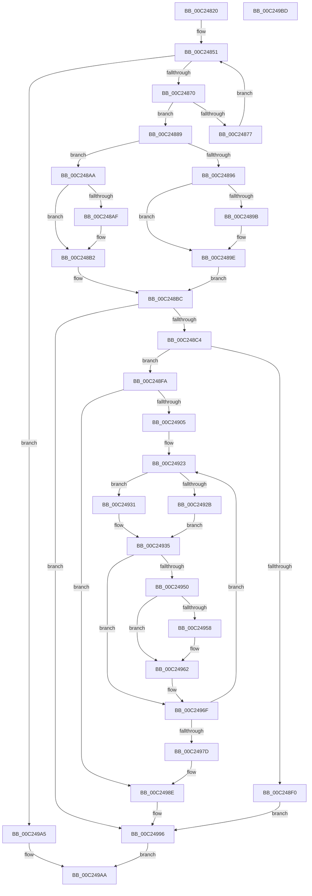

# HalpAuditQuerySlicAddresses

- RVA: `0x00C24820`–`0x00C249BE` (길이 `414` bytes)
- VA: `0x0000000140C24820`
- 실행 섹션: `INIT`
- PDB 이름 있음: `예`; PDB Function 태그: `아니요`
- unwind 정보 RVA: `0x000A315C`
- 디코드: `123`개 명령, `414/414` bytes 표시
- 미해석 바이트: `0` (있으면 어셈블리에 `.byte`로 보존)

> 이 문서는 커널 이미지의 기계어와 PDB 기호를 분석해 생성했습니다. 4번과 5번은 함수 원형과 자료형을 바이너리 사용 방식에서 추정한 C 해석이며 원본 소스 복구 결과는 아닙니다.

## 1. Dependencies

- 직접 호출 지점: **6**; 고유 호출 대상: **3**
- 직접 호출자로 확인된 함수: **1**
- RIP 상대 이미지 참조: **0**

### Outgoing calls
- `0x00C2485F` → [MmMapIoSpaceEx](../../text/32/MmMapIoSpaceEx_function_00327830.md) (function, `0x00327830`)
- `0x00C24880` → [MiUnmapContiguousMemory](../../text/3F/MiUnmapContiguousMemory_function_003F7908.md) (function, `0x003F7908`)
- `0x00C248E1` → [ExAllocatePool2](../../poolcode/B8/ExAllocatePool2_function_00B820F0.md) (function, `0x00B820F0`)
- `0x00C24943` → [MmMapIoSpaceEx](../../text/32/MmMapIoSpaceEx_function_00327830.md) (function, `0x00327830`)
- `0x00C2496A` → [MiUnmapContiguousMemory](../../text/3F/MiUnmapContiguousMemory_function_003F7908.md) (function, `0x003F7908`)
- `0x00C2499E` → [MiUnmapContiguousMemory](../../text/3F/MiUnmapContiguousMemory_function_003F7908.md) (function, `0x003F7908`)

### Direct callers
- [HalpAuditAcpiTables](HalpAuditAcpiTables_function_00C244D4.md) at `0x00C24521`

### Static image references
- 디코드된 RIP-relative 메모리 참조가 없습니다.

## 2. Other-region calls and transfers

- 다른 실행 섹션으로 향하는 call: **6**
  - `0x00C2485F` → [MmMapIoSpaceEx](../../text/32/MmMapIoSpaceEx_function_00327830.md) (`INIT` → `.text`)
  - `0x00C24880` → [MiUnmapContiguousMemory](../../text/3F/MiUnmapContiguousMemory_function_003F7908.md) (`INIT` → `.text`)
  - `0x00C248E1` → [ExAllocatePool2](../../poolcode/B8/ExAllocatePool2_function_00B820F0.md) (`INIT` → `POOLCODE`)
  - `0x00C24943` → [MmMapIoSpaceEx](../../text/32/MmMapIoSpaceEx_function_00327830.md) (`INIT` → `.text`)
  - `0x00C2496A` → [MiUnmapContiguousMemory](../../text/3F/MiUnmapContiguousMemory_function_003F7908.md) (`INIT` → `.text`)
  - `0x00C2499E` → [MiUnmapContiguousMemory](../../text/3F/MiUnmapContiguousMemory_function_003F7908.md) (`INIT` → `.text`)
- 별도 외부 분기/꼬리 이동을 확인하지 못했습니다.

## 3. Assembly (complete function range)

```asm
00C24820  40 53                           push rbx
00C24822  55                              push rbp
00C24823  56                              push rsi
00C24824  57                              push rdi
00C24825  41 54                           push r12
00C24827  41 55                           push r13
00C24829  41 56                           push r14
00C2482B  41 57                           push r15
00C2482D  48 83 EC 28                     sub rsp, 0x28
00C24831  8B 01                           mov eax, dword ptr [rcx]
00C24833  41 BC 24 00 00 00               mov r12d, 0x24
00C24839  25 FF 0F 00 00                  and eax, 0xfff
00C2483E  BF 00 10 00 00                  mov edi, 0x1000
00C24843  2B F8                           sub edi, eax
00C24845  4C 8B F1                        mov r14, rcx
00C24848  41 3B FC                        cmp edi, r12d
00C2484B  41 0F 42 FC                     cmovb edi, r12d
00C2484F  33 ED                           xor ebp, ebp
00C24851  49 8B 0E                        mov rcx, qword ptr [r14]
00C24854  41 B8 04 02 00 00               mov r8d, 0x204
00C2485A  8B D7                           mov edx, edi
00C2485C  44 8B FF                        mov r15d, edi
00C2485F  E8 CC 2F 70 FF                  call 0x140327830
00C24864  48 8B F0                        mov rsi, rax
00C24867  48 85 C0                        test rax, rax
00C2486A  0F 84 35 01 00 00               je 0x140c249a5
00C24870  8B 58 04                        mov ebx, dword ptr [rax + 4]
00C24873  3B FB                           cmp edi, ebx
00C24875  73 12                           jae 0x140c24889
00C24877  41 B0 01                        mov r8b, 1
00C2487A  41 8B D7                        mov edx, r15d
00C2487D  48 8B C8                        mov rcx, rax
00C24880  E8 83 30 7D FF                  call 0x1403f7908
00C24885  8B FB                           mov edi, ebx
00C24887  EB C8                           jmp 0x140c24851
00C24889  8B 48 04                        mov ecx, dword ptr [rax + 4]
00C2488C  41 8B 46 0C                     mov eax, dword ptr [r14 + 0xc]
00C24890  A8 04                           test al, 4
00C24892  8B C1                           mov eax, ecx
00C24894  74 14                           je 0x140c248aa
00C24896  41 3B CC                        cmp ecx, r12d
00C24899  72 03                           jb 0x140c2489e
00C2489B  49 8B C4                        mov rax, r12
00C2489E  48 8B D9                        mov rbx, rcx
00C248A1  48 2B D8                        sub rbx, rax
00C248A4  48 C1 EB 03                     shr rbx, 3
00C248A8  EB 12                           jmp 0x140c248bc
00C248AA  41 3B CC                        cmp ecx, r12d
00C248AD  72 03                           jb 0x140c248b2
00C248AF  49 8B C4                        mov rax, r12
00C248B2  48 8B D9                        mov rbx, rcx
00C248B5  48 2B D8                        sub rbx, rax
00C248B8  48 C1 EB 02                     shr rbx, 2
00C248BC  85 DB                           test ebx, ebx
00C248BE  0F 84 D2 00 00 00               je 0x140c24996
00C248C4  8B C3                           mov eax, ebx
00C248C6  B9 00 01 00 00                  mov ecx, 0x100
00C248CB  41 B8 48 61 6C 41               mov r8d, 0x416c6148
00C248D1  48 89 84 24 80 00 00 00         mov qword ptr [rsp + 0x80], rax
00C248D9  48 8D 14 C5 00 00 00 00         lea rdx, [rax*8]
00C248E1  E8 0A D8 F5 FF                  call 0x140b820f0
00C248E6  48 89 44 24 78                  mov qword ptr [rsp + 0x78], rax
00C248EB  48 85 C0                        test rax, rax
00C248EE  75 0A                           jne 0x140c248fa
00C248F0  BD 17 00 00 C0                  mov ebp, 0xc0000017
00C248F5  E9 9C 00 00 00                  jmp 0x140c24996
00C248FA  44 8B FD                        mov r15d, ebp
00C248FD  85 DB                           test ebx, ebx
00C248FF  0F 84 89 00 00 00               je 0x140c2498e
00C24905  4C 8D 66 24                     lea r12, [rsi + 0x24]
00C24909  89 7C 24 70                     mov dword ptr [rsp + 0x70], edi
00C2490D  48 8B BC 24 80 00 00 00         mov rdi, qword ptr [rsp + 0x80]
00C24915  4D 8B EC                        mov r13, r12
00C24918  48 89 B4 24 88 00 00 00         mov qword ptr [rsp + 0x88], rsi
00C24920  48 8B F0                        mov rsi, rax
00C24923  41 8B 46 0C                     mov eax, dword ptr [r14 + 0xc]
00C24927  A8 04                           test al, 4
00C24929  74 06                           je 0x140c24931
00C2492B  49 8B 5D 00                     mov rbx, qword ptr [r13]
00C2492F  EB 04                           jmp 0x140c24935
00C24931  41 8B 1C 24                     mov ebx, dword ptr [r12]
00C24935  BA 24 00 00 00                  mov edx, 0x24
00C2493A  41 B8 04 02 00 00               mov r8d, 0x204
00C24940  48 8B CB                        mov rcx, rbx
00C24943  E8 E8 2E 70 FF                  call 0x140327830
00C24948  48 8B C8                        mov rcx, rax
00C2494B  48 85 C0                        test rax, rax
00C2494E  74 1F                           je 0x140c2496f
00C24950  81 38 53 4C 49 43               cmp dword ptr [rax], 0x43494c53
00C24956  75 0A                           jne 0x140c24962
00C24958  41 8B C7                        mov eax, r15d
00C2495B  41 FF C7                        inc r15d
00C2495E  48 89 1C C6                     mov qword ptr [rsi + rax*8], rbx
00C24962  41 B0 01                        mov r8b, 1
00C24965  BA 24 00 00 00                  mov edx, 0x24
00C2496A  E8 99 2F 7D FF                  call 0x1403f7908
00C2496F  49 83 C4 04                     add r12, 4
00C24973  49 83 C5 08                     add r13, 8
00C24977  48 83 EF 01                     sub rdi, 1
00C2497B  75 A6                           jne 0x140c24923
00C2497D  8B 7C 24 70                     mov edi, dword ptr [rsp + 0x70]
00C24981  48 8B B4 24 88 00 00 00         mov rsi, qword ptr [rsp + 0x88]
00C24989  48 8B 44 24 78                  mov rax, qword ptr [rsp + 0x78]
00C2498E  49 89 46 18                     mov qword ptr [r14 + 0x18], rax
00C24992  45 89 7E 10                     mov dword ptr [r14 + 0x10], r15d
00C24996  8B D7                           mov edx, edi
00C24998  41 B0 01                        mov r8b, 1
00C2499B  48 8B CE                        mov rcx, rsi
00C2499E  E8 65 2F 7D FF                  call 0x1403f7908
00C249A3  EB 05                           jmp 0x140c249aa
00C249A5  BD 01 00 00 C0                  mov ebp, 0xc0000001
00C249AA  8B C5                           mov eax, ebp
00C249AC  48 83 C4 28                     add rsp, 0x28
00C249B0  41 5F                           pop r15
00C249B2  41 5E                           pop r14
00C249B4  41 5D                           pop r13
00C249B6  41 5C                           pop r12
00C249B8  5F                              pop rdi
00C249B9  5E                              pop rsi
00C249BA  5D                              pop rbp
00C249BB  5B                              pop rbx
00C249BC  C3                              ret
00C249BD  CC                              int3
```

## 4. C-style interpretation (structured pseudocode)

```c
__int64 __fastcall HalpAuditQuerySlicAddresses(__int64 a1)
{
    __int64 result;
    __int64 v_r12;
    __int64 v_r13;
    __int64 v_r15;
    __int64 v_rbp;
    __int64 v_rbx;
    __int64 v_rdi;
    __int64 v_rsp;
    unsigned __int64 v_stack_p10;
    unsigned __int64 v_stack_p18;
    unsigned __int64 v_stack_p20;
    unsigned int v_stack_p8;

    v_rsp = (v_rsp) - (40);
    result = (unsigned int)(((unsigned int)(*(unsigned int *)(a1))) & (0xFFFULL));
    v_rdi = (unsigned int)(((unsigned int)(0x1000ULL)) - ((unsigned int)(result)));
    if (((unsigned int)(v_rdi)) < 36) { v_rdi = 36; }
    v_rbp = 0;
loc_00C24851:
    result = MmMapIoSpaceEx(*(unsigned __int64 *)(a1), (unsigned int)((unsigned int)(v_rdi)), 516, a4);
    if (result == 0) goto loc_00C249A5;
    if (((unsigned int)(v_rdi)) >= ((unsigned int)((unsigned int)(*(unsigned int *)(result + 4))))) goto loc_00C24889;
    result = MiUnmapContiguousMemory(result, (unsigned int)((unsigned int)((unsigned int)((unsigned int)(v_rdi)))), 1, a4);
    goto loc_00C24851;
loc_00C24889:
    if ((((unsigned __int8)((unsigned int)(*(unsigned int *)(a1 + 12)))) & (4)) == 0) goto loc_00C248AA;
    result = (unsigned int)((unsigned int)((unsigned int)(*(unsigned int *)(result + 4))));
    if (((unsigned int)((unsigned int)(*(unsigned int *)(result + 4)))) >= 36) {
        result = 36;
    }
    v_rbx = ((unsigned int)(*(unsigned int *)(result + 4))) - (result);
    v_rbx = (v_rbx) >> (3);
    goto loc_00C248BC;
loc_00C248AA:
    if (((unsigned int)((unsigned int)(*(unsigned int *)(result + 4)))) >= 36) {
        result = 36;
    }
    v_rbx = ((unsigned int)(*(unsigned int *)(result + 4))) - (result);
    v_rbx = (v_rbx) >> (2);
loc_00C248BC:
    if ((unsigned int)(v_rbx) == 0) goto loc_00C24996;
    v_stack_p18 = (unsigned int)((unsigned int)(v_rbx));
    result = ExAllocatePool2(256, (unsigned int)((unsigned int)(v_rbx)) * 8, (unsigned int)(0x416C6148ULL), a4);
    v_stack_p10 = result;
    if (result != 0) goto loc_00C248FA;
    goto loc_00C24996;
loc_00C248FA:
    if ((unsigned int)(v_rbx) == 0) goto loc_00C2498E;
    v_stack_p8 = (unsigned int)((unsigned int)((unsigned int)((unsigned int)(*(unsigned int *)(result + 4)))));
    v_stack_p20 = result;
loc_00C24923:
    if ((((unsigned __int8)((unsigned int)(*(unsigned int *)(a1 + 12)))) & (4)) == 0) goto loc_00C24931;
    goto loc_00C24935;
loc_00C24931:
loc_00C24935:
    result = MmMapIoSpaceEx((unsigned int)(*(unsigned int *)(result + 36)), 36, 516, a4);
    if (result == 0) goto loc_00C2496F;
    v_r15 = (unsigned int)((unsigned int)((unsigned int)(0xC0000017ULL)));
    if ((*(unsigned int *)(result)) == 0x43494C53ULL) {
        result = (unsigned int)((unsigned int)((unsigned int)((unsigned int)(0xC0000017ULL))));
        v_r15 = (unsigned int)(((unsigned int)((unsigned int)((unsigned int)(0xC0000017ULL)))) + 1);
        *(unsigned __int64 *)(result + result * 8) = (unsigned int)(*(unsigned int *)(result + 36));
    }
    result = MiUnmapContiguousMemory(result, 36, 1, a4);
loc_00C2496F:
    v_r12 = (result + 36) + (4);
    v_r13 = (result + 36) + (8);
    v_rdi = (v_stack_p18) - (1);
    if (condition_is_not_equal) goto loc_00C24923;
loc_00C2498E:
    *(unsigned __int64 *)(a1 + 24) = v_stack_p10;
    *(unsigned int *)(a1 + 16) = (unsigned int)(v_r15);
loc_00C24996:
    result = MiUnmapContiguousMemory(v_stack_p20, (unsigned int)((unsigned int)((unsigned int)(v_stack_p8))), 1, a4);
    goto loc_00C249AA;
loc_00C249A5:
loc_00C249AA:
    v_rsp = (v_rsp) + (40);
    return (unsigned int)((unsigned int)((unsigned int)(0xC0000001ULL)));
}
```

## 5. (Beta) C Style

```c
int64_t HalpAuditQuerySlicAddresses(void *Arg1)
{
    uint8_t *arg1 = (uint8_t *)Arg1;

    int64_t result;
    int64_t local_r12;
    int64_t local_r13;
    int64_t local_r15;
    int64_t local_rbp;
    int64_t local_rbx;
    int64_t local_rdi;
    int64_t local_rsp;
    uint64_t v_stack_p10;
    uint64_t v_stack_p18;
    uint64_t v_stack_p20;
    uint32_t v_stack_p8;

    local_rsp = (local_rsp) - (40);
    result = (uint32_t)(((uint32_t)(*(uint32_t *)(arg1))) & (0xFFFULL));
    local_rdi = (uint32_t)(((uint32_t)(0x1000ULL)) - ((uint32_t)(result)));
    if (((uint32_t)(local_rdi)) < 36) { local_rdi = 36; }
    local_rbp = 0;
loc_00C24851:
    result = MmMapIoSpaceEx(*(uint64_t *)(arg1), (uint32_t)((uint32_t)(local_rdi)), 516, a4);
    if (result == 0) goto loc_00C249A5;
    if (((uint32_t)(local_rdi)) >= ((uint32_t)((uint32_t)(*(uint32_t *)(result + 0x4))))) goto loc_00C24889;
    result = MiUnmapContiguousMemory(result, (uint32_t)((uint32_t)((uint32_t)((uint32_t)(local_rdi)))), 1, a4);
    goto loc_00C24851;
loc_00C24889:
    if ((((uint8_t)((uint32_t)(*(uint32_t *)(arg1 + 0xC)))) & (4)) == 0) goto loc_00C248AA;
    result = (uint32_t)((uint32_t)((uint32_t)(*(uint32_t *)(result + 0x4))));
    if (((uint32_t)((uint32_t)(*(uint32_t *)(result + 0x4)))) >= 36) {
        result = 36;
    }
    local_rbx = ((uint32_t)(*(uint32_t *)(result + 0x4))) - (result);
    local_rbx = (local_rbx) >> (3);
    goto loc_00C248BC;
loc_00C248AA:
    if (((uint32_t)((uint32_t)(*(uint32_t *)(result + 0x4)))) >= 36) {
        result = 36;
    }
    local_rbx = ((uint32_t)(*(uint32_t *)(result + 0x4))) - (result);
    local_rbx = (local_rbx) >> (2);
loc_00C248BC:
    if ((uint32_t)(local_rbx) == 0) goto loc_00C24996;
    v_stack_p18 = (uint32_t)((uint32_t)(local_rbx));
    result = ExAllocatePool2(256, (uint32_t)((uint32_t)(local_rbx)) * 8, (uint32_t)(0x416C6148ULL), a4);
    v_stack_p10 = result;
    if (result != 0) goto loc_00C248FA;
    goto loc_00C24996;
loc_00C248FA:
    if ((uint32_t)(local_rbx) == 0) goto loc_00C2498E;
    v_stack_p8 = (uint32_t)((uint32_t)((uint32_t)((uint32_t)(*(uint32_t *)(result + 0x4)))));
    v_stack_p20 = result;
loc_00C24923:
    if ((((uint8_t)((uint32_t)(*(uint32_t *)(arg1 + 0xC)))) & (4)) == 0) goto loc_00C24931;
    goto loc_00C24935;
loc_00C24931:
loc_00C24935:
    result = MmMapIoSpaceEx((uint32_t)(*(uint32_t *)(result + 0x24)), 36, 516, a4);
    if (result == 0) goto loc_00C2496F;
    local_r15 = (uint32_t)((uint32_t)((uint32_t)(0xC0000017ULL)));
    if ((*(uint32_t *)(result)) == 0x43494C53ULL) {
        result = (uint32_t)((uint32_t)((uint32_t)((uint32_t)(0xC0000017ULL))));
        local_r15 = (uint32_t)(((uint32_t)((uint32_t)((uint32_t)(0xC0000017ULL)))) + 1);
        *(uint64_t *)(result + result * 8) = (uint32_t)(*(uint32_t *)(result + 0x24));
    }
    result = MiUnmapContiguousMemory(result, 36, 1, a4);
loc_00C2496F:
    local_r12 = (result + 36) + (4);
    local_r13 = (result + 36) + (8);
    local_rdi = (v_stack_p18) - (1);
    if (condition_is_not_equal) goto loc_00C24923;
loc_00C2498E:
    *(uint64_t *)(arg1 + 0x18) = v_stack_p10;
    *(uint32_t *)(arg1 + 0x10) = (uint32_t)(local_r15);
loc_00C24996:
    result = MiUnmapContiguousMemory(v_stack_p20, (uint32_t)((uint32_t)((uint32_t)(v_stack_p8))), 1, a4);
    goto loc_00C249AA;
loc_00C249A5:
loc_00C249AA:
    local_rsp = (local_rsp) + (40);
    return (uint32_t)((uint32_t)((uint32_t)(0xC0000001ULL)));
}
```

### 관측된 메모리 오프셋

구조체 형식이 확인되지 않은 접근은 인자 기준의 오프셋으로만 기록했습니다.

| 기준 인자 | 오프셋 표현 | 폭 (bit) | 접근 |
|---|---:|---:|---|
| `Arg1` | `+ 0x0` | `32` | `R` |
| `Arg1` | `+ 0x0` | `64` | `R` |
| `Arg1` | `+ 0xC` | `32` | `R` |
| `Arg1` | `+ 0x10` | `32` | `W` |
| `Arg1` | `+ 0x18` | `64` | `W` |

## 6. Execution-region graph

[열기: 2D/3D 그래프와 함수 탐색 컨트롤 패널](../../../control-panel.html?section=init&rva=0x00C24820&view=graph)

- 2D 그래프는 위에서 아래로 흐르고, 3D 그래프는 빈 공간을 드래그해 회전합니다. Shift+드래그는 이동, 휠은 확대·축소, 함수 노드 선택은 대상 보고서 이동입니다.

### Static fallback


