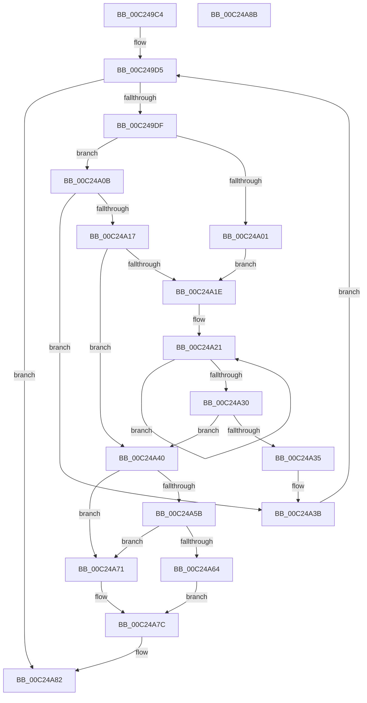

# HalpAuditSelectRsdtOrXsdt

- RVA: `0x00C249C4`–`0x00C24A8C` (길이 `200` bytes)
- VA: `0x0000000140C249C4`
- 실행 섹션: `INIT`
- PDB 이름 있음: `예`; PDB Function 태그: `아니요`
- unwind 정보 RVA: `0x00071750`
- 디코드: `63`개 명령, `200/200` bytes 표시
- 미해석 바이트: `0` (있으면 어셈블리에 `.byte`로 보존)

> 이 문서는 커널 이미지의 기계어와 PDB 기호를 분석해 생성했습니다. 4번과 5번은 함수 원형과 자료형을 바이너리 사용 방식에서 추정한 C 해석이며 원본 소스 복구 결과는 아닙니다.

## 1. Dependencies

- 직접 호출 지점: **0**; 고유 호출 대상: **0**
- 직접 호출자로 확인된 함수: **1**
- RIP 상대 이미지 참조: **0**

### Outgoing calls
- 직접 디코드된 call 명령이 없습니다.

### Direct callers
- [HalpAuditEnumerateRsdtsInRange](HalpAuditEnumerateRsdtsInRange_function_00C2472C.md) at `0x00C247BB`

### Static image references
- 디코드된 RIP-relative 메모리 참조가 없습니다.

## 2. Other-region calls and transfers

- 다른 실행 섹션으로 향하는 call: **0**
- 별도 외부 분기/꼬리 이동을 확인하지 못했습니다.

## 3. Assembly (complete function range)

```asm
00C249C4  48 89 5C 24 08                  mov qword ptr [rsp + 8], rbx
00C249C9  4C 8B C1                        mov r8, rcx
00C249CC  41 B9 19 00 14 C0               mov r9d, 0xc0140019
00C249D2  45 33 DB                        xor r11d, r11d
00C249D5  41 83 FB 02                     cmp r11d, 2
00C249D9  0F 83 A3 00 00 00               jae 0x140c24a82
00C249DF  41 8B C3                        mov eax, r11d
00C249E2  F7 D8                           neg eax
00C249E4  41 0F B6 40 0F                  movzx eax, byte ptr [r8 + 0xf]
00C249E9  45 1B D2                        sbb r10d, r10d
00C249EC  41 F7 D2                        not r10d
00C249EF  41 83 E2 02                     and r10d, 2
00C249F3  41 3B C2                        cmp eax, r10d
00C249F6  41 8B CA                        mov ecx, r10d
00C249F9  0F 42 C8                        cmovb ecx, eax
00C249FC  83 F9 02                        cmp ecx, 2
00C249FF  73 0A                           jae 0x140c24a0b
00C24A01  B9 14 00 00 00                  mov ecx, 0x14
00C24A06  45 33 C9                        xor r9d, r9d
00C24A09  EB 13                           jmp 0x140c24a1e
00C24A0B  41 8B 48 14                     mov ecx, dword ptr [r8 + 0x14]
00C24A0F  8D 41 DF                        lea eax, [rcx - 0x21]
00C24A12  83 F8 63                        cmp eax, 0x63
00C24A15  77 24                           ja 0x140c24a3b
00C24A17  45 33 C9                        xor r9d, r9d
00C24A1A  85 C9                           test ecx, ecx
00C24A1C  74 22                           je 0x140c24a40
00C24A1E  49 8B D8                        mov rbx, r8
00C24A21  0F B6 03                        movzx eax, byte ptr [rbx]
00C24A24  48 FF C3                        inc rbx
00C24A27  4C 03 C8                        add r9, rax
00C24A2A  48 83 E9 01                     sub rcx, 1
00C24A2E  75 F1                           jne 0x140c24a21
00C24A30  45 84 C9                        test r9b, r9b
00C24A33  74 0B                           je 0x140c24a40
00C24A35  41 B9 01 00 00 C0               mov r9d, 0xc0000001
00C24A3B  41 FF C3                        inc r11d
00C24A3E  EB 95                           jmp 0x140c249d5
00C24A40  8B 4A 0C                        mov ecx, dword ptr [rdx + 0xc]
00C24A43  83 C9 02                        or ecx, 2
00C24A46  89 4A 0C                        mov dword ptr [rdx + 0xc], ecx
00C24A49  41 0F B6 40 0F                  movzx eax, byte ptr [r8 + 0xf]
00C24A4E  41 3B C2                        cmp eax, r10d
00C24A51  44 0F 42 D0                     cmovb r10d, eax
00C24A55  41 83 FA 02                     cmp r10d, 2
00C24A59  72 16                           jb 0x140c24a71
00C24A5B  49 8B 40 18                     mov rax, qword ptr [r8 + 0x18]
00C24A5F  48 85 C0                        test rax, rax
00C24A62  74 0D                           je 0x140c24a71
00C24A64  83 C9 04                        or ecx, 4
00C24A67  48 89 02                        mov qword ptr [rdx], rax
00C24A6A  89 4A 0C                        mov dword ptr [rdx + 0xc], ecx
00C24A6D  33 C0                           xor eax, eax
00C24A6F  EB 0B                           jmp 0x140c24a7c
00C24A71  41 8B 40 10                     mov eax, dword ptr [r8 + 0x10]
00C24A75  48 89 02                        mov qword ptr [rdx], rax
00C24A78  41 8B 40 14                     mov eax, dword ptr [r8 + 0x14]
00C24A7C  89 42 08                        mov dword ptr [rdx + 8], eax
00C24A7F  45 33 C9                        xor r9d, r9d
00C24A82  48 8B 5C 24 08                  mov rbx, qword ptr [rsp + 8]
00C24A87  41 8B C1                        mov eax, r9d
00C24A8A  C3                              ret
00C24A8B  CC                              int3
```

## 4. C-style interpretation (structured pseudocode)

```c
__int64 __fastcall HalpAuditSelectRsdtOrXsdt(__int64 a1, __int64 a2)
{
    __int64 result;
    __int64 v_r10;
    __int64 v_r11;
    __int64 v_rbx;
    unsigned __int64 v_stack_p8;

    v_stack_p8 = v_rbx;
    v_r11 = 0;
loc_00C249D5:
    if (0 >= 2) goto loc_00C24A82;
    result = (unsigned int)(-(0));
    v_r10 = (unsigned int)(~(v_r10));
    v_r10 = (unsigned int)((v_r10) & (2));
    a1 = (unsigned int)((unsigned int)(v_r10));
    if (((unsigned int)(*(unsigned __int8 *)(a1 + 15))) < ((unsigned int)(v_r10))) { a1 = (unsigned int)(*(unsigned __int8 *)(a1 + 15)); }
    if (((unsigned int)(a1)) >= 2) goto loc_00C24A0B;
    a4 = 0;
    goto loc_00C24A1E;
loc_00C24A0B:
    if (((unsigned int)((unsigned int)(*(unsigned int *)(a1 + 20)) - 33)) > 99) goto loc_00C24A3B;
    a4 = 0;
    if ((unsigned int)((unsigned int)(*(unsigned int *)(a1 + 20))) == 0) goto loc_00C24A40;
loc_00C24A1E:
loc_00C24A21:
    v_rbx = (a1) + 1;
    a4 = (a4) + (*(unsigned __int8 *)(a1));
    a1 = ((unsigned int)(*(unsigned int *)(a1 + 20))) - (1);
    if (condition_is_not_equal) goto loc_00C24A21;
    if ((unsigned __int8)(a4) == 0) goto loc_00C24A40;
loc_00C24A3B:
    v_r11 = (unsigned int)((v_r11) + 1);
    goto loc_00C249D5;
loc_00C24A40:
    a1 = (unsigned int)(((unsigned int)(*(unsigned int *)(a2 + 12))) | (2));
    *(unsigned int *)(a2 + 12) = (unsigned int)(a1);
    if (((unsigned int)(*(unsigned __int8 *)(a1 + 15))) < ((unsigned int)(v_r10))) { v_r10 = (unsigned int)(*(unsigned __int8 *)(a1 + 15)); }
    if (((unsigned int)(v_r10)) < 2) goto loc_00C24A71;
    if (*(unsigned __int64 *)(a1 + 24) == 0) goto loc_00C24A71;
    a1 = (unsigned int)((a1) | (4));
    *(unsigned __int64 *)(a2) = *(unsigned __int64 *)(a1 + 24);
    *(unsigned int *)(a2 + 12) = (unsigned int)(a1);
    result = 0;
    goto loc_00C24A7C;
loc_00C24A71:
    *(unsigned __int64 *)(a2) = (unsigned int)(*(unsigned int *)(a1 + 16));
loc_00C24A7C:
    *(unsigned int *)(a2 + 8) = (unsigned int)((unsigned int)(*(unsigned int *)(a1 + 20)));
    a4 = 0;
loc_00C24A82:
    return 0;
}
```

## 5. (Beta) C Style

```c
int64_t HalpAuditSelectRsdtOrXsdt(void *Arg1, void *Arg2)
{
    uint8_t *arg1 = (uint8_t *)Arg1;
    uint8_t *arg2 = (uint8_t *)Arg2;

    int64_t result;
    int64_t local_r10;
    int64_t local_r11;
    int64_t local_rbx;
    uint64_t v_stack_p8;

    v_stack_p8 = local_rbx;
    local_r11 = 0;
loc_00C249D5:
    if (0 >= 2) goto loc_00C24A82;
    result = (uint32_t)(-(0));
    local_r10 = (uint32_t)(~(local_r10));
    local_r10 = (uint32_t)((local_r10) & (2));
    Arg1 = (uint32_t)((uint32_t)(local_r10));
    if (((uint32_t)(*(uint8_t *)(arg1 + 0xF))) < ((uint32_t)(local_r10))) { Arg1 = (uint32_t)(*(uint8_t *)(arg1 + 0xF)); }
    if (((uint32_t)(Arg1)) >= 2) goto loc_00C24A0B;
    a4 = 0;
    goto loc_00C24A1E;
loc_00C24A0B:
    if (((uint32_t)((uint32_t)(*(uint32_t *)(arg1 + 0x14)) - 33)) > 99) goto loc_00C24A3B;
    a4 = 0;
    if ((uint32_t)((uint32_t)(*(uint32_t *)(arg1 + 0x14))) == 0) goto loc_00C24A40;
loc_00C24A1E:
loc_00C24A21:
    local_rbx = (Arg1) + 1;
    a4 = (a4) + (*(uint8_t *)(arg1));
    Arg1 = ((uint32_t)(*(uint32_t *)(arg1 + 0x14))) - (1);
    if (condition_is_not_equal) goto loc_00C24A21;
    if ((uint8_t)(a4) == 0) goto loc_00C24A40;
loc_00C24A3B:
    local_r11 = (uint32_t)((local_r11) + 1);
    goto loc_00C249D5;
loc_00C24A40:
    Arg1 = (uint32_t)(((uint32_t)(*(uint32_t *)(arg2 + 0xC))) | (2));
    *(uint32_t *)(arg2 + 0xC) = (uint32_t)(Arg1);
    if (((uint32_t)(*(uint8_t *)(arg1 + 0xF))) < ((uint32_t)(local_r10))) { local_r10 = (uint32_t)(*(uint8_t *)(arg1 + 0xF)); }
    if (((uint32_t)(local_r10)) < 2) goto loc_00C24A71;
    if (*(uint64_t *)(arg1 + 0x18) == 0) goto loc_00C24A71;
    Arg1 = (uint32_t)((Arg1) | (4));
    *(uint64_t *)(arg2) = *(uint64_t *)(arg1 + 0x18);
    *(uint32_t *)(arg2 + 0xC) = (uint32_t)(Arg1);
    result = 0;
    goto loc_00C24A7C;
loc_00C24A71:
    *(uint64_t *)(arg2) = (uint32_t)(*(uint32_t *)(arg1 + 0x10));
loc_00C24A7C:
    *(uint32_t *)(arg2 + 0x8) = (uint32_t)((uint32_t)(*(uint32_t *)(arg1 + 0x14)));
    a4 = 0;
loc_00C24A82:
    return 0;
}
```

### 관측된 메모리 오프셋

구조체 형식이 확인되지 않은 접근은 인자 기준의 오프셋으로만 기록했습니다.

| 기준 인자 | 오프셋 표현 | 폭 (bit) | 접근 |
|---|---:|---:|---|
| `Arg1` | `+ 0xF` | `8` | `R` |
| `Arg1` | `+ 0x10` | `32` | `R` |
| `Arg1` | `+ 0x14` | `32` | `R` |
| `Arg1` | `+ 0x18` | `64` | `R` |
| `Arg2` | `+ 0x0` | `64` | `W` |
| `Arg2` | `+ 0x8` | `32` | `W` |
| `Arg2` | `+ 0xC` | `32` | `R` |
| `Arg2` | `+ 0xC` | `32` | `W` |

## 6. Execution-region graph

[열기: 2D/3D 그래프와 함수 탐색 컨트롤 패널](../../../control-panel.html?section=init&rva=0x00C249C4&view=graph)

- 2D 그래프는 위에서 아래로 흐르고, 3D 그래프는 빈 공간을 드래그해 회전합니다. Shift+드래그는 이동, 휠은 확대·축소, 함수 노드 선택은 대상 보고서 이동입니다.

### Static fallback


