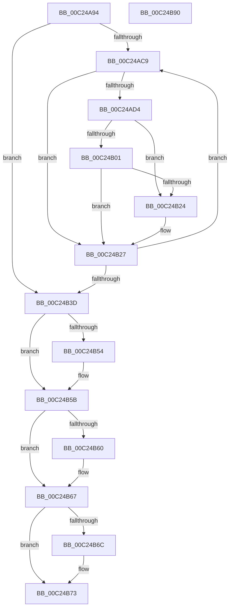

# HalpAuditSlicTables

- RVA: `0x00C24A94`–`0x00C24B91` (길이 `253` bytes)
- VA: `0x0000000140C24A94`
- 실행 섹션: `INIT`
- PDB 이름 있음: `예`; PDB Function 태그: `아니요`
- unwind 정보 RVA: `0x00075C18`
- 디코드: `73`개 명령, `253/253` bytes 표시
- 미해석 바이트: `0` (있으면 어셈블리에 `.byte`로 보존)

> 이 문서는 커널 이미지의 기계어와 PDB 기호를 분석해 생성했습니다. 4번과 5번은 함수 원형과 자료형을 바이너리 사용 방식에서 추정한 C 해석이며 원본 소스 복구 결과는 아닙니다.

## 1. Dependencies

- 직접 호출 지점: **1**; 고유 호출 대상: **1**
- 직접 호출자로 확인된 함수: **1**
- RIP 상대 이미지 참조: **2**

### Outgoing calls
- `0x00C24B14` → [RtlCompareMemory](../../text/6B/RtlCompareMemory_function_006BA670.md) (function, `0x006BA670`)

### Direct callers
- [HalpAuditAcpiTables](HalpAuditAcpiTables_function_00C244D4.md) at `0x00C24536`

### Static image references
- `0x00C24B3F` → RVA `0x00F8FB78` (`.data`; write)
- `0x00C24B54` → RVA `0x00F8FB7C` (`.data`; read/write)

## 2. Other-region calls and transfers

- 다른 실행 섹션으로 향하는 call: **1**
  - `0x00C24B14` → [RtlCompareMemory](../../text/6B/RtlCompareMemory_function_006BA670.md) (`INIT` → `.text`)
- 별도 외부 분기/꼬리 이동을 확인하지 못했습니다.

## 3. Assembly (complete function range)

```asm
00C24A94  48 89 5C 24 08                  mov qword ptr [rsp + 8], rbx
00C24A99  48 89 6C 24 10                  mov qword ptr [rsp + 0x10], rbp
00C24A9E  48 89 74 24 18                  mov qword ptr [rsp + 0x18], rsi
00C24AA3  57                              push rdi
00C24AA4  41 54                           push r12
00C24AA6  41 55                           push r13
00C24AA8  41 56                           push r14
00C24AAA  41 57                           push r15
00C24AAC  48 83 EC 20                     sub rsp, 0x20
00C24AB0  40 32 ED                        xor bpl, bpl
00C24AB3  45 32 E4                        xor r12b, r12b
00C24AB6  33 F6                           xor esi, esi
00C24AB8  41 B8 01 00 00 00               mov r8d, 1
00C24ABE  48 8B F9                        mov rdi, rcx
00C24AC1  45 8A F8                        mov r15b, r8b
00C24AC4  39 71 04                        cmp dword ptr [rcx + 4], esi
00C24AC7  76 74                           jbe 0x140c24b3d
00C24AC9  44 8B F6                        mov r14d, esi
00C24ACC  49 C1 E6 05                     shl r14, 5
00C24AD0  85 F6                           test esi, esi
00C24AD2  74 53                           je 0x140c24b27
00C24AD4  33 D2                           xor edx, edx
00C24AD6  41 0F B6 CF                     movzx ecx, r15b
00C24ADA  44 8D 4E FF                     lea r9d, [rsi - 1]
00C24ADE  49 C1 E1 05                     shl r9, 5
00C24AE2  49 8B 44 39 08                  mov rax, qword ptr [r9 + rdi + 8]
00C24AE7  49 39 44 3E 08                  cmp qword ptr [r14 + rdi + 8], rax
00C24AEC  41 8B 44 3E 18                  mov eax, dword ptr [r14 + rdi + 0x18]
00C24AF1  0F 44 D1                        cmove edx, ecx
00C24AF4  44 8A FA                        mov r15b, dl
00C24AF7  44 8A EA                        mov r13b, dl
00C24AFA  41 3B 44 39 18                  cmp eax, dword ptr [r9 + rdi + 0x18]
00C24AFF  75 23                           jne 0x140c24b24
00C24B01  49 8B 54 39 20                  mov rdx, qword ptr [r9 + rdi + 0x20]
00C24B06  8B D8                           mov ebx, eax
00C24B08  49 8B 4C 3E 20                  mov rcx, qword ptr [r14 + rdi + 0x20]
00C24B0D  48 C1 E3 03                     shl rbx, 3
00C24B11  4C 8B C3                        mov r8, rbx
00C24B14  E8 57 5B A9 FF                  call 0x1406ba670
00C24B19  41 B8 01 00 00 00               mov r8d, 1
00C24B1F  48 3B C3                        cmp rax, rbx
00C24B22  74 03                           je 0x140c24b27
00C24B24  45 8A E0                        mov r12b, r8b
00C24B27  41 83 7C 3E 18 00               cmp dword ptr [r14 + rdi + 0x18], 0
00C24B2D  40 0F B6 ED                     movzx ebp, bpl
00C24B31  41 0F 47 E8                     cmova ebp, r8d
00C24B35  41 03 F0                        add esi, r8d
00C24B38  3B 77 04                        cmp esi, dword ptr [rdi + 4]
00C24B3B  72 8C                           jb 0x140c24ac9
00C24B3D  33 C0                           xor eax, eax
00C24B3F  48 89 05 32 B0 36 00            mov qword ptr [rip + 0x36b032], rax
00C24B46  8B 47 04                        mov eax, dword ptr [rdi + 4]
00C24B49  89 05 29 B0 36 00               mov dword ptr [rip + 0x36b029], eax
00C24B4F  45 84 FF                        test r15b, r15b
00C24B52  74 07                           je 0x140c24b5b
00C24B54  44 09 05 21 B0 36 00            or dword ptr [rip + 0x36b021], r8d
00C24B5B  40 84 ED                        test bpl, bpl
00C24B5E  74 07                           je 0x140c24b67
00C24B60  83 0D 15 B0 36 00 02            or dword ptr [rip + 0x36b015], 2
00C24B67  45 84 E4                        test r12b, r12b
00C24B6A  74 07                           je 0x140c24b73
00C24B6C  83 0D 09 B0 36 00 04            or dword ptr [rip + 0x36b009], 4
00C24B73  48 8B 5C 24 50                  mov rbx, qword ptr [rsp + 0x50]
00C24B78  48 8B 6C 24 58                  mov rbp, qword ptr [rsp + 0x58]
00C24B7D  48 8B 74 24 60                  mov rsi, qword ptr [rsp + 0x60]
00C24B82  48 83 C4 20                     add rsp, 0x20
00C24B86  41 5F                           pop r15
00C24B88  41 5E                           pop r14
00C24B8A  41 5D                           pop r13
00C24B8C  41 5C                           pop r12
00C24B8E  5F                              pop rdi
00C24B8F  C3                              ret
00C24B90  CC                              int3
```

## 4. C-style interpretation (structured pseudocode)

```c
__int64 __fastcall HalpAuditSlicTables(__int64 a1, int a2)
{
    __int64 result;
    __int64 v_r12;
    __int64 v_r14;
    __int64 v_rbp;
    __int64 v_rbx;
    __int64 v_rsi;
    __int64 v_rsp;
    unsigned __int64 v_stack_p10;
    unsigned __int64 v_stack_p18;
    unsigned __int64 v_stack_p8;

    v_stack_p8 = v_rbx;
    v_stack_p10 = v_rbp;
    v_stack_p18 = v_rsi;
    v_rsp = (v_rsp) - (32);
    v_rbp = 0;
    v_r12 = 0;
    v_rsi = 0;
    if ((*(unsigned int *)(a1 + 4)) <= 0) goto loc_00C24B3D;
loc_00C24AC9:
    v_r14 = (0) << (5);
    if (0 == 0) goto loc_00C24B27;
    a2 = 0;
    a4 = (v_rsi - 1) << (5);
    if ((*(unsigned __int64 *)(v_r14 + a1 * 1 + 8)) == (*(unsigned __int64 *)(a4 + a1 * 1 + 8))) { a2 = 1; }
    if (((unsigned int)((unsigned int)(*(unsigned int *)(v_r14 + a1 * 1 + 24)))) != (*(unsigned int *)(a4 + a1 * 1 + 24))) goto loc_00C24B24;
    v_rbx = ((unsigned int)((unsigned int)((unsigned int)(*(unsigned int *)(v_r14 + a1 * 1 + 24))))) << (3);
    result = RtlCompareMemory(*(unsigned __int64 *)(v_r14 + a1 * 1 + 32), *(unsigned __int64 *)(a4 + a1 * 1 + 32), v_rbx, a4);
    if (result != v_rbx) {
        v_r12 = 1;
    }
    v_rbp = 0;
    if ((*(unsigned int *)(v_r14 + a1 * 1 + 24)) > 0) { v_rbp = 1; }
    v_rsi = (unsigned int)((v_rsi) + (1));
    if (((unsigned int)(v_rsi)) < (*(unsigned int *)(a1 + 4))) goto loc_00C24AC9;
loc_00C24B3D:
    result = 0;
    *(unsigned __int64 *)(v_rip + 3584050) = 0;
    *(unsigned int *)(v_rip + 3584041) = (unsigned int)((unsigned int)(*(unsigned int *)(a1 + 4)));
    if ((unsigned __int8)((unsigned __int8)(a2)) != 0) {
    }
    if ((unsigned __int8)(v_rbp) != 0) {
    }
    if ((unsigned __int8)(v_r12) != 0) {
    }
    v_rsp = (v_rsp) + (32);
    return (unsigned int)(*(unsigned int *)(a1 + 4));
}
```

## 5. (Beta) C Style

```c
int64_t HalpAuditSlicTables(void *Arg1, int32_t Arg2)
{
    uint8_t *arg1 = (uint8_t *)Arg1;

    int64_t result;
    int64_t local_r12;
    int64_t local_r14;
    int64_t local_rbp;
    int64_t local_rbx;
    int64_t local_rsi;
    int64_t local_rsp;
    uint64_t v_stack_p10;
    uint64_t v_stack_p18;
    uint64_t v_stack_p8;

    v_stack_p8 = local_rbx;
    v_stack_p10 = local_rbp;
    v_stack_p18 = local_rsi;
    local_rsp = (local_rsp) - (32);
    local_rbp = 0;
    local_r12 = 0;
    local_rsi = 0;
    if ((*(uint32_t *)(arg1 + 0x4)) <= 0) goto loc_00C24B3D;
loc_00C24AC9:
    local_r14 = (0) << (5);
    if (0 == 0) goto loc_00C24B27;
    Arg2 = 0;
    a4 = (local_rsi - 1) << (5);
    if ((*(uint64_t *)(local_r14 + arg1 * 1 + 0x8)) == (*(uint64_t *)(a4 + arg1 * 1 + 0x8))) { Arg2 = 1; }
    if (((uint32_t)((uint32_t)(*(uint32_t *)(local_r14 + arg1 * 1 + 0x18)))) != (*(uint32_t *)(a4 + arg1 * 1 + 0x18))) goto loc_00C24B24;
    local_rbx = ((uint32_t)((uint32_t)((uint32_t)(*(uint32_t *)(local_r14 + arg1 * 1 + 0x18))))) << (3);
    result = RtlCompareMemory(*(uint64_t *)(local_r14 + arg1 * 1 + 0x20), *(uint64_t *)(a4 + arg1 * 1 + 0x20), local_rbx, a4);
    if (result != local_rbx) {
        local_r12 = 1;
    }
    local_rbp = 0;
    if ((*(uint32_t *)(local_r14 + arg1 * 1 + 0x18)) > 0) { local_rbp = 1; }
    local_rsi = (uint32_t)((local_rsi) + (1));
    if (((uint32_t)(local_rsi)) < (*(uint32_t *)(arg1 + 0x4))) goto loc_00C24AC9;
loc_00C24B3D:
    result = 0;
    *(uint64_t *)(v_rip + 0x36B032) = 0;
    *(uint32_t *)(v_rip + 0x36B029) = (uint32_t)((uint32_t)(*(uint32_t *)(arg1 + 0x4)));
    if ((uint8_t)((uint8_t)(Arg2)) != 0) {
    }
    if ((uint8_t)(local_rbp) != 0) {
    }
    if ((uint8_t)(local_r12) != 0) {
    }
    local_rsp = (local_rsp) + (32);
    return (uint32_t)(*(uint32_t *)(arg1 + 0x4));
}
```

### 관측된 메모리 오프셋

구조체 형식이 확인되지 않은 접근은 인자 기준의 오프셋으로만 기록했습니다.

| 기준 인자 | 오프셋 표현 | 폭 (bit) | 접근 |
|---|---:|---:|---|
| `Arg1` | `+ 0x4` | `32` | `R` |

## 6. Execution-region graph

[열기: 2D/3D 그래프와 함수 탐색 컨트롤 패널](../../../control-panel.html?section=init&rva=0x00C24A94&view=graph)

- 2D 그래프는 위에서 아래로 흐르고, 3D 그래프는 빈 공간을 드래그해 회전합니다. Shift+드래그는 이동, 휠은 확대·축소, 함수 노드 선택은 대상 보고서 이동입니다.

### Static fallback


