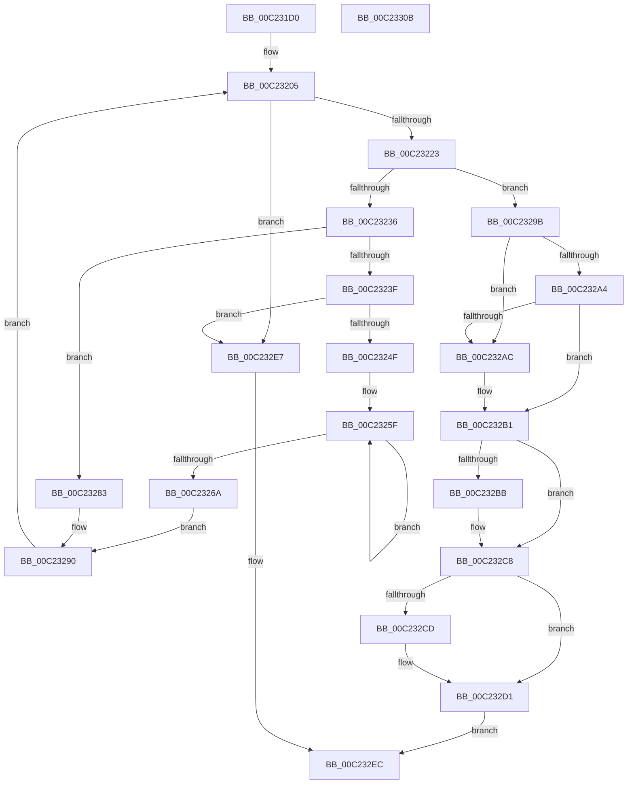

# HalpBlkAddVirtualMapping

- RVA: `0x00C231D0`–`0x00C2330C` (길이 `316` bytes)
- VA: `0x0000000140C231D0`
- 실행 섹션: `INIT`
- PDB 이름 있음: `예`; PDB Function 태그: `아니요`
- unwind 정보 RVA: `0x00075C18`
- 디코드: `89`개 명령, `316/316` bytes 표시
- 미해석 바이트: `0` (있으면 어셈블리에 `.byte`로 보존)

> 이 문서는 커널 이미지의 기계어와 PDB 기호를 분석해 생성했습니다. 4번과 5번은 함수 원형과 자료형을 바이너리 사용 방식에서 추정한 C 해석이며 원본 소스 복구 결과는 아닙니다.

## 1. Dependencies

- 직접 호출 지점: **2**; 고유 호출 대상: **2**
- 직접 호출자로 확인된 함수: **3**
- RIP 상대 이미지 참조: **1**

### Outgoing calls
- `0x00C23212` → [HalpRemapVirtualAddress64](../../text/48/HalpRemapVirtualAddress64_function_0048C644.md) (function, `0x0048C644`)
- `0x00C23241` → [HalpBlkAllocatePageTablePage](HalpBlkAllocatePageTablePage_function_00C23410.md) (function, `0x00C23410`)

### Direct callers
- [HalpBlkAllocateAndShadowMemory](HalpBlkAllocateAndShadowMemory_function_00C23314.md) at `0x00C233CD`
- [HalpBlkAllocateShadowCode](HalpBlkAllocateShadowCode_function_00C234A4.md) at `0x00C234EF`
- [HalpBlkInitializeVirtualAddressSpace](HalpBlkInitializeVirtualAddressSpace_function_00C2368C.md) at `0x00C236FD`
- [HalpBlkInitializeVirtualAddressSpace](HalpBlkInitializeVirtualAddressSpace_function_00C2368C.md) at `0x00C2372B`
- [HalpBlkInitializeVirtualAddressSpace](HalpBlkInitializeVirtualAddressSpace_function_00C2368C.md) at `0x00C23755`

### Static image references
- `0x00C23205` → RVA `0x010086D0` (`INITDATA`; read)

## 2. Other-region calls and transfers

- 다른 실행 섹션으로 향하는 call: **1**
  - `0x00C23212` → [HalpRemapVirtualAddress64](../../text/48/HalpRemapVirtualAddress64_function_0048C644.md) (`INIT` → `.text`)
- 별도 외부 분기/꼬리 이동을 확인하지 못했습니다.

## 3. Assembly (complete function range)

```asm
00C231D0  48 89 5C 24 08                  mov qword ptr [rsp + 8], rbx
00C231D5  48 89 6C 24 10                  mov qword ptr [rsp + 0x10], rbp
00C231DA  48 89 74 24 18                  mov qword ptr [rsp + 0x18], rsi
00C231DF  57                              push rdi
00C231E0  41 54                           push r12
00C231E2  41 55                           push r13
00C231E4  41 56                           push r14
00C231E6  41 57                           push r15
00C231E8  48 83 EC 20                     sub rsp, 0x20
00C231EC  33 FF                           xor edi, edi
00C231EE  45 8B E9                        mov r13d, r9d
00C231F1  4D 8B E0                        mov r12, r8
00C231F4  48 8B DA                        mov rbx, rdx
00C231F7  48 8B C1                        mov rax, rcx
00C231FA  8D 6F 27                        lea ebp, [rdi + 0x27]
00C231FD  44 8D 7F 04                     lea r15d, [rdi + 4]
00C23201  44 8D 5F 01                     lea r11d, [rdi + 1]
00C23205  48 8B 0D C4 54 3E 00            mov rcx, qword ptr [rip + 0x3e54c4]
00C2320C  45 33 C0                        xor r8d, r8d
00C2320F  48 8B D0                        mov rdx, rax
00C23212  E8 2D 94 86 FF                  call 0x14048c644
00C23217  4C 8B F0                        mov r14, rax
00C2321A  48 85 C0                        test rax, rax
00C2321D  0F 84 C4 00 00 00               je 0x140c232e7
00C23223  49 8B F4                        mov rsi, r12
00C23226  8B CD                           mov ecx, ebp
00C23228  48 D3 EE                        shr rsi, cl
00C2322B  81 E6 FF 01 00 00               and esi, 0x1ff
00C23231  45 3B FB                        cmp r15d, r11d
00C23234  74 65                           je 0x140c2329b
00C23236  48 8B 04 F0                     mov rax, qword ptr [rax + rsi*8]
00C2323A  41 84 C3                        test r11b, al
00C2323D  75 44                           jne 0x140c23283
00C2323F  33 C9                           xor ecx, ecx
00C23241  E8 CA 01 00 00                  call 0x140c23410
00C23246  48 85 C0                        test rax, rax
00C23249  0F 84 98 00 00 00               je 0x140c232e7
00C2324F  41 BB 01 00 00 00               mov r11d, 1
00C23255  48 8B CF                        mov rcx, rdi
00C23258  41 8B D3                        mov edx, r11d
00C2325B  45 8D 43 01                     lea r8d, [r11 + 1]
00C2325F  48 0B CA                        or rcx, rdx
00C23262  49 03 D3                        add rdx, r11
00C23265  4D 2B C3                        sub r8, r11
00C23268  75 F5                           jne 0x140c2325f
00C2326A  48 33 C8                        xor rcx, rax
00C2326D  48 BA FF 0F 00 00 00 00 F0 FF   movabs rdx, 0xfff0000000000fff
00C23277  48 23 CA                        and rcx, rdx
00C2327A  48 33 C8                        xor rcx, rax
00C2327D  49 89 0C F6                     mov qword ptr [r14 + rsi*8], rcx
00C23281  EB 0D                           jmp 0x140c23290
00C23283  48 B9 00 F0 FF FF FF FF 0F 00   movabs rcx, 0xffffffffff000
00C2328D  48 23 C1                        and rax, rcx
00C23290  83 C5 F7                        add ebp, -9
00C23293  41 FF CF                        dec r15d
00C23296  E9 6A FF FF FF                  jmp 0x140c23205
00C2329B  8B 44 24 70                     mov eax, dword ptr [rsp + 0x70]
00C2329F  83 F8 04                        cmp eax, 4
00C232A2  74 08                           je 0x140c232ac
00C232A4  49 8B CB                        mov rcx, r11
00C232A7  83 F8 40                        cmp eax, 0x40
00C232AA  75 05                           jne 0x140c232b1
00C232AC  B9 03 00 00 00                  mov ecx, 3
00C232B1  83 C0 E0                        add eax, -0x20
00C232B4  A9 DF FF FF FF                  test eax, 0xffffffdf
00C232B9  74 0D                           je 0x140c232c8
00C232BB  48 B8 00 00 00 00 00 00 00 80   movabs rax, 0x8000000000000000
00C232C5  48 0B C8                        or rcx, rax
00C232C8  45 3B EB                        cmp r13d, r11d
00C232CB  74 04                           je 0x140c232d1
00C232CD  48 83 C9 18                     or rcx, 0x18
00C232D1  48 B8 00 F0 FF FF FF FF 0F 00   movabs rax, 0xffffffffff000
00C232DB  48 23 D8                        and rbx, rax
00C232DE  48 0B D9                        or rbx, rcx
00C232E1  49 89 1C F6                     mov qword ptr [r14 + rsi*8], rbx
00C232E5  EB 05                           jmp 0x140c232ec
00C232E7  BF 17 00 00 C0                  mov edi, 0xc0000017
00C232EC  48 8B 5C 24 50                  mov rbx, qword ptr [rsp + 0x50]
00C232F1  8B C7                           mov eax, edi
00C232F3  48 8B 6C 24 58                  mov rbp, qword ptr [rsp + 0x58]
00C232F8  48 8B 74 24 60                  mov rsi, qword ptr [rsp + 0x60]
00C232FD  48 83 C4 20                     add rsp, 0x20
00C23301  41 5F                           pop r15
00C23303  41 5E                           pop r14
00C23305  41 5D                           pop r13
00C23307  41 5C                           pop r12
00C23309  5F                              pop rdi
00C2330A  C3                              ret
00C2330B  CC                              int3
```

## 4. C-style interpretation (structured pseudocode)

```c
__int64 __fastcall HalpBlkAddVirtualMapping(__int64 a1, __int64 a2, __int64 a3, int a4, unsigned int a5)
{
    __int64 result;
    __int64 v_r15;
    __int64 v_rbp;
    __int64 v_rbx;
    __int64 v_rdi;
    __int64 v_rsi;
    __int64 v_rsp;
    unsigned __int64 v_stack_p10;
    unsigned __int64 v_stack_p18;
    unsigned __int64 v_stack_p8;

    v_stack_p8 = v_rbx;
    v_stack_p10 = v_rbp;
    v_stack_p18 = v_rsi;
    v_rsp = (v_rsp) - (32);
    v_rdi = 0;
loc_00C23205:
    a3 = 0;
    result = HalpRemapVirtualAddress64(*(unsigned __int64 *)(v_rip + 4084932), a1, a3, a4);
    if (result == 0) goto loc_00C232E7;
    v_rsi = (0) >> ((unsigned __int8)((unsigned int)((unsigned int)(v_rdi + 39))));
    v_rsi = (unsigned int)((v_rsi) & (511));
    if (((unsigned int)(v_rdi + 4)) == ((unsigned int)(v_rdi + 1))) goto loc_00C2329B;
    if ((((unsigned __int8)(v_rdi + 1)) & ((unsigned __int8)(*(unsigned __int64 *)(result + v_rsi * 8)))) != 0) goto loc_00C23283;
    a1 = 0;
    result = HalpBlkAllocatePageTablePage(a1, a1, a3, a4);
    if (result == 0) goto loc_00C232E7;
loc_00C2325F:
    a1 = (0) | (1);
    a2 = (1) + (1);
    a3 = (1 + 1) - (1);
    if (condition_is_not_equal) goto loc_00C2325F;
    a1 = (a1) ^ (result);
    a1 = (a1) & (a2);
    a1 = (a1) ^ (result);
    *(unsigned __int64 *)(result + v_rsi * 8) = a1;
    goto loc_00C23290;
loc_00C23283:
    result = (result) & (a1);
loc_00C23290:
    v_rbp = (unsigned int)((v_rdi + 39) + (-9));
    v_r15 = (unsigned int)((v_rdi + 4) - 1);
    goto loc_00C23205;
loc_00C2329B:
    if (((unsigned int)((unsigned int)(a5))) == 4) goto loc_00C232AC;
    if (((unsigned int)((unsigned int)(a5))) == 64) {
        a1 = 3;
    }
    result = (unsigned int)(((unsigned int)(a5)) + (-32));
    if ((((unsigned int)(result)) & (0xFFFFFFDFULL)) != 0) {
        a1 = (a1) | (result);
    }
    if (((unsigned int)((unsigned int)(a4))) != 1) {
        a1 = (a1) | (24);
    }
    v_rbx = (a2) & (result);
    v_rbx = (v_rbx) | (a1);
    *(unsigned __int64 *)(result + v_rsi * 8) = v_rbx;
    goto loc_00C232EC;
loc_00C232E7:
loc_00C232EC:
    v_rsp = (v_rsp) + (32);
    return (unsigned int)((unsigned int)((unsigned int)(0xC0000017ULL)));
}
```

## 5. (Beta) C Style

```c
int64_t HalpBlkAddVirtualMapping(int64_t Arg1, int64_t Arg2, int64_t Arg3, int32_t Arg4, uint32_t Arg5)
{
    int64_t result;
    int64_t local_r15;
    int64_t local_rbp;
    int64_t local_rbx;
    int64_t local_rdi;
    int64_t local_rsi;
    int64_t local_rsp;
    uint64_t v_stack_p10;
    uint64_t v_stack_p18;
    uint64_t v_stack_p8;

    v_stack_p8 = local_rbx;
    v_stack_p10 = local_rbp;
    v_stack_p18 = local_rsi;
    local_rsp = (local_rsp) - (32);
    local_rdi = 0;
loc_00C23205:
    Arg3 = 0;
    result = HalpRemapVirtualAddress64(*(uint64_t *)(v_rip + 0x3E54C4), Arg1, Arg3, Arg4);
    if (result == 0) goto loc_00C232E7;
    local_rsi = (0) >> ((uint8_t)((uint32_t)((uint32_t)(local_rdi + 39))));
    local_rsi = (uint32_t)((local_rsi) & (511));
    if (((uint32_t)(local_rdi + 4)) == ((uint32_t)(local_rdi + 1))) goto loc_00C2329B;
    if ((((uint8_t)(local_rdi + 1)) & ((uint8_t)(*(uint64_t *)(result + local_rsi * 8)))) != 0) goto loc_00C23283;
    Arg1 = 0;
    result = HalpBlkAllocatePageTablePage(Arg1, Arg1, Arg3, Arg4);
    if (result == 0) goto loc_00C232E7;
loc_00C2325F:
    Arg1 = (0) | (1);
    Arg2 = (1) + (1);
    Arg3 = (1 + 1) - (1);
    if (condition_is_not_equal) goto loc_00C2325F;
    Arg1 = (Arg1) ^ (result);
    Arg1 = (Arg1) & (Arg2);
    Arg1 = (Arg1) ^ (result);
    *(uint64_t *)(result + local_rsi * 8) = Arg1;
    goto loc_00C23290;
loc_00C23283:
    result = (result) & (Arg1);
loc_00C23290:
    local_rbp = (uint32_t)((local_rdi + 39) + (-9));
    local_r15 = (uint32_t)((local_rdi + 4) - 1);
    goto loc_00C23205;
loc_00C2329B:
    if (((uint32_t)((uint32_t)(Arg5))) == 4) goto loc_00C232AC;
    if (((uint32_t)((uint32_t)(Arg5))) == 64) {
        Arg1 = 3;
    }
    result = (uint32_t)(((uint32_t)(Arg5)) + (-32));
    if ((((uint32_t)(result)) & (0xFFFFFFDFULL)) != 0) {
        Arg1 = (Arg1) | (result);
    }
    if (((uint32_t)((uint32_t)(Arg4))) != 1) {
        Arg1 = (Arg1) | (24);
    }
    local_rbx = (Arg2) & (result);
    local_rbx = (local_rbx) | (Arg1);
    *(uint64_t *)(result + local_rsi * 8) = local_rbx;
    goto loc_00C232EC;
loc_00C232E7:
loc_00C232EC:
    local_rsp = (local_rsp) + (32);
    return (uint32_t)((uint32_t)((uint32_t)(0xC0000017ULL)));
}
```

## 6. Execution-region graph

[열기: 2D/3D 그래프와 함수 탐색 컨트롤 패널](../../../control-panel.html?section=init&rva=0x00C231D0&view=graph)

- 2D 그래프는 위에서 아래로 흐르고, 3D 그래프는 빈 공간을 드래그해 회전합니다. Shift+드래그는 이동, 휠은 확대·축소, 함수 노드 선택은 대상 보고서 이동입니다.

### Static fallback


