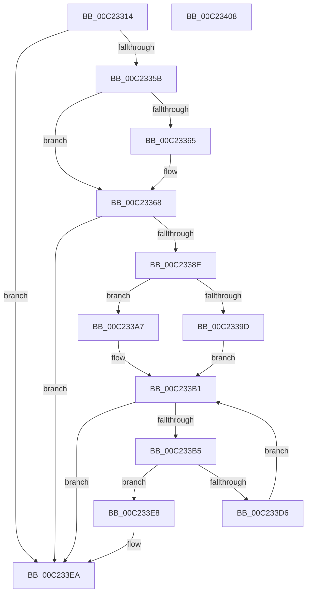

# HalpBlkAllocateAndShadowMemory

- RVA: `0x00C23314`–`0x00C23409` (길이 `245` bytes)
- VA: `0x0000000140C23314`
- 실행 섹션: `INIT`
- PDB 이름 있음: `예`; PDB Function 태그: `아니요`
- unwind 정보 RVA: `0x0005D7BC`
- 디코드: `69`개 명령, `245/245` bytes 표시
- 미해석 바이트: `0` (있으면 어셈블리에 `.byte`로 보존)

> 이 문서는 커널 이미지의 기계어와 PDB 기호를 분석해 생성했습니다. 4번과 5번은 함수 원형과 자료형을 바이너리 사용 방식에서 추정한 C 해석이며 원본 소스 복구 결과는 아닙니다.

## 1. Dependencies

- 직접 호출 지점: **5**; 고유 호출 대상: **5**
- 직접 호출자로 확인된 함수: **2**
- RIP 상대 이미지 참조: **2**

### Outgoing calls
- `0x00C2334A` → [HalpAllocPhysicalMemoryEx](../C7/HalpAllocPhysicalMemoryEx_function_00C771DC.md) (function, `0x00C771DC`)
- `0x00C23381` → [HalpMap](../../text/3F/HalpMap_function_003F88F4.md) (function, `0x003F88F4`)
- `0x00C233A0` → [memcpy](../../text/6C/memcpy_function_006C6840.md) (function, `0x006C6840`)
- `0x00C233A9` → [memset](../../text/6C/memset_function_006C6C40.md) (function, `0x006C6C40`)
- `0x00C233CD` → [HalpBlkAddVirtualMapping](HalpBlkAddVirtualMapping_function_00C231D0.md) (function, `0x00C231D0`)

### Direct callers
- [HalpBlkAllocateShadowCodePages](HalpBlkAllocateShadowCodePages_function_00C2352C.md) at `0x00C23558`
- [HalpBlkAllocateShadowData](HalpBlkAllocateShadowData_function_00C23578.md) at `0x00C235CE`

### Static image references
- `0x00C23338` → RVA `0x00E10230` (`.data`; read)
- `0x00C233B5` → RVA `0x00F90558` (`.data`; read)

## 2. Other-region calls and transfers

- 다른 실행 섹션으로 향하는 call: **3**
  - `0x00C23381` → [HalpMap](../../text/3F/HalpMap_function_003F88F4.md) (`INIT` → `.text`)
  - `0x00C233A0` → [memcpy](../../text/6C/memcpy_function_006C6840.md) (`INIT` → `.text`)
  - `0x00C233A9` → [memset](../../text/6C/memset_function_006C6C40.md) (`INIT` → `.text`)
- 별도 외부 분기/꼬리 이동을 확인하지 못했습니다.

## 3. Assembly (complete function range)

```asm
00C23314  48 8B C4                        mov rax, rsp
00C23317  48 89 58 08                     mov qword ptr [rax + 8], rbx
00C2331B  48 89 68 10                     mov qword ptr [rax + 0x10], rbp
00C2331F  48 89 70 18                     mov qword ptr [rax + 0x18], rsi
00C23323  48 89 78 20                     mov qword ptr [rax + 0x20], rdi
00C23327  41 56                           push r14
00C23329  48 83 EC 30                     sub rsp, 0x30
00C2332D  45 8B F1                        mov r14d, r9d
00C23330  8B EA                           mov ebp, edx
00C23332  48 8B F1                        mov rsi, rcx
00C23335  44 8B C2                        mov r8d, edx
00C23338  48 8B 0D F1 CE 1E 00            mov rcx, qword ptr [rip + 0x1ecef1]
00C2333F  33 FF                           xor edi, edi
00C23341  48 21 78 E8                     and qword ptr [rax - 0x18], rdi
00C23345  45 33 C9                        xor r9d, r9d
00C23348  33 D2                           xor edx, edx
00C2334A  E8 8D 3E 05 00                  call 0x140c771dc
00C2334F  48 8B D8                        mov rbx, rax
00C23352  48 85 C0                        test rax, rax
00C23355  0F 84 8F 00 00 00               je 0x140c233ea
00C2335B  48 8B 44 24 60                  mov rax, qword ptr [rsp + 0x60]
00C23360  48 85 C0                        test rax, rax
00C23363  74 03                           je 0x140c23368
00C23365  48 89 18                        mov qword ptr [rax], rbx
00C23368  48 21 7C 24 28                  and qword ptr [rsp + 0x28], rdi
00C2336D  45 33 C9                        xor r9d, r9d
00C23370  8B D5                           mov edx, ebp
00C23372  C7 44 24 20 04 00 00 00         mov dword ptr [rsp + 0x20], 4
00C2337A  48 8B CB                        mov rcx, rbx
00C2337D  45 8D 41 01                     lea r8d, [r9 + 1]
00C23381  E8 6E 55 7D FF                  call 0x1403f88f4
00C23386  48 8B F8                        mov rdi, rax
00C23389  48 85 C0                        test rax, rax
00C2338C  74 5C                           je 0x140c233ea
00C2338E  4C 8B C5                        mov r8, rbp
00C23391  48 8B C8                        mov rcx, rax
00C23394  49 C1 E0 0C                     shl r8, 0xc
00C23398  48 85 F6                        test rsi, rsi
00C2339B  74 0A                           je 0x140c233a7
00C2339D  48 8B D6                        mov rdx, rsi
00C233A0  E8 9B 34 AA FF                  call 0x1406c6840
00C233A5  EB 0A                           jmp 0x140c233b1
00C233A7  33 D2                           xor edx, edx
00C233A9  E8 92 38 AA FF                  call 0x1406c6c40
00C233AE  48 8B F7                        mov rsi, rdi
00C233B1  85 ED                           test ebp, ebp
00C233B3  74 35                           je 0x140c233ea
00C233B5  48 8B 0D 9C D1 36 00            mov rcx, qword ptr [rip + 0x36d19c]
00C233BC  41 B9 01 00 00 00               mov r9d, 1
00C233C2  4C 8B C6                        mov r8, rsi
00C233C5  44 89 74 24 20                  mov dword ptr [rsp + 0x20], r14d
00C233CA  48 8B D3                        mov rdx, rbx
00C233CD  E8 FE FD FF FF                  call 0x140c231d0
00C233D2  85 C0                           test eax, eax
00C233D4  78 12                           js 0x140c233e8
00C233D6  48 81 C3 00 10 00 00            add rbx, 0x1000
00C233DD  48 81 C6 00 10 00 00            add rsi, 0x1000
00C233E4  FF CD                           dec ebp
00C233E6  EB C9                           jmp 0x140c233b1
00C233E8  33 FF                           xor edi, edi
00C233EA  48 8B 5C 24 40                  mov rbx, qword ptr [rsp + 0x40]
00C233EF  48 8B C7                        mov rax, rdi
00C233F2  48 8B 7C 24 58                  mov rdi, qword ptr [rsp + 0x58]
00C233F7  48 8B 6C 24 48                  mov rbp, qword ptr [rsp + 0x48]
00C233FC  48 8B 74 24 50                  mov rsi, qword ptr [rsp + 0x50]
00C23401  48 83 C4 30                     add rsp, 0x30
00C23405  41 5E                           pop r14
00C23407  C3                              ret
00C23408  CC                              int3
```

## 4. C-style interpretation (structured pseudocode)

```c
__int64 __fastcall HalpBlkAllocateAndShadowMemory(__int64 a1, int a2, __int64 a3, int a4, __int64 a5)
{
    __int64 result;
    __int64 v_rbp;
    __int64 v_rbx;
    __int64 v_rdi;
    __int64 v_rsi;
    __int64 v_rsp;
    unsigned __int64 v_stack_m10;
    unsigned int v_stack_m18;
    unsigned __int64 v_stack_p10;
    unsigned __int64 v_stack_p18;
    unsigned __int64 v_stack_p20;
    unsigned __int64 v_stack_p8;

    *(unsigned __int64 *)(v_rsp + 8) = v_rbx;
    *(unsigned __int64 *)(v_rsp + 16) = v_rbp;
    *(unsigned __int64 *)(v_rsp + 24) = v_rsi;
    *(unsigned __int64 *)(v_rsp + 32) = v_rdi;
    v_rsp = (v_rsp) - (48);
    v_rdi = 0;
    a4 = 0;
    a2 = 0;
    result = HalpAllocPhysicalMemoryEx(*(unsigned __int64 *)(v_rip + 2019057), a2, (unsigned int)(a2), a4);
    if (result == 0) goto loc_00C233EA;
    if (a5 != 0) {
        *(unsigned __int64 *)(a5) = result;
    }
    a4 = 0;
    v_stack_m18 = 4;
    result = HalpMap(result, (unsigned int)((unsigned int)((unsigned int)(a2))), a4 + 1, a4);
    if (result == 0) goto loc_00C233EA;
    a3 = ((unsigned int)(a2)) << (12);
    if (a1 == 0) goto loc_00C233A7;
    result = memcpy(result, a1, a3, a4);
    goto loc_00C233B1;
loc_00C233A7:
    a2 = 0;
    result = memset(result, a2, a3, a4);
loc_00C233B1:
    if ((unsigned int)((unsigned int)(a2)) == 0) goto loc_00C233EA;
    v_stack_m18 = (unsigned int)((unsigned int)(a4));
    result = HalpBlkAddVirtualMapping(*(unsigned __int64 *)(v_rip + 3592604), result, result, 1);
    if (sign_flag) goto loc_00C233E8;
    v_rbx = (result) + (0x1000ULL);
    v_rsi = (result) + (0x1000ULL);
    v_rbp = (unsigned int)(((unsigned int)(a2)) - 1);
    goto loc_00C233B1;
loc_00C233E8:
    v_rdi = 0;
loc_00C233EA:
    v_rsp = (v_rsp) + (48);
    return 0;
}
```

## 5. (Beta) C Style

```c
int64_t HalpBlkAllocateAndShadowMemory(int64_t Arg1, int32_t Arg2, int64_t Arg3, int32_t Arg4, int64_t Arg5)
{
    int64_t result;
    int64_t local_rbp;
    int64_t local_rbx;
    int64_t local_rdi;
    int64_t local_rsi;
    int64_t local_rsp;
    uint64_t v_stack_m10;
    uint32_t v_stack_m18;
    uint64_t v_stack_p10;
    uint64_t v_stack_p18;
    uint64_t v_stack_p20;
    uint64_t v_stack_p8;

    *(uint64_t *)(local_rsp + 0x8) = local_rbx;
    *(uint64_t *)(local_rsp + 0x10) = local_rbp;
    *(uint64_t *)(local_rsp + 0x18) = local_rsi;
    *(uint64_t *)(local_rsp + 0x20) = local_rdi;
    local_rsp = (local_rsp) - (48);
    local_rdi = 0;
    Arg4 = 0;
    Arg2 = 0;
    result = HalpAllocPhysicalMemoryEx(*(uint64_t *)(v_rip + 0x1ECEF1), Arg2, (uint32_t)(Arg2), Arg4);
    if (result == 0) goto loc_00C233EA;
    if (Arg5 != 0) {
        *(uint64_t *)(Arg5) = result;
    }
    Arg4 = 0;
    v_stack_m18 = 4;
    result = HalpMap(result, (uint32_t)((uint32_t)((uint32_t)(Arg2))), Arg4 + 1, Arg4);
    if (result == 0) goto loc_00C233EA;
    Arg3 = ((uint32_t)(Arg2)) << (12);
    if (Arg1 == 0) goto loc_00C233A7;
    result = memcpy(result, Arg1, Arg3, Arg4);
    goto loc_00C233B1;
loc_00C233A7:
    Arg2 = 0;
    result = memset(result, Arg2, Arg3, Arg4);
loc_00C233B1:
    if ((uint32_t)((uint32_t)(Arg2)) == 0) goto loc_00C233EA;
    v_stack_m18 = (uint32_t)((uint32_t)(Arg4));
    result = HalpBlkAddVirtualMapping(*(uint64_t *)(v_rip + 0x36D19C), result, result, 1);
    if (sign_flag) goto loc_00C233E8;
    local_rbx = (result) + (0x1000ULL);
    local_rsi = (result) + (0x1000ULL);
    local_rbp = (uint32_t)(((uint32_t)(Arg2)) - 1);
    goto loc_00C233B1;
loc_00C233E8:
    local_rdi = 0;
loc_00C233EA:
    local_rsp = (local_rsp) + (48);
    return 0;
}
```

## 6. Execution-region graph

[열기: 2D/3D 그래프와 함수 탐색 컨트롤 패널](../../../control-panel.html?section=init&rva=0x00C23314&view=graph)

- 2D 그래프는 위에서 아래로 흐르고, 3D 그래프는 빈 공간을 드래그해 회전합니다. Shift+드래그는 이동, 휠은 확대·축소, 함수 노드 선택은 대상 보고서 이동입니다.

### Static fallback


