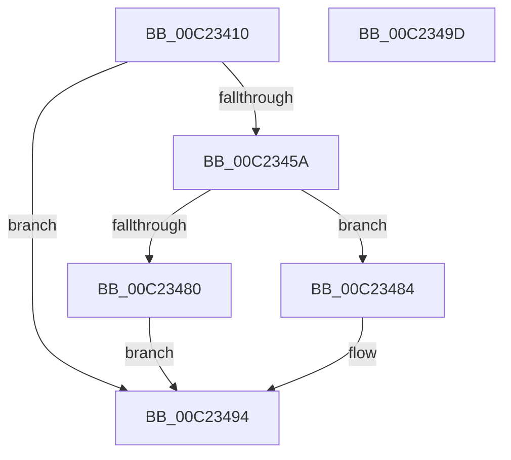

# HalpBlkAllocatePageTablePage

- RVA: `0x00C23410`–`0x00C2349E` (길이 `142` bytes)
- VA: `0x0000000140C23410`
- 실행 섹션: `INIT`
- PDB 이름 있음: `예`; PDB Function 태그: `아니요`
- unwind 정보 RVA: `0x00064C80`
- 디코드: `40`개 명령, `142/142` bytes 표시
- 미해석 바이트: `0` (있으면 어셈블리에 `.byte`로 보존)

> 이 문서는 커널 이미지의 기계어와 PDB 기호를 분석해 생성했습니다. 4번과 5번은 함수 원형과 자료형을 바이너리 사용 방식에서 추정한 C 해석이며 원본 소스 복구 결과는 아닙니다.

## 1. Dependencies

- 직접 호출 지점: **3**; 고유 호출 대상: **3**
- 직접 호출자로 확인된 함수: **2**
- RIP 상대 이미지 참조: **1**

### Outgoing calls
- `0x00C2344D` → [HalpAllocPhysicalMemoryEx](../C7/HalpAllocPhysicalMemoryEx_function_00C771DC.md) (function, `0x00C771DC`)
- `0x00C23476` → [HalpMap](../../text/3F/HalpMap_function_003F88F4.md) (function, `0x003F88F4`)
- `0x00C2348F` → [memset](../../text/6C/memset_function_006C6C40.md) (function, `0x006C6C40`)

### Direct callers
- [HalpBlkAddVirtualMapping](HalpBlkAddVirtualMapping_function_00C231D0.md) at `0x00C23241`
- [HalpBlkInitializePageTables](HalpBlkInitializePageTables_function_00C23608.md) at `0x00C2361B`
- [HalpBlkInitializePageTables](HalpBlkInitializePageTables_function_00C23608.md) at `0x00C23631`

### Static image references
- `0x00C2342A` → RVA `0x00E10230` (`.data`; read)

## 2. Other-region calls and transfers

- 다른 실행 섹션으로 향하는 call: **2**
  - `0x00C23476` → [HalpMap](../../text/3F/HalpMap_function_003F88F4.md) (`INIT` → `.text`)
  - `0x00C2348F` → [memset](../../text/6C/memset_function_006C6C40.md) (`INIT` → `.text`)
- 별도 외부 분기/꼬리 이동을 확인하지 못했습니다.

## 3. Assembly (complete function range)

```asm
00C23410  40 53                           push rbx
00C23412  48 83 EC 30                     sub rsp, 0x30
00C23416  48 83 64 24 48 00               and qword ptr [rsp + 0x48], 0
00C2341C  83 CA FF                        or edx, 0xffffffff
00C2341F  8B 44 24 48                     mov eax, dword ptr [rsp + 0x48]
00C23423  84 C9                           test cl, cl
00C23425  0F 45 C2                        cmovne eax, edx
00C23428  F6 D9                           neg cl
00C2342A  48 8B 0D FF CD 1E 00            mov rcx, qword ptr [rip + 0x1ecdff]
00C23431  48 1B D2                        sbb rdx, rdx
00C23434  89 44 24 48                     mov dword ptr [rsp + 0x48], eax
00C23438  48 83 64 24 20 00               and qword ptr [rsp + 0x20], 0
00C2343E  48 8D 44 24 48                  lea rax, [rsp + 0x48]
00C23443  45 33 C9                        xor r9d, r9d
00C23446  48 23 D0                        and rdx, rax
00C23449  45 8D 41 01                     lea r8d, [r9 + 1]
00C2344D  E8 8A 3D 05 00                  call 0x140c771dc
00C23452  48 8B D8                        mov rbx, rax
00C23455  48 85 C0                        test rax, rax
00C23458  74 3A                           je 0x140c23494
00C2345A  48 83 64 24 28 00               and qword ptr [rsp + 0x28], 0
00C23460  BA 01 00 00 00                  mov edx, 1
00C23465  44 8B C2                        mov r8d, edx
00C23468  C7 44 24 20 04 00 00 00         mov dword ptr [rsp + 0x20], 4
00C23470  41 B1 01                        mov r9b, 1
00C23473  48 8B C8                        mov rcx, rax
00C23476  E8 79 54 7D FF                  call 0x1403f88f4
00C2347B  48 85 C0                        test rax, rax
00C2347E  75 04                           jne 0x140c23484
00C23480  33 DB                           xor ebx, ebx
00C23482  EB 10                           jmp 0x140c23494
00C23484  33 D2                           xor edx, edx
00C23486  41 B8 00 10 00 00               mov r8d, 0x1000
00C2348C  48 8B C8                        mov rcx, rax
00C2348F  E8 AC 37 AA FF                  call 0x1406c6c40
00C23494  48 8B C3                        mov rax, rbx
00C23497  48 83 C4 30                     add rsp, 0x30
00C2349B  5B                              pop rbx
00C2349C  C3                              ret
00C2349D  CC                              int3
```

## 4. C-style interpretation (structured pseudocode)

```c
__int64 __fastcall HalpBlkAllocatePageTablePage(unsigned __int8 a1, int a2, __int64 a3, int a4)
{
    __int64 result;
    __int64 v_rbx;
    __int64 v_rsp;
    unsigned __int64 v_stack_m10;
    unsigned __int64 v_stack_m18;
    unsigned __int64 v_stack_p10;

    v_rsp = (v_rsp) - (48);
    a2 = (unsigned int)((a2) | (0xFFFFFFFFULL));
    result = (unsigned int)(v_stack_p10);
    if (a1 != 0) { result = a2; }
    a1 = (unsigned __int8)(-(a1));
    v_stack_p10 = (unsigned int)(result);
    a4 = 0;
    a2 = (a2) & (v_stack_p10);
    result = HalpAllocPhysicalMemoryEx(*(unsigned __int64 *)(v_rip + 2018815), a2, a4 + 1, a4);
    if (result == 0) goto loc_00C23494;
    v_stack_m18 = 4;
    result = HalpMap(result, 1, 1, 1);
    if (result != 0) goto loc_00C23484;
    v_rbx = 0;
    goto loc_00C23494;
loc_00C23484:
    a2 = 0;
    result = memset(result, a2, (unsigned int)(0x1000ULL), 1);
loc_00C23494:
    v_rsp = (v_rsp) + (48);
    return 0;
}
```

## 5. (Beta) C Style

```c
int64_t HalpBlkAllocatePageTablePage(uint8_t Arg1, int32_t Arg2, int64_t Arg3, int32_t Arg4)
{
    int64_t result;
    int64_t local_rbx;
    int64_t local_rsp;
    uint64_t v_stack_m10;
    uint64_t v_stack_m18;
    uint64_t v_stack_p10;

    local_rsp = (local_rsp) - (48);
    Arg2 = (uint32_t)((Arg2) | (0xFFFFFFFFULL));
    result = (uint32_t)(v_stack_p10);
    if (Arg1 != 0) { result = Arg2; }
    Arg1 = (uint8_t)(-(Arg1));
    v_stack_p10 = (uint32_t)(result);
    Arg4 = 0;
    Arg2 = (Arg2) & (v_stack_p10);
    result = HalpAllocPhysicalMemoryEx(*(uint64_t *)(v_rip + 0x1ECDFF), Arg2, Arg4 + 1, Arg4);
    if (result == 0) goto loc_00C23494;
    v_stack_m18 = 4;
    result = HalpMap(result, 1, 1, 1);
    if (result != 0) goto loc_00C23484;
    local_rbx = 0;
    goto loc_00C23494;
loc_00C23484:
    Arg2 = 0;
    result = memset(result, Arg2, (uint32_t)(0x1000ULL), 1);
loc_00C23494:
    local_rsp = (local_rsp) + (48);
    return 0;
}
```

## 6. Execution-region graph

[열기: 2D/3D 그래프와 함수 탐색 컨트롤 패널](../../../control-panel.html?section=init&rva=0x00C23410&view=graph)

- 2D 그래프는 위에서 아래로 흐르고, 3D 그래프는 빈 공간을 드래그해 회전합니다. Shift+드래그는 이동, 휠은 확대·축소, 함수 노드 선택은 대상 보고서 이동입니다.

### Static fallback


