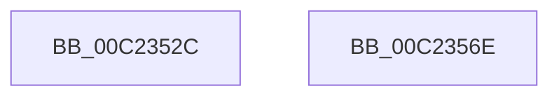

# HalpBlkAllocateShadowCodePages

- RVA: `0x00C2352C`–`0x00C2356F` (길이 `67` bytes)
- VA: `0x0000000140C2352C`
- 실행 섹션: `INIT`
- PDB 이름 있음: `예`; PDB Function 태그: `아니요`
- unwind 정보 RVA: `0x0005D2F4`
- 디코드: `17`개 명령, `67/67` bytes 표시
- 미해석 바이트: `0` (있으면 어셈블리에 `.byte`로 보존)

> 이 문서는 커널 이미지의 기계어와 PDB 기호를 분석해 생성했습니다. 4번과 5번은 함수 원형과 자료형을 바이너리 사용 방식에서 추정한 C 해석이며 원본 소스 복구 결과는 아닙니다.

## 1. Dependencies

- 직접 호출 지점: **1**; 고유 호출 대상: **1**
- 직접 호출자로 확인된 함수: **1**
- RIP 상대 이미지 참조: **0**

### Outgoing calls
- `0x00C23558` → [HalpBlkAllocateAndShadowMemory](HalpBlkAllocateAndShadowMemory_function_00C23314.md) (function, `0x00C23314`)

### Direct callers
- [HalpBlkAllocateShadowCode](HalpBlkAllocateShadowCode_function_00C234A4.md) at `0x00C234C9`
- [HalpBlkAllocateShadowCode](HalpBlkAllocateShadowCode_function_00C234A4.md) at `0x00C23517`

### Static image references
- 디코드된 RIP-relative 메모리 참조가 없습니다.

## 2. Other-region calls and transfers

- 다른 실행 섹션으로 향하는 call: **0**
- 별도 외부 분기/꼬리 이동을 확인하지 못했습니다.

## 3. Assembly (complete function range)

```asm
00C2352C  48 83 EC 38                     sub rsp, 0x38
00C23530  48 8B C1                        mov rax, rcx
00C23533  4C 89 44 24 20                  mov qword ptr [rsp + 0x20], r8
00C23538  48 81 C2 FF 0F 00 00            add rdx, 0xfff
00C2353F  25 FF 0F 00 00                  and eax, 0xfff
00C23544  48 03 D0                        add rdx, rax
00C23547  48 81 E1 00 F0 FF FF            and rcx, 0xfffffffffffff000
00C2354E  48 C1 EA 0C                     shr rdx, 0xc
00C23552  41 B9 20 00 00 00               mov r9d, 0x20
00C23558  E8 B7 FD FF FF                  call 0x140c23314
00C2355D  48 F7 D8                        neg rax
00C23560  1B C0                           sbb eax, eax
00C23562  F7 D0                           not eax
00C23564  25 17 00 00 C0                  and eax, 0xc0000017
00C23569  48 83 C4 38                     add rsp, 0x38
00C2356D  C3                              ret
00C2356E  CC                              int3
```

## 4. C-style interpretation (structured pseudocode)

```c
__int64 __fastcall HalpBlkAllocateShadowCodePages(__int64 a1, __int64 a2, __int64 a3)
{
    __int64 result;
    __int64 v_rsp;
    unsigned __int64 v_stack_m18;

    v_rsp = (v_rsp) - (56);
    v_stack_m18 = a3;
    a2 = (a2) + (0xFFFULL);
    result = (unsigned int)((a1) & (0xFFFULL));
    a2 = (a2) + (result);
    a1 = (a1) & (0xFFFFFFFFFFFFF000ULL);
    a2 = (a2) >> (12);
    result = HalpBlkAllocateAndShadowMemory(a1, a2, a3, 32);
    result = -(result);
    result = (unsigned int)(~(result));
    result = (unsigned int)((result) & (0xC0000017ULL));
    v_rsp = (v_rsp) + (56);
    return result;
}
```

## 5. (Beta) C Style

```c
int64_t HalpBlkAllocateShadowCodePages(int64_t Arg1, int64_t Arg2, int64_t Arg3)
{
    int64_t result;
    int64_t local_rsp;
    uint64_t v_stack_m18;

    local_rsp = (local_rsp) - (56);
    v_stack_m18 = Arg3;
    Arg2 = (Arg2) + (0xFFFULL);
    result = (uint32_t)((Arg1) & (0xFFFULL));
    Arg2 = (Arg2) + (result);
    Arg1 = (Arg1) & (0xFFFFFFFFFFFFF000ULL);
    Arg2 = (Arg2) >> (12);
    result = HalpBlkAllocateAndShadowMemory(Arg1, Arg2, Arg3, 32);
    result = -(result);
    result = (uint32_t)(~(result));
    result = (uint32_t)((result) & (0xC0000017ULL));
    local_rsp = (local_rsp) + (56);
    return result;
}
```

## 6. Execution-region graph

[열기: 2D/3D 그래프와 함수 탐색 컨트롤 패널](../../../control-panel.html?section=init&rva=0x00C2352C&view=graph)

- 2D 그래프는 위에서 아래로 흐르고, 3D 그래프는 빈 공간을 드래그해 회전합니다. Shift+드래그는 이동, 휠은 확대·축소, 함수 노드 선택은 대상 보고서 이동입니다.

### Static fallback


