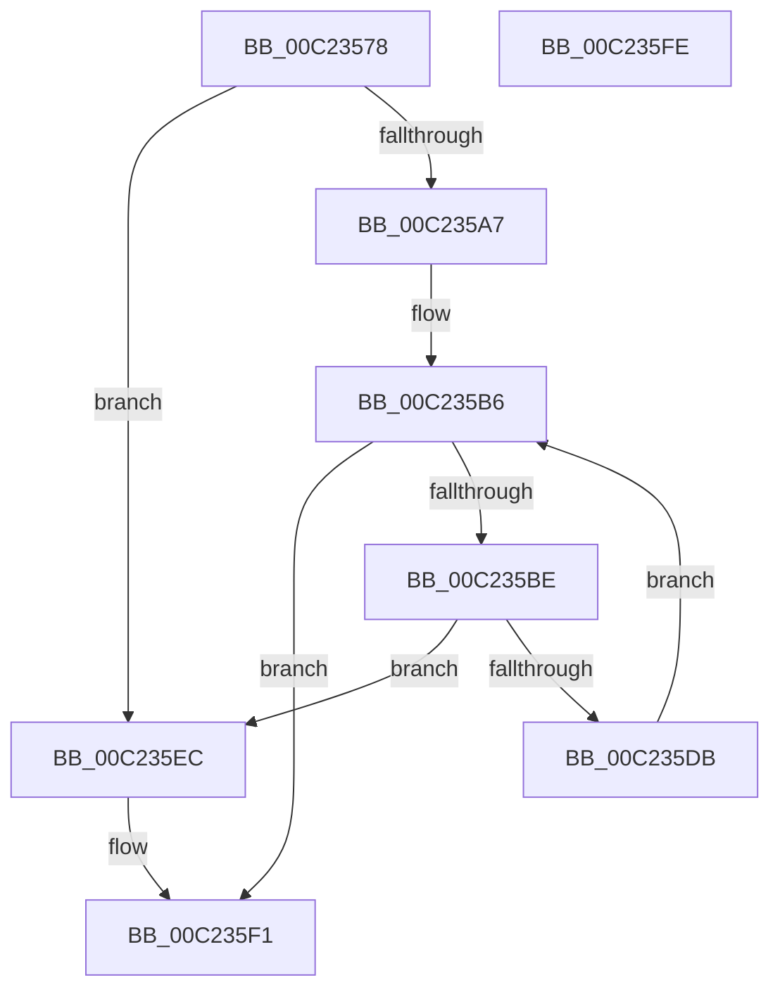

# HalpBlkAllocateShadowData

- RVA: `0x00C23578`–`0x00C235FF` (길이 `135` bytes)
- VA: `0x0000000140C23578`
- 실행 섹션: `INIT`
- PDB 이름 있음: `예`; PDB Function 태그: `아니요`
- unwind 정보 RVA: `0x0006E5F8`
- 디코드: `39`개 명령, `135/135` bytes 표시
- 미해석 바이트: `0` (있으면 어셈블리에 `.byte`로 보존)

> 이 문서는 커널 이미지의 기계어와 PDB 기호를 분석해 생성했습니다. 4번과 5번은 함수 원형과 자료형을 바이너리 사용 방식에서 추정한 C 해석이며 원본 소스 복구 결과는 아닙니다.

## 1. Dependencies

- 직접 호출 지점: **3**; 고유 호출 대상: **3**
- 직접 호출자로 확인된 함수: **1**
- RIP 상대 이미지 참조: **3**

### Outgoing calls
- `0x00C23596` → [HalpMmAllocateMemoryInternal](../../text/54/HalpMmAllocateMemoryInternal_function_00544990.md) (function, `0x00544990`)
- `0x00C235AF` → [memset](../../text/6C/memset_function_006C6C40.md) (function, `0x006C6C40`)
- `0x00C235CE` → [HalpBlkAllocateAndShadowMemory](HalpBlkAllocateAndShadowMemory_function_00C23314.md) (function, `0x00C23314`)

### Direct callers
- [HalpBlkInitializeVirtualAddressSpace](HalpBlkInitializeVirtualAddressSpace_function_00C2368C.md) at `0x00C236B0`

### Static image references
- `0x00C23582` → RVA `0x00F90690` (`.data`; read)
- `0x00C2359B` → RVA `0x00F90550` (`.data`; write)
- `0x00C235DB` → RVA `0x00F90550` (`.data`; read)

## 2. Other-region calls and transfers

- 다른 실행 섹션으로 향하는 call: **2**
  - `0x00C23596` → [HalpMmAllocateMemoryInternal](../../text/54/HalpMmAllocateMemoryInternal_function_00544990.md) (`INIT` → `.text`)
  - `0x00C235AF` → [memset](../../text/6C/memset_function_006C6C40.md) (`INIT` → `.text`)
- 별도 외부 분기/꼬리 이동을 확인하지 못했습니다.

## 3. Assembly (complete function range)

```asm
00C23578  48 89 5C 24 08                  mov qword ptr [rsp + 8], rbx
00C2357D  57                              push rdi
00C2357E  48 83 EC 30                     sub rsp, 0x30
00C23582  8B 05 08 D1 36 00               mov eax, dword ptr [rip + 0x36d108]
00C23588  33 DB                           xor ebx, ebx
00C2358A  8D 3C C5 00 00 00 00            lea edi, [rax*8]
00C23591  8B CF                           mov ecx, edi
00C23593  8D 53 01                        lea edx, [rbx + 1]
00C23596  E8 F5 13 92 FF                  call 0x140544990
00C2359B  48 89 05 AE CF 36 00            mov qword ptr [rip + 0x36cfae], rax
00C235A2  48 85 C0                        test rax, rax
00C235A5  74 45                           je 0x140c235ec
00C235A7  44 8B C7                        mov r8d, edi
00C235AA  33 D2                           xor edx, edx
00C235AC  48 8B C8                        mov rcx, rax
00C235AF  E8 8C 36 AA FF                  call 0x1406c6c40
00C235B4  8B FB                           mov edi, ebx
00C235B6  3B 3D D4 D0 36 00               cmp edi, dword ptr [rip + 0x36d0d4]
00C235BC  73 33                           jae 0x140c235f1
00C235BE  BA 0E 00 00 00                  mov edx, 0xe
00C235C3  48 89 5C 24 20                  mov qword ptr [rsp + 0x20], rbx
00C235C8  33 C9                           xor ecx, ecx
00C235CA  44 8D 4A F6                     lea r9d, [rdx - 0xa]
00C235CE  E8 41 FD FF FF                  call 0x140c23314
00C235D3  48 8B D0                        mov rdx, rax
00C235D6  48 85 C0                        test rax, rax
00C235D9  74 11                           je 0x140c235ec
00C235DB  48 8B 05 6E CF 36 00            mov rax, qword ptr [rip + 0x36cf6e]
00C235E2  8B CF                           mov ecx, edi
00C235E4  FF C7                           inc edi
00C235E6  48 89 14 C8                     mov qword ptr [rax + rcx*8], rdx
00C235EA  EB CA                           jmp 0x140c235b6
00C235EC  BB 17 00 00 C0                  mov ebx, 0xc0000017
00C235F1  8B C3                           mov eax, ebx
00C235F3  48 8B 5C 24 40                  mov rbx, qword ptr [rsp + 0x40]
00C235F8  48 83 C4 30                     add rsp, 0x30
00C235FC  5F                              pop rdi
00C235FD  C3                              ret
00C235FE  CC                              int3
```

## 4. C-style interpretation (structured pseudocode)

```c
__int64 __fastcall HalpBlkAllocateShadowData(void)
{
    __int64 result;
    __int64 v_rbx;
    __int64 v_rdi;
    __int64 v_rsp;
    unsigned __int64 v_stack_m18;
    unsigned __int64 v_stack_p8;

    v_stack_p8 = v_rbx;
    v_rsp = (v_rsp) - (48);
    v_rbx = 0;
    result = HalpMmAllocateMemoryInternal((unsigned int)((unsigned int)((unsigned int)(*(unsigned int *)(v_rip + 3592456)) * 8)), v_rbx + 1, a3, a4);
    *(unsigned __int64 *)(v_rip + 3592110) = result;
    if (result == 0) goto loc_00C235EC;
    a2 = 0;
    result = memset(result, a2, (unsigned int)((unsigned int)((unsigned int)(*(unsigned int *)(v_rip + 3592456)) * 8)), a4);
loc_00C235B6:
    if (0 >= (*(unsigned int *)(v_rip + 3592404))) goto loc_00C235F1;
    v_stack_m18 = 0;
    a1 = 0;
    result = HalpBlkAllocateAndShadowMemory(a1, 14, (unsigned int)((unsigned int)((unsigned int)(*(unsigned int *)(v_rip + 3592456)) * 8)), 14 - 10);
    if (result == 0) goto loc_00C235EC;
    v_rdi = (unsigned int)((0) + 1);
    *(unsigned __int64 *)(*(unsigned __int64 *)(v_rip + 3592046) + 0 * 8) = result;
    goto loc_00C235B6;
loc_00C235EC:
loc_00C235F1:
    v_rsp = (v_rsp) + (48);
    return (unsigned int)((unsigned int)((unsigned int)(0xC0000017ULL)));
}
```

## 5. (Beta) C Style

```c
void HalpBlkAllocateShadowData(void)
{
    int64_t result;
    int64_t local_rbx;
    int64_t local_rdi;
    int64_t local_rsp;
    uint64_t v_stack_m18;
    uint64_t v_stack_p8;

    v_stack_p8 = local_rbx;
    local_rsp = (local_rsp) - (48);
    local_rbx = 0;
    result = HalpMmAllocateMemoryInternal((uint32_t)((uint32_t)((uint32_t)(*(uint32_t *)(v_rip + 0x36D108)) * 8)), local_rbx + 1, a3, a4);
    *(uint64_t *)(v_rip + 0x36CFAE) = result;
    if (result == 0) goto loc_00C235EC;
    a2 = 0;
    result = memset(result, a2, (uint32_t)((uint32_t)((uint32_t)(*(uint32_t *)(v_rip + 0x36D108)) * 8)), a4);
loc_00C235B6:
    if (0 >= (*(uint32_t *)(v_rip + 0x36D0D4))) goto loc_00C235F1;
    v_stack_m18 = 0;
    a1 = 0;
    result = HalpBlkAllocateAndShadowMemory(a1, 14, (uint32_t)((uint32_t)((uint32_t)(*(uint32_t *)(v_rip + 0x36D108)) * 8)), 14 - 10);
    if (result == 0) goto loc_00C235EC;
    local_rdi = (uint32_t)((0) + 1);
    *(uint64_t *)(*(uint64_t *)(v_rip + 0x36CF6E) + 0x0 * 8) = result;
    goto loc_00C235B6;
loc_00C235EC:
loc_00C235F1:
    local_rsp = (local_rsp) + (48);
    return (uint32_t)((uint32_t)((uint32_t)(0xC0000017ULL)));
}
```

## 6. Execution-region graph

[열기: 2D/3D 그래프와 함수 탐색 컨트롤 패널](../../../control-panel.html?section=init&rva=0x00C23578&view=graph)

- 2D 그래프는 위에서 아래로 흐르고, 3D 그래프는 빈 공간을 드래그해 회전합니다. Shift+드래그는 이동, 휠은 확대·축소, 함수 노드 선택은 대상 보고서 이동입니다.

### Static fallback


