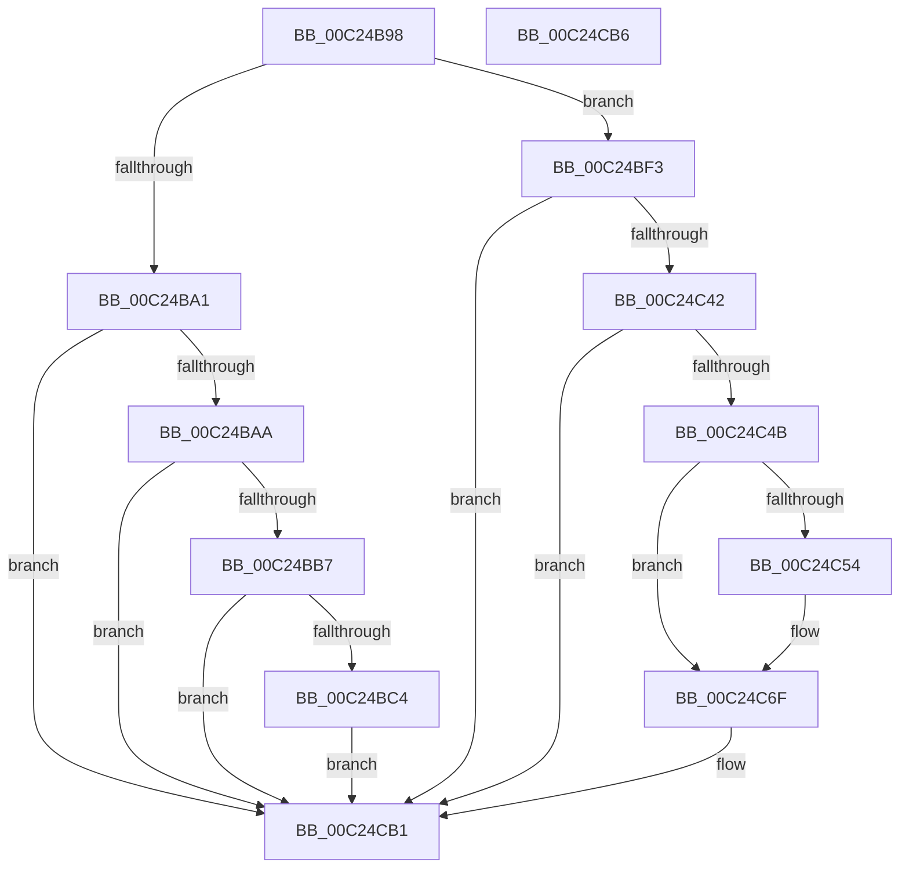

# HalpBlkInitSystem

- RVA: `0x00C24B98`–`0x00C24CB7` (길이 `287` bytes)
- VA: `0x0000000140C24B98`
- 실행 섹션: `INIT`
- PDB 이름 있음: `예`; PDB Function 태그: `아니요`
- unwind 정보 RVA: `0x00063458`
- 디코드: `54`개 명령, `287/287` bytes 표시
- 미해석 바이트: `0` (있으면 어셈블리에 `.byte`로 보존)

> 이 문서는 커널 이미지의 기계어와 PDB 기호를 분석해 생성했습니다. 4번과 5번은 함수 원형과 자료형을 바이너리 사용 방식에서 추정한 C 해석이며 원본 소스 복구 결과는 아닙니다.

## 1. Dependencies

- 직접 호출 지점: **4**; 고유 호출 대상: **4**
- 직접 호출자로 확인된 함수: **1**
- RIP 상대 이미지 참조: **19**

### Outgoing calls
- `0x00C24BE9` → [KeSetTimer2](../../text/3A/KeSetTimer2_function_003A08E0.md) (function, `0x003A08E0`)
- `0x00C24C4B` → [HalpBlkInitializeVirtualAddressSpace](HalpBlkInitializeVirtualAddressSpace_function_00C2368C.md) (function, `0x00C2368C`)
- `0x00C24C69` → [KeBugCheckEx](../../text/4F/KeBugCheckEx_function_004FD660.md) (function, `0x004FD660`)
- `0x00C24C8E` → [KiInitializeTimer2](../../text/3A/KiInitializeTimer2_function_003A3288.md) (function, `0x003A3288`)

### Direct callers
- [HalpProcInitSystem](../../pagelk/B5/HalpProcInitSystem_function_00B5D440.md) at `0x00B5D4C2`

### Static image references
- `0x00C24BAA` → RVA `0x00F90690` (`.data`; read)
- `0x00C24BB7` → RVA `0x00F90709` (`.data`; read)
- `0x00C24BD5` → RVA `0x00F8F800` (`.data`; read)
- `0x00C24BFA` → RVA `0x0056E240` (`HalpBlkPoGetPowerInterface`; read)
- `0x00C24C01` → RVA `0x00E00C68` (`.data`; write)
- `0x00C24C08` → RVA `0x0056E1F0` (`HalpBlkPoGetPackageId`; read)
- `0x00C24C0F` → RVA `0x00E00C70` (`.data`; write)
- `0x00C24C16` → RVA `0x0056E290` (`HalpBlkPoGetProcessorCount`; read)
- `0x00C24C1D` → RVA `0x00E00C78` (`.data`; write)
- `0x00C24C24` → RVA `0x0056E1C0` (`HalpBlkPoGetApicIdByIndex`; read)
- `0x00C24C2B` → RVA `0x00E00C80` (`.data`; write)
- `0x00C24C32` → RVA `0x0056E4F0` (`HalpBlkPoRegisterIdleState`; read)
- `0x00C24C39` → RVA `0x00E00C88` (`.data`; write)
- `0x00C24C6F` → RVA `0x00F8F802` (`.data`; read/write)
- `0x00C24C77` → RVA `0x0056E7D0` (`HalpBlkWdTimerRoutine`; read)
- `0x00C24C93` → RVA `0x00F8F7F8` (`.data`; read/write)
- `0x00C24C9B` → RVA `0x0056E810` (`HalpBlkWdWorkerRoutine`; read)
- `0x00C24CA2` → RVA `0x00F8F7E0` (`.data`; read/write)
- `0x00C24CAA` → RVA `0x00F8F7F0` (`.data`; write)

## 2. Other-region calls and transfers

- 다른 실행 섹션으로 향하는 call: **3**
  - `0x00C24BE9` → [KeSetTimer2](../../text/3A/KeSetTimer2_function_003A08E0.md) (`INIT` → `.text`)
  - `0x00C24C69` → [KeBugCheckEx](../../text/4F/KeBugCheckEx_function_004FD660.md) (`INIT` → `.text`)
  - `0x00C24C8E` → [KiInitializeTimer2](../../text/3A/KiInitializeTimer2_function_003A3288.md) (`INIT` → `.text`)
- 별도 외부 분기/꼬리 이동을 확인하지 못했습니다.

## 3. Assembly (complete function range)

```asm
00C24B98  48 83 EC 48                     sub rsp, 0x48
00C24B9C  83 F9 0C                        cmp ecx, 0xc
00C24B9F  74 52                           je 0x140c24bf3
00C24BA1  83 F9 15                        cmp ecx, 0x15
00C24BA4  0F 85 07 01 00 00               jne 0x140c24cb1
00C24BAA  83 3D DF BA 36 00 00            cmp dword ptr [rip + 0x36badf], 0
00C24BB1  0F 84 FA 00 00 00               je 0x140c24cb1
00C24BB7  80 3D 4B BB 36 00 00            cmp byte ptr [rip + 0x36bb4b], 0
00C24BBE  0F 84 ED 00 00 00               je 0x140c24cb1
00C24BC4  48 83 64 24 30 00               and qword ptr [rsp + 0x30], 0
00C24BCA  4C 8D 4C 24 30                  lea r9, [rsp + 0x30]
00C24BCF  48 83 4C 24 38 FF               or qword ptr [rsp + 0x38], 0xffffffffffffffff
00C24BD5  48 8D 0D 24 AC 36 00            lea rcx, [rip + 0x36ac24]
00C24BDC  48 C7 C2 80 3C 36 FE            mov rdx, 0xfffffffffe363c80
00C24BE3  41 B8 80 C3 C9 01               mov r8d, 0x1c9c380
00C24BE9  E8 F2 BC 77 FF                  call 0x1403a08e0
00C24BEE  E9 BE 00 00 00                  jmp 0x140c24cb1
00C24BF3  83 3D 96 BA 36 00 00            cmp dword ptr [rip + 0x36ba96], 0
00C24BFA  48 8D 05 3F 96 94 FF            lea rax, [rip - 0x6b69c1]
00C24C01  48 89 05 60 C0 1D 00            mov qword ptr [rip + 0x1dc060], rax
00C24C08  48 8D 05 E1 95 94 FF            lea rax, [rip - 0x6b6a1f]
00C24C0F  48 89 05 5A C0 1D 00            mov qword ptr [rip + 0x1dc05a], rax
00C24C16  48 8D 05 73 96 94 FF            lea rax, [rip - 0x6b698d]
00C24C1D  48 89 05 54 C0 1D 00            mov qword ptr [rip + 0x1dc054], rax
00C24C24  48 8D 05 95 95 94 FF            lea rax, [rip - 0x6b6a6b]
00C24C2B  48 89 05 4E C0 1D 00            mov qword ptr [rip + 0x1dc04e], rax
00C24C32  48 8D 05 B7 98 94 FF            lea rax, [rip - 0x6b6749]
00C24C39  48 89 05 48 C0 1D 00            mov qword ptr [rip + 0x1dc048], rax
00C24C40  74 6F                           je 0x140c24cb1
00C24C42  80 3D C0 BA 36 00 00            cmp byte ptr [rip + 0x36bac0], 0
00C24C49  74 66                           je 0x140c24cb1
00C24C4B  E8 3C EA FF FF                  call 0x140c2368c
00C24C50  85 C0                           test eax, eax
00C24C52  79 1B                           jns 0x140c24c6f
00C24C54  48 83 64 24 20 00               and qword ptr [rsp + 0x20], 0
00C24C5A  45 33 C9                        xor r9d, r9d
00C24C5D  4C 63 C0                        movsxd r8, eax
00C24C60  B9 DA 01 00 00                  mov ecx, 0x1da
00C24C65  41 8D 51 01                     lea edx, [r9 + 1]
00C24C69  E8 F2 89 8D FF                  call 0x1404fd660
00C24C6E  CC                              int3
00C24C6F  66 83 25 8B AB 36 00 00         and word ptr [rip + 0x36ab8b], 0
00C24C77  48 8D 15 52 9B 94 FF            lea rdx, [rip - 0x6b64ae]
00C24C7E  41 B9 08 00 00 00               mov r9d, 8
00C24C84  48 8D 0D 75 AB 36 00            lea rcx, [rip + 0x36ab75]
00C24C8B  45 33 C0                        xor r8d, r8d
00C24C8E  E8 F5 E5 77 FF                  call 0x1403a3288
00C24C93  48 83 25 5D AB 36 00 00         and qword ptr [rip + 0x36ab5d], 0
00C24C9B  48 8D 05 6E 9B 94 FF            lea rax, [rip - 0x6b6492]
00C24CA2  48 83 25 36 AB 36 00 00         and qword ptr [rip + 0x36ab36], 0
00C24CAA  48 89 05 3F AB 36 00            mov qword ptr [rip + 0x36ab3f], rax
00C24CB1  48 83 C4 48                     add rsp, 0x48
00C24CB5  C3                              ret
00C24CB6  CC                              int3
```

## 4. C-style interpretation (structured pseudocode)

```c
__int64 __fastcall HalpBlkInitSystem(int a1)
{
    __int64 result;
    __int64 v_rsp;
    unsigned __int64 v_stack_m10;
    unsigned __int64 v_stack_m18;
    unsigned __int64 v_stack_m28;

    v_rsp = (v_rsp) - (72);
    if (a1 == 12) goto loc_00C24BF3;
    if (a1 != 21) goto loc_00C24CB1;
    if ((*(unsigned int *)(v_rip + 3586783)) == 0) goto loc_00C24CB1;
    if ((*(unsigned __int8 *)(v_rip + 3586891)) == 0) goto loc_00C24CB1;
    result = KeSetTimer2(v_rip + 3583012, 0xFFFFFFFFFE363C80ULL, (unsigned int)(0x1C9C380ULL), v_stack_m18);
    goto loc_00C24CB1;
loc_00C24BF3:
    *(unsigned __int64 *)(v_rip + 1949792) = v_rip - 7039425;
    *(unsigned __int64 *)(v_rip + 1949786) = v_rip - 7039519;
    *(unsigned __int64 *)(v_rip + 1949780) = v_rip - 7039373;
    *(unsigned __int64 *)(v_rip + 1949774) = v_rip - 7039595;
    *(unsigned __int64 *)(v_rip + 1949768) = v_rip - 7038793;
    if ((*(unsigned int *)(v_rip + 3586710)) == 0) goto loc_00C24CB1;
    if ((*(unsigned __int8 *)(v_rip + 3586752)) == 0) goto loc_00C24CB1;
    result = HalpBlkInitializeVirtualAddressSpace(v_rip + 3583012, 0xFFFFFFFFFE363C80ULL, (unsigned int)(0x1C9C380ULL), v_stack_m18);
    if (sign_flag) {
        a4 = 0;
        a3 = (int)((unsigned int)(result));
        a1 = 474;
        a2 = a4 + 1;
        result = KeBugCheckEx(a1, a2, a3, a4);
    }
    a3 = 0;
    result = KiInitializeTimer2(v_rip + 3582837, v_rip - 7038126, a3, 8);
    *(unsigned __int64 *)(v_rip + 3582783) = v_rip - 7038098;
loc_00C24CB1:
    v_rsp = (v_rsp) + (72);
    return v_rip - 7038098;
}
```

## 5. (Beta) C Style

```c
int64_t HalpBlkInitSystem(int32_t Arg1)
{
    int64_t result;
    int64_t local_rsp;
    uint64_t v_stack_m10;
    uint64_t v_stack_m18;
    uint64_t v_stack_m28;

    local_rsp = (local_rsp) - (72);
    if (Arg1 == 12) goto loc_00C24BF3;
    if (Arg1 != 21) goto loc_00C24CB1;
    if ((*(uint32_t *)(v_rip + 0x36BADF)) == 0) goto loc_00C24CB1;
    if ((*(uint8_t *)(v_rip + 0x36BB4B)) == 0) goto loc_00C24CB1;
    result = KeSetTimer2(v_rip + 3583012, 0xFFFFFFFFFE363C80ULL, (uint32_t)(0x1C9C380ULL), v_stack_m18);
    goto loc_00C24CB1;
loc_00C24BF3:
    *(uint64_t *)(v_rip + 0x1DC060) = v_rip - 7039425;
    *(uint64_t *)(v_rip + 0x1DC05A) = v_rip - 7039519;
    *(uint64_t *)(v_rip + 0x1DC054) = v_rip - 7039373;
    *(uint64_t *)(v_rip + 0x1DC04E) = v_rip - 7039595;
    *(uint64_t *)(v_rip + 0x1DC048) = v_rip - 7038793;
    if ((*(uint32_t *)(v_rip + 0x36BA96)) == 0) goto loc_00C24CB1;
    if ((*(uint8_t *)(v_rip + 0x36BAC0)) == 0) goto loc_00C24CB1;
    result = HalpBlkInitializeVirtualAddressSpace(v_rip + 3583012, 0xFFFFFFFFFE363C80ULL, (uint32_t)(0x1C9C380ULL), v_stack_m18);
    if (sign_flag) {
        a4 = 0;
        a3 = (int32_t)((uint32_t)(result));
        Arg1 = 474;
        a2 = a4 + 1;
        result = KeBugCheckEx(Arg1, a2, a3, a4);
    }
    a3 = 0;
    result = KiInitializeTimer2(v_rip + 3582837, v_rip - 7038126, a3, 8);
    *(uint64_t *)(v_rip + 0x36AB3F) = v_rip - 7038098;
loc_00C24CB1:
    local_rsp = (local_rsp) + (72);
    return v_rip - 7038098;
}
```

## 6. Execution-region graph

[열기: 2D/3D 그래프와 함수 탐색 컨트롤 패널](../../../control-panel.html?section=init&rva=0x00C24B98&view=graph)

- 2D 그래프는 위에서 아래로 흐르고, 3D 그래프는 빈 공간을 드래그해 회전합니다. Shift+드래그는 이동, 휠은 확대·축소, 함수 노드 선택은 대상 보고서 이동입니다.

### Static fallback


