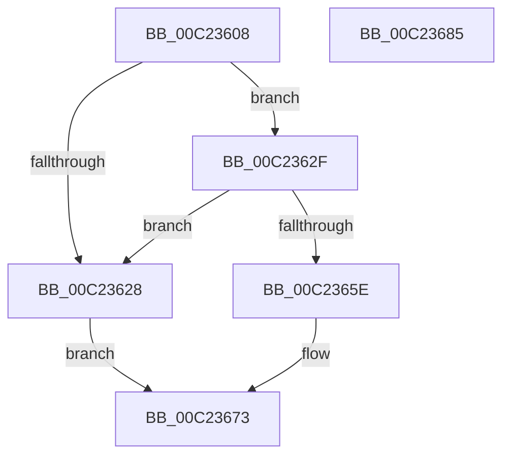

# HalpBlkInitializePageTables

- RVA: `0x00C23608`–`0x00C23686` (길이 `126` bytes)
- VA: `0x0000000140C23608`
- 실행 섹션: `INIT`
- PDB 이름 있음: `예`; PDB Function 태그: `아니요`
- unwind 정보 RVA: `0x000794E0`
- 디코드: `34`개 명령, `126/126` bytes 표시
- 미해석 바이트: `0` (있으면 어셈블리에 `.byte`로 보존)

> 이 문서는 커널 이미지의 기계어와 PDB 기호를 분석해 생성했습니다. 4번과 5번은 함수 원형과 자료형을 바이너리 사용 방식에서 추정한 C 해석이며 원본 소스 복구 결과는 아닙니다.

## 1. Dependencies

- 직접 호출 지점: **3**; 고유 호출 대상: **2**
- 직접 호출자로 확인된 함수: **1**
- RIP 상대 이미지 참조: **3**

### Outgoing calls
- `0x00C2361B` → [HalpBlkAllocatePageTablePage](HalpBlkAllocatePageTablePage_function_00C23410.md) (function, `0x00C23410`)
- `0x00C23631` → [HalpBlkAllocatePageTablePage](HalpBlkAllocatePageTablePage_function_00C23410.md) (function, `0x00C23410`)
- `0x00C23654` → [HalpMap](../../text/3F/HalpMap_function_003F88F4.md) (function, `0x003F88F4`)

### Direct callers
- [HalpBlkInitializeVirtualAddressSpace](HalpBlkInitializeVirtualAddressSpace_function_00C2368C.md) at `0x00C23692`

### Static image references
- `0x00C2365E` → RVA `0x00F90558` (`.data`; write)
- `0x00C23665` → RVA `0x00F90548` (`.data`; write)
- `0x00C2366C` → RVA `0x010086D0` (`INITDATA`; write)

## 2. Other-region calls and transfers

- 다른 실행 섹션으로 향하는 call: **1**
  - `0x00C23654` → [HalpMap](../../text/3F/HalpMap_function_003F88F4.md) (`INIT` → `.text`)
- 별도 외부 분기/꼬리 이동을 확인하지 못했습니다.

## 3. Assembly (complete function range)

```asm
00C23608  48 89 5C 24 08                  mov qword ptr [rsp + 8], rbx
00C2360D  48 89 74 24 10                  mov qword ptr [rsp + 0x10], rsi
00C23612  57                              push rdi
00C23613  48 83 EC 30                     sub rsp, 0x30
00C23617  B1 01                           mov cl, 1
00C23619  33 F6                           xor esi, esi
00C2361B  E8 F0 FD FF FF                  call 0x140c23410
00C23620  48 8B D8                        mov rbx, rax
00C23623  48 85 C0                        test rax, rax
00C23626  75 07                           jne 0x140c2362f
00C23628  BE 17 00 00 C0                  mov esi, 0xc0000017
00C2362D  EB 44                           jmp 0x140c23673
00C2362F  B1 01                           mov cl, 1
00C23631  E8 DA FD FF FF                  call 0x140c23410
00C23636  BA 01 00 00 00                  mov edx, 1
00C2363B  48 89 74 24 28                  mov qword ptr [rsp + 0x28], rsi
00C23640  44 8B C2                        mov r8d, edx
00C23643  C7 44 24 20 04 00 00 00         mov dword ptr [rsp + 0x20], 4
00C2364B  41 B1 01                        mov r9b, 1
00C2364E  48 8B CB                        mov rcx, rbx
00C23651  48 8B F8                        mov rdi, rax
00C23654  E8 9B 52 7D FF                  call 0x1403f88f4
00C23659  48 85 C0                        test rax, rax
00C2365C  74 CA                           je 0x140c23628
00C2365E  48 89 1D F3 CE 36 00            mov qword ptr [rip + 0x36cef3], rbx
00C23665  48 89 3D DC CE 36 00            mov qword ptr [rip + 0x36cedc], rdi
00C2366C  48 89 05 5D 50 3E 00            mov qword ptr [rip + 0x3e505d], rax
00C23673  48 8B 5C 24 40                  mov rbx, qword ptr [rsp + 0x40]
00C23678  8B C6                           mov eax, esi
00C2367A  48 8B 74 24 48                  mov rsi, qword ptr [rsp + 0x48]
00C2367F  48 83 C4 30                     add rsp, 0x30
00C23683  5F                              pop rdi
00C23684  C3                              ret
00C23685  CC                              int3
```

## 4. C-style interpretation (structured pseudocode)

```c
__int64 __fastcall HalpBlkInitializePageTables(void)
{
    __int64 result;
    __int64 v_rsi;
    __int64 v_rsp;
    unsigned __int64 v_stack_m10;
    unsigned int v_stack_m18;
    unsigned __int64 v_stack_p10;
    unsigned __int64 v_stack_p8;

    v_stack_p8 = v_rbx;
    v_stack_p10 = v_rsi;
    v_rsp = (v_rsp) - (48);
    v_rsi = 0;
    result = HalpBlkAllocatePageTablePage(1, a2, a3, a4);
    if (result != 0) goto loc_00C2362F;
loc_00C23628:
    goto loc_00C23673;
loc_00C2362F:
    result = HalpBlkAllocatePageTablePage(1, a2, a3, a4);
    v_stack_m10 = (unsigned int)(0xC0000017ULL);
    v_stack_m18 = 4;
    result = HalpMap(result, 1, 1, 1);
    if (result == 0) goto loc_00C23628;
    *(unsigned __int64 *)(v_rip + 3591923) = result;
    *(unsigned __int64 *)(v_rip + 3591900) = result;
    *(unsigned __int64 *)(v_rip + 4083805) = result;
loc_00C23673:
    v_rsp = (v_rsp) + (48);
    return (unsigned int)((unsigned int)((unsigned int)(0xC0000017ULL)));
}
```

## 5. (Beta) C Style

```c
void HalpBlkInitializePageTables(void)
{
    int64_t result;
    int64_t local_rsi;
    int64_t local_rsp;
    uint64_t v_stack_m10;
    uint32_t v_stack_m18;
    uint64_t v_stack_p10;
    uint64_t v_stack_p8;

    v_stack_p8 = local_rbx;
    v_stack_p10 = local_rsi;
    local_rsp = (local_rsp) - (48);
    local_rsi = 0;
    result = HalpBlkAllocatePageTablePage(1, a2, a3, a4);
    if (result != 0) goto loc_00C2362F;
loc_00C23628:
    goto loc_00C23673;
loc_00C2362F:
    result = HalpBlkAllocatePageTablePage(1, a2, a3, a4);
    v_stack_m10 = (uint32_t)(0xC0000017ULL);
    v_stack_m18 = 4;
    result = HalpMap(result, 1, 1, 1);
    if (result == 0) goto loc_00C23628;
    *(uint64_t *)(v_rip + 0x36CEF3) = result;
    *(uint64_t *)(v_rip + 0x36CEDC) = result;
    *(uint64_t *)(v_rip + 0x3E505D) = result;
loc_00C23673:
    local_rsp = (local_rsp) + (48);
    return (uint32_t)((uint32_t)((uint32_t)(0xC0000017ULL)));
}
```

## 6. Execution-region graph

[열기: 2D/3D 그래프와 함수 탐색 컨트롤 패널](../../../control-panel.html?section=init&rva=0x00C23608&view=graph)

- 2D 그래프는 위에서 아래로 흐르고, 3D 그래프는 빈 공간을 드래그해 회전합니다. Shift+드래그는 이동, 휠은 확대·축소, 함수 노드 선택은 대상 보고서 이동입니다.

### Static fallback


