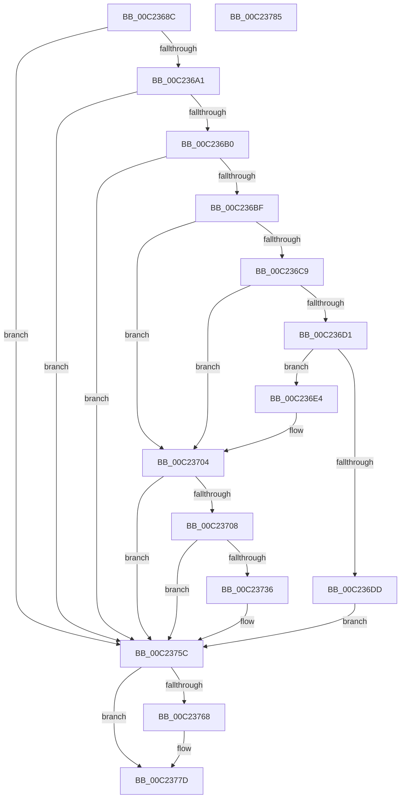

# HalpBlkInitializeVirtualAddressSpace

- RVA: `0x00C2368C`–`0x00C23786` (길이 `250` bytes)
- VA: `0x0000000140C2368C`
- 실행 섹션: `INIT`
- PDB 이름 있음: `예`; PDB Function 태그: `아니요`
- unwind 정보 RVA: `0x00064C80`
- 디코드: `60`개 명령, `250/250` bytes 표시
- 미해석 바이트: `0` (있으면 어셈블리에 `.byte`로 보존)

> 이 문서는 커널 이미지의 기계어와 PDB 기호를 분석해 생성했습니다. 4번과 5번은 함수 원형과 자료형을 바이너리 사용 방식에서 추정한 C 해석이며 원본 소스 복구 결과는 아닙니다.

## 1. Dependencies

- 직접 호출 지점: **7**; 고유 호출 대상: **5**
- 직접 호출자로 확인된 함수: **1**
- RIP 상대 이미지 참조: **10**

### Outgoing calls
- `0x00C23692` → [HalpBlkInitializePageTables](HalpBlkInitializePageTables_function_00C23608.md) (function, `0x00C23608`)
- `0x00C236A1` → [HalpBlkAllocateShadowCode](HalpBlkAllocateShadowCode_function_00C234A4.md) (function, `0x00C234A4`)
- `0x00C236B0` → [HalpBlkAllocateShadowData](HalpBlkAllocateShadowData_function_00C23578.md) (function, `0x00C23578`)
- `0x00C236FD` → [HalpBlkAddVirtualMapping](HalpBlkAddVirtualMapping_function_00C231D0.md) (function, `0x00C231D0`)
- `0x00C2372B` → [HalpBlkAddVirtualMapping](HalpBlkAddVirtualMapping_function_00C231D0.md) (function, `0x00C231D0`)
- `0x00C23755` → [HalpBlkAddVirtualMapping](HalpBlkAddVirtualMapping_function_00C231D0.md) (function, `0x00C231D0`)
- `0x00C23770` → [HalpUnmapVirtualAddress](../../text/3F/HalpUnmapVirtualAddress_function_003F8C30.md) (function, `0x003F8C30`)

### Direct callers
- [HalpBlkInitSystem](HalpBlkInitSystem_function_00C24B98.md) at `0x00C24C4B`

### Static image references
- `0x00C236C1` → RVA `0x00E10452` (`.data`; read)
- `0x00C236C9` → RVA `0x00E10451` (`.data`; read)
- `0x00C236D1` → RVA `0x00E10440` (`.data`; read)
- `0x00C236E4` → RVA `0x00F90678` (`.data`; read)
- `0x00C236EE` → RVA `0x00F90558` (`.data`; read)
- `0x00C23708` → RVA `0x00FC1AA8` (`.data`; read)
- `0x00C23715` → RVA `0x00FC1AA0` (`.data`; read)
- `0x00C23743` → RVA `0x00F90548` (`.data`; read)
- `0x00C2375C` → RVA `0x010086D0` (`INITDATA`; read)
- `0x00C23775` → RVA `0x010086D0` (`INITDATA`; read/write)

## 2. Other-region calls and transfers

- 다른 실행 섹션으로 향하는 call: **1**
  - `0x00C23770` → [HalpUnmapVirtualAddress](../../text/3F/HalpUnmapVirtualAddress_function_003F8C30.md) (`INIT` → `.text`)
- 별도 외부 분기/꼬리 이동을 확인하지 못했습니다.

## 3. Assembly (complete function range)

```asm
00C2368C  40 53                           push rbx
00C2368E  48 83 EC 30                     sub rsp, 0x30
00C23692  E8 71 FF FF FF                  call 0x140c23608
00C23697  8B D8                           mov ebx, eax
00C23699  85 C0                           test eax, eax
00C2369B  0F 88 BB 00 00 00               js 0x140c2375c
00C236A1  E8 FE FD FF FF                  call 0x140c234a4
00C236A6  8B D8                           mov ebx, eax
00C236A8  85 C0                           test eax, eax
00C236AA  0F 88 AC 00 00 00               js 0x140c2375c
00C236B0  E8 C3 FE FF FF                  call 0x140c23578
00C236B5  8B D8                           mov ebx, eax
00C236B7  85 C0                           test eax, eax
00C236B9  0F 88 9D 00 00 00               js 0x140c2375c
00C236BF  33 DB                           xor ebx, ebx
00C236C1  38 1D 8B CD 1E 00               cmp byte ptr [rip + 0x1ecd8b], bl
00C236C7  75 3B                           jne 0x140c23704
00C236C9  38 1D 82 CD 1E 00               cmp byte ptr [rip + 0x1ecd82], bl
00C236CF  75 33                           jne 0x140c23704
00C236D1  4C 8B 05 68 CD 1E 00            mov r8, qword ptr [rip + 0x1ecd68]
00C236D8  4D 85 C0                        test r8, r8
00C236DB  75 07                           jne 0x140c236e4
00C236DD  BB 0E 00 00 C0                  mov ebx, 0xc000000e
00C236E2  EB 78                           jmp 0x140c2375c
00C236E4  48 8B 15 8D CF 36 00            mov rdx, qword ptr [rip + 0x36cf8d]
00C236EB  45 33 C9                        xor r9d, r9d
00C236EE  48 8B 0D 63 CE 36 00            mov rcx, qword ptr [rip + 0x36ce63]
00C236F5  C7 44 24 20 04 00 00 00         mov dword ptr [rsp + 0x20], 4
00C236FD  E8 CE FA FF FF                  call 0x140c231d0
00C23702  8B D8                           mov ebx, eax
00C23704  85 DB                           test ebx, ebx
00C23706  78 54                           js 0x140c2375c
00C23708  4C 8B 05 99 E3 39 00            mov r8, qword ptr [rip + 0x39e399]
00C2370F  41 B9 01 00 00 00               mov r9d, 1
00C23715  48 8B 15 84 E3 39 00            mov rdx, qword ptr [rip + 0x39e384]
00C2371C  48 8B 0D 35 CE 36 00            mov rcx, qword ptr [rip + 0x36ce35]
00C23723  C7 44 24 20 04 00 00 00         mov dword ptr [rsp + 0x20], 4
00C2372B  E8 A0 FA FF FF                  call 0x140c231d0
00C23730  8B D8                           mov ebx, eax
00C23732  85 C0                           test eax, eax
00C23734  78 26                           js 0x140c2375c
00C23736  48 8B 15 63 E3 39 00            mov rdx, qword ptr [rip + 0x39e363]
00C2373D  41 B9 01 00 00 00               mov r9d, 1
00C23743  48 8B 0D FE CD 36 00            mov rcx, qword ptr [rip + 0x36cdfe]
00C2374A  4C 8B C2                        mov r8, rdx
00C2374D  C7 44 24 20 40 00 00 00         mov dword ptr [rsp + 0x20], 0x40
00C23755  E8 76 FA FF FF                  call 0x140c231d0
00C2375A  8B D8                           mov ebx, eax
00C2375C  48 8B 0D 6D 4F 3E 00            mov rcx, qword ptr [rip + 0x3e4f6d]
00C23763  48 85 C9                        test rcx, rcx
00C23766  74 15                           je 0x140c2377d
00C23768  41 B0 01                        mov r8b, 1
00C2376B  BA 01 00 00 00                  mov edx, 1
00C23770  E8 BB 54 7D FF                  call 0x1403f8c30
00C23775  48 83 25 53 4F 3E 00 00         and qword ptr [rip + 0x3e4f53], 0
00C2377D  8B C3                           mov eax, ebx
00C2377F  48 83 C4 30                     add rsp, 0x30
00C23783  5B                              pop rbx
00C23784  C3                              ret
00C23785  CC                              int3
```

## 4. C-style interpretation (structured pseudocode)

```c
__int64 __fastcall HalpBlkInitializeVirtualAddressSpace(__int64 a1, __int64 a2, __int64 a3, int a4)
{
    __int64 result;
    __int64 v_rbx;
    __int64 v_rsp;
    unsigned int v_stack_m18;

    v_rsp = (v_rsp) - (48);
    result = HalpBlkInitializePageTables(a1, a2, a3, a4);
    if (sign_flag) goto loc_00C2375C;
    result = HalpBlkAllocateShadowCode(a1, a2, a3, a4);
    if (sign_flag) goto loc_00C2375C;
    result = HalpBlkAllocateShadowData(a1, a2, a3, a4);
    if (sign_flag) goto loc_00C2375C;
    v_rbx = 0;
    if ((*(unsigned __int8 *)(v_rip + 2018699)) != 0) goto loc_00C23704;
    if ((*(unsigned __int8 *)(v_rip + 2018690)) != 0) goto loc_00C23704;
    if (*(unsigned __int64 *)(v_rip + 2018664) != 0) goto loc_00C236E4;
    goto loc_00C2375C;
loc_00C236E4:
    a4 = 0;
    v_stack_m18 = 4;
    result = HalpBlkAddVirtualMapping(*(unsigned __int64 *)(v_rip + 3591779), *(unsigned __int64 *)(v_rip + 3592077), *(unsigned __int64 *)(v_rip + 2018664), a4);
loc_00C23704:
    if (sign_flag) goto loc_00C2375C;
    v_stack_m18 = 4;
    result = HalpBlkAddVirtualMapping(*(unsigned __int64 *)(v_rip + 3591733), *(unsigned __int64 *)(v_rip + 3793796), *(unsigned __int64 *)(v_rip + 3793817), 1);
    v_rbx = (unsigned int)((unsigned int)(result));
    if (!(sign_flag)) {
        a2 = *(unsigned __int64 *)(v_rip + 3793763);
        a4 = 1;
        a1 = *(unsigned __int64 *)(v_rip + 3591678);
        a3 = a2;
        v_stack_m18 = 64;
        result = HalpBlkAddVirtualMapping(a1, a2, a3, a4);
        v_rbx = (unsigned int)(result);
    }
    if (*(unsigned __int64 *)(v_rip + 4083565) != 0) {
        a3 = 1;
        a2 = 1;
        result = HalpUnmapVirtualAddress(*(unsigned __int64 *)(v_rip + 4083565), a2, a3, a4);
    }
    v_rsp = (v_rsp) + (48);
    return (unsigned int)((unsigned int)(v_rbx));
}
```

## 5. (Beta) C Style

```c
int64_t HalpBlkInitializeVirtualAddressSpace(int64_t Arg1, int64_t Arg2, int64_t Arg3, int32_t Arg4)
{
    int64_t result;
    int64_t local_rbx;
    int64_t local_rsp;
    uint32_t v_stack_m18;

    local_rsp = (local_rsp) - (48);
    result = HalpBlkInitializePageTables(Arg1, Arg2, Arg3, Arg4);
    if (sign_flag) goto loc_00C2375C;
    result = HalpBlkAllocateShadowCode(Arg1, Arg2, Arg3, Arg4);
    if (sign_flag) goto loc_00C2375C;
    result = HalpBlkAllocateShadowData(Arg1, Arg2, Arg3, Arg4);
    if (sign_flag) goto loc_00C2375C;
    local_rbx = 0;
    if ((*(uint8_t *)(v_rip + 0x1ECD8B)) != 0) goto loc_00C23704;
    if ((*(uint8_t *)(v_rip + 0x1ECD82)) != 0) goto loc_00C23704;
    if (*(uint64_t *)(v_rip + 0x1ECD68) != 0) goto loc_00C236E4;
    goto loc_00C2375C;
loc_00C236E4:
    Arg4 = 0;
    v_stack_m18 = 4;
    result = HalpBlkAddVirtualMapping(*(uint64_t *)(v_rip + 0x36CE63), *(uint64_t *)(v_rip + 0x36CF8D), *(uint64_t *)(v_rip + 0x1ECD68), Arg4);
loc_00C23704:
    if (sign_flag) goto loc_00C2375C;
    v_stack_m18 = 4;
    result = HalpBlkAddVirtualMapping(*(uint64_t *)(v_rip + 0x36CE35), *(uint64_t *)(v_rip + 0x39E384), *(uint64_t *)(v_rip + 0x39E399), 1);
    local_rbx = (uint32_t)((uint32_t)(result));
    if (!(sign_flag)) {
        Arg2 = *(uint64_t *)(v_rip + 0x39E363);
        Arg4 = 1;
        Arg1 = *(uint64_t *)(v_rip + 0x36CDFE);
        Arg3 = Arg2;
        v_stack_m18 = 64;
        result = HalpBlkAddVirtualMapping(Arg1, Arg2, Arg3, Arg4);
        local_rbx = (uint32_t)(result);
    }
    if (*(uint64_t *)(v_rip + 0x3E4F6D) != 0) {
        Arg3 = 1;
        Arg2 = 1;
        result = HalpUnmapVirtualAddress(*(uint64_t *)(v_rip + 0x3E4F6D), Arg2, Arg3, Arg4);
    }
    local_rsp = (local_rsp) + (48);
    return (uint32_t)((uint32_t)(local_rbx));
}
```

## 6. Execution-region graph

[열기: 2D/3D 그래프와 함수 탐색 컨트롤 패널](../../../control-panel.html?section=init&rva=0x00C2368C&view=graph)

- 2D 그래프는 위에서 아래로 흐르고, 3D 그래프는 빈 공간을 드래그해 회전합니다. Shift+드래그는 이동, 휠은 확대·축소, 함수 노드 선택은 대상 보고서 이동입니다.

### Static fallback


