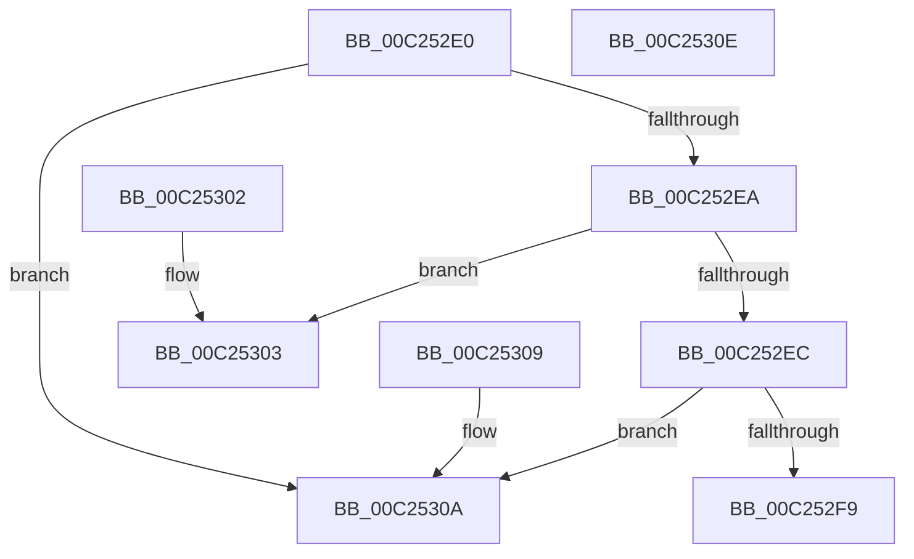

# HalpChannelAssignmentSort

- RVA: `0x00C252E0`–`0x00C2530F` (길이 `47` bytes)
- VA: `0x0000000140C252E0`
- 실행 섹션: `INIT`
- PDB 이름 있음: `예`; PDB Function 태그: `아니요`
- unwind 정보 RVA: `0x000DB714`
- 디코드: `19`개 명령, `47/47` bytes 표시
- 미해석 바이트: `0` (있으면 어셈블리에 `.byte`로 보존)

> 이 문서는 커널 이미지의 기계어와 PDB 기호를 분석해 생성했습니다. 4번과 5번은 함수 원형과 자료형을 바이너리 사용 방식에서 추정한 C 해석이며 원본 소스 복구 결과는 아닙니다.

## 1. Dependencies

- 직접 호출 지점: **0**; 고유 호출 대상: **0**
- 직접 호출자로 확인된 함수: **0**
- RIP 상대 이미지 참조: **0**

### Outgoing calls
- 직접 디코드된 call 명령이 없습니다.

### Direct callers
- 이 함수 시작 RVA로 연결되는 직접 call은 확인되지 않았습니다. 간접 호출은 완전히 역산할 수 없습니다.

### Static image references
- 디코드된 RIP-relative 메모리 참조가 없습니다.

## 2. Other-region calls and transfers

- 다른 실행 섹션으로 향하는 call: **0**
- 별도 외부 분기/꼬리 이동을 확인하지 못했습니다.

## 3. Assembly (complete function range)

```asm
00C252E0  0F B7 41 0A                     movzx eax, word ptr [rcx + 0xa]
00C252E4  66 3B 42 0A                     cmp ax, word ptr [rdx + 0xa]
00C252E8  72 20                           jb 0x140c2530a
00C252EA  77 17                           ja 0x140c25303
00C252EC  0F B7 49 08                     movzx ecx, word ptr [rcx + 8]
00C252F0  0F B7 52 08                     movzx edx, word ptr [rdx + 8]
00C252F4  66 3B CA                        cmp cx, dx
00C252F7  72 11                           jb 0x140c2530a
00C252F9  33 C0                           xor eax, eax
00C252FB  66 3B CA                        cmp cx, dx
00C252FE  0F 97 C0                        seta al
00C25301  C3                              ret
00C25302  CC                              int3
00C25303  B8 01 00 00 00                  mov eax, 1
00C25308  C3                              ret
00C25309  CC                              int3
00C2530A  83 C8 FF                        or eax, 0xffffffff
00C2530D  C3                              ret
00C2530E  CC                              int3
```

## 4. C-style interpretation (structured pseudocode)

```c
__int64 __fastcall HalpChannelAssignmentSort(__int64 a1, __int64 a2)
{
    __int64 result;

    if (((unsigned __int16)(*(unsigned __int16 *)(a1 + 10))) < (*(unsigned __int16 *)(a2 + 10))) goto loc_00C2530A;
    if (((unsigned __int16)(*(unsigned __int16 *)(a1 + 10))) > (*(unsigned __int16 *)(a2 + 10))) goto loc_00C25303;
    if (((unsigned __int16)(*(unsigned __int16 *)(a1 + 8))) < ((unsigned __int16)(*(unsigned __int16 *)(a2 + 8)))) goto loc_00C2530A;
    result = 0;
    result = (((unsigned __int16)(*(unsigned __int16 *)(a1 + 8))) > ((unsigned __int16)(*(unsigned __int16 *)(a2 + 8)))) ? 1 : 0;
    return result;
loc_00C25303:
    return 1;
loc_00C2530A:
    result = (unsigned int)((1) | (0xFFFFFFFFULL));
    return result;
}
```

## 5. (Beta) C Style

```c
int64_t HalpChannelAssignmentSort(void *Arg1, void *Arg2)
{
    uint8_t *arg1 = (uint8_t *)Arg1;
    uint8_t *arg2 = (uint8_t *)Arg2;

    int64_t result;

    if (((uint16_t)(*(uint16_t *)(arg1 + 0xA))) < (*(uint16_t *)(arg2 + 0xA))) goto loc_00C2530A;
    if (((uint16_t)(*(uint16_t *)(arg1 + 0xA))) > (*(uint16_t *)(arg2 + 0xA))) goto loc_00C25303;
    if (((uint16_t)(*(uint16_t *)(arg1 + 0x8))) < ((uint16_t)(*(uint16_t *)(arg2 + 0x8)))) goto loc_00C2530A;
    result = 0;
    result = (((uint16_t)(*(uint16_t *)(arg1 + 0x8))) > ((uint16_t)(*(uint16_t *)(arg2 + 0x8)))) ? 1 : 0;
    return result;
loc_00C25303:
    return 1;
loc_00C2530A:
    result = (uint32_t)((1) | (0xFFFFFFFFULL));
    return result;
}
```

### 관측된 메모리 오프셋

구조체 형식이 확인되지 않은 접근은 인자 기준의 오프셋으로만 기록했습니다.

| 기준 인자 | 오프셋 표현 | 폭 (bit) | 접근 |
|---|---:|---:|---|
| `Arg1` | `+ 0x8` | `16` | `R` |
| `Arg1` | `+ 0xA` | `16` | `R` |
| `Arg2` | `+ 0x8` | `16` | `R` |
| `Arg2` | `+ 0xA` | `16` | `R` |

## 6. Execution-region graph

[열기: 2D/3D 그래프와 함수 탐색 컨트롤 패널](../../../control-panel.html?section=init&rva=0x00C252E0&view=graph)

- 2D 그래프는 위에서 아래로 흐르고, 3D 그래프는 빈 공간을 드래그해 회전합니다. Shift+드래그는 이동, 휠은 확대·축소, 함수 노드 선택은 대상 보고서 이동입니다.

### Static fallback


