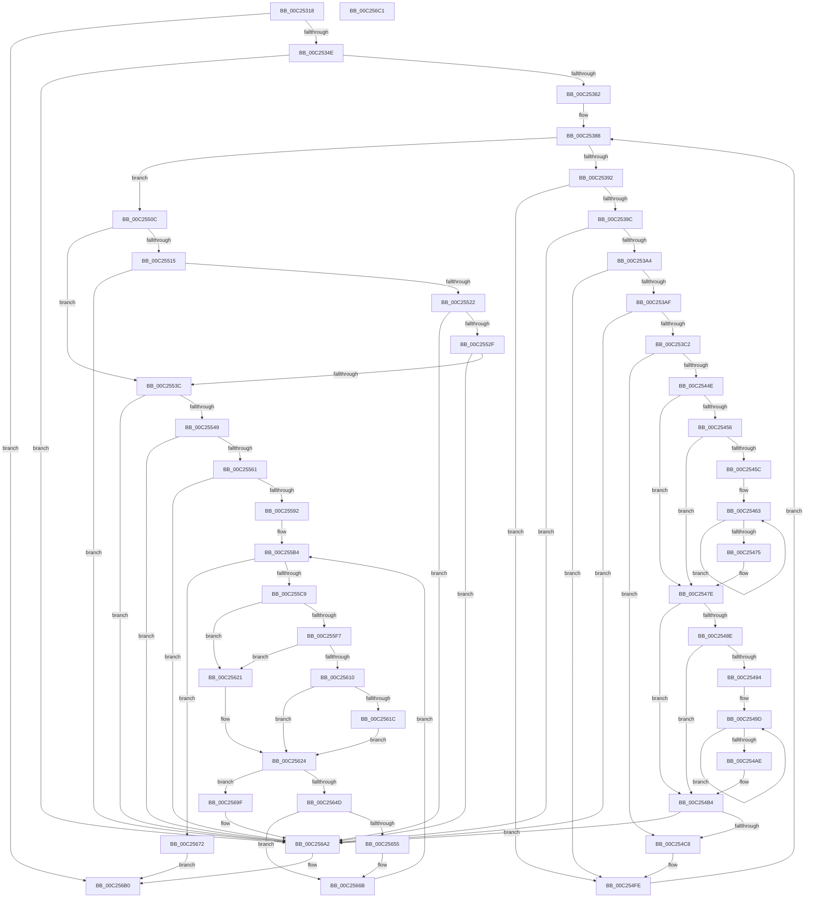

# HalpChannelInitializeStaticConfiguration

- RVA: `0x00C25318`–`0x00C256C2` (길이 `938` bytes)
- VA: `0x0000000140C25318`
- 실행 섹션: `INIT`
- PDB 이름 있음: `예`; PDB Function 태그: `아니요`
- unwind 정보 RVA: `0x000A315C`
- 디코드: `232`개 명령, `938/938` bytes 표시
- 미해석 바이트: `0` (있으면 어셈블리에 `.byte`로 보존)

> 이 문서는 커널 이미지의 기계어와 PDB 기호를 분석해 생성했습니다. 4번과 5번은 함수 원형과 자료형을 바이너리 사용 방식에서 추정한 C 해석이며 원본 소스 복구 결과는 아닙니다.

## 1. Dependencies

- 직접 호출 지점: **6**; 고유 호출 대상: **3**
- 직접 호출자로 확인된 함수: **2**
- RIP 상대 이미지 참조: **13**

### Outgoing calls
- `0x00C253D3` → [qsort](../../text/50/qsort_function_005009F0.md) (function, `0x005009F0`)
- `0x00C2557D` → [qsort](../../text/50/qsort_function_005009F0.md) (function, `0x005009F0`)
- `0x00C25582` → [HalpValidateMpns](../../page/70/HalpValidateMpns_function_0070D96C.md) (function, `0x0070D96C`)
- `0x00C255A5` → [qsort](../../text/50/qsort_function_005009F0.md) (function, `0x005009F0`)
- `0x00C2563F` → [HalpSelectFeasibleLowPowerState](HalpSelectFeasibleLowPowerState_function_00C25728.md) (function, `0x00C25728`)
- `0x00C25682` → [qsort](../../text/50/qsort_function_005009F0.md) (function, `0x005009F0`)

### Direct callers
- [HalpInitializeConfigurationFromMadt](HalpInitializeConfigurationFromMadt_function_00C21D54.md) at `0x00C21FF8`
- [HalpNumaInitializeStaticConfiguration](HalpNumaInitializeStaticConfiguration_function_00C220D8.md) at `0x00C22961`

### Static image references
- `0x00C2532C` → RVA `0x00F8F9E0` (`.data`; read)
- `0x00C2534E` → RVA `0x00E117E8` (`.data`; read)
- `0x00C253CC` → RVA `0x00569490` (`HalpMpsValueAscendingSort`; read)
- `0x00C25439` → RVA `0x00F90608` (`.data`; read)
- `0x00C254C8` → RVA `0x00F8F9D8` (`.data`; read)
- `0x00C25515` → RVA `0x00E0A828` (`.data`; read)
- `0x00C25522` → RVA `0x00F90600` (`.data`; read)
- `0x00C2552F` → RVA `0x00F90638` (`.data`; read)
- `0x00C25568` → RVA `0x00C256D0` (`HalpChannelMpnIdSort`; read)
- `0x00C25599` → RVA `0x00C252E0` (`HalpChannelAssignmentSort`; read)
- `0x00C25672` → RVA `0x00C252C0` (`HalpChannelAscendingSort`; read)
- `0x00C256A2` → RVA `0x00F8F9E0` (`.data`; write)
- `0x00C256A9` → RVA `0x00F8F9D8` (`.data`; write)

## 2. Other-region calls and transfers

- 다른 실행 섹션으로 향하는 call: **5**
  - `0x00C253D3` → [qsort](../../text/50/qsort_function_005009F0.md) (`INIT` → `.text`)
  - `0x00C2557D` → [qsort](../../text/50/qsort_function_005009F0.md) (`INIT` → `.text`)
  - `0x00C25582` → [HalpValidateMpns](../../page/70/HalpValidateMpns_function_0070D96C.md) (`INIT` → `PAGE`)
  - `0x00C255A5` → [qsort](../../text/50/qsort_function_005009F0.md) (`INIT` → `.text`)
  - `0x00C25682` → [qsort](../../text/50/qsort_function_005009F0.md) (`INIT` → `.text`)
- 별도 외부 분기/꼬리 이동을 확인하지 못했습니다.

## 3. Assembly (complete function range)

```asm
00C25318  40 53                           push rbx
00C2531A  55                              push rbp
00C2531B  56                              push rsi
00C2531C  57                              push rdi
00C2531D  41 54                           push r12
00C2531F  41 55                           push r13
00C25321  41 56                           push r14
00C25323  41 57                           push r15
00C25325  48 83 EC 28                     sub rsp, 0x28
00C25329  45 33 C0                        xor r8d, r8d
00C2532C  44 39 05 AD A6 36 00            cmp dword ptr [rip + 0x36a6ad], r8d
00C25333  4C 89 84 24 80 00 00 00         mov qword ptr [rsp + 0x80], r8
00C2533B  44 88 44 24 70                  mov byte ptr [rsp + 0x70], r8b
00C25340  4C 89 84 24 88 00 00 00         mov qword ptr [rsp + 0x88], r8
00C25348  0F 84 62 03 00 00               je 0x140c256b0
00C2534E  48 8B 05 93 C4 1E 00            mov rax, qword ptr [rip + 0x1ec493]
00C25355  41 8D 48 01                     lea ecx, [r8 + 1]
00C25359  38 48 08                        cmp byte ptr [rax + 8], cl
00C2535C  0F 85 40 03 00 00               jne 0x140c256a2
00C25362  44 0F B7 68 28                  movzx r13d, word ptr [rax + 0x28]
00C25367  48 8D 58 2C                     lea rbx, [rax + 0x2c]
00C2536B  8B 78 04                        mov edi, dword ptr [rax + 4]
00C2536E  48 83 CD FF                     or rbp, 0xffffffffffffffff
00C25372  66 44 89 6C 24 78               mov word ptr [rsp + 0x78], r13w
00C25378  48 03 F8                        add rdi, rax
00C2537B  45 8B E0                        mov r12d, r8d
00C2537E  45 8B F0                        mov r14d, r8d
00C25381  45 8B F8                        mov r15d, r8d
00C25384  41 0F B7 F0                     movzx esi, r8w
00C25388  66 41 3B F5                     cmp si, r13w
00C2538C  0F 83 7A 01 00 00               jae 0x140c2550c
00C25392  8A 03                           mov al, byte ptr [rbx]
00C25394  84 C1                           test cl, al
00C25396  0F 84 62 01 00 00               je 0x140c254fe
00C2539C  A8 04                           test al, 4
00C2539E  0F 85 FE 02 00 00               jne 0x140c256a2
00C253A4  8B 43 18                        mov eax, dword ptr [rbx + 0x18]
00C253A7  85 C0                           test eax, eax
00C253A9  0F 84 4F 01 00 00               je 0x140c254fe
00C253AF  8B D0                           mov edx, eax
00C253B1  48 83 C0 10                     add rax, 0x10
00C253B5  48 8D 04 43                     lea rax, [rbx + rax*2]
00C253B9  48 3B C7                        cmp rax, rdi
00C253BC  0F 87 E0 02 00 00               ja 0x140c256a2
00C253C2  48 8D 4B 20                     lea rcx, [rbx + 0x20]
00C253C6  41 B8 02 00 00 00               mov r8d, 2
00C253CC  4C 8D 0D BD 40 94 FF            lea r9, [rip - 0x6bbf43]
00C253D3  E8 18 B6 8D FF                  call 0x1405009f0
00C253D8  8B 43 0C                        mov eax, dword ptr [rbx + 0xc]
00C253DB  89 84 24 84 00 00 00            mov dword ptr [rsp + 0x84], eax
00C253E2  8B 43 08                        mov eax, dword ptr [rbx + 8]
00C253E5  89 84 24 80 00 00 00            mov dword ptr [rsp + 0x80], eax
00C253EC  48 8B 94 24 80 00 00 00         mov rdx, qword ptr [rsp + 0x80]
00C253F4  48 C1 EA 0C                     shr rdx, 0xc
00C253F8  48 3B D5                        cmp rdx, rbp
00C253FB  48 8B C2                        mov rax, rdx
00C253FE  48 0F 43 C5                     cmovae rax, rbp
00C25402  48 8B E8                        mov rbp, rax
00C25405  8B 43 14                        mov eax, dword ptr [rbx + 0x14]
00C25408  89 84 24 8C 00 00 00            mov dword ptr [rsp + 0x8c], eax
00C2540F  8B 43 10                        mov eax, dword ptr [rbx + 0x10]
00C25412  89 84 24 88 00 00 00            mov dword ptr [rsp + 0x88], eax
00C25419  48 8B 8C 24 88 00 00 00         mov rcx, qword ptr [rsp + 0x88]
00C25421  48 C1 E9 0C                     shr rcx, 0xc
00C25425  4C 8D 51 FF                     lea r10, [rcx - 1]
00C25429  4C 03 D2                        add r10, rdx
00C2542C  4D 3B D6                        cmp r10, r14
00C2542F  49 8B C2                        mov rax, r10
00C25432  49 0F 46 C6                     cmovbe rax, r14
00C25436  4C 03 F9                        add r15, rcx
00C25439  48 8B 0D C8 B1 36 00            mov rcx, qword ptr [rip + 0x36b1c8]
00C25440  45 33 C0                        xor r8d, r8d
00C25443  4C 8B F0                        mov r14, rax
00C25446  45 8B C8                        mov r9d, r8d
00C25449  48 85 C9                        test rcx, rcx
00C2544C  74 7A                           je 0x140c254c8
00C2544E  4C 8B 19                        mov r11, qword ptr [rcx]
00C25451  49 3B D3                        cmp rdx, r11
00C25454  72 28                           jb 0x140c2547e
00C25456  48 3B 51 10                     cmp rdx, qword ptr [rcx + 0x10]
00C2545A  72 22                           jb 0x140c2547e
00C2545C  45 8D 68 01                     lea r13d, [r8 + 1]
00C25460  45 8B C5                        mov r8d, r13d
00C25463  45 03 C5                        add r8d, r13d
00C25466  45 03 CD                        add r9d, r13d
00C25469  41 8B C0                        mov eax, r8d
00C2546C  48 03 C0                        add rax, rax
00C2546F  48 3B 14 C1                     cmp rdx, qword ptr [rcx + rax*8]
00C25473  73 EE                           jae 0x140c25463
00C25475  44 0F B7 6C 24 78               movzx r13d, word ptr [rsp + 0x78]
00C2547B  45 33 C0                        xor r8d, r8d
00C2547E  41 8B C1                        mov eax, r9d
00C25481  48 03 C0                        add rax, rax
00C25484  44 8B 4C C1 08                  mov r9d, dword ptr [rcx + rax*8 + 8]
00C25489  4D 3B D3                        cmp r10, r11
00C2548C  72 26                           jb 0x140c254b4
00C2548E  4C 3B 51 10                     cmp r10, qword ptr [rcx + 0x10]
00C25492  72 20                           jb 0x140c254b4
00C25494  41 BD 01 00 00 00               mov r13d, 1
00C2549A  41 8B D5                        mov edx, r13d
00C2549D  41 03 D5                        add edx, r13d
00C254A0  45 03 C5                        add r8d, r13d
00C254A3  8B C2                           mov eax, edx
00C254A5  48 03 C0                        add rax, rax
00C254A8  4C 3B 14 C1                     cmp r10, qword ptr [rcx + rax*8]
00C254AC  73 EF                           jae 0x140c2549d
00C254AE  44 0F B7 6C 24 78               movzx r13d, word ptr [rsp + 0x78]
00C254B4  41 8B C0                        mov eax, r8d
00C254B7  45 33 C0                        xor r8d, r8d
00C254BA  48 03 C0                        add rax, rax
00C254BD  44 39 4C C1 08                  cmp dword ptr [rcx + rax*8 + 8], r9d
00C254C2  0F 85 DA 01 00 00               jne 0x140c256a2
00C254C8  48 8B 05 09 A5 36 00            mov rax, qword ptr [rip + 0x36a509]
00C254CF  41 8B D4                        mov edx, r12d
00C254D2  48 03 D2                        add rdx, rdx
00C254D5  48 89 1C D0                     mov qword ptr [rax + rdx*8], rbx
00C254D9  48 8B 05 F8 A4 36 00            mov rax, qword ptr [rip + 0x36a4f8]
00C254E0  0F B7 4B 02                     movzx ecx, word ptr [rbx + 2]
00C254E4  66 89 4C D0 08                  mov word ptr [rax + rdx*8 + 8], cx
00C254E9  B9 01 00 00 00                  mov ecx, 1
00C254EE  48 8B 05 E3 A4 36 00            mov rax, qword ptr [rip + 0x36a4e3]
00C254F5  44 03 E1                        add r12d, ecx
00C254F8  66 44 89 4C D0 0A               mov word ptr [rax + rdx*8 + 0xa], r9w
00C254FE  8B 43 04                        mov eax, dword ptr [rbx + 4]
00C25501  66 03 F1                        add si, cx
00C25504  48 03 D8                        add rbx, rax
00C25507  E9 7C FE FF FF                  jmp 0x140c25388
00C2550C  4C 39 05 F5 B0 36 00            cmp qword ptr [rip + 0x36b0f5], r8
00C25513  74 27                           je 0x140c2553c
00C25515  48 3B 2D 0C 53 1E 00            cmp rbp, qword ptr [rip + 0x1e530c]
00C2551C  0F 85 80 01 00 00               jne 0x140c256a2
00C25522  4C 3B 35 D7 B0 36 00            cmp r14, qword ptr [rip + 0x36b0d7]
00C25529  0F 85 73 01 00 00               jne 0x140c256a2
00C2552F  4C 3B 3D 02 B1 36 00            cmp r15, qword ptr [rip + 0x36b102]
00C25536  0F 85 66 01 00 00               jne 0x140c256a2
00C2553C  48 8D 43 02                     lea rax, [rbx + 2]
00C25540  48 3B C7                        cmp rax, rdi
00C25543  0F 87 59 01 00 00               ja 0x140c256a2
00C25549  44 0F B7 33                     movzx r14d, word ptr [rbx]
00C2554D  4C 8D 7B 04                     lea r15, [rbx + 4]
00C25551  49 6B CE 1C                     imul rcx, r14, 0x1c
00C25555  49 03 CF                        add rcx, r15
00C25558  48 3B CF                        cmp rcx, rdi
00C2555B  0F 87 41 01 00 00               ja 0x140c256a2
00C25561  48 8B 0D 70 A4 36 00            mov rcx, qword ptr [rip + 0x36a470]
00C25568  4C 8D 0D 61 01 00 00            lea r9, [rip + 0x161]
00C2556F  BB 10 00 00 00                  mov ebx, 0x10
00C25574  41 8B D4                        mov edx, r12d
00C25577  44 8B C3                        mov r8d, ebx
00C2557A  41 8B EC                        mov ebp, r12d
00C2557D  E8 6E B4 8D FF                  call 0x1405009f0
00C25582  E8 E5 83 AE FF                  call 0x14070d96c
00C25587  45 33 C0                        xor r8d, r8d
00C2558A  85 C0                           test eax, eax
00C2558C  0F 84 10 01 00 00               je 0x140c256a2
00C25592  48 8B 0D 3F A4 36 00            mov rcx, qword ptr [rip + 0x36a43f]
00C25599  4C 8D 0D 40 FD FF FF            lea r9, [rip - 0x2c0]
00C255A0  44 8B C3                        mov r8d, ebx
00C255A3  8B D5                           mov edx, ebp
00C255A5  E8 46 B4 8D FF                  call 0x1405009f0
00C255AA  45 33 ED                        xor r13d, r13d
00C255AD  41 0F B7 F5                     movzx esi, r13w
00C255B1  41 8B FD                        mov edi, r13d
00C255B4  48 8B 0D 1D A4 36 00            mov rcx, qword ptr [rip + 0x36a41d]
00C255BB  8B DF                           mov ebx, edi
00C255BD  48 03 DB                        add rbx, rbx
00C255C0  41 3B FC                        cmp edi, r12d
00C255C3  0F 83 A9 00 00 00               jae 0x140c25672
00C255C9  4C 8B 14 D9                     mov r10, qword ptr [rcx + rbx*8]
00C255CD  41 8B 42 0C                     mov eax, dword ptr [r10 + 0xc]
00C255D1  89 84 24 84 00 00 00            mov dword ptr [rsp + 0x84], eax
00C255D8  41 8B 42 08                     mov eax, dword ptr [r10 + 8]
00C255DC  89 84 24 80 00 00 00            mov dword ptr [rsp + 0x80], eax
00C255E3  48 8B 84 24 80 00 00 00         mov rax, qword ptr [rsp + 0x80]
00C255EB  48 C1 E8 0C                     shr rax, 0xc
00C255EF  48 89 04 D9                     mov qword ptr [rcx + rbx*8], rax
00C255F3  85 FF                           test edi, edi
00C255F5  74 2A                           je 0x140c25621
00C255F7  48 8B 0D DA A3 36 00            mov rcx, qword ptr [rip + 0x36a3da]
00C255FE  8D 57 FF                        lea edx, [rdi - 1]
00C25601  48 03 D2                        add rdx, rdx
00C25604  0F B7 44 D1 0A                  movzx eax, word ptr [rcx + rdx*8 + 0xa]
00C25609  66 39 44 D9 0A                  cmp word ptr [rcx + rbx*8 + 0xa], ax
00C2560E  75 11                           jne 0x140c25621
00C25610  0F B7 44 D1 08                  movzx eax, word ptr [rcx + rdx*8 + 8]
00C25615  66 39 44 D9 08                  cmp word ptr [rcx + rbx*8 + 8], ax
00C2561A  74 08                           je 0x140c25624
00C2561C  66 FF C6                        inc si
00C2561F  EB 03                           jmp 0x140c25624
00C25621  41 8B F5                        mov esi, r13d
00C25624  48 8B 05 AD A3 36 00            mov rax, qword ptr [rip + 0x36a3ad]
00C2562B  48 8D 54 24 70                  lea rdx, [rsp + 0x70]
00C25630  4D 8B CF                        mov r9, r15
00C25633  45 0F B7 C6                     movzx r8d, r14w
00C25637  49 8B CA                        mov rcx, r10
00C2563A  66 89 74 D8 0C                  mov word ptr [rax + rbx*8 + 0xc], si
00C2563F  E8 E4 00 00 00                  call 0x140c25728
00C25644  BA 01 00 00 00                  mov edx, 1
00C25649  3B C2                           cmp eax, edx
00C2564B  75 52                           jne 0x140c2569f
00C2564D  8A 4C 24 70                     mov cl, byte ptr [rsp + 0x70]
00C25651  84 C9                           test cl, cl
00C25653  74 16                           je 0x140c2566b
00C25655  48 8B 05 7C A3 36 00            mov rax, qword ptr [rip + 0x36a37c]
00C2565C  88 54 D8 0E                     mov byte ptr [rax + rbx*8 + 0xe], dl
00C25660  48 8B 05 71 A3 36 00            mov rax, qword ptr [rip + 0x36a371]
00C25667  88 4C D8 0F                     mov byte ptr [rax + rbx*8 + 0xf], cl
00C2566B  03 FA                           add edi, edx
00C2566D  E9 42 FF FF FF                  jmp 0x140c255b4
00C25672  4C 8D 0D 47 FC FF FF            lea r9, [rip - 0x3b9]
00C25679  41 B8 10 00 00 00               mov r8d, 0x10
00C2567F  48 8B D5                        mov rdx, rbp
00C25682  E8 69 B3 8D FF                  call 0x1405009f0
00C25687  48 8B 05 4A A3 36 00            mov rax, qword ptr [rip + 0x36a34a]
00C2568E  48 83 0C D8 FF                  or qword ptr [rax + rbx*8], 0xffffffffffffffff
00C25693  48 8B 05 3E A3 36 00            mov rax, qword ptr [rip + 0x36a33e]
00C2569A  4C 89 28                        mov qword ptr [rax], r13
00C2569D  EB 11                           jmp 0x140c256b0
00C2569F  45 33 C0                        xor r8d, r8d
00C256A2  44 89 05 37 A3 36 00            mov dword ptr [rip + 0x36a337], r8d
00C256A9  4C 89 05 28 A3 36 00            mov qword ptr [rip + 0x36a328], r8
00C256B0  48 83 C4 28                     add rsp, 0x28
00C256B4  41 5F                           pop r15
00C256B6  41 5E                           pop r14
00C256B8  41 5D                           pop r13
00C256BA  41 5C                           pop r12
00C256BC  5F                              pop rdi
00C256BD  5E                              pop rsi
00C256BE  5D                              pop rbp
00C256BF  5B                              pop rbx
00C256C0  C3                              ret
00C256C1  CC                              int3
```

## 4. C-style interpretation (structured pseudocode)

```c
__int64 __fastcall HalpChannelInitializeStaticConfiguration(__int64 a1, __int64 a2, int a3)
{
    __int64 result;
    __int64 v_r10;
    __int64 v_r12;
    __int64 v_r13;
    __int64 v_r15;
    __int64 v_rbp;
    __int64 v_rbx;
    __int64 v_rdi;
    __int64 v_rsi;
    __int64 v_rsp;
    unsigned __int16 v_stack_p10;
    unsigned __int64 v_stack_p18;
    unsigned int v_stack_p1C;
    unsigned __int64 v_stack_p20;
    unsigned int v_stack_p24;
    unsigned __int8 v_stack_p8;

    v_rsp = (v_rsp) - (40);
    a3 = 0;
    v_stack_p18 = 0;
    v_stack_p8 = 0;
    v_stack_p20 = 0;
    if ((*(unsigned int *)(v_rip + 3581613)) == 0) goto loc_00C256B0;
    if ((*(unsigned __int8 *)(*(unsigned __int64 *)(v_rip + 2016403) + 8)) != ((unsigned __int8)(a3 + 1))) goto loc_00C256A2;
    v_rbp = (v_rbp) | (-1);
    v_stack_p10 = (unsigned __int16)(*(unsigned __int16 *)(*(unsigned __int64 *)(v_rip + 2016403) + 40));
    v_rdi = ((unsigned int)(*(unsigned int *)(*(unsigned __int64 *)(v_rip + 2016403) + 4))) + (*(unsigned __int64 *)(v_rip + 2016403));
loc_00C25388:
    if (0 >= ((unsigned __int16)(*(unsigned __int16 *)(*(unsigned __int64 *)(v_rip + 2016403) + 40)))) goto loc_00C2550C;
    if ((((unsigned __int8)(a3 + 1)) & ((unsigned __int8)(*(unsigned __int8 *)(*(unsigned __int64 *)(v_rip + 2016403) + 44)))) == 0) goto loc_00C254FE;
    if ((((unsigned __int8)(*(unsigned __int8 *)(*(unsigned __int64 *)(v_rip + 2016403) + 44))) & (4)) != 0) goto loc_00C256A2;
    if ((unsigned int)((unsigned int)(*(unsigned int *)(*(unsigned __int64 *)(v_rip + 2016403) + 44 + 24))) == 0) goto loc_00C254FE;
    result = ((unsigned int)(*(unsigned int *)(*(unsigned __int64 *)(v_rip + 2016403) + 44 + 24))) + (16);
    if ((*(unsigned __int64 *)(v_rip + 2016403) + 44 + result * 2) > v_rdi) goto loc_00C256A2;
    result = qsort(*(unsigned __int64 *)(v_rip + 2016403) + 44 + 32, (unsigned int)((unsigned int)((unsigned int)(*(unsigned int *)(*(unsigned __int64 *)(v_rip + 2016403) + 44 + 24)))), 2, v_rip - 7061315);
    v_stack_p1C = (unsigned int)((unsigned int)(*(unsigned int *)(*(unsigned __int64 *)(v_rip + 2016403) + 44 + 12)));
    v_stack_p18 = (unsigned int)((unsigned int)(*(unsigned int *)(*(unsigned __int64 *)(v_rip + 2016403) + 44 + 8)));
    a2 = (v_stack_p18) >> (12);
    if (a2 >= v_rbp) { a2 = v_rbp; }
    v_stack_p24 = (unsigned int)((unsigned int)(*(unsigned int *)(*(unsigned __int64 *)(v_rip + 2016403) + 44 + 20)));
    v_stack_p20 = (unsigned int)((unsigned int)(*(unsigned int *)(*(unsigned __int64 *)(v_rip + 2016403) + 44 + 16)));
    a1 = (v_stack_p20) >> (12);
    v_r10 = (a1 - 1) + (a2);
    result = v_r10;
    if (v_r10 <= 0) { result = 0; }
    v_r15 = (0) + (a1);
    a3 = 0;
    if (*(unsigned __int64 *)(v_rip + 3584456) == 0) goto loc_00C254C8;
    if (a2 < (*(unsigned __int64 *)(*(unsigned __int64 *)(v_rip + 3584456)))) goto loc_00C2547E;
    if (a2 < (*(unsigned __int64 *)(*(unsigned __int64 *)(v_rip + 3584456) + 16))) goto loc_00C2547E;
loc_00C25463:
    a3 = (unsigned int)(((unsigned int)((unsigned int)(a3 + 1))) + ((unsigned int)(a3 + 1)));
    a4 = (unsigned int)((0) + ((unsigned int)(a3 + 1)));
    result = ((unsigned int)(a3)) + ((unsigned int)(a3));
    if (a2 >= (*(unsigned __int64 *)(*(unsigned __int64 *)(v_rip + 3584456) + result * 8))) goto loc_00C25463;
    a3 = 0;
loc_00C2547E:
    result = ((unsigned int)((unsigned int)(a4))) + ((unsigned int)((unsigned int)(a4)));
    if (v_r10 < (*(unsigned __int64 *)(*(unsigned __int64 *)(v_rip + 3584456)))) goto loc_00C254B4;
    if (v_r10 < (*(unsigned __int64 *)(*(unsigned __int64 *)(v_rip + 3584456) + 16))) goto loc_00C254B4;
loc_00C2549D:
    a2 = (unsigned int)((1) + (1));
    a3 = (unsigned int)((a3) + (1));
    result = ((unsigned int)((unsigned int)(a2))) + ((unsigned int)((unsigned int)(a2)));
    if (v_r10 >= (*(unsigned __int64 *)(*(unsigned __int64 *)(v_rip + 3584456) + result * 8))) goto loc_00C2549D;
loc_00C254B4:
    a3 = 0;
    result = ((unsigned int)(a3)) + ((unsigned int)(a3));
    if ((*(unsigned int *)(*(unsigned __int64 *)(v_rip + 3584456) + result * 8 + 8)) != ((unsigned int)((unsigned int)(*(unsigned int *)(*(unsigned __int64 *)(v_rip + 3584456) + result * 8 + 8))))) goto loc_00C256A2;
loc_00C254C8:
    a2 = (0) + (0);
    *(unsigned __int64 *)(*(unsigned __int64 *)(v_rip + 3581193) + a2 * 8) = *(unsigned __int64 *)(v_rip + 2016403) + 44;
    *(unsigned __int16 *)(*(unsigned __int64 *)(v_rip + 3581176) + a2 * 8 + 8) = (unsigned __int16)(*(unsigned __int16 *)(*(unsigned __int64 *)(v_rip + 2016403) + 44 + 2));
    v_r12 = (unsigned int)((0) + (1));
    *(unsigned __int16 *)(*(unsigned __int64 *)(v_rip + 3581155) + a2 * 8 + 10) = (unsigned __int16)((unsigned int)(*(unsigned int *)(*(unsigned __int64 *)(v_rip + 3584456) + result * 8 + 8)));
loc_00C254FE:
    v_rsi = (unsigned __int16)((0) + (1));
    v_rbx = (*(unsigned __int64 *)(v_rip + 2016403) + 44) + ((unsigned int)(*(unsigned int *)(*(unsigned __int64 *)(v_rip + 2016403) + 44 + 4)));
    goto loc_00C25388;
loc_00C2550C:
    if ((*(unsigned __int64 *)(v_rip + 3584245)) == 0) goto loc_00C2553C;
    if (a2 != (*(unsigned __int64 *)(v_rip + 1987340))) goto loc_00C256A2;
    if (result != (*(unsigned __int64 *)(v_rip + 3584215))) goto loc_00C256A2;
    if (v_r15 != (*(unsigned __int64 *)(v_rip + 3584258))) goto loc_00C256A2;
loc_00C2553C:
    if ((v_rbx + 2) > v_rdi) goto loc_00C256A2;
    a1 = (1) * (*(unsigned __int16 *)(v_rbx));
    a1 = (a1) + (v_rbx + 4);
    if (a1 > v_rdi) goto loc_00C256A2;
    result = qsort(*(unsigned __int64 *)(v_rip + 3581040), (unsigned int)((unsigned int)(v_r12)), 16, v_rip + 353);
    result = HalpValidateMpns(*(unsigned __int64 *)(v_rip + 3581040), (unsigned int)((unsigned int)(v_r12)), 16, v_rip + 353);
    a3 = 0;
    if ((unsigned int)(result) == 0) goto loc_00C256A2;
    result = qsort(*(unsigned __int64 *)(v_rip + 3580991), (unsigned int)((unsigned int)((unsigned int)((unsigned int)(v_r12)))), 16, v_rip - 704);
    v_r13 = 0;
loc_00C255B4:
    v_rbx = (0) + (0);
    if (0 >= ((unsigned int)(v_r12))) goto loc_00C25672;
    v_stack_p1C = (unsigned int)((unsigned int)(*(unsigned int *)(*(unsigned __int64 *)(*(unsigned __int64 *)(v_rip + 3580957) + v_rbx * 8) + 12)));
    v_stack_p18 = (unsigned int)((unsigned int)(*(unsigned int *)(*(unsigned __int64 *)(*(unsigned __int64 *)(v_rip + 3580957) + v_rbx * 8) + 8)));
    result = (v_stack_p18) >> (12);
    *(unsigned __int64 *)(*(unsigned __int64 *)(v_rip + 3580957) + v_rbx * 8) = result;
    if (0 == 0) goto loc_00C25621;
    a2 = (0 - 1) + (0 - 1);
    if ((*(unsigned __int16 *)(*(unsigned __int64 *)(v_rip + 3580890) + v_rbx * 8 + 10)) != ((unsigned __int16)(*(unsigned __int16 *)(*(unsigned __int64 *)(v_rip + 3580890) + a2 * 8 + 10)))) goto loc_00C25621;
    if ((*(unsigned __int16 *)(*(unsigned __int64 *)(v_rip + 3580890) + v_rbx * 8 + 8)) == ((unsigned __int16)(*(unsigned __int16 *)(*(unsigned __int64 *)(v_rip + 3580890) + a2 * 8 + 8)))) goto loc_00C25624;
    v_rsi = (unsigned __int16)((0) + 1);
    goto loc_00C25624;
loc_00C25621:
loc_00C25624:
    *(unsigned __int16 *)(*(unsigned __int64 *)(v_rip + 3580845) + v_rbx * 8 + 12) = 0;
    result = HalpSelectFeasibleLowPowerState(*(unsigned __int64 *)(*(unsigned __int64 *)(v_rip + 3580957) + v_rbx * 8), v_stack_p8, (unsigned __int16)(*(unsigned __int16 *)(v_rbx)), v_rbx + 4);
    if (((unsigned int)(result)) != 1) goto loc_00C2569F;
    if ((unsigned __int8)(v_stack_p8) != 0) {
        result = *(unsigned __int64 *)(v_rip + 3580796);
        *(unsigned __int8 *)(result + v_rbx * 8 + 14) = 1;
        result = *(unsigned __int64 *)(v_rip + 3580785);
        *(unsigned __int8 *)(result + v_rbx * 8 + 15) = (unsigned __int8)(v_stack_p8);
    }
    v_rdi = (unsigned int)((0) + (1));
    goto loc_00C255B4;
loc_00C25672:
    result = qsort(v_stack_p8, (unsigned int)((unsigned int)(v_r12)), 16, v_rip - 953);
    *(unsigned __int64 *)(*(unsigned __int64 *)(v_rip + 3580734)) = 0;
    goto loc_00C256B0;
loc_00C2569F:
    a3 = 0;
loc_00C256A2:
    *(unsigned int *)(v_rip + 3580727) = 0;
    *(unsigned __int64 *)(v_rip + 3580712) = 0;
loc_00C256B0:
    v_rsp = (v_rsp) + (40);
    return *(unsigned __int64 *)(v_rip + 3580734);
}
```

## 5. (Beta) C Style

```c
int64_t HalpChannelInitializeStaticConfiguration(int64_t Arg1, int64_t Arg2, int32_t Arg3)
{
    int64_t result;
    int64_t local_r10;
    int64_t local_r12;
    int64_t local_r13;
    int64_t local_r15;
    int64_t local_rbp;
    int64_t local_rbx;
    int64_t local_rdi;
    int64_t local_rsi;
    int64_t local_rsp;
    uint16_t v_stack_p10;
    uint64_t v_stack_p18;
    uint32_t v_stack_p1C;
    uint64_t v_stack_p20;
    uint32_t v_stack_p24;
    uint8_t v_stack_p8;

    local_rsp = (local_rsp) - (40);
    Arg3 = 0;
    v_stack_p18 = 0;
    v_stack_p8 = 0;
    v_stack_p20 = 0;
    if ((*(uint32_t *)(v_rip + 0x36A6AD)) == 0) goto loc_00C256B0;
    if ((*(uint8_t *)(*(uint64_t *)(v_rip + 0x1EC493) + 0x8)) != ((uint8_t)(Arg3 + 1))) goto loc_00C256A2;
    local_rbp = (local_rbp) | (-1);
    v_stack_p10 = (uint16_t)(*(uint16_t *)(*(uint64_t *)(v_rip + 0x1EC493) + 0x28));
    local_rdi = ((uint32_t)(*(uint32_t *)(*(uint64_t *)(v_rip + 0x1EC493) + 0x4))) + (*(uint64_t *)(v_rip + 0x1EC493));
loc_00C25388:
    if (0 >= ((uint16_t)(*(uint16_t *)(*(uint64_t *)(v_rip + 0x1EC493) + 0x28)))) goto loc_00C2550C;
    if ((((uint8_t)(Arg3 + 1)) & ((uint8_t)(*(uint8_t *)(*(uint64_t *)(v_rip + 0x1EC493) + 0x2C)))) == 0) goto loc_00C254FE;
    if ((((uint8_t)(*(uint8_t *)(*(uint64_t *)(v_rip + 0x1EC493) + 0x2C))) & (4)) != 0) goto loc_00C256A2;
    if ((uint32_t)((uint32_t)(*(uint32_t *)(*(uint64_t *)(v_rip + 0x1EC493) + 0x2C + 0x18))) == 0) goto loc_00C254FE;
    result = ((uint32_t)(*(uint32_t *)(*(uint64_t *)(v_rip + 0x1EC493) + 0x2C + 0x18))) + (16);
    if ((*(uint64_t *)(v_rip + 0x1EC493) + 44 + result * 2) > local_rdi) goto loc_00C256A2;
    result = qsort(*(uint64_t *)(v_rip + 0x1EC493) + 44 + 32, (uint32_t)((uint32_t)((uint32_t)(*(uint32_t *)(*(uint64_t *)(v_rip + 0x1EC493) + 0x2C + 0x18)))), 2, v_rip - 7061315);
    v_stack_p1C = (uint32_t)((uint32_t)(*(uint32_t *)(*(uint64_t *)(v_rip + 0x1EC493) + 0x2C + 0xC)));
    v_stack_p18 = (uint32_t)((uint32_t)(*(uint32_t *)(*(uint64_t *)(v_rip + 0x1EC493) + 0x2C + 0x8)));
    Arg2 = (v_stack_p18) >> (12);
    if (Arg2 >= local_rbp) { Arg2 = local_rbp; }
    v_stack_p24 = (uint32_t)((uint32_t)(*(uint32_t *)(*(uint64_t *)(v_rip + 0x1EC493) + 0x2C + 0x14)));
    v_stack_p20 = (uint32_t)((uint32_t)(*(uint32_t *)(*(uint64_t *)(v_rip + 0x1EC493) + 0x2C + 0x10)));
    Arg1 = (v_stack_p20) >> (12);
    local_r10 = (Arg1 - 1) + (Arg2);
    result = local_r10;
    if (local_r10 <= 0) { result = 0; }
    local_r15 = (0) + (Arg1);
    Arg3 = 0;
    if (*(uint64_t *)(v_rip + 0x36B1C8) == 0) goto loc_00C254C8;
    if (Arg2 < (*(uint64_t *)(*(uint64_t *)(v_rip + 0x36B1C8)))) goto loc_00C2547E;
    if (Arg2 < (*(uint64_t *)(*(uint64_t *)(v_rip + 0x36B1C8) + 0x10))) goto loc_00C2547E;
loc_00C25463:
    Arg3 = (uint32_t)(((uint32_t)((uint32_t)(Arg3 + 1))) + ((uint32_t)(Arg3 + 1)));
    a4 = (uint32_t)((0) + ((uint32_t)(Arg3 + 1)));
    result = ((uint32_t)(Arg3)) + ((uint32_t)(Arg3));
    if (Arg2 >= (*(uint64_t *)(*(uint64_t *)(v_rip + 0x36B1C8) + result * 8))) goto loc_00C25463;
    Arg3 = 0;
loc_00C2547E:
    result = ((uint32_t)((uint32_t)(a4))) + ((uint32_t)((uint32_t)(a4)));
    if (local_r10 < (*(uint64_t *)(*(uint64_t *)(v_rip + 0x36B1C8)))) goto loc_00C254B4;
    if (local_r10 < (*(uint64_t *)(*(uint64_t *)(v_rip + 0x36B1C8) + 0x10))) goto loc_00C254B4;
loc_00C2549D:
    Arg2 = (uint32_t)((1) + (1));
    Arg3 = (uint32_t)((Arg3) + (1));
    result = ((uint32_t)((uint32_t)(Arg2))) + ((uint32_t)((uint32_t)(Arg2)));
    if (local_r10 >= (*(uint64_t *)(*(uint64_t *)(v_rip + 0x36B1C8) + result * 8))) goto loc_00C2549D;
loc_00C254B4:
    Arg3 = 0;
    result = ((uint32_t)(Arg3)) + ((uint32_t)(Arg3));
    if ((*(uint32_t *)(*(uint64_t *)(v_rip + 0x36B1C8) + result * 8 + 0x8)) != ((uint32_t)((uint32_t)(*(uint32_t *)(*(uint64_t *)(v_rip + 0x36B1C8) + result * 8 + 0x8))))) goto loc_00C256A2;
loc_00C254C8:
    Arg2 = (0) + (0);
    *(uint64_t *)(*(uint64_t *)(v_rip + 0x36A509) + Arg2 * 8) = *(uint64_t *)(v_rip + 0x1EC493) + 44;
    *(uint16_t *)(*(uint64_t *)(v_rip + 0x36A4F8) + Arg2 * 8 + 0x8) = (uint16_t)(*(uint16_t *)(*(uint64_t *)(v_rip + 0x1EC493) + 0x2C + 0x2));
    local_r12 = (uint32_t)((0) + (1));
    *(uint16_t *)(*(uint64_t *)(v_rip + 0x36A4E3) + Arg2 * 8 + 0xA) = (uint16_t)((uint32_t)(*(uint32_t *)(*(uint64_t *)(v_rip + 0x36B1C8) + result * 8 + 0x8)));
loc_00C254FE:
    local_rsi = (uint16_t)((0) + (1));
    local_rbx = (*(uint64_t *)(v_rip + 0x1EC493) + 44) + ((uint32_t)(*(uint32_t *)(*(uint64_t *)(v_rip + 0x1EC493) + 0x2C + 0x4)));
    goto loc_00C25388;
loc_00C2550C:
    if ((*(uint64_t *)(v_rip + 0x36B0F5)) == 0) goto loc_00C2553C;
    if (Arg2 != (*(uint64_t *)(v_rip + 0x1E530C))) goto loc_00C256A2;
    if (result != (*(uint64_t *)(v_rip + 0x36B0D7))) goto loc_00C256A2;
    if (local_r15 != (*(uint64_t *)(v_rip + 0x36B102))) goto loc_00C256A2;
loc_00C2553C:
    if ((local_rbx + 2) > local_rdi) goto loc_00C256A2;
    Arg1 = (1) * (*(uint16_t *)(local_rbx));
    Arg1 = (Arg1) + (local_rbx + 4);
    if (Arg1 > local_rdi) goto loc_00C256A2;
    result = qsort(*(uint64_t *)(v_rip + 0x36A470), (uint32_t)((uint32_t)(local_r12)), 16, v_rip + 353);
    result = HalpValidateMpns(*(uint64_t *)(v_rip + 0x36A470), (uint32_t)((uint32_t)(local_r12)), 16, v_rip + 353);
    Arg3 = 0;
    if ((uint32_t)(result) == 0) goto loc_00C256A2;
    result = qsort(*(uint64_t *)(v_rip + 0x36A43F), (uint32_t)((uint32_t)((uint32_t)((uint32_t)(local_r12)))), 16, v_rip - 704);
    local_r13 = 0;
loc_00C255B4:
    local_rbx = (0) + (0);
    if (0 >= ((uint32_t)(local_r12))) goto loc_00C25672;
    v_stack_p1C = (uint32_t)((uint32_t)(*(uint32_t *)(*(uint64_t *)(*(uint64_t *)(v_rip + 0x36A41D) + local_rbx * 8) + 0xC)));
    v_stack_p18 = (uint32_t)((uint32_t)(*(uint32_t *)(*(uint64_t *)(*(uint64_t *)(v_rip + 0x36A41D) + local_rbx * 8) + 0x8)));
    result = (v_stack_p18) >> (12);
    *(uint64_t *)(*(uint64_t *)(v_rip + 0x36A41D) + local_rbx * 8) = result;
    if (0 == 0) goto loc_00C25621;
    Arg2 = (0 - 1) + (0 - 1);
    if ((*(uint16_t *)(*(uint64_t *)(v_rip + 0x36A3DA) + local_rbx * 8 + 0xA)) != ((uint16_t)(*(uint16_t *)(*(uint64_t *)(v_rip + 0x36A3DA) + Arg2 * 8 + 0xA)))) goto loc_00C25621;
    if ((*(uint16_t *)(*(uint64_t *)(v_rip + 0x36A3DA) + local_rbx * 8 + 0x8)) == ((uint16_t)(*(uint16_t *)(*(uint64_t *)(v_rip + 0x36A3DA) + Arg2 * 8 + 0x8)))) goto loc_00C25624;
    local_rsi = (uint16_t)((0) + 1);
    goto loc_00C25624;
loc_00C25621:
loc_00C25624:
    *(uint16_t *)(*(uint64_t *)(v_rip + 0x36A3AD) + local_rbx * 8 + 0xC) = 0;
    result = HalpSelectFeasibleLowPowerState(*(uint64_t *)(*(uint64_t *)(v_rip + 0x36A41D) + local_rbx * 8), v_stack_p8, (uint16_t)(*(uint16_t *)(local_rbx)), local_rbx + 4);
    if (((uint32_t)(result)) != 1) goto loc_00C2569F;
    if ((uint8_t)(v_stack_p8) != 0) {
        result = *(uint64_t *)(v_rip + 0x36A37C);
        *(uint8_t *)(result + local_rbx * 8 + 0xE) = 1;
        result = *(uint64_t *)(v_rip + 0x36A371);
        *(uint8_t *)(result + local_rbx * 8 + 0xF) = (uint8_t)(v_stack_p8);
    }
    local_rdi = (uint32_t)((0) + (1));
    goto loc_00C255B4;
loc_00C25672:
    result = qsort(v_stack_p8, (uint32_t)((uint32_t)(local_r12)), 16, v_rip - 953);
    *(uint64_t *)(*(uint64_t *)(v_rip + 0x36A33E)) = 0;
    goto loc_00C256B0;
loc_00C2569F:
    Arg3 = 0;
loc_00C256A2:
    *(uint32_t *)(v_rip + 0x36A337) = 0;
    *(uint64_t *)(v_rip + 0x36A328) = 0;
loc_00C256B0:
    local_rsp = (local_rsp) + (40);
    return *(uint64_t *)(v_rip + 0x36A33E);
}
```

## 6. Execution-region graph

[열기: 2D/3D 그래프와 함수 탐색 컨트롤 패널](../../../control-panel.html?section=init&rva=0x00C25318&view=graph)

- 2D 그래프는 위에서 아래로 흐르고, 3D 그래프는 빈 공간을 드래그해 회전합니다. Shift+드래그는 이동, 휠은 확대·축소, 함수 노드 선택은 대상 보고서 이동입니다.

### Static fallback


