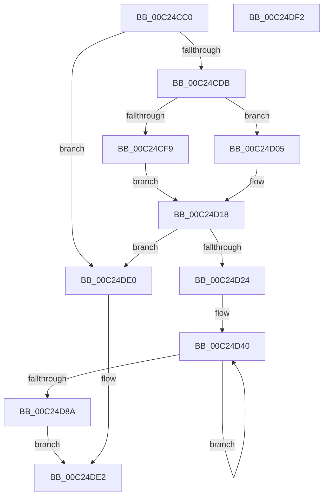

# HalpCopyDebugDescriptor

- RVA: `0x00C24CC0`–`0x00C24DF3` (길이 `307` bytes)
- VA: `0x0000000140C24CC0`
- 실행 섹션: `INIT`
- PDB 이름 있음: `예`; PDB Function 태그: `아니요`
- unwind 정보 RVA: `0x00060BC4`
- 디코드: `74`개 명령, `307/307` bytes 표시
- 미해석 바이트: `0` (있으면 어셈블리에 `.byte`로 보존)

> 이 문서는 커널 이미지의 기계어와 PDB 기호를 분석해 생성했습니다. 4번과 5번은 함수 원형과 자료형을 바이너리 사용 방식에서 추정한 C 해석이며 원본 소스 복구 결과는 아닙니다.

## 1. Dependencies

- 직접 호출 지점: **5**; 고유 호출 대상: **4**
- 직접 호출자로 확인된 함수: **1**
- RIP 상대 이미지 참조: **1**

### Outgoing calls
- `0x00C24CFE` → [HalpMmAllocateMemoryInternal](../../text/54/HalpMmAllocateMemoryInternal_function_00544990.md) (function, `0x00544990`)
- `0x00C24D13` → [ExAllocatePool2](../../poolcode/B8/ExAllocatePool2_function_00B820F0.md) (function, `0x00B820F0`)
- `0x00C24D2C` → [memset](../../text/6C/memset_function_006C6C40.md) (function, `0x006C6C40`)
- `0x00C24DBC` → [memcpy](../../text/6C/memcpy_function_006C6840.md) (function, `0x006C6840`)
- `0x00C24DD6` → [memcpy](../../text/6C/memcpy_function_006C6840.md) (function, `0x006C6840`)

### Direct callers
- [HalpDbgInitSystem](../../pagelk/B5/HalpDbgInitSystem_function_00B5D710.md) at `0x00B5D72C`

### Static image references
- `0x00C24CED` → RVA `0x00E10230` (`.data`; read)

## 2. Other-region calls and transfers

- 다른 실행 섹션으로 향하는 call: **5**
  - `0x00C24CFE` → [HalpMmAllocateMemoryInternal](../../text/54/HalpMmAllocateMemoryInternal_function_00544990.md) (`INIT` → `.text`)
  - `0x00C24D13` → [ExAllocatePool2](../../poolcode/B8/ExAllocatePool2_function_00B820F0.md) (`INIT` → `POOLCODE`)
  - `0x00C24D2C` → [memset](../../text/6C/memset_function_006C6C40.md) (`INIT` → `.text`)
  - `0x00C24DBC` → [memcpy](../../text/6C/memcpy_function_006C6840.md) (`INIT` → `.text`)
  - `0x00C24DD6` → [memcpy](../../text/6C/memcpy_function_006C6840.md) (`INIT` → `.text`)
- 별도 외부 분기/꼬리 이동을 확인하지 못했습니다.

## 3. Assembly (complete function range)

```asm
00C24CC0  48 89 5C 24 08                  mov qword ptr [rsp + 8], rbx
00C24CC5  48 89 74 24 10                  mov qword ptr [rsp + 0x10], rsi
00C24CCA  57                              push rdi
00C24CCB  48 83 EC 20                     sub rsp, 0x20
00C24CCF  48 8B D9                        mov rbx, rcx
00C24CD2  48 85 C9                        test rcx, rcx
00C24CD5  0F 84 05 01 00 00               je 0x140c24de0
00C24CDB  8B 89 E8 00 00 00               mov ecx, dword ptr [rcx + 0xe8]
00C24CE1  81 C1 10 01 00 00               add ecx, 0x110
00C24CE7  03 8B D8 00 00 00               add ecx, dword ptr [rbx + 0xd8]
00C24CED  48 83 3D 3B B5 1E 00 00         cmp qword ptr [rip + 0x1eb53b], 0
00C24CF5  8B F1                           mov esi, ecx
00C24CF7  74 0C                           je 0x140c24d05
00C24CF9  BA 01 00 00 00                  mov edx, 1
00C24CFE  E8 8D FC 91 FF                  call 0x140544990
00C24D03  EB 13                           jmp 0x140c24d18
00C24D05  41 B8 48 61 6C 64               mov r8d, 0x646c6148
00C24D0B  48 8B D6                        mov rdx, rsi
00C24D0E  B9 00 01 00 00                  mov ecx, 0x100
00C24D13  E8 D8 D3 F5 FF                  call 0x140b820f0
00C24D18  48 8B F8                        mov rdi, rax
00C24D1B  48 85 C0                        test rax, rax
00C24D1E  0F 84 BC 00 00 00               je 0x140c24de0
00C24D24  4C 8B C6                        mov r8, rsi
00C24D27  33 D2                           xor edx, edx
00C24D29  48 8B C8                        mov rcx, rax
00C24D2C  E8 0F 1F AA FF                  call 0x1406c6c40
00C24D31  BA 02 00 00 00                  mov edx, 2
00C24D36  48 8B C7                        mov rax, rdi
00C24D39  48 8B CB                        mov rcx, rbx
00C24D3C  44 8D 42 7E                     lea r8d, [rdx + 0x7e]
00C24D40  0F 10 01                        movups xmm0, xmmword ptr [rcx]
00C24D43  0F 11 00                        movups xmmword ptr [rax], xmm0
00C24D46  0F 10 49 10                     movups xmm1, xmmword ptr [rcx + 0x10]
00C24D4A  0F 11 48 10                     movups xmmword ptr [rax + 0x10], xmm1
00C24D4E  0F 10 41 20                     movups xmm0, xmmword ptr [rcx + 0x20]
00C24D52  0F 11 40 20                     movups xmmword ptr [rax + 0x20], xmm0
00C24D56  0F 10 49 30                     movups xmm1, xmmword ptr [rcx + 0x30]
00C24D5A  0F 11 48 30                     movups xmmword ptr [rax + 0x30], xmm1
00C24D5E  0F 10 41 40                     movups xmm0, xmmword ptr [rcx + 0x40]
00C24D62  0F 11 40 40                     movups xmmword ptr [rax + 0x40], xmm0
00C24D66  0F 10 49 50                     movups xmm1, xmmword ptr [rcx + 0x50]
00C24D6A  0F 11 48 50                     movups xmmword ptr [rax + 0x50], xmm1
00C24D6E  0F 10 41 60                     movups xmm0, xmmword ptr [rcx + 0x60]
00C24D72  0F 11 40 60                     movups xmmword ptr [rax + 0x60], xmm0
00C24D76  49 03 C0                        add rax, r8
00C24D79  0F 10 49 70                     movups xmm1, xmmword ptr [rcx + 0x70]
00C24D7D  49 03 C8                        add rcx, r8
00C24D80  0F 11 48 F0                     movups xmmword ptr [rax - 0x10], xmm1
00C24D84  48 83 EA 01                     sub rdx, 1
00C24D88  75 B6                           jne 0x140c24d40
00C24D8A  0F 10 01                        movups xmm0, xmmword ptr [rcx]
00C24D8D  48 8D 8F 10 01 00 00            lea rcx, [rdi + 0x110]
00C24D94  0F 11 00                        movups xmmword ptr [rax], xmm0
00C24D97  48 89 8F D0 00 00 00            mov qword ptr [rdi + 0xd0], rcx
00C24D9E  8B 93 D8 00 00 00               mov edx, dword ptr [rbx + 0xd8]
00C24DA4  48 03 D1                        add rdx, rcx
00C24DA7  48 89 97 E0 00 00 00            mov qword ptr [rdi + 0xe0], rdx
00C24DAE  44 8B 83 D8 00 00 00            mov r8d, dword ptr [rbx + 0xd8]
00C24DB5  48 8B 93 D0 00 00 00            mov rdx, qword ptr [rbx + 0xd0]
00C24DBC  E8 7F 1A AA FF                  call 0x1406c6840
00C24DC1  44 8B 83 E8 00 00 00            mov r8d, dword ptr [rbx + 0xe8]
00C24DC8  48 8B 93 E0 00 00 00            mov rdx, qword ptr [rbx + 0xe0]
00C24DCF  48 8B 8F E0 00 00 00            mov rcx, qword ptr [rdi + 0xe0]
00C24DD6  E8 65 1A AA FF                  call 0x1406c6840
00C24DDB  48 8B C7                        mov rax, rdi
00C24DDE  EB 02                           jmp 0x140c24de2
00C24DE0  33 C0                           xor eax, eax
00C24DE2  48 8B 5C 24 30                  mov rbx, qword ptr [rsp + 0x30]
00C24DE7  48 8B 74 24 38                  mov rsi, qword ptr [rsp + 0x38]
00C24DEC  48 83 C4 20                     add rsp, 0x20
00C24DF0  5F                              pop rdi
00C24DF1  C3                              ret
00C24DF2  CC                              int3
```

## 4. C-style interpretation (structured pseudocode)

```c
__int64 __fastcall HalpCopyDebugDescriptor(__int64 a1)
{
    __int64 result;
    __int64 v_rsp;
    unsigned __int64 v_stack_p10;
    unsigned __int64 v_stack_p8;

    v_stack_p8 = v_rbx;
    v_stack_p10 = v_rsi;
    v_rsp = (v_rsp) - (32);
    if (a1 == 0) goto loc_00C24DE0;
    a1 = (unsigned int)(((unsigned int)(*(unsigned int *)(a1 + 232))) + (272));
    a1 = (unsigned int)((a1) + (*(unsigned int *)(a1 + 216)));
    if ((*(unsigned __int64 *)(v_rip + 2012475)) == 0) goto loc_00C24D05;
    result = HalpMmAllocateMemoryInternal(a1, 1, a3, a4);
    goto loc_00C24D18;
loc_00C24D05:
    result = ExAllocatePool2(256, (unsigned int)((unsigned int)(a1)), (unsigned int)(0x646C6148ULL), a4);
loc_00C24D18:
    if (result == 0) goto loc_00C24DE0;
    a2 = 0;
    result = memset(result, a2, (unsigned int)((unsigned int)(a1)), a4);
loc_00C24D40:
    *(unsigned __int64 *)(result) = v_xmm0;
    *(unsigned __int64 *)(result + 16) = v_xmm1;
    *(unsigned __int64 *)(result + 32) = v_xmm0;
    *(unsigned __int64 *)(result + 48) = v_xmm1;
    *(unsigned __int64 *)(result + 64) = v_xmm0;
    *(unsigned __int64 *)(result + 80) = v_xmm1;
    *(unsigned __int64 *)(result + 96) = v_xmm0;
    result = (result) + (2 + 126);
    a1 = (a1) + (2 + 126);
    *(unsigned __int64 *)(result - 16) = v_xmm1;
    a2 = (2) - (1);
    if (condition_is_not_equal) goto loc_00C24D40;
    *(unsigned __int64 *)(result) = v_xmm0;
    *(unsigned __int64 *)(result + 208) = result + 272;
    a2 = ((unsigned int)(*(unsigned int *)(a1 + 216))) + (result + 272);
    *(unsigned __int64 *)(result + 224) = a2;
    result = memcpy(result + 272, *(unsigned __int64 *)(a1 + 208), (unsigned int)(*(unsigned int *)(a1 + 216)), a4);
    result = memcpy(*(unsigned __int64 *)(result + 224), *(unsigned __int64 *)(a1 + 224), (unsigned int)(*(unsigned int *)(a1 + 232)), a4);
    goto loc_00C24DE2;
loc_00C24DE0:
    result = 0;
loc_00C24DE2:
    v_rsp = (v_rsp) + (32);
    return result;
}
```

## 5. (Beta) C Style

```c
int64_t HalpCopyDebugDescriptor(void *Arg1)
{
    uint8_t *arg1 = (uint8_t *)Arg1;

    int64_t result;
    int64_t local_rsp;
    uint64_t v_stack_p10;
    uint64_t v_stack_p8;

    v_stack_p8 = local_rbx;
    v_stack_p10 = local_rsi;
    local_rsp = (local_rsp) - (32);
    if (Arg1 == NULL) goto loc_00C24DE0;
    Arg1 = (uint32_t)(((uint32_t)(*(uint32_t *)(arg1 + 0xE8))) + (272));
    Arg1 = (uint32_t)((Arg1) + (*(uint32_t *)(arg1 + 0xD8)));
    if ((*(uint64_t *)(v_rip + 0x1EB53B)) == 0) goto loc_00C24D05;
    result = HalpMmAllocateMemoryInternal(Arg1, 1, a3, a4);
    goto loc_00C24D18;
loc_00C24D05:
    result = ExAllocatePool2(256, (uint32_t)((uint32_t)(Arg1)), (uint32_t)(0x646C6148ULL), a4);
loc_00C24D18:
    if (result == 0) goto loc_00C24DE0;
    a2 = 0;
    result = memset(result, a2, (uint32_t)((uint32_t)(Arg1)), a4);
loc_00C24D40:
    *(uint64_t *)(result) = v_xmm0;
    *(uint64_t *)(result + 0x10) = v_xmm1;
    *(uint64_t *)(result + 0x20) = v_xmm0;
    *(uint64_t *)(result + 0x30) = v_xmm1;
    *(uint64_t *)(result + 0x40) = v_xmm0;
    *(uint64_t *)(result + 0x50) = v_xmm1;
    *(uint64_t *)(result + 0x60) = v_xmm0;
    result = (result) + (2 + 126);
    Arg1 = (Arg1) + (2 + 126);
    *(uint64_t *)(result - 0x10) = v_xmm1;
    a2 = (2) - (1);
    if (condition_is_not_equal) goto loc_00C24D40;
    *(uint64_t *)(result) = v_xmm0;
    *(uint64_t *)(result + 0xD0) = result + 272;
    a2 = ((uint32_t)(*(uint32_t *)(arg1 + 0xD8))) + (result + 272);
    *(uint64_t *)(result + 0xE0) = a2;
    result = memcpy(result + 272, *(uint64_t *)(arg1 + 0xD0), (uint32_t)(*(uint32_t *)(arg1 + 0xD8)), a4);
    result = memcpy(*(uint64_t *)(result + 0xE0), *(uint64_t *)(arg1 + 0xE0), (uint32_t)(*(uint32_t *)(arg1 + 0xE8)), a4);
    goto loc_00C24DE2;
loc_00C24DE0:
    result = 0;
loc_00C24DE2:
    local_rsp = (local_rsp) + (32);
    return result;
}
```

### 관측된 메모리 오프셋

구조체 형식이 확인되지 않은 접근은 인자 기준의 오프셋으로만 기록했습니다.

| 기준 인자 | 오프셋 표현 | 폭 (bit) | 접근 |
|---|---:|---:|---|
| `Arg1` | `+ 0x0` | `128` | `R` |
| `Arg1` | `+ 0x10` | `128` | `R` |
| `Arg1` | `+ 0x20` | `128` | `R` |
| `Arg1` | `+ 0x30` | `128` | `R` |
| `Arg1` | `+ 0x40` | `128` | `R` |
| `Arg1` | `+ 0x50` | `128` | `R` |
| `Arg1` | `+ 0x60` | `128` | `R` |
| `Arg1` | `+ 0x70` | `128` | `R` |
| `Arg1` | `+ 0xD0` | `64` | `R` |
| `Arg1` | `+ 0xD8` | `32` | `R` |
| `Arg1` | `+ 0xE0` | `64` | `R` |
| `Arg1` | `+ 0xE8` | `32` | `R` |

## 6. Execution-region graph

[열기: 2D/3D 그래프와 함수 탐색 컨트롤 패널](../../../control-panel.html?section=init&rva=0x00C24CC0&view=graph)

- 2D 그래프는 위에서 아래로 흐르고, 3D 그래프는 빈 공간을 드래그해 회전합니다. Shift+드래그는 이동, 휠은 확대·축소, 함수 노드 선택은 대상 보고서 이동입니다.

### Static fallback


