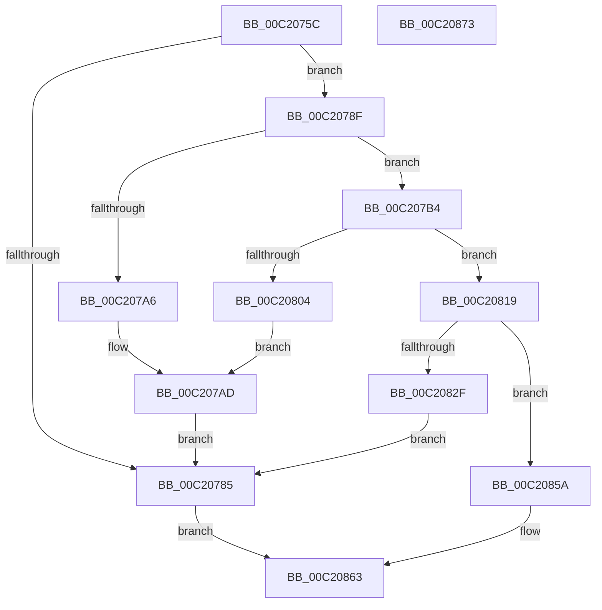

# HalpDmaAllocateEmergencyResources

- RVA: `0x00C2075C`–`0x00C20874` (길이 `280` bytes)
- VA: `0x0000000140C2075C`
- 실행 섹션: `INIT`
- PDB 이름 있음: `예`; PDB Function 태그: `아니요`
- unwind 정보 RVA: `0x00060BC4`
- 디코드: `67`개 명령, `280/280` bytes 표시
- 미해석 바이트: `0` (있으면 어셈블리에 `.byte`로 보존)

> 이 문서는 커널 이미지의 기계어와 PDB 기호를 분석해 생성했습니다. 4번과 5번은 함수 원형과 자료형을 바이너리 사용 방식에서 추정한 C 해석이며 원본 소스 복구 결과는 아닙니다.

## 1. Dependencies

- 직접 호출 지점: **9**; 고유 호출 대상: **4**
- 직접 호출자로 확인된 함수: **1**
- RIP 상대 이미지 참조: **8**

### Outgoing calls
- `0x00C20772` → [HalpMmAllocCtxAlloc](../../text/3E/HalpMmAllocCtxAlloc_function_003E10B8.md) (function, `0x003E10B8`)
- `0x00C20792` → [HalpMmAllocCtxAlloc](../../text/3E/HalpMmAllocCtxAlloc_function_003E10B8.md) (function, `0x003E10B8`)
- `0x00C207AD` → [HalpMmAllocCtxFree](../../text/3E/HalpMmAllocCtxFree_function_003E1904.md) (function, `0x003E1904`)
- `0x00C207F3` → [MmAllocateMappingAddress](../../page/A7/MmAllocateMappingAddress_function_00A72690.md) (function, `0x00A72690`)
- `0x00C2080B` → [HalpMmAllocCtxFree](../../text/3E/HalpMmAllocCtxFree_function_003E1904.md) (function, `0x003E1904`)
- `0x00C2081E` → [MmAllocateMappingAddress](../../page/A7/MmAllocateMappingAddress_function_00A72690.md) (function, `0x00A72690`)
- `0x00C20836` → [HalpMmAllocCtxFree](../../text/3E/HalpMmAllocCtxFree_function_003E1904.md) (function, `0x003E1904`)
- `0x00C20842` → [HalpMmAllocCtxFree](../../text/3E/HalpMmAllocCtxFree_function_003E1904.md) (function, `0x003E1904`)
- `0x00C20850` → [MmFreeMappingAddress](../../page/A7/MmFreeMappingAddress_function_00A75F20.md) (function, `0x00A75F20`)

### Direct callers
- [HalpDmaInit](HalpDmaInit_function_00C20D34.md) at `0x00C20E4E`

### Static image references
- `0x00C20779` → RVA `0x00E3EC58` (`.data`; write)
- `0x00C20797` → RVA `0x00E3EC20` (`.data`; write)
- `0x00C207A6` → RVA `0x00E3EC58` (`.data`; read)
- `0x00C207F8` → RVA `0x00E3EC30` (`.data`; write)
- `0x00C20810` → RVA `0x00E3EC20` (`.data`; read)
- `0x00C20823` → RVA `0x00E3EC60` (`.data`; write)
- `0x00C20847` → RVA `0x00E3EC30` (`.data`; read)
- `0x00C2085A` → RVA `0x00E3EC80` (`.data`; write)

## 2. Other-region calls and transfers

- 다른 실행 섹션으로 향하는 call: **9**
  - `0x00C20772` → [HalpMmAllocCtxAlloc](../../text/3E/HalpMmAllocCtxAlloc_function_003E10B8.md) (`INIT` → `.text`)
  - `0x00C20792` → [HalpMmAllocCtxAlloc](../../text/3E/HalpMmAllocCtxAlloc_function_003E10B8.md) (`INIT` → `.text`)
  - `0x00C207AD` → [HalpMmAllocCtxFree](../../text/3E/HalpMmAllocCtxFree_function_003E1904.md) (`INIT` → `.text`)
  - `0x00C207F3` → [MmAllocateMappingAddress](../../page/A7/MmAllocateMappingAddress_function_00A72690.md) (`INIT` → `PAGE`)
  - `0x00C2080B` → [HalpMmAllocCtxFree](../../text/3E/HalpMmAllocCtxFree_function_003E1904.md) (`INIT` → `.text`)
  - `0x00C2081E` → [MmAllocateMappingAddress](../../page/A7/MmAllocateMappingAddress_function_00A72690.md) (`INIT` → `PAGE`)
  - `0x00C20836` → [HalpMmAllocCtxFree](../../text/3E/HalpMmAllocCtxFree_function_003E1904.md) (`INIT` → `.text`)
  - `0x00C20842` → [HalpMmAllocCtxFree](../../text/3E/HalpMmAllocCtxFree_function_003E1904.md) (`INIT` → `.text`)
  - `0x00C20850` → [MmFreeMappingAddress](../../page/A7/MmFreeMappingAddress_function_00A75F20.md) (`INIT` → `PAGE`)
- 별도 외부 분기/꼬리 이동을 확인하지 못했습니다.

## 3. Assembly (complete function range)

```asm
00C2075C  48 89 5C 24 08                  mov qword ptr [rsp + 8], rbx
00C20761  48 89 74 24 10                  mov qword ptr [rsp + 0x10], rsi
00C20766  57                              push rdi
00C20767  48 83 EC 20                     sub rsp, 0x20
00C2076B  BF 38 00 00 00                  mov edi, 0x38
00C20770  8B D7                           mov edx, edi
00C20772  E8 41 09 7C FF                  call 0x1403e10b8
00C20777  33 DB                           xor ebx, ebx
00C20779  48 89 05 D8 E4 21 00            mov qword ptr [rip + 0x21e4d8], rax
00C20780  48 85 C0                        test rax, rax
00C20783  75 0A                           jne 0x140c2078f
00C20785  B8 9A 00 00 C0                  mov eax, 0xc000009a
00C2078A  E9 D4 00 00 00                  jmp 0x140c20863
00C2078F  48 8B D7                        mov rdx, rdi
00C20792  E8 21 09 7C FF                  call 0x1403e10b8
00C20797  48 89 05 82 E4 21 00            mov qword ptr [rip + 0x21e482], rax
00C2079E  48 8B C8                        mov rcx, rax
00C207A1  48 85 C0                        test rax, rax
00C207A4  75 0E                           jne 0x140c207b4
00C207A6  48 8B 15 AB E4 21 00            mov rdx, qword ptr [rip + 0x21e4ab]
00C207AD  E8 52 11 7C FF                  call 0x1403e1904
00C207B2  EB D1                           jmp 0x140c20785
00C207B4  48 8B 05 9D E4 21 00            mov rax, qword ptr [rip + 0x21e49d]
00C207BB  BE 00 10 00 00                  mov esi, 0x1000
00C207C0  89 78 08                        mov dword ptr [rax + 8], edi
00C207C3  48 89 18                        mov qword ptr [rax], rbx
00C207C6  48 89 58 20                     mov qword ptr [rax + 0x20], rbx
00C207CA  48 C7 40 28 00 10 00 00         mov qword ptr [rax + 0x28], 0x1000
00C207D2  89 79 08                        mov dword ptr [rcx + 8], edi
00C207D5  BF 48 61 6C 44                  mov edi, 0x446c6148
00C207DA  48 89 19                        mov qword ptr [rcx], rbx
00C207DD  8B D7                           mov edx, edi
00C207DF  48 89 59 20                     mov qword ptr [rcx + 0x20], rbx
00C207E3  48 89 71 28                     mov qword ptr [rcx + 0x28], rsi
00C207E7  66 83 48 0A 02                  or word ptr [rax + 0xa], 2
00C207EC  66 83 49 0A 02                  or word ptr [rcx + 0xa], 2
00C207F1  8B CE                           mov ecx, esi
00C207F3  E8 98 1E E5 FF                  call 0x140a72690
00C207F8  48 89 05 31 E4 21 00            mov qword ptr [rip + 0x21e431], rax
00C207FF  48 85 C0                        test rax, rax
00C20802  75 15                           jne 0x140c20819
00C20804  48 8B 15 4D E4 21 00            mov rdx, qword ptr [rip + 0x21e44d]
00C2080B  E8 F4 10 7C FF                  call 0x1403e1904
00C20810  48 8B 15 09 E4 21 00            mov rdx, qword ptr [rip + 0x21e409]
00C20817  EB 94                           jmp 0x140c207ad
00C20819  8B D7                           mov edx, edi
00C2081B  48 8B CE                        mov rcx, rsi
00C2081E  E8 6D 1E E5 FF                  call 0x140a72690
00C20823  48 89 05 36 E4 21 00            mov qword ptr [rip + 0x21e436], rax
00C2082A  48 85 C0                        test rax, rax
00C2082D  75 2B                           jne 0x140c2085a
00C2082F  48 8B 15 22 E4 21 00            mov rdx, qword ptr [rip + 0x21e422]
00C20836  E8 C9 10 7C FF                  call 0x1403e1904
00C2083B  48 8B 15 DE E3 21 00            mov rdx, qword ptr [rip + 0x21e3de]
00C20842  E8 BD 10 7C FF                  call 0x1403e1904
00C20847  48 8B 0D E2 E3 21 00            mov rcx, qword ptr [rip + 0x21e3e2]
00C2084E  8B D7                           mov edx, edi
00C20850  E8 CB 56 E5 FF                  call 0x140a75f20
00C20855  E9 2B FF FF FF                  jmp 0x140c20785
00C2085A  48 89 1D 1F E4 21 00            mov qword ptr [rip + 0x21e41f], rbx
00C20861  33 C0                           xor eax, eax
00C20863  48 8B 5C 24 30                  mov rbx, qword ptr [rsp + 0x30]
00C20868  48 8B 74 24 38                  mov rsi, qword ptr [rsp + 0x38]
00C2086D  48 83 C4 20                     add rsp, 0x20
00C20871  5F                              pop rdi
00C20872  C3                              ret
00C20873  CC                              int3
```

## 4. C-style interpretation (structured pseudocode)

```c
__int64 __fastcall HalpDmaAllocateEmergencyResources(void)
{
    __int64 result;
    __int64 v_rbx;
    __int64 v_rsp;
    unsigned __int64 v_stack_p10;
    unsigned __int64 v_stack_p8;

    v_stack_p8 = v_rbx;
    v_stack_p10 = v_rsi;
    v_rsp = (v_rsp) - (32);
    result = HalpMmAllocCtxAlloc(a1, 56, a3, a4);
    v_rbx = 0;
    *(unsigned __int64 *)(v_rip + 2221272) = result;
    if (result != 0) goto loc_00C2078F;
loc_00C20785:
    goto loc_00C20863;
loc_00C2078F:
    result = HalpMmAllocCtxAlloc(a1, 56, a3, a4);
    *(unsigned __int64 *)(v_rip + 2221186) = result;
    if (result != 0) goto loc_00C207B4;
loc_00C207AD:
    result = HalpMmAllocCtxFree(result, *(unsigned __int64 *)(v_rip + 2221227), a3, a4);
    goto loc_00C20785;
loc_00C207B4:
    *(unsigned int *)(*(unsigned __int64 *)(v_rip + 2221213) + 8) = 56;
    *(unsigned __int64 *)(*(unsigned __int64 *)(v_rip + 2221213)) = 0;
    *(unsigned __int64 *)(*(unsigned __int64 *)(v_rip + 2221213) + 32) = 0;
    *(unsigned __int64 *)(*(unsigned __int64 *)(v_rip + 2221213) + 40) = 0x1000ULL;
    *(unsigned int *)(result + 8) = 56;
    *(unsigned __int64 *)(result) = 0;
    *(unsigned __int64 *)(result + 32) = 0;
    *(unsigned __int64 *)(result + 40) = (unsigned int)(0x1000ULL);
    result = MmAllocateMappingAddress((unsigned int)((unsigned int)((unsigned int)(0x1000ULL))), (unsigned int)((unsigned int)((unsigned int)(0x446C6148ULL))), a3, a4);
    *(unsigned __int64 *)(v_rip + 2221105) = result;
    if (result != 0) goto loc_00C20819;
    result = HalpMmAllocCtxFree((unsigned int)((unsigned int)((unsigned int)(0x1000ULL))), *(unsigned __int64 *)(v_rip + 2221133), a3, a4);
    goto loc_00C207AD;
loc_00C20819:
    result = MmAllocateMappingAddress((unsigned int)(0x1000ULL), (unsigned int)((unsigned int)((unsigned int)(0x446C6148ULL))), a3, a4);
    *(unsigned __int64 *)(v_rip + 2221110) = result;
    if (result != 0) goto loc_00C2085A;
    result = HalpMmAllocCtxFree((unsigned int)(0x1000ULL), *(unsigned __int64 *)(v_rip + 2221090), a3, a4);
    result = HalpMmAllocCtxFree((unsigned int)(0x1000ULL), *(unsigned __int64 *)(v_rip + 2221022), a3, a4);
    result = MmFreeMappingAddress(*(unsigned __int64 *)(v_rip + 2221026), (unsigned int)((unsigned int)((unsigned int)(0x446C6148ULL))), a3, a4);
    goto loc_00C20785;
loc_00C2085A:
    *(unsigned __int64 *)(v_rip + 2221087) = 0;
    result = 0;
loc_00C20863:
    v_rsp = (v_rsp) + (32);
    return result;
}
```

## 5. (Beta) C Style

```c
void HalpDmaAllocateEmergencyResources(void)
{
    int64_t result;
    int64_t local_rbx;
    int64_t local_rsp;
    uint64_t v_stack_p10;
    uint64_t v_stack_p8;

    v_stack_p8 = local_rbx;
    v_stack_p10 = local_rsi;
    local_rsp = (local_rsp) - (32);
    result = HalpMmAllocCtxAlloc(a1, 56, a3, a4);
    local_rbx = 0;
    *(uint64_t *)(v_rip + 0x21E4D8) = result;
    if (result != 0) goto loc_00C2078F;
loc_00C20785:
    goto loc_00C20863;
loc_00C2078F:
    result = HalpMmAllocCtxAlloc(a1, 56, a3, a4);
    *(uint64_t *)(v_rip + 0x21E482) = result;
    if (result != 0) goto loc_00C207B4;
loc_00C207AD:
    result = HalpMmAllocCtxFree(result, *(uint64_t *)(v_rip + 0x21E4AB), a3, a4);
    goto loc_00C20785;
loc_00C207B4:
    *(uint32_t *)(*(uint64_t *)(v_rip + 0x21E49D) + 0x8) = 56;
    *(uint64_t *)(*(uint64_t *)(v_rip + 0x21E49D)) = 0;
    *(uint64_t *)(*(uint64_t *)(v_rip + 0x21E49D) + 0x20) = 0;
    *(uint64_t *)(*(uint64_t *)(v_rip + 0x21E49D) + 0x28) = 0x1000ULL;
    *(uint32_t *)(result + 0x8) = 56;
    *(uint64_t *)(result) = 0;
    *(uint64_t *)(result + 0x20) = 0;
    *(uint64_t *)(result + 0x28) = (uint32_t)(0x1000ULL);
    result = MmAllocateMappingAddress((uint32_t)((uint32_t)((uint32_t)(0x1000ULL))), (uint32_t)((uint32_t)((uint32_t)(0x446C6148ULL))), a3, a4);
    *(uint64_t *)(v_rip + 0x21E431) = result;
    if (result != 0) goto loc_00C20819;
    result = HalpMmAllocCtxFree((uint32_t)((uint32_t)((uint32_t)(0x1000ULL))), *(uint64_t *)(v_rip + 0x21E44D), a3, a4);
    goto loc_00C207AD;
loc_00C20819:
    result = MmAllocateMappingAddress((uint32_t)(0x1000ULL), (uint32_t)((uint32_t)((uint32_t)(0x446C6148ULL))), a3, a4);
    *(uint64_t *)(v_rip + 0x21E436) = result;
    if (result != 0) goto loc_00C2085A;
    result = HalpMmAllocCtxFree((uint32_t)(0x1000ULL), *(uint64_t *)(v_rip + 0x21E422), a3, a4);
    result = HalpMmAllocCtxFree((uint32_t)(0x1000ULL), *(uint64_t *)(v_rip + 0x21E3DE), a3, a4);
    result = MmFreeMappingAddress(*(uint64_t *)(v_rip + 0x21E3E2), (uint32_t)((uint32_t)((uint32_t)(0x446C6148ULL))), a3, a4);
    goto loc_00C20785;
loc_00C2085A:
    *(uint64_t *)(v_rip + 0x21E41F) = 0;
    result = 0;
loc_00C20863:
    local_rsp = (local_rsp) + (32);
    return result;
}
```

## 6. Execution-region graph

[열기: 2D/3D 그래프와 함수 탐색 컨트롤 패널](../../../control-panel.html?section=init&rva=0x00C2075C&view=graph)

- 2D 그래프는 위에서 아래로 흐르고, 3D 그래프는 빈 공간을 드래그해 회전합니다. Shift+드래그는 이동, 휠은 확대·축소, 함수 노드 선택은 대상 보고서 이동입니다.

### Static fallback


