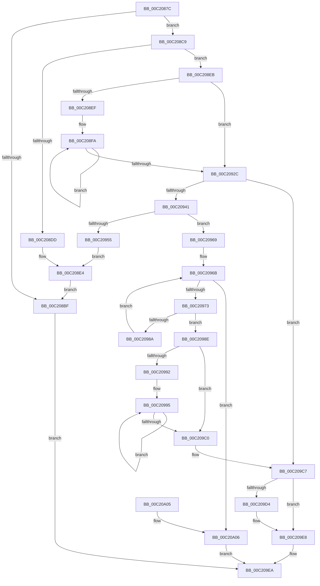

# HalpDmaAllocateMappingResources

- RVA: `0x00C2087C`–`0x00C20A11` (길이 `405` bytes)
- VA: `0x0000000140C2087C`
- 실행 섹션: `INIT`
- PDB 이름 있음: `예`; PDB Function 태그: `아니요`
- unwind 정보 RVA: `0x000C42B4`
- 디코드: `102`개 명령, `405/405` bytes 표시
- 미해석 바이트: `0` (있으면 어셈블리에 `.byte`로 보존)

> 이 문서는 커널 이미지의 기계어와 PDB 기호를 분석해 생성했습니다. 4번과 5번은 함수 원형과 자료형을 바이너리 사용 방식에서 추정한 C 해석이며 원본 소스 복구 결과는 아닙니다.

## 1. Dependencies

- 직접 호출 지점: **13**; 고유 호출 대상: **6**
- 직접 호출자로 확인된 함수: **1**
- RIP 상대 이미지 참조: **6**

### Outgoing calls
- `0x00C2089A` → [KeQueryMaximumProcessorCountEx](../../text/26/KeQueryMaximumProcessorCountEx_function_00264D60.md) (function, `0x00264D60`)
- `0x00C208AE` → [HalpMmAllocCtxAlloc](../../text/3E/HalpMmAllocCtxAlloc_function_003E10B8.md) (function, `0x003E10B8`)
- `0x00C208D0` → [HalpMmAllocCtxAlloc](../../text/3E/HalpMmAllocCtxAlloc_function_003E10B8.md) (function, `0x003E10B8`)
- `0x00C208E4` → [HalpMmAllocCtxFree](../../text/3E/HalpMmAllocCtxFree_function_003E1904.md) (function, `0x003E1904`)
- `0x00C20944` → [HalpMmAllocCtxAlloc](../../text/3E/HalpMmAllocCtxAlloc_function_003E10B8.md) (function, `0x003E10B8`)
- `0x00C2095C` → [HalpMmAllocCtxFree](../../text/3E/HalpMmAllocCtxFree_function_003E1904.md) (function, `0x003E1904`)
- `0x00C20973` → [HalpDmaAllocateReservedMapping](HalpDmaAllocateReservedMapping_function_00C20A18.md) (function, `0x00C20A18`)
- `0x00C209A2` → [MmFreeMappingAddress](../../page/A7/MmFreeMappingAddress_function_00A75F20.md) (function, `0x00A75F20`)
- `0x00C209AA` → [HalpMmAllocCtxFree](../../text/3E/HalpMmAllocCtxFree_function_003E1904.md) (function, `0x003E1904`)
- `0x00C209C0` → [HalpMmAllocCtxFree](../../text/3E/HalpMmAllocCtxFree_function_003E1904.md) (function, `0x003E1904`)
- `0x00C209C9` → [HalpDmaAllocateReservedMappingArray](HalpDmaAllocateReservedMappingArray_function_00C20A74.md) (function, `0x00C20A74`)
- `0x00C209DB` → [HalpMmAllocCtxFree](../../text/3E/HalpMmAllocCtxFree_function_003E1904.md) (function, `0x003E1904`)
- `0x00C209E3` → [HalpMmAllocCtxFree](../../text/3E/HalpMmAllocCtxFree_function_003E1904.md) (function, `0x003E1904`)

### Direct callers
- [HalpDmaInit](HalpDmaInit_function_00C20D34.md) at `0x00C20E57`

### Static image references
- `0x00C208B3` → RVA `0x00E3EC68` (`.data`; write)
- `0x00C208DD` → RVA `0x00E3EC68` (`.data`; read)
- `0x00C2092C` → RVA `0x00E3EC28` (`.data`; read/write)
- `0x00C20949` → RVA `0x00E3EC70` (`.data`; write)
- `0x00C20978` → RVA `0x00E3EC70` (`.data`; read)
- `0x00C20A06` → RVA `0x00E3EC38` (`.data`; write)

## 2. Other-region calls and transfers

- 다른 실행 섹션으로 향하는 call: **11**
  - `0x00C2089A` → [KeQueryMaximumProcessorCountEx](../../text/26/KeQueryMaximumProcessorCountEx_function_00264D60.md) (`INIT` → `.text`)
  - `0x00C208AE` → [HalpMmAllocCtxAlloc](../../text/3E/HalpMmAllocCtxAlloc_function_003E10B8.md) (`INIT` → `.text`)
  - `0x00C208D0` → [HalpMmAllocCtxAlloc](../../text/3E/HalpMmAllocCtxAlloc_function_003E10B8.md) (`INIT` → `.text`)
  - `0x00C208E4` → [HalpMmAllocCtxFree](../../text/3E/HalpMmAllocCtxFree_function_003E1904.md) (`INIT` → `.text`)
  - `0x00C20944` → [HalpMmAllocCtxAlloc](../../text/3E/HalpMmAllocCtxAlloc_function_003E10B8.md) (`INIT` → `.text`)
  - `0x00C2095C` → [HalpMmAllocCtxFree](../../text/3E/HalpMmAllocCtxFree_function_003E1904.md) (`INIT` → `.text`)
  - `0x00C209A2` → [MmFreeMappingAddress](../../page/A7/MmFreeMappingAddress_function_00A75F20.md) (`INIT` → `PAGE`)
  - `0x00C209AA` → [HalpMmAllocCtxFree](../../text/3E/HalpMmAllocCtxFree_function_003E1904.md) (`INIT` → `.text`)
  - `0x00C209C0` → [HalpMmAllocCtxFree](../../text/3E/HalpMmAllocCtxFree_function_003E1904.md) (`INIT` → `.text`)
  - `0x00C209DB` → [HalpMmAllocCtxFree](../../text/3E/HalpMmAllocCtxFree_function_003E1904.md) (`INIT` → `.text`)
  - `0x00C209E3` → [HalpMmAllocCtxFree](../../text/3E/HalpMmAllocCtxFree_function_003E1904.md) (`INIT` → `.text`)
- 별도 외부 분기/꼬리 이동을 확인하지 못했습니다.

## 3. Assembly (complete function range)

```asm
00C2087C  48 8B C4                        mov rax, rsp
00C2087F  48 89 58 08                     mov qword ptr [rax + 8], rbx
00C20883  48 89 68 10                     mov qword ptr [rax + 0x10], rbp
00C20887  48 89 70 18                     mov qword ptr [rax + 0x18], rsi
00C2088B  48 89 78 20                     mov qword ptr [rax + 0x20], rdi
00C2088F  41 56                           push r14
00C20891  48 83 EC 20                     sub rsp, 0x20
00C20895  B9 FF FF 00 00                  mov ecx, 0xffff
00C2089A  E8 C1 44 64 FF                  call 0x140264d60
00C2089F  8B F8                           mov edi, eax
00C208A1  8B D8                           mov ebx, eax
00C208A3  48 8D 2C FD 00 00 00 00         lea rbp, [rdi*8]
00C208AB  48 8B D5                        mov rdx, rbp
00C208AE  E8 05 08 7C FF                  call 0x1403e10b8
00C208B3  48 89 05 AE E3 21 00            mov qword ptr [rip + 0x21e3ae], rax
00C208BA  48 85 C0                        test rax, rax
00C208BD  75 0A                           jne 0x140c208c9
00C208BF  B8 9A 00 00 C0                  mov eax, 0xc000009a
00C208C4  E9 21 01 00 00                  jmp 0x140c209ea
00C208C9  48 69 D3 30 10 00 00            imul rdx, rbx, 0x1030
00C208D0  E8 E3 07 7C FF                  call 0x1403e10b8
00C208D5  48 8B F0                        mov rsi, rax
00C208D8  48 85 C0                        test rax, rax
00C208DB  75 0E                           jne 0x140c208eb
00C208DD  48 8B 15 84 E3 21 00            mov rdx, qword ptr [rip + 0x21e384]
00C208E4  E8 1B 10 7C FF                  call 0x1403e1904
00C208E9  EB D4                           jmp 0x140c208bf
00C208EB  85 FF                           test edi, edi
00C208ED  74 3D                           je 0x140c2092c
00C208EF  4C 8B 05 72 E3 21 00            mov r8, qword ptr [rip + 0x21e372]
00C208F6  48 8D 48 20                     lea rcx, [rax + 0x20]
00C208FA  48 83 21 00                     and qword ptr [rcx], 0
00C208FE  48 8D 41 E0                     lea rax, [rcx - 0x20]
00C20902  83 61 0C 00                     and dword ptr [rcx + 0xc], 0
00C20906  48 83 20 00                     and qword ptr [rax], 0
00C2090A  C7 41 E8 38 00 02 00            mov dword ptr [rcx - 0x18], 0x20038
00C20911  C7 41 08 00 10 00 00            mov dword ptr [rcx + 8], 0x1000
00C20918  48 8D 89 30 10 00 00            lea rcx, [rcx + 0x1030]
00C2091F  49 89 00                        mov qword ptr [r8], rax
00C20922  4D 8D 40 08                     lea r8, [r8 + 8]
00C20926  48 83 EB 01                     sub rbx, 1
00C2092A  75 CE                           jne 0x140c208fa
00C2092C  48 83 25 F4 E2 21 00 00         and qword ptr [rip + 0x21e2f4], 0
00C20934  BA 04 00 00 00                  mov edx, 4
00C20939  3B FA                           cmp edi, edx
00C2093B  0F 87 86 00 00 00               ja 0x140c209c7
00C20941  48 8B D5                        mov rdx, rbp
00C20944  E8 6F 07 7C FF                  call 0x1403e10b8
00C20949  48 89 05 20 E3 21 00            mov qword ptr [rip + 0x21e320], rax
00C20950  48 85 C0                        test rax, rax
00C20953  75 14                           jne 0x140c20969
00C20955  48 8B 15 0C E3 21 00            mov rdx, qword ptr [rip + 0x21e30c]
00C2095C  E8 A3 0F 7C FF                  call 0x1403e1904
00C20961  48 8B D6                        mov rdx, rsi
00C20964  E9 7B FF FF FF                  jmp 0x140c208e4
00C20969  33 DB                           xor ebx, ebx
00C2096B  3B DF                           cmp ebx, edi
00C2096D  0F 83 93 00 00 00               jae 0x140c20a06
00C20973  E8 A0 00 00 00                  call 0x140c20a18
00C20978  48 8B 15 F1 E2 21 00            mov rdx, qword ptr [rip + 0x21e2f1]
00C2097F  8B EB                           mov ebp, ebx
00C20981  48 89 04 DA                     mov qword ptr [rdx + rbx*8], rax
00C20985  48 85 C0                        test rax, rax
00C20988  74 04                           je 0x140c2098e
00C2098A  FF C3                           inc ebx
00C2098C  EB DD                           jmp 0x140c2096b
00C2098E  85 DB                           test ebx, ebx
00C20990  74 2E                           je 0x140c209c0
00C20992  45 33 F6                        xor r14d, r14d
00C20995  49 8B 1C 16                     mov rbx, qword ptr [r14 + rdx]
00C20999  BA 48 61 6C 44                  mov edx, 0x446c6148
00C2099E  48 8B 4B 10                     mov rcx, qword ptr [rbx + 0x10]
00C209A2  E8 79 55 E5 FF                  call 0x140a75f20
00C209A7  48 8B D3                        mov rdx, rbx
00C209AA  E8 55 0F 7C FF                  call 0x1403e1904
00C209AF  48 8B 15 BA E2 21 00            mov rdx, qword ptr [rip + 0x21e2ba]
00C209B6  4D 8D 76 08                     lea r14, [r14 + 8]
00C209BA  48 83 ED 01                     sub rbp, 1
00C209BE  75 D5                           jne 0x140c20995
00C209C0  E8 3F 0F 7C FF                  call 0x1403e1904
00C209C5  8B D7                           mov edx, edi
00C209C7  8B CF                           mov ecx, edi
00C209C9  E8 A6 00 00 00                  call 0x140c20a74
00C209CE  8B D8                           mov ebx, eax
00C209D0  85 C0                           test eax, eax
00C209D2  79 14                           jns 0x140c209e8
00C209D4  48 8B 15 8D E2 21 00            mov rdx, qword ptr [rip + 0x21e28d]
00C209DB  E8 24 0F 7C FF                  call 0x1403e1904
00C209E0  48 8B D6                        mov rdx, rsi
00C209E3  E8 1C 0F 7C FF                  call 0x1403e1904
00C209E8  8B C3                           mov eax, ebx
00C209EA  48 8B 5C 24 30                  mov rbx, qword ptr [rsp + 0x30]
00C209EF  48 8B 6C 24 38                  mov rbp, qword ptr [rsp + 0x38]
00C209F4  48 8B 74 24 40                  mov rsi, qword ptr [rsp + 0x40]
00C209F9  48 8B 7C 24 48                  mov rdi, qword ptr [rsp + 0x48]
00C209FE  48 83 C4 20                     add rsp, 0x20
00C20A02  41 5E                           pop r14
00C20A04  C3                              ret
00C20A05  CC                              int3
00C20A06  C6 05 2B E2 21 00 01            mov byte ptr [rip + 0x21e22b], 1
00C20A0D  33 C0                           xor eax, eax
00C20A0F  EB D9                           jmp 0x140c209ea
```

## 4. C-style interpretation (structured pseudocode)

```c
__int64 __fastcall HalpDmaAllocateMappingResources(void)
{
    __int64 result;
    __int64 v_r14;
    __int64 v_rbp;
    __int64 v_rbx;
    __int64 v_rsp;
    unsigned __int64 v_stack_p10;
    unsigned __int64 v_stack_p18;
    unsigned __int64 v_stack_p20;
    unsigned __int64 v_stack_p8;

    *(unsigned __int64 *)(v_rsp + 8) = v_rbx;
    *(unsigned __int64 *)(v_rsp + 16) = v_rbp;
    *(unsigned __int64 *)(v_rsp + 24) = v_rsi;
    *(unsigned __int64 *)(v_rsp + 32) = v_rdi;
    v_rsp = (v_rsp) - (32);
    result = KeQueryMaximumProcessorCountEx((unsigned int)(0xFFFFULL), a2, a3, a4);
    result = HalpMmAllocCtxAlloc((unsigned int)(0xFFFFULL), (unsigned int)((unsigned int)(result)) * 8, a3, a4);
    *(unsigned __int64 *)(v_rip + 2220974) = result;
    if (result != 0) goto loc_00C208C9;
loc_00C208BF:
    goto loc_00C209EA;
loc_00C208C9:
    a2 = ((unsigned int)((unsigned int)(result)) * 8) * ((unsigned int)((unsigned int)(result)));
    result = HalpMmAllocCtxAlloc((unsigned int)(0xFFFFULL), a2, a3, a4);
    if (result != 0) goto loc_00C208EB;
loc_00C208E4:
    result = HalpMmAllocCtxFree((unsigned int)(0xFFFFULL), *(unsigned __int64 *)(v_rip + 2220932), a3, a4);
    goto loc_00C208BF;
loc_00C208EB:
    if ((unsigned int)((unsigned int)((unsigned int)(result))) == 0) goto loc_00C2092C;
loc_00C208FA:
    *(unsigned int *)(result + 32 - 24) = 0x20038ULL;
    *(unsigned int *)(result + 32 + 8) = 0x1000ULL;
    *(unsigned __int64 *)(*(unsigned __int64 *)(v_rip + 2220914)) = result + 32 - 32;
    v_rbx = ((unsigned int)((unsigned int)(result))) - (1);
    if (condition_is_not_equal) goto loc_00C208FA;
loc_00C2092C:
    if (((unsigned int)((unsigned int)((unsigned int)(result)))) > 4) goto loc_00C209C7;
    result = HalpMmAllocCtxAlloc(result + 32 + 4144, (unsigned int)((unsigned int)(result)) * 8, *(unsigned __int64 *)(v_rip + 2220914) + 8, a4);
    *(unsigned __int64 *)(v_rip + 2220832) = result;
    if (result != 0) goto loc_00C20969;
    result = HalpMmAllocCtxFree(result + 32 + 4144, *(unsigned __int64 *)(v_rip + 2220812), *(unsigned __int64 *)(v_rip + 2220914) + 8, a4);
    goto loc_00C208E4;
loc_00C20969:
    v_rbx = 0;
loc_00C2096B:
    if (0 >= ((unsigned int)((unsigned int)((unsigned int)(result))))) goto loc_00C20A06;
    result = HalpDmaAllocateReservedMapping(result + 32 + 4144, result, *(unsigned __int64 *)(v_rip + 2220914) + 8, a4);
    *(unsigned __int64 *)(*(unsigned __int64 *)(v_rip + 2220785) + v_rbx * 8) = result;
    if (result == 0) goto loc_00C2098E;
    v_rbx = (unsigned int)((v_rbx) + 1);
    goto loc_00C2096B;
loc_00C2098E:
    if ((unsigned int)(v_rbx) == 0) goto loc_00C209C0;
    v_r14 = 0;
loc_00C20995:
    result = MmFreeMappingAddress(*(unsigned __int64 *)(*(unsigned __int64 *)(v_r14 + *(unsigned __int64 *)(v_rip + 2220785) * 1) + 16), (unsigned int)(0x446C6148ULL), *(unsigned __int64 *)(v_rip + 2220914) + 8, a4);
    result = HalpMmAllocCtxFree(*(unsigned __int64 *)(*(unsigned __int64 *)(v_r14 + *(unsigned __int64 *)(v_rip + 2220785) * 1) + 16), *(unsigned __int64 *)(v_r14 + *(unsigned __int64 *)(v_rip + 2220785) * 1), *(unsigned __int64 *)(v_rip + 2220914) + 8, a4);
    v_rbp = (0) - (1);
    if (condition_is_not_equal) goto loc_00C20995;
loc_00C209C0:
    result = HalpMmAllocCtxFree(*(unsigned __int64 *)(*(unsigned __int64 *)(v_r14 + *(unsigned __int64 *)(v_rip + 2220785) * 1) + 16), *(unsigned __int64 *)(v_rip + 2220730), *(unsigned __int64 *)(v_rip + 2220914) + 8, a4);
loc_00C209C7:
    result = HalpDmaAllocateReservedMappingArray((unsigned int)((unsigned int)((unsigned int)((unsigned int)(result)))), (unsigned int)((unsigned int)((unsigned int)((unsigned int)(result)))), *(unsigned __int64 *)(v_rip + 2220914) + 8, a4);
    if (sign_flag) {
        a2 = *(unsigned __int64 *)(v_rip + 2220685);
        result = HalpMmAllocCtxFree((unsigned int)((unsigned int)((unsigned int)((unsigned int)(result)))), a2, *(unsigned __int64 *)(v_rip + 2220914) + 8, a4);
        a2 = result;
        result = HalpMmAllocCtxFree((unsigned int)((unsigned int)((unsigned int)((unsigned int)(result)))), a2, *(unsigned __int64 *)(v_rip + 2220914) + 8, a4);
    }
loc_00C209EA:
    v_rsp = (v_rsp) + (32);
    return (unsigned int)((unsigned int)((unsigned int)((unsigned int)(result))));
loc_00C20A06:
    *(unsigned __int8 *)(v_rip + 2220587) = 1;
    result = 0;
    goto loc_00C209EA;
}
```

## 5. (Beta) C Style

```c
void HalpDmaAllocateMappingResources(void)
{
    int64_t result;
    int64_t local_r14;
    int64_t local_rbp;
    int64_t local_rbx;
    int64_t local_rsp;
    uint64_t v_stack_p10;
    uint64_t v_stack_p18;
    uint64_t v_stack_p20;
    uint64_t v_stack_p8;

    *(uint64_t *)(local_rsp + 0x8) = local_rbx;
    *(uint64_t *)(local_rsp + 0x10) = local_rbp;
    *(uint64_t *)(local_rsp + 0x18) = local_rsi;
    *(uint64_t *)(local_rsp + 0x20) = local_rdi;
    local_rsp = (local_rsp) - (32);
    result = KeQueryMaximumProcessorCountEx((uint32_t)(0xFFFFULL), a2, a3, a4);
    result = HalpMmAllocCtxAlloc((uint32_t)(0xFFFFULL), (uint32_t)((uint32_t)(result)) * 8, a3, a4);
    *(uint64_t *)(v_rip + 0x21E3AE) = result;
    if (result != 0) goto loc_00C208C9;
loc_00C208BF:
    goto loc_00C209EA;
loc_00C208C9:
    a2 = ((uint32_t)((uint32_t)(result)) * 8) * ((uint32_t)((uint32_t)(result)));
    result = HalpMmAllocCtxAlloc((uint32_t)(0xFFFFULL), a2, a3, a4);
    if (result != 0) goto loc_00C208EB;
loc_00C208E4:
    result = HalpMmAllocCtxFree((uint32_t)(0xFFFFULL), *(uint64_t *)(v_rip + 0x21E384), a3, a4);
    goto loc_00C208BF;
loc_00C208EB:
    if ((uint32_t)((uint32_t)((uint32_t)(result))) == 0) goto loc_00C2092C;
loc_00C208FA:
    *(uint32_t *)(result + 0x20 - 0x18) = 0x20038ULL;
    *(uint32_t *)(result + 0x20 + 0x8) = 0x1000ULL;
    *(uint64_t *)(*(uint64_t *)(v_rip + 0x21E372)) = result + 32 - 32;
    local_rbx = ((uint32_t)((uint32_t)(result))) - (1);
    if (condition_is_not_equal) goto loc_00C208FA;
loc_00C2092C:
    if (((uint32_t)((uint32_t)((uint32_t)(result)))) > 4) goto loc_00C209C7;
    result = HalpMmAllocCtxAlloc(result + 32 + 4144, (uint32_t)((uint32_t)(result)) * 8, *(uint64_t *)(v_rip + 0x21E372) + 8, a4);
    *(uint64_t *)(v_rip + 0x21E320) = result;
    if (result != 0) goto loc_00C20969;
    result = HalpMmAllocCtxFree(result + 32 + 4144, *(uint64_t *)(v_rip + 0x21E30C), *(uint64_t *)(v_rip + 0x21E372) + 8, a4);
    goto loc_00C208E4;
loc_00C20969:
    local_rbx = 0;
loc_00C2096B:
    if (0 >= ((uint32_t)((uint32_t)((uint32_t)(result))))) goto loc_00C20A06;
    result = HalpDmaAllocateReservedMapping(result + 32 + 4144, result, *(uint64_t *)(v_rip + 0x21E372) + 8, a4);
    *(uint64_t *)(*(uint64_t *)(v_rip + 0x21E2F1) + local_rbx * 8) = result;
    if (result == 0) goto loc_00C2098E;
    local_rbx = (uint32_t)((local_rbx) + 1);
    goto loc_00C2096B;
loc_00C2098E:
    if ((uint32_t)(local_rbx) == 0) goto loc_00C209C0;
    local_r14 = 0;
loc_00C20995:
    result = MmFreeMappingAddress(*(uint64_t *)(*(uint64_t *)(local_r14 + *(uint64_t *)(v_rip + 0x21E2F1) * 1) + 0x10), (uint32_t)(0x446C6148ULL), *(uint64_t *)(v_rip + 0x21E372) + 8, a4);
    result = HalpMmAllocCtxFree(*(uint64_t *)(*(uint64_t *)(local_r14 + *(uint64_t *)(v_rip + 0x21E2F1) * 1) + 0x10), *(uint64_t *)(local_r14 + *(uint64_t *)(v_rip + 0x21E2F1) * 1), *(uint64_t *)(v_rip + 0x21E372) + 8, a4);
    local_rbp = (0) - (1);
    if (condition_is_not_equal) goto loc_00C20995;
loc_00C209C0:
    result = HalpMmAllocCtxFree(*(uint64_t *)(*(uint64_t *)(local_r14 + *(uint64_t *)(v_rip + 0x21E2F1) * 1) + 0x10), *(uint64_t *)(v_rip + 0x21E2BA), *(uint64_t *)(v_rip + 0x21E372) + 8, a4);
loc_00C209C7:
    result = HalpDmaAllocateReservedMappingArray((uint32_t)((uint32_t)((uint32_t)((uint32_t)(result)))), (uint32_t)((uint32_t)((uint32_t)((uint32_t)(result)))), *(uint64_t *)(v_rip + 0x21E372) + 8, a4);
    if (sign_flag) {
        a2 = *(uint64_t *)(v_rip + 0x21E28D);
        result = HalpMmAllocCtxFree((uint32_t)((uint32_t)((uint32_t)((uint32_t)(result)))), a2, *(uint64_t *)(v_rip + 0x21E372) + 8, a4);
        a2 = result;
        result = HalpMmAllocCtxFree((uint32_t)((uint32_t)((uint32_t)((uint32_t)(result)))), a2, *(uint64_t *)(v_rip + 0x21E372) + 8, a4);
    }
loc_00C209EA:
    local_rsp = (local_rsp) + (32);
    return (uint32_t)((uint32_t)((uint32_t)((uint32_t)(result))));
loc_00C20A06:
    *(uint8_t *)(v_rip + 0x21E22B) = 1;
    result = 0;
    goto loc_00C209EA;
}
```

## 6. Execution-region graph

[열기: 2D/3D 그래프와 함수 탐색 컨트롤 패널](../../../control-panel.html?section=init&rva=0x00C2087C&view=graph)

- 2D 그래프는 위에서 아래로 흐르고, 3D 그래프는 빈 공간을 드래그해 회전합니다. Shift+드래그는 이동, 휠은 확대·축소, 함수 노드 선택은 대상 보고서 이동입니다.

### Static fallback


