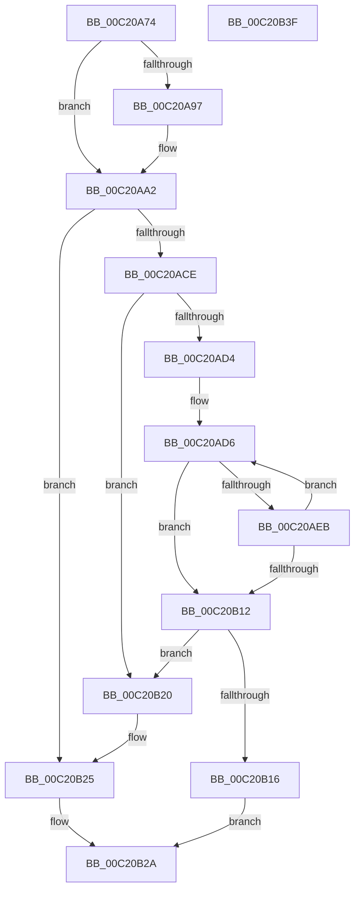

# HalpDmaAllocateReservedMappingArray

- RVA: `0x00C20A74`–`0x00C20B40` (길이 `204` bytes)
- VA: `0x0000000140C20A74`
- 실행 섹션: `INIT`
- PDB 이름 있음: `예`; PDB Function 태그: `아니요`
- unwind 정보 RVA: `0x0005C954`
- 디코드: `55`개 명령, `204/204` bytes 표시
- 미해석 바이트: `0` (있으면 어셈블리에 `.byte`로 보존)

> 이 문서는 커널 이미지의 기계어와 PDB 기호를 분석해 생성했습니다. 4번과 5번은 함수 원형과 자료형을 바이너리 사용 방식에서 추정한 C 해석이며 원본 소스 복구 결과는 아닙니다.

## 1. Dependencies

- 직접 호출 지점: **5**; 고유 호출 대상: **5**
- 직접 호출자로 확인된 함수: **1**
- RIP 상대 이미지 참조: **6**

### Outgoing calls
- `0x00C20A9C` → [RtlRaiseStatus](../../text/2F/RtlRaiseStatus_function_002F6A50.md) (function, `0x002F6A50`)
- `0x00C20ABA` → [HalpMmAllocCtxAlloc](../../text/3E/HalpMmAllocCtxAlloc_function_003E10B8.md) (function, `0x003E10B8`)
- `0x00C20AD6` → [HalpDmaAllocateReservedMapping](HalpDmaAllocateReservedMapping_function_00C20A18.md) (function, `0x00C20A18`)
- `0x00C20AF1` → [ExpInterlockedPushEntrySList](../../text/6B/ExpInterlockedPushEntrySList_function_006BA5B0.md) (function, `0x006BA5B0`)
- `0x00C20B20` → [HalpMmAllocCtxFree](../../text/3E/HalpMmAllocCtxFree_function_003E1904.md) (function, `0x003E1904`)

### Direct callers
- [HalpDmaAllocateMappingResources](HalpDmaAllocateMappingResources_function_00C2087C.md) at `0x00C209C9`

### Static image references
- `0x00C20A88` → RVA `0x00E3EC40` (`.data`; read)
- `0x00C20AA2` → RVA `0x00E3EC50` (`.data`; read/write)
- `0x00C20AB3` → RVA `0x00E3EC40` (`.data`; write)
- `0x00C20ABF` → RVA `0x00E3EC70` (`.data`; write)
- `0x00C20ADB` → RVA `0x00E3EC70` (`.data`; read)
- `0x00C20B16` → RVA `0x00E3EC78` (`.data`; write)

## 2. Other-region calls and transfers

- 다른 실행 섹션으로 향하는 call: **4**
  - `0x00C20A9C` → [RtlRaiseStatus](../../text/2F/RtlRaiseStatus_function_002F6A50.md) (`INIT` → `.text`)
  - `0x00C20ABA` → [HalpMmAllocCtxAlloc](../../text/3E/HalpMmAllocCtxAlloc_function_003E10B8.md) (`INIT` → `.text`)
  - `0x00C20AF1` → [ExpInterlockedPushEntrySList](../../text/6B/ExpInterlockedPushEntrySList_function_006BA5B0.md) (`INIT` → `.text`)
  - `0x00C20B20` → [HalpMmAllocCtxFree](../../text/3E/HalpMmAllocCtxFree_function_003E1904.md) (`INIT` → `.text`)
- 별도 외부 분기/꼬리 이동을 확인하지 못했습니다.

## 3. Assembly (complete function range)

```asm
00C20A74  48 89 5C 24 08                  mov qword ptr [rsp + 8], rbx
00C20A79  48 89 6C 24 10                  mov qword ptr [rsp + 0x10], rbp
00C20A7E  48 89 74 24 18                  mov qword ptr [rsp + 0x18], rsi
00C20A83  57                              push rdi
00C20A84  48 83 EC 20                     sub rsp, 0x20
00C20A88  48 8D 2D B1 E1 21 00            lea rbp, [rip + 0x21e1b1]
00C20A8F  8B F2                           mov esi, edx
00C20A91  40 F6 C5 0F                     test bpl, 0xf
00C20A95  74 0B                           je 0x140c20aa2
00C20A97  B9 02 00 00 80                  mov ecx, 0x80000002
00C20A9C  E8 AF 5F 6D FF                  call 0x1402f6a50
00C20AA1  CC                              int3
00C20AA2  48 83 25 A6 E1 21 00 00         and qword ptr [rip + 0x21e1a6], 0
00C20AAA  0F 57 C0                        xorps xmm0, xmm0
00C20AAD  8B D1                           mov edx, ecx
00C20AAF  48 C1 E2 03                     shl rdx, 3
00C20AB3  0F 29 05 86 E1 21 00            movaps xmmword ptr [rip + 0x21e186], xmm0
00C20ABA  E8 F9 05 7C FF                  call 0x1403e10b8
00C20ABF  48 89 05 AA E1 21 00            mov qword ptr [rip + 0x21e1aa], rax
00C20AC6  48 8B D0                        mov rdx, rax
00C20AC9  48 85 C0                        test rax, rax
00C20ACC  74 57                           je 0x140c20b25
00C20ACE  33 DB                           xor ebx, ebx
00C20AD0  85 F6                           test esi, esi
00C20AD2  74 4C                           je 0x140c20b20
00C20AD4  33 FF                           xor edi, edi
00C20AD6  E8 3D FF FF FF                  call 0x140c20a18
00C20ADB  48 8B 15 8E E1 21 00            mov rdx, qword ptr [rip + 0x21e18e]
00C20AE2  48 89 04 17                     mov qword ptr [rdi + rdx], rax
00C20AE6  48 85 C0                        test rax, rax
00C20AE9  74 27                           je 0x140c20b12
00C20AEB  48 8B D0                        mov rdx, rax
00C20AEE  48 8B CD                        mov rcx, rbp
00C20AF1  E8 BA 9A A9 FF                  call 0x1406ba5b0
00C20AF6  48 8B 15 73 E1 21 00            mov rdx, qword ptr [rip + 0x21e173]
00C20AFD  FF C3                           inc ebx
00C20AFF  48 8B 04 17                     mov rax, qword ptr [rdi + rdx]
00C20B03  48 83 C7 08                     add rdi, 8
00C20B07  C7 40 1C 01 00 00 00            mov dword ptr [rax + 0x1c], 1
00C20B0E  3B DE                           cmp ebx, esi
00C20B10  72 C4                           jb 0x140c20ad6
00C20B12  85 DB                           test ebx, ebx
00C20B14  74 0A                           je 0x140c20b20
00C20B16  89 1D 5C E1 21 00               mov dword ptr [rip + 0x21e15c], ebx
00C20B1C  33 C0                           xor eax, eax
00C20B1E  EB 0A                           jmp 0x140c20b2a
00C20B20  E8 DF 0D 7C FF                  call 0x1403e1904
00C20B25  B8 9A 00 00 C0                  mov eax, 0xc000009a
00C20B2A  48 8B 5C 24 30                  mov rbx, qword ptr [rsp + 0x30]
00C20B2F  48 8B 6C 24 38                  mov rbp, qword ptr [rsp + 0x38]
00C20B34  48 8B 74 24 40                  mov rsi, qword ptr [rsp + 0x40]
00C20B39  48 83 C4 20                     add rsp, 0x20
00C20B3D  5F                              pop rdi
00C20B3E  C3                              ret
00C20B3F  CC                              int3
```

## 4. C-style interpretation (structured pseudocode)

```c
__int64 __fastcall HalpDmaAllocateReservedMappingArray(__int64 a1, int a2)
{
    __int64 result;
    __int64 v_rbx;
    __int64 v_rdi;
    __int64 v_rsp;
    unsigned __int64 v_stack_p10;
    unsigned __int64 v_stack_p18;
    unsigned __int64 v_stack_p8;

    v_stack_p8 = v_rbx;
    v_stack_p10 = v_rbp;
    v_stack_p18 = v_rsi;
    v_rsp = (v_rsp) - (32);
    if ((((unsigned __int8)(v_rip + 2220465)) & (15)) != 0) {
        a1 = 0x80000002ULL;
        result = RtlRaiseStatus(a1, a2, a3, a4);
    }
    a2 = ((unsigned int)((unsigned int)(a1))) << (3);
    *(unsigned __int64 *)(v_rip + 2220422) = v_xmm0;
    result = HalpMmAllocCtxAlloc(a1, a2, a3, a4);
    *(unsigned __int64 *)(v_rip + 2220458) = result;
    if (result == 0) goto loc_00C20B25;
    v_rbx = 0;
    if ((unsigned int)((unsigned int)(a2)) == 0) goto loc_00C20B20;
    v_rdi = 0;
loc_00C20AD6:
    result = HalpDmaAllocateReservedMapping(a1, result, a3, a4);
    *(unsigned __int64 *)(v_rdi + *(unsigned __int64 *)(v_rip + 2220430) * 1) = result;
    if (result == 0) goto loc_00C20B12;
    result = ExpInterlockedPushEntrySList(v_rip + 2220465, result, a3, a4);
    v_rbx = (unsigned int)((v_rbx) + 1);
    v_rdi = (v_rdi) + (8);
    *(unsigned int *)(*(unsigned __int64 *)(v_rdi + *(unsigned __int64 *)(v_rip + 2220403) * 1) + 28) = 1;
    if (((unsigned int)(v_rbx)) < ((unsigned int)((unsigned int)(a2)))) goto loc_00C20AD6;
loc_00C20B12:
    if ((unsigned int)(v_rbx) == 0) goto loc_00C20B20;
    *(unsigned int *)(v_rip + 2220380) = (unsigned int)(v_rbx);
    result = 0;
    goto loc_00C20B2A;
loc_00C20B20:
    result = HalpMmAllocCtxFree(v_rip + 2220465, *(unsigned __int64 *)(v_rip + 2220403), a3, a4);
loc_00C20B25:
loc_00C20B2A:
    v_rsp = (v_rsp) + (32);
    return (unsigned int)(0xC000009AULL);
}
```

## 5. (Beta) C Style

```c
int64_t HalpDmaAllocateReservedMappingArray(int64_t Arg1, int32_t Arg2)
{
    int64_t result;
    int64_t local_rbx;
    int64_t local_rdi;
    int64_t local_rsp;
    uint64_t v_stack_p10;
    uint64_t v_stack_p18;
    uint64_t v_stack_p8;

    v_stack_p8 = local_rbx;
    v_stack_p10 = local_rbp;
    v_stack_p18 = local_rsi;
    local_rsp = (local_rsp) - (32);
    if ((((uint8_t)(v_rip + 2220465)) & (15)) != 0) {
        Arg1 = 0x80000002ULL;
        result = RtlRaiseStatus(Arg1, Arg2, a3, a4);
    }
    Arg2 = ((uint32_t)((uint32_t)(Arg1))) << (3);
    *(uint64_t *)(v_rip + 0x21E186) = v_xmm0;
    result = HalpMmAllocCtxAlloc(Arg1, Arg2, a3, a4);
    *(uint64_t *)(v_rip + 0x21E1AA) = result;
    if (result == 0) goto loc_00C20B25;
    local_rbx = 0;
    if ((uint32_t)((uint32_t)(Arg2)) == 0) goto loc_00C20B20;
    local_rdi = 0;
loc_00C20AD6:
    result = HalpDmaAllocateReservedMapping(Arg1, result, a3, a4);
    *(uint64_t *)(local_rdi + *(uint64_t *)(v_rip + 0x21E18E) * 1) = result;
    if (result == 0) goto loc_00C20B12;
    result = ExpInterlockedPushEntrySList(v_rip + 2220465, result, a3, a4);
    local_rbx = (uint32_t)((local_rbx) + 1);
    local_rdi = (local_rdi) + (8);
    *(uint32_t *)(*(uint64_t *)(local_rdi + *(uint64_t *)(v_rip + 0x21E173) * 1) + 0x1C) = 1;
    if (((uint32_t)(local_rbx)) < ((uint32_t)((uint32_t)(Arg2)))) goto loc_00C20AD6;
loc_00C20B12:
    if ((uint32_t)(local_rbx) == 0) goto loc_00C20B20;
    *(uint32_t *)(v_rip + 0x21E15C) = (uint32_t)(local_rbx);
    result = 0;
    goto loc_00C20B2A;
loc_00C20B20:
    result = HalpMmAllocCtxFree(v_rip + 2220465, *(uint64_t *)(v_rip + 0x21E173), a3, a4);
loc_00C20B25:
loc_00C20B2A:
    local_rsp = (local_rsp) + (32);
    return (uint32_t)(0xC000009AULL);
}
```

## 6. Execution-region graph

[열기: 2D/3D 그래프와 함수 탐색 컨트롤 패널](../../../control-panel.html?section=init&rva=0x00C20A74&view=graph)

- 2D 그래프는 위에서 아래로 흐르고, 3D 그래프는 빈 공간을 드래그해 회전합니다. Shift+드래그는 이동, 휠은 확대·축소, 함수 노드 선택은 대상 보고서 이동입니다.

### Static fallback


