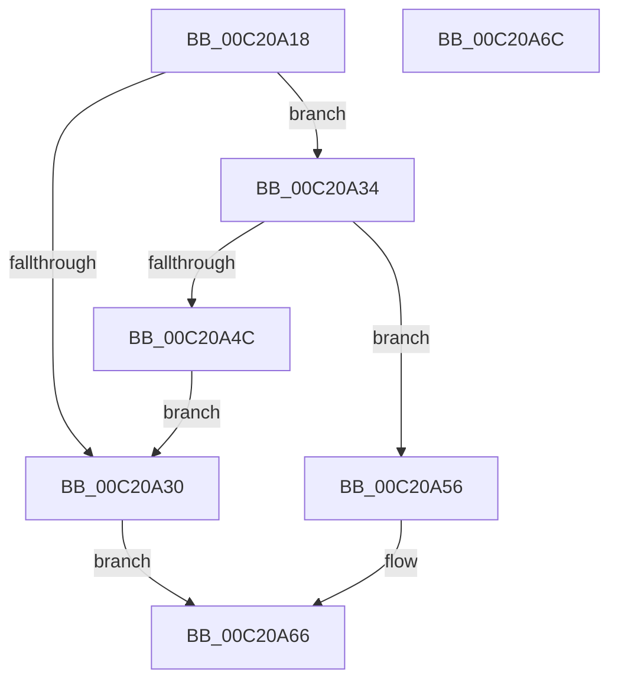

# HalpDmaAllocateReservedMapping

- RVA: `0x00C20A18`–`0x00C20A6D` (길이 `85` bytes)
- VA: `0x0000000140C20A18`
- 실행 섹션: `INIT`
- PDB 이름 있음: `예`; PDB Function 태그: `아니요`
- unwind 정보 RVA: `0x0005CF00`
- 디코드: `26`개 명령, `85/85` bytes 표시
- 미해석 바이트: `0` (있으면 어셈블리에 `.byte`로 보존)

> 이 문서는 커널 이미지의 기계어와 PDB 기호를 분석해 생성했습니다. 4번과 5번은 함수 원형과 자료형을 바이너리 사용 방식에서 추정한 C 해석이며 원본 소스 복구 결과는 아닙니다.

## 1. Dependencies

- 직접 호출 지점: **3**; 고유 호출 대상: **3**
- 직접 호출자로 확인된 함수: **2**
- RIP 상대 이미지 참조: **0**

### Outgoing calls
- `0x00C20A23` → [HalpMmAllocCtxAlloc](../../text/3E/HalpMmAllocCtxAlloc_function_003E10B8.md) (function, `0x003E10B8`)
- `0x00C20A3E` → [MmAllocateMappingAddress](../../page/A7/MmAllocateMappingAddress_function_00A72690.md) (function, `0x00A72690`)
- `0x00C20A4F` → [HalpMmAllocCtxFree](../../text/3E/HalpMmAllocCtxFree_function_003E1904.md) (function, `0x003E1904`)

### Direct callers
- [HalpDmaAllocateMappingResources](HalpDmaAllocateMappingResources_function_00C2087C.md) at `0x00C20973`
- [HalpDmaAllocateReservedMappingArray](HalpDmaAllocateReservedMappingArray_function_00C20A74.md) at `0x00C20AD6`

### Static image references
- 디코드된 RIP-relative 메모리 참조가 없습니다.

## 2. Other-region calls and transfers

- 다른 실행 섹션으로 향하는 call: **3**
  - `0x00C20A23` → [HalpMmAllocCtxAlloc](../../text/3E/HalpMmAllocCtxAlloc_function_003E10B8.md) (`INIT` → `.text`)
  - `0x00C20A3E` → [MmAllocateMappingAddress](../../page/A7/MmAllocateMappingAddress_function_00A72690.md) (`INIT` → `PAGE`)
  - `0x00C20A4F` → [HalpMmAllocCtxFree](../../text/3E/HalpMmAllocCtxFree_function_003E1904.md) (`INIT` → `.text`)
- 별도 외부 분기/꼬리 이동을 확인하지 못했습니다.

## 3. Assembly (complete function range)

```asm
00C20A18  40 53                           push rbx
00C20A1A  48 83 EC 20                     sub rsp, 0x20
00C20A1E  BA 30 00 00 00                  mov edx, 0x30
00C20A23  E8 90 06 7C FF                  call 0x1403e10b8
00C20A28  48 8B D8                        mov rbx, rax
00C20A2B  48 85 C0                        test rax, rax
00C20A2E  75 04                           jne 0x140c20a34
00C20A30  33 C0                           xor eax, eax
00C20A32  EB 32                           jmp 0x140c20a66
00C20A34  BA 48 61 6C 44                  mov edx, 0x446c6148
00C20A39  B9 00 00 20 00                  mov ecx, 0x200000
00C20A3E  E8 4D 1C E5 FF                  call 0x140a72690
00C20A43  48 89 43 10                     mov qword ptr [rbx + 0x10], rax
00C20A47  48 85 C0                        test rax, rax
00C20A4A  75 0A                           jne 0x140c20a56
00C20A4C  48 8B D3                        mov rdx, rbx
00C20A4F  E8 B0 0E 7C FF                  call 0x1403e1904
00C20A54  EB DA                           jmp 0x140c20a30
00C20A56  83 63 18 00                     and dword ptr [rbx + 0x18], 0
00C20A5A  48 8B C3                        mov rax, rbx
00C20A5D  83 63 1C 00                     and dword ptr [rbx + 0x1c], 0
00C20A61  48 83 63 20 00                  and qword ptr [rbx + 0x20], 0
00C20A66  48 83 C4 20                     add rsp, 0x20
00C20A6A  5B                              pop rbx
00C20A6B  C3                              ret
00C20A6C  CC                              int3
```

## 4. C-style interpretation (structured pseudocode)

```c
__int64 __fastcall HalpDmaAllocateReservedMapping(void)
{
    __int64 result;
    __int64 v_rsp;

    v_rsp = (v_rsp) - (32);
    result = HalpMmAllocCtxAlloc(a1, 48, a3, a4);
    if (result != 0) goto loc_00C20A34;
loc_00C20A30:
    result = 0;
    goto loc_00C20A66;
loc_00C20A34:
    result = MmAllocateMappingAddress((unsigned int)(0x200000ULL), (unsigned int)(0x446C6148ULL), a3, a4);
    *(unsigned __int64 *)(result + 16) = result;
    if (result != 0) goto loc_00C20A56;
    result = HalpMmAllocCtxFree((unsigned int)(0x200000ULL), result, a3, a4);
    goto loc_00C20A30;
loc_00C20A56:
loc_00C20A66:
    v_rsp = (v_rsp) + (32);
    return result;
}
```

## 5. (Beta) C Style

```c
void HalpDmaAllocateReservedMapping(void)
{
    int64_t result;
    int64_t local_rsp;

    local_rsp = (local_rsp) - (32);
    result = HalpMmAllocCtxAlloc(a1, 48, a3, a4);
    if (result != 0) goto loc_00C20A34;
loc_00C20A30:
    result = 0;
    goto loc_00C20A66;
loc_00C20A34:
    result = MmAllocateMappingAddress((uint32_t)(0x200000ULL), (uint32_t)(0x446C6148ULL), a3, a4);
    *(uint64_t *)(result + 0x10) = result;
    if (result != 0) goto loc_00C20A56;
    result = HalpMmAllocCtxFree((uint32_t)(0x200000ULL), result, a3, a4);
    goto loc_00C20A30;
loc_00C20A56:
loc_00C20A66:
    local_rsp = (local_rsp) + (32);
    return result;
}
```

## 6. Execution-region graph

[열기: 2D/3D 그래프와 함수 탐색 컨트롤 패널](../../../control-panel.html?section=init&rva=0x00C20A18&view=graph)

- 2D 그래프는 위에서 아래로 흐르고, 3D 그래프는 빈 공간을 드래그해 회전합니다. Shift+드래그는 이동, 휠은 확대·축소, 함수 노드 선택은 대상 보고서 이동입니다.

### Static fallback


