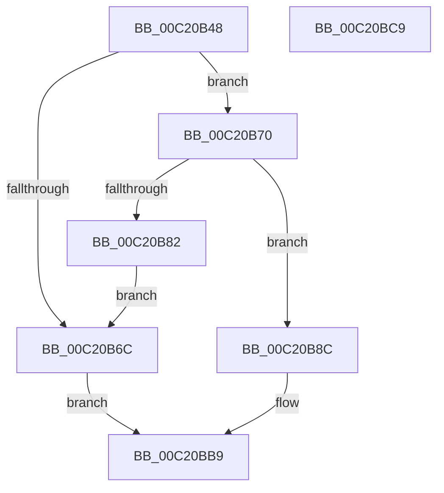

# HalpDmaAllocateTranslationBuffer

- RVA: `0x00C20B48`–`0x00C20BCA` (길이 `130` bytes)
- VA: `0x0000000140C20B48`
- 실행 섹션: `INIT`
- PDB 이름 있음: `예`; PDB Function 태그: `아니요`
- unwind 정보 RVA: `0x00060BC4`
- 디코드: `37`개 명령, `130/130` bytes 표시
- 미해석 바이트: `0` (있으면 어셈블리에 `.byte`로 보존)

> 이 문서는 커널 이미지의 기계어와 PDB 기호를 분석해 생성했습니다. 4번과 5번은 함수 원형과 자료형을 바이너리 사용 방식에서 추정한 C 해석이며 원본 소스 복구 결과는 아닙니다.

## 1. Dependencies

- 직접 호출 지점: **4**; 고유 호출 대상: **3**
- 직접 호출자로 확인된 함수: **1**
- RIP 상대 이미지 참조: **0**

### Outgoing calls
- `0x00C20B5F` → [HalpMmAllocCtxAlloc](../../text/3E/HalpMmAllocCtxAlloc_function_003E10B8.md) (function, `0x003E10B8`)
- `0x00C20B75` → [HalpMmAllocCtxAlloc](../../text/3E/HalpMmAllocCtxAlloc_function_003E10B8.md) (function, `0x003E10B8`)
- `0x00C20B85` → [HalpMmAllocCtxFree](../../text/3E/HalpMmAllocCtxFree_function_003E1904.md) (function, `0x003E1904`)
- `0x00C20B9F` → [memset](../../text/6C/memset_function_006C6C40.md) (function, `0x006C6C40`)

### Direct callers
- [HalpDmaInitializeMasterAdapter](HalpDmaInitializeMasterAdapter_function_00C21278.md) at `0x00C2133D`

### Static image references
- 디코드된 RIP-relative 메모리 참조가 없습니다.

## 2. Other-region calls and transfers

- 다른 실행 섹션으로 향하는 call: **4**
  - `0x00C20B5F` → [HalpMmAllocCtxAlloc](../../text/3E/HalpMmAllocCtxAlloc_function_003E10B8.md) (`INIT` → `.text`)
  - `0x00C20B75` → [HalpMmAllocCtxAlloc](../../text/3E/HalpMmAllocCtxAlloc_function_003E10B8.md) (`INIT` → `.text`)
  - `0x00C20B85` → [HalpMmAllocCtxFree](../../text/3E/HalpMmAllocCtxFree_function_003E1904.md) (`INIT` → `.text`)
  - `0x00C20B9F` → [memset](../../text/6C/memset_function_006C6C40.md) (`INIT` → `.text`)
- 별도 외부 분기/꼬리 이동을 확인하지 못했습니다.

## 3. Assembly (complete function range)

```asm
00C20B48  48 89 5C 24 08                  mov qword ptr [rsp + 8], rbx
00C20B4D  48 89 74 24 10                  mov qword ptr [rsp + 0x10], rsi
00C20B52  57                              push rdi
00C20B53  48 83 EC 20                     sub rsp, 0x20
00C20B57  48 8B F2                        mov rsi, rdx
00C20B5A  BA 18 00 00 00                  mov edx, 0x18
00C20B5F  E8 54 05 7C FF                  call 0x1403e10b8
00C20B64  48 8B D8                        mov rbx, rax
00C20B67  48 85 C0                        test rax, rax
00C20B6A  75 04                           jne 0x140c20b70
00C20B6C  33 C0                           xor eax, eax
00C20B6E  EB 49                           jmp 0x140c20bb9
00C20B70  BA 00 40 00 00                  mov edx, 0x4000
00C20B75  E8 3E 05 7C FF                  call 0x1403e10b8
00C20B7A  48 8B F8                        mov rdi, rax
00C20B7D  48 85 C0                        test rax, rax
00C20B80  75 0A                           jne 0x140c20b8c
00C20B82  48 8B D3                        mov rdx, rbx
00C20B85  E8 7A 0D 7C FF                  call 0x1403e1904
00C20B8A  EB E0                           jmp 0x140c20b6c
00C20B8C  48 83 23 00                     and qword ptr [rbx], 0
00C20B90  33 D2                           xor edx, edx
00C20B92  83 63 0C 00                     and dword ptr [rbx + 0xc], 0
00C20B96  41 B8 00 40 00 00               mov r8d, 0x4000
00C20B9C  48 8B CF                        mov rcx, rdi
00C20B9F  E8 9C 60 AA FF                  call 0x1406c6c40
00C20BA4  C7 43 08 E3 00 00 00            mov dword ptr [rbx + 8], 0xe3
00C20BAB  48 8B C3                        mov rax, rbx
00C20BAE  48 89 7B 10                     mov qword ptr [rbx + 0x10], rdi
00C20BB2  83 66 08 00                     and dword ptr [rsi + 8], 0
00C20BB6  48 89 1E                        mov qword ptr [rsi], rbx
00C20BB9  48 8B 5C 24 30                  mov rbx, qword ptr [rsp + 0x30]
00C20BBE  48 8B 74 24 38                  mov rsi, qword ptr [rsp + 0x38]
00C20BC3  48 83 C4 20                     add rsp, 0x20
00C20BC7  5F                              pop rdi
00C20BC8  C3                              ret
00C20BC9  CC                              int3
```

## 4. C-style interpretation (structured pseudocode)

```c
__int64 __fastcall HalpDmaAllocateTranslationBuffer(__int64 a1, __int64 a2)
{
    __int64 result;
    __int64 v_rsp;
    unsigned __int64 v_stack_p10;
    unsigned __int64 v_stack_p8;

    v_stack_p8 = v_rbx;
    v_stack_p10 = v_rsi;
    v_rsp = (v_rsp) - (32);
    result = HalpMmAllocCtxAlloc(a1, 24, a3, a4);
    if (result != 0) goto loc_00C20B70;
loc_00C20B6C:
    result = 0;
    goto loc_00C20BB9;
loc_00C20B70:
    result = HalpMmAllocCtxAlloc(a1, (unsigned int)(0x4000ULL), a3, a4);
    if (result != 0) goto loc_00C20B8C;
    result = HalpMmAllocCtxFree(a1, result, a3, a4);
    goto loc_00C20B6C;
loc_00C20B8C:
    a2 = 0;
    result = memset(result, a2, (unsigned int)(0x4000ULL), a4);
    *(unsigned int *)(result + 8) = 227;
    *(unsigned __int64 *)(result + 16) = result;
    *(unsigned __int64 *)(a2) = result;
loc_00C20BB9:
    v_rsp = (v_rsp) + (32);
    return result;
}
```

## 5. (Beta) C Style

```c
int64_t HalpDmaAllocateTranslationBuffer(int64_t Arg1, void *Arg2)
{
    uint8_t *arg2 = (uint8_t *)Arg2;

    int64_t result;
    int64_t local_rsp;
    uint64_t v_stack_p10;
    uint64_t v_stack_p8;

    v_stack_p8 = local_rbx;
    v_stack_p10 = local_rsi;
    local_rsp = (local_rsp) - (32);
    result = HalpMmAllocCtxAlloc(Arg1, 24, a3, a4);
    if (result != 0) goto loc_00C20B70;
loc_00C20B6C:
    result = 0;
    goto loc_00C20BB9;
loc_00C20B70:
    result = HalpMmAllocCtxAlloc(Arg1, (uint32_t)(0x4000ULL), a3, a4);
    if (result != 0) goto loc_00C20B8C;
    result = HalpMmAllocCtxFree(Arg1, result, a3, a4);
    goto loc_00C20B6C;
loc_00C20B8C:
    Arg2 = 0;
    result = memset(result, Arg2, (uint32_t)(0x4000ULL), a4);
    *(uint32_t *)(result + 0x8) = 227;
    *(uint64_t *)(result + 0x10) = result;
    *(uint64_t *)(arg2) = result;
loc_00C20BB9:
    local_rsp = (local_rsp) + (32);
    return result;
}
```

### 관측된 메모리 오프셋

구조체 형식이 확인되지 않은 접근은 인자 기준의 오프셋으로만 기록했습니다.

| 기준 인자 | 오프셋 표현 | 폭 (bit) | 접근 |
|---|---:|---:|---|
| `Arg2` | `+ 0x0` | `64` | `W` |
| `Arg2` | `+ 0x8` | `32` | `R/W` |

## 6. Execution-region graph

[열기: 2D/3D 그래프와 함수 탐색 컨트롤 패널](../../../control-panel.html?section=init&rva=0x00C20B48&view=graph)

- 2D 그래프는 위에서 아래로 흐르고, 3D 그래프는 빈 공간을 드래그해 회전합니다. Shift+드래그는 이동, 휠은 확대·축소, 함수 노드 선택은 대상 보고서 이동입니다.

### Static fallback


