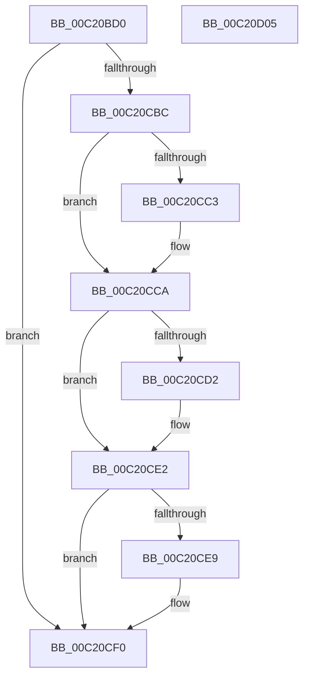

# HalpDmaCvmQueryRegistryKeys

- RVA: `0x00C20BD0`–`0x00C20D06` (길이 `310` bytes)
- VA: `0x0000000140C20BD0`
- 실행 섹션: `INIT`
- PDB 이름 있음: `예`; PDB Function 태그: `아니요`
- unwind 정보 RVA: `0x000C4240`
- 디코드: `71`개 명령, `310/310` bytes 표시
- 미해석 바이트: `0` (있으면 어셈블리에 `.byte`로 보존)

> 이 문서는 커널 이미지의 기계어와 PDB 기호를 분석해 생성했습니다. 4번과 5번은 함수 원형과 자료형을 바이너리 사용 방식에서 추정한 C 해석이며 원본 소스 복구 결과는 아닙니다.

## 1. Dependencies

- 직접 호출 지점: **5**; 고유 호출 대상: **5**
- 직접 호출자로 확인된 함수: **1**
- RIP 상대 이미지 참조: **10**

### Outgoing calls
- `0x00C20C08` → [memset](../../text/6C/memset_function_006C6C40.md) (function, `0x006C6C40`)
- `0x00C20C7D` → [RtlInitUnicodeString](../../text/42/RtlInitUnicodeString_function_0042A780.md) (function, `0x0042A780`)
- `0x00C20C87` → [MmGetSystemRoutineAddress](../../page/90/MmGetSystemRoutineAddress_function_0090EFE0.md) (function, `0x0090EFE0`)
- `0x00C20CB3` → [guard_dispatch_icall](../../text/6B/guard_dispatch_icall_function_006BAAD0.md) (function, `0x006BAAD0`)
- `0x00C20CF7` → [_security_check_cookie](../../text/6A/_security_check_cookie_function_006AC640.md) (function, `0x006AC640`)

### Direct callers
- [HalpDmaInitializeCvmSupport](HalpDmaInitializeCvmSupport_function_00C211C4.md) at `0x00C211D9`

### Static image references
- `0x00C20BDE` → RVA `0x00E0A740` (`.data`; read)
- `0x00C20C12` → RVA `0x00024E98` (`.rdata`; read)
- `0x00C20C34` → RVA `0x00024E68` (`.rdata`; read)
- `0x00C20C4C` → RVA `0x00024EC8` (`.rdata`; read)
- `0x00C20C65` → RVA `0x00023C80` (`.rdata`; read)
- `0x00C20C8C` → RVA `0x008C8FD0` (`RtlQueryRegistryValues`; read)
- `0x00C20C9F` → RVA `0x00024EB8` (`.rdata`; read)
- `0x00C20CC3` → RVA `0x00FC18A1` (`.data`; write)
- `0x00C20CDC` → RVA `0x00FC18A4` (`.data`; write)
- `0x00C20CE9` → RVA `0x00FC18A2` (`.data`; write)

## 2. Other-region calls and transfers

- 다른 실행 섹션으로 향하는 call: **5**
  - `0x00C20C08` → [memset](../../text/6C/memset_function_006C6C40.md) (`INIT` → `.text`)
  - `0x00C20C7D` → [RtlInitUnicodeString](../../text/42/RtlInitUnicodeString_function_0042A780.md) (`INIT` → `.text`)
  - `0x00C20C87` → [MmGetSystemRoutineAddress](../../page/90/MmGetSystemRoutineAddress_function_0090EFE0.md) (`INIT` → `PAGE`)
  - `0x00C20CB3` → [guard_dispatch_icall](../../text/6B/guard_dispatch_icall_function_006BAAD0.md) (`INIT` → `.text`)
  - `0x00C20CF7` → [_security_check_cookie](../../text/6A/_security_check_cookie_function_006AC640.md) (`INIT` → `.text`)
- 별도 외부 분기/꼬리 이동을 확인하지 못했습니다.

## 3. Assembly (complete function range)

```asm
00C20BD0  40 55                           push rbp
00C20BD2  48 8D 6C 24 C0                  lea rbp, [rsp - 0x40]
00C20BD7  48 81 EC 40 01 00 00            sub rsp, 0x140
00C20BDE  48 8B 05 5B 9B 1E 00            mov rax, qword ptr [rip + 0x1e9b5b]
00C20BE5  48 33 C4                        xor rax, rsp
00C20BE8  48 89 45 30                     mov qword ptr [rbp + 0x30], rax
00C20BEC  83 64 24 38 00                  and dword ptr [rsp + 0x38], 0
00C20BF1  48 8D 4C 24 50                  lea rcx, [rsp + 0x50]
00C20BF6  83 64 24 30 00                  and dword ptr [rsp + 0x30], 0
00C20BFB  33 D2                           xor edx, edx
00C20BFD  83 64 24 34 00                  and dword ptr [rsp + 0x34], 0
00C20C02  41 B8 E0 00 00 00               mov r8d, 0xe0
00C20C08  E8 33 60 AA FF                  call 0x1406c6c40
00C20C0D  BA 20 01 00 00                  mov edx, 0x120
00C20C12  48 8D 05 7F 42 40 FF            lea rax, [rip - 0xbfbd81]
00C20C19  48 89 44 24 60                  mov qword ptr [rsp + 0x60], rax
00C20C1E  B9 00 00 00 04                  mov ecx, 0x4000000
00C20C23  48 8D 44 24 30                  lea rax, [rsp + 0x30]
00C20C28  89 54 24 58                     mov dword ptr [rsp + 0x58], edx
00C20C2C  48 89 44 24 68                  mov qword ptr [rsp + 0x68], rax
00C20C31  0F 57 C0                        xorps xmm0, xmm0
00C20C34  48 8D 05 2D 42 40 FF            lea rax, [rip - 0xbfbdd3]
00C20C3B  89 4C 24 70                     mov dword ptr [rsp + 0x70], ecx
00C20C3F  48 89 45 98                     mov qword ptr [rbp - 0x68], rax
00C20C43  48 8D 44 24 34                  lea rax, [rsp + 0x34]
00C20C48  48 89 45 A0                     mov qword ptr [rbp - 0x60], rax
00C20C4C  48 8D 05 75 42 40 FF            lea rax, [rip - 0xbfbd8b]
00C20C53  48 89 45 D0                     mov qword ptr [rbp - 0x30], rax
00C20C57  48 8D 44 24 38                  lea rax, [rsp + 0x38]
00C20C5C  89 55 90                        mov dword ptr [rbp - 0x70], edx
00C20C5F  89 4D A8                        mov dword ptr [rbp - 0x58], ecx
00C20C62  89 55 C8                        mov dword ptr [rbp - 0x38], edx
00C20C65  48 8D 15 14 30 40 FF            lea rdx, [rip - 0xbfcfec]
00C20C6C  89 4D E0                        mov dword ptr [rbp - 0x20], ecx
00C20C6F  48 8D 4C 24 40                  lea rcx, [rsp + 0x40]
00C20C74  48 89 45 D8                     mov qword ptr [rbp - 0x28], rax
00C20C78  0F 11 44 24 40                  movups xmmword ptr [rsp + 0x40], xmm0
00C20C7D  E8 FE 9A 80 FF                  call 0x14042a780
00C20C82  48 8D 4C 24 40                  lea rcx, [rsp + 0x40]
00C20C87  E8 54 E3 CE FF                  call 0x14090efe0
00C20C8C  48 8D 0D 3D 83 CA FF            lea rcx, [rip - 0x357cc3]
00C20C93  48 85 C0                        test rax, rax
00C20C96  4C 8D 44 24 50                  lea r8, [rsp + 0x50]
00C20C9B  48 0F 44 C1                     cmove rax, rcx
00C20C9F  48 8D 15 12 42 40 FF            lea rdx, [rip - 0xbfbdee]
00C20CA6  48 83 64 24 20 00               and qword ptr [rsp + 0x20], 0
00C20CAC  45 33 C9                        xor r9d, r9d
00C20CAF  41 8D 49 02                     lea ecx, [r9 + 2]
00C20CB3  E8 18 9E A9 FF                  call 0x1406baad0
00C20CB8  85 C0                           test eax, eax
00C20CBA  78 34                           js 0x140c20cf0
00C20CBC  83 7C 24 30 00                  cmp dword ptr [rsp + 0x30], 0
00C20CC1  74 07                           je 0x140c20cca
00C20CC3  C6 05 D7 0B 3A 00 01            mov byte ptr [rip + 0x3a0bd7], 1
00C20CCA  8B 44 24 34                     mov eax, dword ptr [rsp + 0x34]
00C20CCE  85 C0                           test eax, eax
00C20CD0  74 10                           je 0x140c20ce2
00C20CD2  B9 00 80 00 00                  mov ecx, 0x8000
00C20CD7  3B C1                           cmp eax, ecx
00C20CD9  0F 47 C1                        cmova eax, ecx
00C20CDC  89 05 C2 0B 3A 00               mov dword ptr [rip + 0x3a0bc2], eax
00C20CE2  83 7C 24 38 00                  cmp dword ptr [rsp + 0x38], 0
00C20CE7  74 07                           je 0x140c20cf0
00C20CE9  C6 05 B2 0B 3A 00 01            mov byte ptr [rip + 0x3a0bb2], 1
00C20CF0  48 8B 4D 30                     mov rcx, qword ptr [rbp + 0x30]
00C20CF4  48 33 CC                        xor rcx, rsp
00C20CF7  E8 44 B9 A8 FF                  call 0x1406ac640
00C20CFC  48 81 C4 40 01 00 00            add rsp, 0x140
00C20D03  5D                              pop rbp
00C20D04  C3                              ret
00C20D05  CC                              int3
```

## 4. C-style interpretation (structured pseudocode)

```c
__int64 __fastcall HalpDmaCvmQueryRegistryKeys(__int64 a1, int a2, __int64 a3, int a4)
{
    __int64 result;
    __int64 v_rsp;
    unsigned __int64 v_stack_m108;
    unsigned int v_stack_m110;
    unsigned int v_stack_m114;
    unsigned int v_stack_m118;
    unsigned __int64 v_stack_m128;
    unsigned __int64 v_stack_m18;
    unsigned __int64 v_stack_m48;
    unsigned int v_stack_m68;
    unsigned __int64 v_stack_m70;
    unsigned __int64 v_stack_m78;
    unsigned int v_stack_m80;
    unsigned int v_stack_mA0;
    unsigned __int64 v_stack_mA8;
    unsigned __int64 v_stack_mB0;
    unsigned int v_stack_mB8;
    unsigned int v_stack_mD8;
    unsigned __int64 v_stack_mE0;
    unsigned __int64 v_stack_mE8;
    unsigned int v_stack_mF0;
    unsigned __int64 v_stack_mF8;

    v_rsp = (v_rsp) - (320);
    result = (*(unsigned __int64 *)(v_rip + 2005851)) ^ (v_rsp);
    v_stack_m18 = result;
    a2 = 0;
    result = memset(v_stack_mF8, a2, 224, a4);
    v_stack_mE8 = v_rip - 12565889;
    v_stack_mF0 = 288;
    v_stack_mE0 = v_stack_m118;
    v_stack_mD8 = (unsigned int)((unsigned int)(0x4000000ULL));
    v_stack_mB0 = v_rip - 12565971;
    v_stack_mA8 = v_stack_m114;
    v_stack_m78 = v_rip - 12565899;
    v_stack_mB8 = 288;
    v_stack_mA0 = (unsigned int)((unsigned int)(0x4000000ULL));
    v_stack_m80 = 288;
    v_stack_m68 = (unsigned int)((unsigned int)(0x4000000ULL));
    v_stack_m70 = v_stack_m110;
    v_stack_m108 = v_xmm0;
    result = RtlInitUnicodeString(v_stack_m108, v_rip - 12570604, 224, a4);
    result = MmGetSystemRoutineAddress(v_stack_m108, v_rip - 12570604, 224, a4);
    if (result == 0) { result = v_rip - 3505347; }
    a4 = 0;
    result = guard_dispatch_icall(a4 + 2, v_rip - 12565998, v_stack_mF8, a4);
    if (sign_flag) goto loc_00C20CF0;
    if (v_stack_m118 != 0) {
        *(unsigned __int8 *)(v_rip + 3804119) = 1;
    }
    result = (unsigned int)(v_stack_m114);
    if ((unsigned int)((unsigned int)(v_stack_m114)) != 0) {
        a1 = 0x8000ULL;
        result = (unsigned int)(v_stack_m114);
        if (((unsigned int)((unsigned int)(v_stack_m114))) > ((unsigned int)(a1))) { result = (unsigned int)(a1); }
        *(unsigned int *)(v_rip + 3804098) = (unsigned int)(result);
    }
    if (v_stack_m110 != 0) {
        *(unsigned __int8 *)(v_rip + 3804082) = 1;
    }
    a1 = (v_stack_m18) ^ (v_rsp);
    result = _security_check_cookie(a1, v_rip - 12565998, v_stack_mF8, a4);
    v_rsp = (v_rsp) + (320);
    return result;
}
```

## 5. (Beta) C Style

```c
int64_t HalpDmaCvmQueryRegistryKeys(int64_t Arg1, int32_t Arg2, int64_t Arg3, int32_t Arg4)
{
    int64_t result;
    int64_t local_rsp;
    uint64_t v_stack_m108;
    uint32_t v_stack_m110;
    uint32_t v_stack_m114;
    uint32_t v_stack_m118;
    uint64_t v_stack_m128;
    uint64_t v_stack_m18;
    uint64_t v_stack_m48;
    uint32_t v_stack_m68;
    uint64_t v_stack_m70;
    uint64_t v_stack_m78;
    uint32_t v_stack_m80;
    uint32_t v_stack_mA0;
    uint64_t v_stack_mA8;
    uint64_t v_stack_mB0;
    uint32_t v_stack_mB8;
    uint32_t v_stack_mD8;
    uint64_t v_stack_mE0;
    uint64_t v_stack_mE8;
    uint32_t v_stack_mF0;
    uint64_t v_stack_mF8;

    local_rsp = (local_rsp) - (320);
    result = (*(uint64_t *)(v_rip + 0x1E9B5B)) ^ (local_rsp);
    v_stack_m18 = result;
    Arg2 = 0;
    result = memset(v_stack_mF8, Arg2, 224, Arg4);
    v_stack_mE8 = v_rip - 12565889;
    v_stack_mF0 = 288;
    v_stack_mE0 = v_stack_m118;
    v_stack_mD8 = (uint32_t)((uint32_t)(0x4000000ULL));
    v_stack_mB0 = v_rip - 12565971;
    v_stack_mA8 = v_stack_m114;
    v_stack_m78 = v_rip - 12565899;
    v_stack_mB8 = 288;
    v_stack_mA0 = (uint32_t)((uint32_t)(0x4000000ULL));
    v_stack_m80 = 288;
    v_stack_m68 = (uint32_t)((uint32_t)(0x4000000ULL));
    v_stack_m70 = v_stack_m110;
    v_stack_m108 = v_xmm0;
    result = RtlInitUnicodeString(v_stack_m108, v_rip - 12570604, 224, Arg4);
    result = MmGetSystemRoutineAddress(v_stack_m108, v_rip - 12570604, 224, Arg4);
    if (result == 0) { result = v_rip - 3505347; }
    Arg4 = 0;
    result = guard_dispatch_icall(Arg4 + 2, v_rip - 12565998, v_stack_mF8, Arg4);
    if (sign_flag) goto loc_00C20CF0;
    if (v_stack_m118 != 0) {
        *(uint8_t *)(v_rip + 0x3A0BD7) = 1;
    }
    result = (uint32_t)(v_stack_m114);
    if ((uint32_t)((uint32_t)(v_stack_m114)) != 0) {
        Arg1 = 0x8000ULL;
        result = (uint32_t)(v_stack_m114);
        if (((uint32_t)((uint32_t)(v_stack_m114))) > ((uint32_t)(Arg1))) { result = (uint32_t)(Arg1); }
        *(uint32_t *)(v_rip + 0x3A0BC2) = (uint32_t)(result);
    }
    if (v_stack_m110 != 0) {
        *(uint8_t *)(v_rip + 0x3A0BB2) = 1;
    }
    Arg1 = (v_stack_m18) ^ (local_rsp);
    result = _security_check_cookie(Arg1, v_rip - 12565998, v_stack_mF8, Arg4);
    local_rsp = (local_rsp) + (320);
    return result;
}
```

## 6. Execution-region graph

[열기: 2D/3D 그래프와 함수 탐색 컨트롤 패널](../../../control-panel.html?section=init&rva=0x00C20BD0&view=graph)

- 2D 그래프는 위에서 아래로 흐르고, 3D 그래프는 빈 공간을 드래그해 회전합니다. Shift+드래그는 이동, 휠은 확대·축소, 함수 노드 선택은 대상 보고서 이동입니다.

### Static fallback


