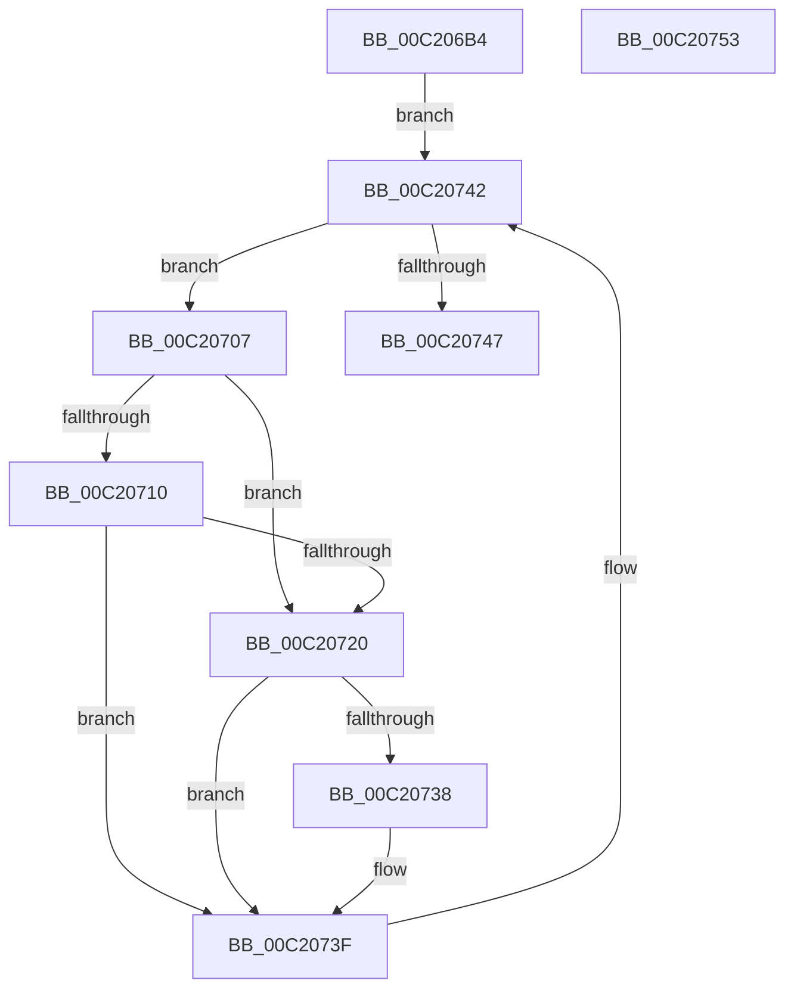

# HalpDmaInitDiscard

- RVA: `0x00C206B4`–`0x00C20754` (길이 `160` bytes)
- VA: `0x0000000140C206B4`
- 실행 섹션: `INIT`
- PDB 이름 있음: `예`; PDB Function 태그: `아니요`
- unwind 정보 RVA: `0x0005C788`
- 디코드: `35`개 명령, `160/160` bytes 표시
- 미해석 바이트: `0` (있으면 어셈블리에 `.byte`로 보존)

> 이 문서는 커널 이미지의 기계어와 PDB 기호를 분석해 생성했습니다. 4번과 5번은 함수 원형과 자료형을 바이너리 사용 방식에서 추정한 C 해석이며 원본 소스 복구 결과는 아닙니다.

## 1. Dependencies

- 직접 호출 지점: **1**; 고유 호출 대상: **1**
- 직접 호출자로 확인된 함수: **1**
- RIP 상대 이미지 참조: **12**

### Outgoing calls
- `0x00C20747` → [HalpDmaInitMemory](HalpDmaInitMemory_function_00C20FC8.md) (function, `0x00C20FC8`)

### Direct callers
- [HalpDmaInitSystem](../../pagelk/B5/HalpDmaInitSystem_function_00B5DB50.md) at `0x00B5DBA2`

### Static image references
- `0x00C206B8` → RVA `0x00543CC0` (`HalPnpGetDmaAdapter`; read)
- `0x00C206BF` → RVA `0x00E006A0` (`.data`; write)
- `0x00C206CA` → RVA `0x00706F70` (`HalpDmaLinkDeviceObjectByToken`; read)
- `0x00C206D1` → RVA `0x00E00B68` (`.data`; write)
- `0x00C206D8` → RVA `0x0053FC40` (`HalpDmaCheckAdapterToken`; read)
- `0x00C206DF` → RVA `0x00E00B70` (`.data`; write)
- `0x00C206E6` → RVA `0x00707640` (`HalpAllocateMapRegisters`; read)
- `0x00C206ED` → RVA `0x00E00850` (`.data`; write)
- `0x00C206F4` → RVA `0x0053FE10` (`HalpDmaFreeCrashDumpRegisters`; read)
- `0x00C206FB` → RVA `0x00E00AB8` (`.data`; write)
- `0x00C2072F` → RVA `0x00FC3C08` (`.data`; read)
- `0x00C20738` → RVA `0x00FC3C08` (`.data`; write)

## 2. Other-region calls and transfers

- 다른 실행 섹션으로 향하는 call: **0**
- 별도 외부 분기/꼬리 이동을 확인하지 못했습니다.

## 3. Assembly (complete function range)

```asm
00C206B4  48 83 EC 28                     sub rsp, 0x28
00C206B8  48 8D 05 01 36 92 FF            lea rax, [rip - 0x6dc9ff]
00C206BF  48 89 05 DA FF 1D 00            mov qword ptr [rip + 0x1dffda], rax
00C206C6  4C 8D 41 20                     lea r8, [rcx + 0x20]
00C206CA  48 8D 05 9F 68 AE FF            lea rax, [rip - 0x519761]
00C206D1  48 89 05 90 04 1E 00            mov qword ptr [rip + 0x1e0490], rax
00C206D8  48 8D 05 61 F5 91 FF            lea rax, [rip - 0x6e0a9f]
00C206DF  48 89 05 8A 04 1E 00            mov qword ptr [rip + 0x1e048a], rax
00C206E6  48 8D 05 53 6F AE FF            lea rax, [rip - 0x5190ad]
00C206ED  48 89 05 5C 01 1E 00            mov qword ptr [rip + 0x1e015c], rax
00C206F4  48 8D 05 15 F7 91 FF            lea rax, [rip - 0x6e08eb]
00C206FB  48 89 05 B6 03 1E 00            mov qword ptr [rip + 0x1e03b6], rax
00C20702  49 8B 10                        mov rdx, qword ptr [r8]
00C20705  EB 3B                           jmp 0x140c20742
00C20707  48 63 42 18                     movsxd rax, dword ptr [rdx + 0x18]
00C2070B  83 F8 25                        cmp eax, 0x25
00C2070E  77 10                           ja 0x140c20720
00C20710  49 B9 48 00 40 C0 2B 00 00 00   movabs r9, 0x2bc0400048
00C2071A  49 0F A3 C1                     bt r9, rax
00C2071E  72 1F                           jb 0x140c2073f
00C20720  48 8B 42 28                     mov rax, qword ptr [rdx + 0x28]
00C20724  48 03 42 20                     add rax, qword ptr [rdx + 0x20]
00C20728  48 C1 E0 0C                     shl rax, 0xc
00C2072C  48 FF C8                        dec rax
00C2072F  48 3B 05 D2 34 3A 00            cmp rax, qword ptr [rip + 0x3a34d2]
00C20736  76 07                           jbe 0x140c2073f
00C20738  48 89 05 C9 34 3A 00            mov qword ptr [rip + 0x3a34c9], rax
00C2073F  48 8B 12                        mov rdx, qword ptr [rdx]
00C20742  49 3B D0                        cmp rdx, r8
00C20745  75 C0                           jne 0x140c20707
00C20747  E8 7C 08 00 00                  call 0x140c20fc8
00C2074C  33 C0                           xor eax, eax
00C2074E  48 83 C4 28                     add rsp, 0x28
00C20752  C3                              ret
00C20753  CC                              int3
```

## 4. C-style interpretation (structured pseudocode)

```c
__int64 __fastcall HalpDmaInitDiscard(__int64 a1)
{
    __int64 result;
    __int64 v_rsp;

    v_rsp = (v_rsp) - (40);
    *(unsigned __int64 *)(v_rip + 1966042) = v_rip - 7195135;
    *(unsigned __int64 *)(v_rip + 1967248) = v_rip - 5347169;
    *(unsigned __int64 *)(v_rip + 1967242) = v_rip - 7211679;
    *(unsigned __int64 *)(v_rip + 1966428) = v_rip - 5345453;
    *(unsigned __int64 *)(v_rip + 1967030) = v_rip - 7211243;
    goto loc_00C20742;
loc_00C20707:
    if (((unsigned int)((int)(*(unsigned int *)(*(unsigned __int64 *)(a1 + 32) + 24)))) > 37) goto loc_00C20720;
    if (((unsigned int)((int)(*(unsigned int *)(*(unsigned __int64 *)(a1 + 32) + 24)))) < 37) goto loc_00C2073F;
loc_00C20720:
    result = (*(unsigned __int64 *)(*(unsigned __int64 *)(a1 + 32) + 40)) + (*(unsigned __int64 *)(*(unsigned __int64 *)(a1 + 32) + 32));
    result = (result) << (12);
    result = (result) - 1;
    if (result >= = (*(unsigned __int64 *)(v_rip + 3814610))) {
        *(unsigned __int64 *)(v_rip + 3814601) = result;
    }
loc_00C20742:
    if ((*(unsigned __int64 *)(*(unsigned __int64 *)(a1 + 32))) != (a1 + 32)) goto loc_00C20707;
    result = HalpDmaInitMemory(a1, *(unsigned __int64 *)(*(unsigned __int64 *)(a1 + 32)), a1 + 32, a4);
    result = 0;
    v_rsp = (v_rsp) + (40);
    return result;
}
```

## 5. (Beta) C Style

```c
int64_t HalpDmaInitDiscard(void *Arg1)
{
    uint8_t *arg1 = (uint8_t *)Arg1;

    int64_t result;
    int64_t local_rsp;

    local_rsp = (local_rsp) - (40);
    *(uint64_t *)(v_rip + 0x1DFFDA) = v_rip - 7195135;
    *(uint64_t *)(v_rip + 0x1E0490) = v_rip - 5347169;
    *(uint64_t *)(v_rip + 0x1E048A) = v_rip - 7211679;
    *(uint64_t *)(v_rip + 0x1E015C) = v_rip - 5345453;
    *(uint64_t *)(v_rip + 0x1E03B6) = v_rip - 7211243;
    goto loc_00C20742;
loc_00C20707:
    if (((uint32_t)((int32_t)(*(uint32_t *)(*(uint64_t *)(arg1 + 0x20) + 0x18)))) > 37) goto loc_00C20720;
    if (((uint32_t)((int32_t)(*(uint32_t *)(*(uint64_t *)(arg1 + 0x20) + 0x18)))) < 37) goto loc_00C2073F;
loc_00C20720:
    result = (*(uint64_t *)(*(uint64_t *)(arg1 + 0x20) + 0x28)) + (*(uint64_t *)(*(uint64_t *)(arg1 + 0x20) + 0x20));
    result = (result) << (12);
    result = (result) - 1;
    if (result >= = (*(uint64_t *)(v_rip + 0x3A34D2))) {
        *(uint64_t *)(v_rip + 0x3A34C9) = result;
    }
loc_00C20742:
    if ((*(uint64_t *)(*(uint64_t *)(arg1 + 0x20))) != (Arg1 + 32)) goto loc_00C20707;
    result = HalpDmaInitMemory(Arg1, *(uint64_t *)(*(uint64_t *)(arg1 + 0x20)), Arg1 + 32, a4);
    result = 0;
    local_rsp = (local_rsp) + (40);
    return result;
}
```

### 관측된 메모리 오프셋

구조체 형식이 확인되지 않은 접근은 인자 기준의 오프셋으로만 기록했습니다.

| 기준 인자 | 오프셋 표현 | 폭 (bit) | 접근 |
|---|---:|---:|---|
| `Arg1` | `+ 0x0` | `64` | `R` |
| `Arg1` | `+ 0x20` | `64` | `R` |

## 6. Execution-region graph

[열기: 2D/3D 그래프와 함수 탐색 컨트롤 패널](../../../control-panel.html?section=init&rva=0x00C206B4&view=graph)

- 2D 그래프는 위에서 아래로 흐르고, 3D 그래프는 빈 공간을 드래그해 회전합니다. Shift+드래그는 이동, 휠은 확대·축소, 함수 노드 선택은 대상 보고서 이동입니다.

### Static fallback


