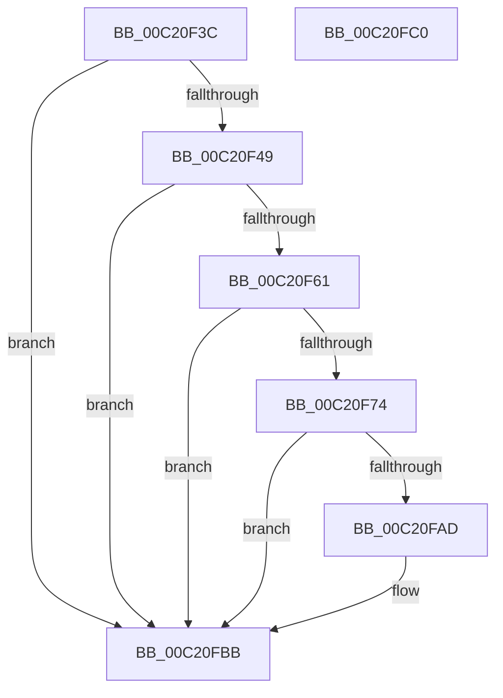

# HalpDmaInitEarly

- RVA: `0x00C20F3C`–`0x00C20FC1` (길이 `133` bytes)
- VA: `0x0000000140C20F3C`
- 실행 섹션: `INIT`
- PDB 이름 있음: `예`; PDB Function 태그: `아니요`
- unwind 정보 RVA: `0x0005D2F4`
- 디코드: `31`개 명령, `133/133` bytes 표시
- 미해석 바이트: `0` (있으면 어셈블리에 `.byte`로 보존)

> 이 문서는 커널 이미지의 기계어와 PDB 기호를 분석해 생성했습니다. 4번과 5번은 함수 원형과 자료형을 바이너리 사용 방식에서 추정한 C 해석이며 원본 소스 복구 결과는 아닙니다.

## 1. Dependencies

- 직접 호출 지점: **4**; 고유 호출 대상: **3**
- 직접 호출자로 확인된 함수: **1**
- RIP 상대 이미지 참조: **9**

### Outgoing calls
- `0x00C20F40` → [HalpDmaInitializeObjectType](../../text/55/HalpDmaInitializeObjectType_function_00552480.md) (function, `0x00552480`)
- `0x00C20F58` → [HalpDmaAlwaysReserveLogicalAddressRangeInternal](../../text/55/HalpDmaAlwaysReserveLogicalAddressRangeInternal_function_00551F14.md) (function, `0x00551F14`)
- `0x00C20F6B` → [HalpDmaAlwaysReserveLogicalAddressRangeInternal](../../text/55/HalpDmaAlwaysReserveLogicalAddressRangeInternal_function_00551F14.md) (function, `0x00551F14`)
- `0x00C20FA4` → [guard_dispatch_icall](../../text/6B/guard_dispatch_icall_function_006BAAD0.md) (function, `0x006BAAD0`)

### Direct callers
- [HalpDmaInitSystem](../../pagelk/B5/HalpDmaInitSystem_function_00B5DB50.md) at `0x00B5DB91`

### Static image references
- `0x00C20F49` → RVA `0x00FC1790` (`.data`; read/write)
- `0x00C20F74` → RVA `0x00FC1888` (`.data`; read/write)
- `0x00C20F7C` → RVA `0x00FC1890` (`.data`; read)
- `0x00C20F85` → RVA `0x00FC1898` (`.data`; write)
- `0x00C20F8C` → RVA `0x00FC1890` (`.data`; write)
- `0x00C20F93` → RVA `0x00FC17A0` (`.data`; read)
- `0x00C20F9A` → RVA `0x00E00CB0` (`.data`; read)
- `0x00C20FAD` → RVA `0x00FC17B0` (`.data`; read)
- `0x00C20FB4` → RVA `0x00FC1778` (`.data`; write)

## 2. Other-region calls and transfers

- 다른 실행 섹션으로 향하는 call: **4**
  - `0x00C20F40` → [HalpDmaInitializeObjectType](../../text/55/HalpDmaInitializeObjectType_function_00552480.md) (`INIT` → `.text`)
  - `0x00C20F58` → [HalpDmaAlwaysReserveLogicalAddressRangeInternal](../../text/55/HalpDmaAlwaysReserveLogicalAddressRangeInternal_function_00551F14.md) (`INIT` → `.text`)
  - `0x00C20F6B` → [HalpDmaAlwaysReserveLogicalAddressRangeInternal](../../text/55/HalpDmaAlwaysReserveLogicalAddressRangeInternal_function_00551F14.md) (`INIT` → `.text`)
  - `0x00C20FA4` → [guard_dispatch_icall](../../text/6B/guard_dispatch_icall_function_006BAAD0.md) (`INIT` → `.text`)
- 별도 외부 분기/꼬리 이동을 확인하지 못했습니다.

## 3. Assembly (complete function range)

```asm
00C20F3C  48 83 EC 38                     sub rsp, 0x38
00C20F40  E8 3B 15 93 FF                  call 0x140552480
00C20F45  85 C0                           test eax, eax
00C20F47  78 72                           js 0x140c20fbb
00C20F49  0F BA 2D 3F 08 3A 00 1F         bts dword ptr [rip + 0x3a083f], 0x1f
00C20F51  BA 00 00 20 00                  mov edx, 0x200000
00C20F56  33 C9                           xor ecx, ecx
00C20F58  E8 B7 0F 93 FF                  call 0x140551f14
00C20F5D  85 C0                           test eax, eax
00C20F5F  78 5A                           js 0x140c20fbb
00C20F61  BA 00 00 10 00                  mov edx, 0x100000
00C20F66  B9 00 00 E0 FE                  mov ecx, 0xfee00000
00C20F6B  E8 A4 0F 93 FF                  call 0x140551f14
00C20F70  85 C0                           test eax, eax
00C20F72  78 47                           js 0x140c20fbb
00C20F74  48 83 25 0C 09 3A 00 00         and qword ptr [rip + 0x3a090c], 0
00C20F7C  48 8D 05 0D 09 3A 00            lea rax, [rip + 0x3a090d]
00C20F83  33 D2                           xor edx, edx
00C20F85  48 89 05 0C 09 3A 00            mov qword ptr [rip + 0x3a090c], rax
00C20F8C  48 89 05 FD 08 3A 00            mov qword ptr [rip + 0x3a08fd], rax
00C20F93  4C 8D 05 06 08 3A 00            lea r8, [rip + 0x3a0806]
00C20F9A  48 8B 05 0F FD 1D 00            mov rax, qword ptr [rip + 0x1dfd0f]
00C20FA1  8D 4A 03                        lea ecx, [rdx + 3]
00C20FA4  E8 27 9B A9 FF                  call 0x1406baad0
00C20FA9  85 C0                           test eax, eax
00C20FAB  78 0E                           js 0x140c20fbb
00C20FAD  48 8D 0D FC 07 3A 00            lea rcx, [rip + 0x3a07fc]
00C20FB4  48 89 0D BD 07 3A 00            mov qword ptr [rip + 0x3a07bd], rcx
00C20FBB  48 83 C4 38                     add rsp, 0x38
00C20FBF  C3                              ret
00C20FC0  CC                              int3
```

## 4. C-style interpretation (structured pseudocode)

```c
__int64 __fastcall HalpDmaInitEarly(int a1)
{
    __int64 result;
    __int64 v_rsp;

    v_rsp = (v_rsp) - (56);
    result = HalpDmaInitializeObjectType(a1, a2, a3, a4);
    if (sign_flag) goto loc_00C20FBB;
    a1 = 0;
    result = HalpDmaAlwaysReserveLogicalAddressRangeInternal(a1, (unsigned int)(0x200000ULL), a3, a4);
    if (sign_flag) goto loc_00C20FBB;
    result = HalpDmaAlwaysReserveLogicalAddressRangeInternal((unsigned int)(0xFEE00000ULL), (unsigned int)(0x100000ULL), a3, a4);
    if (sign_flag) goto loc_00C20FBB;
    a2 = 0;
    *(unsigned __int64 *)(v_rip + 3803404) = v_rip + 3803405;
    *(unsigned __int64 *)(v_rip + 3803389) = v_rip + 3803405;
    result = guard_dispatch_icall(a2 + 3, a2, v_rip + 3803142, a4);
    if (!(sign_flag)) {
        a1 = v_rip + 3803132;
        *(unsigned __int64 *)(v_rip + 3803069) = a1;
    }
    v_rsp = (v_rsp) + (56);
    return result;
}
```

## 5. (Beta) C Style

```c
int64_t HalpDmaInitEarly(int32_t Arg1)
{
    int64_t result;
    int64_t local_rsp;

    local_rsp = (local_rsp) - (56);
    result = HalpDmaInitializeObjectType(Arg1, a2, a3, a4);
    if (sign_flag) goto loc_00C20FBB;
    Arg1 = 0;
    result = HalpDmaAlwaysReserveLogicalAddressRangeInternal(Arg1, (uint32_t)(0x200000ULL), a3, a4);
    if (sign_flag) goto loc_00C20FBB;
    result = HalpDmaAlwaysReserveLogicalAddressRangeInternal((uint32_t)(0xFEE00000ULL), (uint32_t)(0x100000ULL), a3, a4);
    if (sign_flag) goto loc_00C20FBB;
    a2 = 0;
    *(uint64_t *)(v_rip + 0x3A090C) = v_rip + 3803405;
    *(uint64_t *)(v_rip + 0x3A08FD) = v_rip + 3803405;
    result = guard_dispatch_icall(a2 + 3, a2, v_rip + 3803142, a4);
    if (!(sign_flag)) {
        Arg1 = v_rip + 3803132;
        *(uint64_t *)(v_rip + 0x3A07BD) = Arg1;
    }
    local_rsp = (local_rsp) + (56);
    return result;
}
```

## 6. Execution-region graph

[열기: 2D/3D 그래프와 함수 탐색 컨트롤 패널](../../../control-panel.html?section=init&rva=0x00C20F3C&view=graph)

- 2D 그래프는 위에서 아래로 흐르고, 3D 그래프는 빈 공간을 드래그해 회전합니다. Shift+드래그는 이동, 휠은 확대·축소, 함수 노드 선택은 대상 보고서 이동입니다.

### Static fallback


