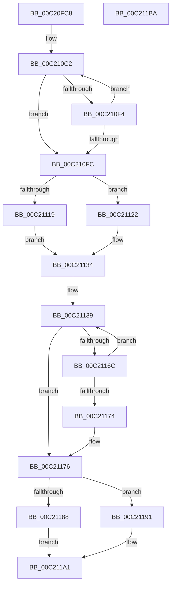

# HalpDmaInitMemory

- RVA: `0x00C20FC8`–`0x00C211BB` (길이 `499` bytes)
- VA: `0x0000000140C20FC8`
- 실행 섹션: `INIT`
- PDB 이름 있음: `예`; PDB Function 태그: `아니요`
- unwind 정보 RVA: `0x000C42EC`
- 디코드: `123`개 명령, `499/499` bytes 표시
- 미해석 바이트: `0` (있으면 어셈블리에 `.byte`로 보존)

> 이 문서는 커널 이미지의 기계어와 PDB 기호를 분석해 생성했습니다. 4번과 5번은 함수 원형과 자료형을 바이너리 사용 방식에서 추정한 C 해석이며 원본 소스 복구 결과는 아닙니다.

## 1. Dependencies

- 직접 호출 지점: **4**; 고유 호출 대상: **1**
- 직접 호출자로 확인된 함수: **1**
- RIP 상대 이미지 참조: **21**

### Outgoing calls
- `0x00C21052` → [HalpAllocPhysicalMemoryEx](../C7/HalpAllocPhysicalMemoryEx_function_00C771DC.md) (function, `0x00C771DC`)
- `0x00C21080` → [HalpAllocPhysicalMemoryEx](../C7/HalpAllocPhysicalMemoryEx_function_00C771DC.md) (function, `0x00C771DC`)
- `0x00C210E8` → [HalpAllocPhysicalMemoryEx](../C7/HalpAllocPhysicalMemoryEx_function_00C771DC.md) (function, `0x00C771DC`)
- `0x00C21160` → [HalpAllocPhysicalMemoryEx](../C7/HalpAllocPhysicalMemoryEx_function_00C771DC.md) (function, `0x00C771DC`)

### Direct callers
- [HalpDmaInitDiscard](HalpDmaInitDiscard_function_00C206B4.md) at `0x00C20747`

### Static image references
- `0x00C20FE0` → RVA `0x00FC3F30` (`.data`; read/write)
- `0x00C20FE8` → RVA `0x00FC3F20` (`.data`; read)
- `0x00C20FFE` → RVA `0x00FC3F28` (`.data`; write)
- `0x00C21005` → RVA `0x00FC3F20` (`.data`; write)
- `0x00C21012` → RVA `0x00FC1768` (`.data`; read)
- `0x00C21019` → RVA `0x00FC1760` (`.data`; write)
- `0x00C21024` → RVA `0x00FC1762` (`.data`; write)
- `0x00C2102F` → RVA `0x00FC1764` (`.data`; write)
- `0x00C21039` → RVA `0x00FC1770` (`.data`; write)
- `0x00C21043` → RVA `0x00FC1768` (`.data`; write)
- `0x00C21057` → RVA `0x00FC3AF0` (`.data`; write)
- `0x00C21077` → RVA `0x00FC3AE8` (`.data`; write)
- `0x00C21085` → RVA `0x00FC3CF0` (`.data`; write)
- `0x00C210A2` → RVA `0x00FC3C08` (`.data`; read)
- `0x00C210A9` → RVA `0x00FC3CE8` (`.data`; write)
- `0x00C210FC` → RVA `0x00FC3BF0` (`.data`; write)
- `0x00C2110E` → RVA `0x00FC3BE8` (`.data`; write)
- `0x00C21119` → RVA `0x00FC3BB0` (`.data`; write)
- `0x00C21176` → RVA `0x00FC3DF0` (`.data`; write)
- `0x00C2117D` → RVA `0x00FC3DE8` (`.data`; write)
- `0x00C21188` → RVA `0x00FC3DB0` (`.data`; write)

## 2. Other-region calls and transfers

- 다른 실행 섹션으로 향하는 call: **0**
- 별도 외부 분기/꼬리 이동을 확인하지 못했습니다.

## 3. Assembly (complete function range)

```asm
00C20FC8  4C 8B DC                        mov r11, rsp
00C20FCB  49 89 5B 08                     mov qword ptr [r11 + 8], rbx
00C20FCF  49 89 6B 18                     mov qword ptr [r11 + 0x18], rbp
00C20FD3  49 89 73 20                     mov qword ptr [r11 + 0x20], rsi
00C20FD7  57                              push rdi
00C20FD8  41 54                           push r12
00C20FDA  41 56                           push r14
00C20FDC  48 83 EC 30                     sub rsp, 0x30
00C20FE0  48 83 25 48 2F 3A 00 00         and qword ptr [rip + 0x3a2f48], 0
00C20FE8  48 8D 05 31 2F 3A 00            lea rax, [rip + 0x3a2f31]
00C20FEF  49 83 63 D8 00                  and qword ptr [r11 - 0x28], 0
00C20FF4  49 8D 53 10                     lea rdx, [r11 + 0x10]
00C20FF8  41 BE 01 00 00 00               mov r14d, 1
00C20FFE  48 89 05 23 2F 3A 00            mov qword ptr [rip + 0x3a2f23], rax
00C21005  48 89 05 14 2F 3A 00            mov qword ptr [rip + 0x3a2f14], rax
00C2100C  41 BC 00 00 01 00               mov r12d, 0x10000
00C21012  48 8D 05 4F 07 3A 00            lea rax, [rip + 0x3a074f]
00C21019  66 44 89 35 3F 07 3A 00         mov word ptr [rip + 0x3a073f], r14w
00C21021  45 8B CC                        mov r9d, r12d
00C21024  C6 05 37 07 3A 00 06            mov byte ptr [rip + 0x3a0737], 6
00C2102B  41 8D 5E 0F                     lea ebx, [r14 + 0xf]
00C2102F  44 89 35 2E 07 3A 00            mov dword ptr [rip + 0x3a072e], r14d
00C21036  44 8B C3                        mov r8d, ebx
00C21039  48 89 05 30 07 3A 00            mov qword ptr [rip + 0x3a0730], rax
00C21040  48 8B F1                        mov rsi, rcx
00C21043  48 89 05 1E 07 3A 00            mov qword ptr [rip + 0x3a071e], rax
00C2104A  49 C7 43 10 00 00 00 01         mov qword ptr [r11 + 0x10], 0x1000000
00C21052  E8 85 61 05 00                  call 0x140c771dc
00C21057  48 89 05 92 2A 3A 00            mov qword ptr [rip + 0x3a2a92], rax
00C2105E  48 8D 54 24 58                  lea rdx, [rsp + 0x58]
00C21063  48 F7 D8                        neg rax
00C21066  45 8B CC                        mov r9d, r12d
00C21069  44 8B C3                        mov r8d, ebx
00C2106C  1B C9                           sbb ecx, ecx
00C2106E  48 83 64 24 20 00               and qword ptr [rsp + 0x20], 0
00C21074  41 23 CC                        and ecx, r12d
00C21077  89 0D 6B 2A 3A 00               mov dword ptr [rip + 0x3a2a6b], ecx
00C2107D  48 8B CE                        mov rcx, rsi
00C21080  E8 57 61 05 00                  call 0x140c771dc
00C21085  48 89 05 64 2C 3A 00            mov qword ptr [rip + 0x3a2c64], rax
00C2108C  41 8D 56 1F                     lea edx, [r14 + 0x1f]
00C21090  48 F7 D8                        neg rax
00C21093  48 B8 00 00 00 00 01 00 00 00   movabs rax, 0x100000000
00C2109D  1B C9                           sbb ecx, ecx
00C2109F  41 23 CC                        and ecx, r12d
00C210A2  48 39 05 5F 2B 3A 00            cmp qword ptr [rip + 0x3a2b5f], rax
00C210A9  89 0D 39 2C 3A 00               mov dword ptr [rip + 0x3a2c39], ecx
00C210AF  1B DB                           sbb ebx, ebx
00C210B1  81 E3 00 00 FE FF               and ebx, 0xfffe0000
00C210B7  81 C3 00 00 03 00               add ebx, 0x30000
00C210BD  8B EB                           mov ebp, ebx
00C210BF  C1 ED 0C                        shr ebp, 0xc
00C210C2  48 83 64 24 20 00               and qword ptr [rsp + 0x20], 0
00C210C8  8B CA                           mov ecx, edx
00C210CA  8B FA                           mov edi, edx
00C210CC  49 8B C6                        mov rax, r14
00C210CF  48 D3 E0                        shl rax, cl
00C210D2  48 8D 54 24 58                  lea rdx, [rsp + 0x58]
00C210D7  49 2B C6                        sub rax, r14
00C210DA  45 8B CC                        mov r9d, r12d
00C210DD  44 8B C5                        mov r8d, ebp
00C210E0  48 89 44 24 58                  mov qword ptr [rsp + 0x58], rax
00C210E5  48 8B CE                        mov rcx, rsi
00C210E8  E8 EF 60 05 00                  call 0x140c771dc
00C210ED  8B D7                           mov edx, edi
00C210EF  48 85 C0                        test rax, rax
00C210F2  75 08                           jne 0x140c210fc
00C210F4  8D 57 01                        lea edx, [rdi + 1]
00C210F7  83 FA 20                        cmp edx, 0x20
00C210FA  76 C6                           jbe 0x140c210c2
00C210FC  48 89 05 ED 2A 3A 00            mov qword ptr [rip + 0x3a2aed], rax
00C21103  48 F7 D8                        neg rax
00C21106  1B C9                           sbb ecx, ecx
00C21108  49 83 CC FF                     or r12, 0xffffffffffffffff
00C2110C  23 CB                           and ecx, ebx
00C2110E  89 0D D4 2A 3A 00               mov dword ptr [rip + 0x3a2ad4], ecx
00C21114  83 FA 40                        cmp edx, 0x40
00C21117  72 09                           jb 0x140c21122
00C21119  4C 89 25 90 2A 3A 00            mov qword ptr [rip + 0x3a2a90], r12
00C21120  EB 12                           jmp 0x140c21134
00C21122  8B CA                           mov ecx, edx
00C21124  49 8B C6                        mov rax, r14
00C21127  48 D3 E0                        shl rax, cl
00C2112A  49 2B C6                        sub rax, r14
00C2112D  48 89 05 7C 2A 3A 00            mov qword ptr [rip + 0x3a2a7c], rax
00C21134  B9 20 00 00 00                  mov ecx, 0x20
00C21139  48 83 64 24 20 00               and qword ptr [rsp + 0x20], 0
00C2113F  48 8D 54 24 58                  lea rdx, [rsp + 0x58]
00C21144  8B F9                           mov edi, ecx
00C21146  49 8B C6                        mov rax, r14
00C21149  48 D3 E0                        shl rax, cl
00C2114C  41 B9 00 00 01 00               mov r9d, 0x10000
00C21152  49 2B C6                        sub rax, r14
00C21155  44 8B C5                        mov r8d, ebp
00C21158  48 8B CE                        mov rcx, rsi
00C2115B  48 89 44 24 58                  mov qword ptr [rsp + 0x58], rax
00C21160  E8 77 60 05 00                  call 0x140c771dc
00C21165  8B CF                           mov ecx, edi
00C21167  48 85 C0                        test rax, rax
00C2116A  75 0A                           jne 0x140c21176
00C2116C  8D 4F 01                        lea ecx, [rdi + 1]
00C2116F  83 F9 20                        cmp ecx, 0x20
00C21172  76 C5                           jbe 0x140c21139
00C21174  33 DB                           xor ebx, ebx
00C21176  48 89 05 73 2C 3A 00            mov qword ptr [rip + 0x3a2c73], rax
00C2117D  89 1D 65 2C 3A 00               mov dword ptr [rip + 0x3a2c65], ebx
00C21183  83 F9 40                        cmp ecx, 0x40
00C21186  72 09                           jb 0x140c21191
00C21188  4C 89 25 21 2C 3A 00            mov qword ptr [rip + 0x3a2c21], r12
00C2118F  EB 10                           jmp 0x140c211a1
00C21191  49 8B C6                        mov rax, r14
00C21194  48 D3 E0                        shl rax, cl
00C21197  49 2B C6                        sub rax, r14
00C2119A  48 89 05 0F 2C 3A 00            mov qword ptr [rip + 0x3a2c0f], rax
00C211A1  48 8B 5C 24 50                  mov rbx, qword ptr [rsp + 0x50]
00C211A6  48 8B 6C 24 60                  mov rbp, qword ptr [rsp + 0x60]
00C211AB  48 8B 74 24 68                  mov rsi, qword ptr [rsp + 0x68]
00C211B0  48 83 C4 30                     add rsp, 0x30
00C211B4  41 5E                           pop r14
00C211B6  41 5C                           pop r12
00C211B8  5F                              pop rdi
00C211B9  C3                              ret
00C211BA  CC                              int3
```

## 4. C-style interpretation (structured pseudocode)

```c
__int64 __fastcall HalpDmaInitMemory(__int64 a1)
{
    __int64 result;
    __int64 v_r12;
    __int64 v_rbp;
    __int64 v_rbx;
    __int64 v_rsp;
    unsigned __int64 v_stack_m28;
    unsigned __int64 v_stack_p10;
    unsigned __int64 v_stack_p18;
    unsigned __int64 v_stack_p20;
    unsigned __int64 v_stack_p8;

    *(unsigned __int64 *)(v_rsp + 8) = v_rbx;
    *(unsigned __int64 *)(v_rsp + 24) = v_rbp;
    *(unsigned __int64 *)(v_rsp + 32) = v_rsi;
    v_rsp = (v_rsp) - (48);
    *(unsigned __int64 *)(v_rip + 3813155) = v_rip + 3813169;
    *(unsigned __int64 *)(v_rip + 3813140) = v_rip + 3813169;
    *(unsigned __int16 *)(v_rip + 3802943) = 1;
    *(unsigned __int8 *)(v_rip + 3802935) = 6;
    *(unsigned int *)(v_rip + 3802926) = 1;
    *(unsigned __int64 *)(v_rip + 3802928) = v_rip + 3802959;
    *(unsigned __int64 *)(v_rip + 3802910) = v_rip + 3802959;
    *(unsigned __int64 *)(v_rsp + 16) = 0x1000000ULL;
    result = HalpAllocPhysicalMemoryEx(a1, v_rsp + 16, (unsigned int)((unsigned int)(1 + 15)), (unsigned int)((unsigned int)((unsigned int)(0x10000ULL))));
    *(unsigned __int64 *)(v_rip + 3811986) = result;
    result = -(result);
    a1 = (unsigned int)((a1) & ((unsigned int)((unsigned int)(0x10000ULL))));
    *(unsigned int *)(v_rip + 3811947) = (unsigned int)(a1);
    result = HalpAllocPhysicalMemoryEx(a1, v_stack_p10, (unsigned int)((unsigned int)(1 + 15)), (unsigned int)((unsigned int)((unsigned int)(0x10000ULL))));
    *(unsigned __int64 *)(v_rip + 3812452) = result;
    result = -(result);
    a1 = (unsigned int)((a1) & ((unsigned int)((unsigned int)(0x10000ULL))));
    *(unsigned int *)(v_rip + 3812409) = (unsigned int)(a1);
    v_rbx = (unsigned int)((1 + 15) & (0xFFFE0000ULL));
    v_rbx = (unsigned int)((v_rbx) + (0x30000ULL));
    v_rbp = (unsigned int)(((unsigned int)((unsigned int)(v_rbx))) >> (12));
loc_00C210C2:
    result = (1) << ((unsigned __int8)((unsigned int)((unsigned int)(1 + 31))));
    result = (result) - (1);
    v_stack_p10 = result;
    result = HalpAllocPhysicalMemoryEx(a1, v_stack_p10, (unsigned int)((unsigned int)(v_rbp)), (unsigned int)((unsigned int)((unsigned int)(0x10000ULL))));
    if (result != 0) goto loc_00C210FC;
    if (((unsigned int)((unsigned int)((unsigned int)(1 + 31)) + 1)) <= 32) goto loc_00C210C2;
loc_00C210FC:
    *(unsigned __int64 *)(v_rip + 3812077) = result;
    result = -(result);
    v_r12 = ((unsigned int)(0x10000ULL)) | (-1);
    a1 = (unsigned int)((a1) & ((unsigned int)(v_rbx)));
    *(unsigned int *)(v_rip + 3812052) = (unsigned int)(a1);
    if (((unsigned int)((unsigned int)((unsigned int)(1 + 31)) + 1)) < 64) goto loc_00C21122;
    *(unsigned __int64 *)(v_rip + 3811984) = v_r12;
    goto loc_00C21134;
loc_00C21122:
    result = (1) << ((unsigned __int8)((unsigned int)((unsigned int)((unsigned int)((unsigned int)(1 + 31)) + 1))));
    result = (result) - (1);
    *(unsigned __int64 *)(v_rip + 3811964) = result;
loc_00C21134:
loc_00C21139:
    result = (1) << (32);
    result = (result) - (1);
    v_stack_p10 = result;
    result = HalpAllocPhysicalMemoryEx(a1, v_stack_p10, (unsigned int)((unsigned int)(v_rbp)), (unsigned int)(0x10000ULL));
    if (result != 0) goto loc_00C21176;
    if (((unsigned int)(32 + 1)) <= 32) goto loc_00C21139;
    v_rbx = 0;
loc_00C21176:
    *(unsigned __int64 *)(v_rip + 3812467) = result;
    *(unsigned int *)(v_rip + 3812453) = 0;
    if (((unsigned int)(32 + 1)) < 64) goto loc_00C21191;
    *(unsigned __int64 *)(v_rip + 3812385) = v_r12;
    goto loc_00C211A1;
loc_00C21191:
    result = (1) << ((unsigned __int8)(32 + 1));
    result = (result) - (1);
    *(unsigned __int64 *)(v_rip + 3812367) = result;
loc_00C211A1:
    v_rsp = (v_rsp) + (48);
    return result;
}
```

## 5. (Beta) C Style

```c
int64_t HalpDmaInitMemory(int64_t Arg1)
{
    int64_t result;
    int64_t local_r12;
    int64_t local_rbp;
    int64_t local_rbx;
    int64_t local_rsp;
    uint64_t v_stack_m28;
    uint64_t v_stack_p10;
    uint64_t v_stack_p18;
    uint64_t v_stack_p20;
    uint64_t v_stack_p8;

    *(uint64_t *)(local_rsp + 0x8) = local_rbx;
    *(uint64_t *)(local_rsp + 0x18) = local_rbp;
    *(uint64_t *)(local_rsp + 0x20) = local_rsi;
    local_rsp = (local_rsp) - (48);
    *(uint64_t *)(v_rip + 0x3A2F23) = v_rip + 3813169;
    *(uint64_t *)(v_rip + 0x3A2F14) = v_rip + 3813169;
    *(uint16_t *)(v_rip + 0x3A073F) = 1;
    *(uint8_t *)(v_rip + 0x3A0737) = 6;
    *(uint32_t *)(v_rip + 0x3A072E) = 1;
    *(uint64_t *)(v_rip + 0x3A0730) = v_rip + 3802959;
    *(uint64_t *)(v_rip + 0x3A071E) = v_rip + 3802959;
    *(uint64_t *)(local_rsp + 0x10) = 0x1000000ULL;
    result = HalpAllocPhysicalMemoryEx(Arg1, local_rsp + 16, (uint32_t)((uint32_t)(1 + 15)), (uint32_t)((uint32_t)((uint32_t)(0x10000ULL))));
    *(uint64_t *)(v_rip + 0x3A2A92) = result;
    result = -(result);
    Arg1 = (uint32_t)((Arg1) & ((uint32_t)((uint32_t)(0x10000ULL))));
    *(uint32_t *)(v_rip + 0x3A2A6B) = (uint32_t)(Arg1);
    result = HalpAllocPhysicalMemoryEx(Arg1, v_stack_p10, (uint32_t)((uint32_t)(1 + 15)), (uint32_t)((uint32_t)((uint32_t)(0x10000ULL))));
    *(uint64_t *)(v_rip + 0x3A2C64) = result;
    result = -(result);
    Arg1 = (uint32_t)((Arg1) & ((uint32_t)((uint32_t)(0x10000ULL))));
    *(uint32_t *)(v_rip + 0x3A2C39) = (uint32_t)(Arg1);
    local_rbx = (uint32_t)((1 + 15) & (0xFFFE0000ULL));
    local_rbx = (uint32_t)((local_rbx) + (0x30000ULL));
    local_rbp = (uint32_t)(((uint32_t)((uint32_t)(local_rbx))) >> (12));
loc_00C210C2:
    result = (1) << ((uint8_t)((uint32_t)((uint32_t)(1 + 31))));
    result = (result) - (1);
    v_stack_p10 = result;
    result = HalpAllocPhysicalMemoryEx(Arg1, v_stack_p10, (uint32_t)((uint32_t)(local_rbp)), (uint32_t)((uint32_t)((uint32_t)(0x10000ULL))));
    if (result != 0) goto loc_00C210FC;
    if (((uint32_t)((uint32_t)((uint32_t)(1 + 31)) + 1)) <= 32) goto loc_00C210C2;
loc_00C210FC:
    *(uint64_t *)(v_rip + 0x3A2AED) = result;
    result = -(result);
    local_r12 = ((uint32_t)(0x10000ULL)) | (-1);
    Arg1 = (uint32_t)((Arg1) & ((uint32_t)(local_rbx)));
    *(uint32_t *)(v_rip + 0x3A2AD4) = (uint32_t)(Arg1);
    if (((uint32_t)((uint32_t)((uint32_t)(1 + 31)) + 1)) < 64) goto loc_00C21122;
    *(uint64_t *)(v_rip + 0x3A2A90) = local_r12;
    goto loc_00C21134;
loc_00C21122:
    result = (1) << ((uint8_t)((uint32_t)((uint32_t)((uint32_t)((uint32_t)(1 + 31)) + 1))));
    result = (result) - (1);
    *(uint64_t *)(v_rip + 0x3A2A7C) = result;
loc_00C21134:
loc_00C21139:
    result = (1) << (32);
    result = (result) - (1);
    v_stack_p10 = result;
    result = HalpAllocPhysicalMemoryEx(Arg1, v_stack_p10, (uint32_t)((uint32_t)(local_rbp)), (uint32_t)(0x10000ULL));
    if (result != 0) goto loc_00C21176;
    if (((uint32_t)(32 + 1)) <= 32) goto loc_00C21139;
    local_rbx = 0;
loc_00C21176:
    *(uint64_t *)(v_rip + 0x3A2C73) = result;
    *(uint32_t *)(v_rip + 0x3A2C65) = 0;
    if (((uint32_t)(32 + 1)) < 64) goto loc_00C21191;
    *(uint64_t *)(v_rip + 0x3A2C21) = local_r12;
    goto loc_00C211A1;
loc_00C21191:
    result = (1) << ((uint8_t)(32 + 1));
    result = (result) - (1);
    *(uint64_t *)(v_rip + 0x3A2C0F) = result;
loc_00C211A1:
    local_rsp = (local_rsp) + (48);
    return result;
}
```

## 6. Execution-region graph

[열기: 2D/3D 그래프와 함수 탐색 컨트롤 패널](../../../control-panel.html?section=init&rva=0x00C20FC8&view=graph)

- 2D 그래프는 위에서 아래로 흐르고, 3D 그래프는 빈 공간을 드래그해 회전합니다. Shift+드래그는 이동, 휠은 확대·축소, 함수 노드 선택은 대상 보고서 이동입니다.

### Static fallback


