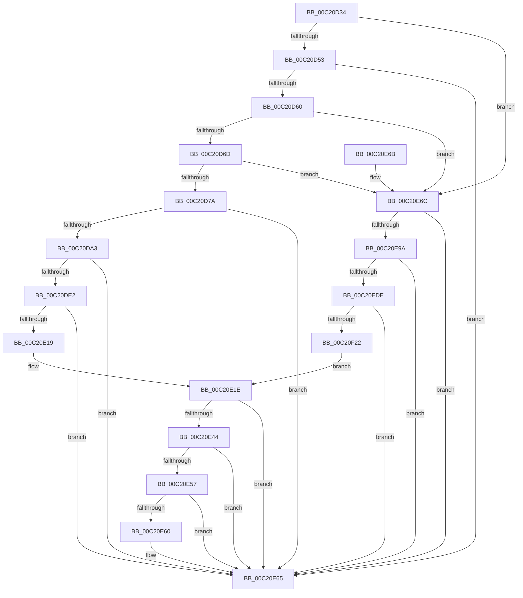

# HalpDmaInit

- RVA: `0x00C20D34`–`0x00C20F35` (길이 `513` bytes)
- VA: `0x0000000140C20D34`
- 실행 섹션: `INIT`
- PDB 이름 있음: `예`; PDB Function 태그: `아니요`
- unwind 정보 RVA: `0x000C4308`
- 디코드: `106`개 명령, `513/513` bytes 표시
- 미해석 바이트: `0` (있으면 어셈블리에 `.byte`로 보존)

> 이 문서는 커널 이미지의 기계어와 PDB 기호를 분석해 생성했습니다. 4번과 5번은 함수 원형과 자료형을 바이너리 사용 방식에서 추정한 C 해석이며 원본 소스 복구 결과는 아닙니다.

## 1. Dependencies

- 직접 호출 지점: **13**; 고유 호출 대상: **7**
- 직접 호출자로 확인된 함수: **1**
- RIP 상대 이미지 참조: **21**

### Outgoing calls
- `0x00C20D46` → [Feature_CvmDmaBouncing__private_IsEnabledDeviceUsageNoInline](../../text/54/Feature_CvmDmaBouncing__private_IsEnabledDeviceUsageNoInline_function_0054C96C.md) (function, `0x0054C96C`)
- `0x00C20D53` → [HalpDmaInitializeCvmSupport](HalpDmaInitializeCvmSupport_function_00C211C4.md) (function, `0x00C211C4`)
- `0x00C20D60` → [Feature_CvmMasterAdapterBounceFix__private_IsEnabledDeviceUsageNoInline](../../text/55/Feature_CvmMasterAdapterBounceFix__private_IsEnabledDeviceUsageNoInline_function_00550668.md) (function, `0x00550668`)
- `0x00C20D96` → [HalpDmaInitializeMasterAdapter](HalpDmaInitializeMasterAdapter_function_00C21278.md) (function, `0x00C21278`)
- `0x00C20DD5` → [HalpDmaInitializeMasterAdapter](HalpDmaInitializeMasterAdapter_function_00C21278.md) (function, `0x00C21278`)
- `0x00C20E10` → [HalpDmaInitializeMasterAdapter](HalpDmaInitializeMasterAdapter_function_00C21278.md) (function, `0x00C21278`)
- `0x00C20E3B` → [HalpDmaInitializeMasterAdapter](HalpDmaInitializeMasterAdapter_function_00C21278.md) (function, `0x00C21278`)
- `0x00C20E4E` → [HalpDmaAllocateEmergencyResources](HalpDmaAllocateEmergencyResources_function_00C2075C.md) (function, `0x00C2075C`)
- `0x00C20E57` → [HalpDmaAllocateMappingResources](HalpDmaAllocateMappingResources_function_00C2087C.md) (function, `0x00C2087C`)
- `0x00C20E60` → [HalpDmaInitializeControllers](../../text/55/HalpDmaInitializeControllers_function_005531E8.md) (function, `0x005531E8`)
- `0x00C20E91` → [HalpDmaInitializeMasterAdapter](HalpDmaInitializeMasterAdapter_function_00C21278.md) (function, `0x00C21278`)
- `0x00C20ED5` → [HalpDmaInitializeMasterAdapter](HalpDmaInitializeMasterAdapter_function_00C21278.md) (function, `0x00C21278`)
- `0x00C20F15` → [HalpDmaInitializeMasterAdapter](HalpDmaInitializeMasterAdapter_function_00C21278.md) (function, `0x00C21278`)

### Direct callers
- [HalpDmaInitSystem](../../pagelk/B5/HalpDmaInitSystem_function_00B5DB50.md) at `0x00B5DB98`

### Static image references
- `0x00C20D3A` → RVA `0x00FC5120` (`ALMOSTRO`; read)
- `0x00C20D40` → RVA `0x00E0A778` (`.data`; write)
- `0x00C20D6D` → RVA `0x00FC18A0` (`.data`; read)
- `0x00C20D7F` → RVA `0x00FC3A20` (`.data`; read)
- `0x00C20DB0` → RVA `0x00FC3AB0` (`.data`; write)
- `0x00C20DBA` → RVA `0x00FC3ABC` (`.data`; write)
- `0x00C20DCE` → RVA `0x00FC3C20` (`.data`; read)
- `0x00C20DE2` → RVA `0x00FC3CB0` (`.data`; write)
- `0x00C20DE9` → RVA `0x00FC3B20` (`.data`; read)
- `0x00C20E04` → RVA `0x00FC3CBC` (`.data`; write)
- `0x00C20E23` → RVA `0x00FC3D20` (`.data`; read)
- `0x00C20E31` → RVA `0x00FC3BBC` (`.data`; write)
- `0x00C20E44` → RVA `0x00FC3DBC` (`.data`; write)
- `0x00C20E6C` → RVA `0x00FC3AE8` (`.data`; read)
- `0x00C20E7A` → RVA `0x00FC3AF0` (`.data`; read)
- `0x00C20E9A` → RVA `0x00FC3CE8` (`.data`; read)
- `0x00C20EA8` → RVA `0x00FC3CF0` (`.data`; read)
- `0x00C20EDE` → RVA `0x00FC3BE8` (`.data`; read)
- `0x00C20EEC` → RVA `0x00FC3BF0` (`.data`; read)
- `0x00C20F22` → RVA `0x00FC3DE8` (`.data`; read)
- `0x00C20F29` → RVA `0x00FC3DF0` (`.data`; read)

## 2. Other-region calls and transfers

- 다른 실행 섹션으로 향하는 call: **3**
  - `0x00C20D46` → [Feature_CvmDmaBouncing__private_IsEnabledDeviceUsageNoInline](../../text/54/Feature_CvmDmaBouncing__private_IsEnabledDeviceUsageNoInline_function_0054C96C.md) (`INIT` → `.text`)
  - `0x00C20D60` → [Feature_CvmMasterAdapterBounceFix__private_IsEnabledDeviceUsageNoInline](../../text/55/Feature_CvmMasterAdapterBounceFix__private_IsEnabledDeviceUsageNoInline_function_00550668.md) (`INIT` → `.text`)
  - `0x00C20E60` → [HalpDmaInitializeControllers](../../text/55/HalpDmaInitializeControllers_function_005531E8.md) (`INIT` → `.text`)
- 별도 외부 분기/꼬리 이동을 확인하지 못했습니다.

## 3. Assembly (complete function range)

```asm
00C20D34  40 56                           push rsi
00C20D36  48 83 EC 40                     sub rsp, 0x40
00C20D3A  8B 05 E0 43 3A 00               mov eax, dword ptr [rip + 0x3a43e0]
00C20D40  89 05 32 9A 1E 00               mov dword ptr [rip + 0x1e9a32], eax
00C20D46  E8 21 BC 92 FF                  call 0x14054c96c
00C20D4B  85 C0                           test eax, eax
00C20D4D  0F 84 19 01 00 00               je 0x140c20e6c
00C20D53  E8 6C 04 00 00                  call 0x140c211c4
00C20D58  85 C0                           test eax, eax
00C20D5A  0F 88 05 01 00 00               js 0x140c20e65
00C20D60  E8 03 F9 92 FF                  call 0x140550668
00C20D65  85 C0                           test eax, eax
00C20D67  0F 84 FF 00 00 00               je 0x140c20e6c
00C20D6D  80 3D 2C 0B 3A 00 00            cmp byte ptr [rip + 0x3a0b2c], 0
00C20D74  0F 84 F2 00 00 00               je 0x140c20e6c
00C20D7A  C6 44 24 30 00                  mov byte ptr [rsp + 0x30], 0
00C20D7F  48 8D 0D 9A 2C 3A 00            lea rcx, [rip + 0x3a2c9a]
00C20D86  45 33 C9                        xor r9d, r9d
00C20D89  C7 44 24 28 00 04 00 00         mov dword ptr [rsp + 0x28], 0x400
00C20D91  45 33 C0                        xor r8d, r8d
00C20D94  33 D2                           xor edx, edx
00C20D96  E8 DD 04 00 00                  call 0x140c21278
00C20D9B  85 C0                           test eax, eax
00C20D9D  0F 88 C2 00 00 00               js 0x140c20e65
00C20DA3  BE FF FF FF 00                  mov esi, 0xffffff
00C20DA8  C6 44 24 30 00                  mov byte ptr [rsp + 0x30], 0
00C20DAD  45 33 C9                        xor r9d, r9d
00C20DB0  48 89 35 F9 2C 3A 00            mov qword ptr [rip + 0x3a2cf9], rsi
00C20DB7  45 33 C0                        xor r8d, r8d
00C20DBA  C7 05 F8 2C 3A 00 02 00 00 00   mov dword ptr [rip + 0x3a2cf8], 2
00C20DC4  33 D2                           xor edx, edx
00C20DC6  C7 44 24 28 00 04 00 00         mov dword ptr [rsp + 0x28], 0x400
00C20DCE  48 8D 0D 4B 2E 3A 00            lea rcx, [rip + 0x3a2e4b]
00C20DD5  E8 9E 04 00 00                  call 0x140c21278
00C20DDA  85 C0                           test eax, eax
00C20DDC  0F 88 83 00 00 00               js 0x140c20e65
00C20DE2  48 89 35 C7 2E 3A 00            mov qword ptr [rip + 0x3a2ec7], rsi
00C20DE9  48 8D 0D 30 2D 3A 00            lea rcx, [rip + 0x3a2d30]
00C20DF0  BE 00 40 00 00                  mov esi, 0x4000
00C20DF5  C6 44 24 30 01                  mov byte ptr [rsp + 0x30], 1
00C20DFA  45 33 C9                        xor r9d, r9d
00C20DFD  89 74 24 28                     mov dword ptr [rsp + 0x28], esi
00C20E01  45 33 C0                        xor r8d, r8d
00C20E04  C7 05 AE 2E 3A 00 03 00 00 00   mov dword ptr [rip + 0x3a2eae], 3
00C20E0E  33 D2                           xor edx, edx
00C20E10  E8 63 04 00 00                  call 0x140c21278
00C20E15  85 C0                           test eax, eax
00C20E17  78 4C                           js 0x140c20e65
00C20E19  45 33 C0                        xor r8d, r8d
00C20E1C  33 D2                           xor edx, edx
00C20E1E  C6 44 24 30 01                  mov byte ptr [rsp + 0x30], 1
00C20E23  48 8D 0D F6 2E 3A 00            lea rcx, [rip + 0x3a2ef6]
00C20E2A  45 33 C9                        xor r9d, r9d
00C20E2D  89 74 24 28                     mov dword ptr [rsp + 0x28], esi
00C20E31  C7 05 81 2D 3A 00 02 00 00 00   mov dword ptr [rip + 0x3a2d81], 2
00C20E3B  E8 38 04 00 00                  call 0x140c21278
00C20E40  85 C0                           test eax, eax
00C20E42  78 21                           js 0x140c20e65
00C20E44  C7 05 6E 2F 3A 00 03 00 00 00   mov dword ptr [rip + 0x3a2f6e], 3
00C20E4E  E8 09 F9 FF FF                  call 0x140c2075c
00C20E53  85 C0                           test eax, eax
00C20E55  78 0E                           js 0x140c20e65
00C20E57  E8 20 FA FF FF                  call 0x140c2087c
00C20E5C  85 C0                           test eax, eax
00C20E5E  78 05                           js 0x140c20e65
00C20E60  E8 83 23 93 FF                  call 0x1405531e8
00C20E65  48 83 C4 40                     add rsp, 0x40
00C20E69  5E                              pop rsi
00C20E6A  C3                              ret
00C20E6B  CC                              int3
00C20E6C  44 8B 05 75 2C 3A 00            mov r8d, dword ptr [rip + 0x3a2c75]
00C20E73  48 8D 0D A6 2B 3A 00            lea rcx, [rip + 0x3a2ba6]
00C20E7A  48 8B 15 6F 2C 3A 00            mov rdx, qword ptr [rip + 0x3a2c6f]
00C20E81  45 33 C9                        xor r9d, r9d
00C20E84  C6 44 24 30 00                  mov byte ptr [rsp + 0x30], 0
00C20E89  C7 44 24 28 00 04 00 00         mov dword ptr [rsp + 0x28], 0x400
00C20E91  E8 E2 03 00 00                  call 0x140c21278
00C20E96  85 C0                           test eax, eax
00C20E98  78 CB                           js 0x140c20e65
00C20E9A  44 8B 05 47 2E 3A 00            mov r8d, dword ptr [rip + 0x3a2e47]
00C20EA1  48 8D 0D 78 2D 3A 00            lea rcx, [rip + 0x3a2d78]
00C20EA8  48 8B 15 41 2E 3A 00            mov rdx, qword ptr [rip + 0x3a2e41]
00C20EAF  BE FF FF FF 00                  mov esi, 0xffffff
00C20EB4  C6 44 24 30 00                  mov byte ptr [rsp + 0x30], 0
00C20EB9  45 33 C9                        xor r9d, r9d
00C20EBC  48 89 35 ED 2B 3A 00            mov qword ptr [rip + 0x3a2bed], rsi
00C20EC3  C7 05 EF 2B 3A 00 02 00 00 00   mov dword ptr [rip + 0x3a2bef], 2
00C20ECD  C7 44 24 28 00 04 00 00         mov dword ptr [rsp + 0x28], 0x400
00C20ED5  E8 9E 03 00 00                  call 0x140c21278
00C20EDA  85 C0                           test eax, eax
00C20EDC  78 87                           js 0x140c20e65
00C20EDE  44 8B 05 03 2D 3A 00            mov r8d, dword ptr [rip + 0x3a2d03]
00C20EE5  48 8D 0D 34 2C 3A 00            lea rcx, [rip + 0x3a2c34]
00C20EEC  48 8B 15 FD 2C 3A 00            mov rdx, qword ptr [rip + 0x3a2cfd]
00C20EF3  45 33 C9                        xor r9d, r9d
00C20EF6  48 89 35 B3 2D 3A 00            mov qword ptr [rip + 0x3a2db3], rsi
00C20EFD  BE 00 40 00 00                  mov esi, 0x4000
00C20F02  C6 44 24 30 01                  mov byte ptr [rsp + 0x30], 1
00C20F07  89 74 24 28                     mov dword ptr [rsp + 0x28], esi
00C20F0B  C7 05 A7 2D 3A 00 03 00 00 00   mov dword ptr [rip + 0x3a2da7], 3
00C20F15  E8 5E 03 00 00                  call 0x140c21278
00C20F1A  85 C0                           test eax, eax
00C20F1C  0F 88 43 FF FF FF               js 0x140c20e65
00C20F22  44 8B 05 BF 2E 3A 00            mov r8d, dword ptr [rip + 0x3a2ebf]
00C20F29  48 8B 15 C0 2E 3A 00            mov rdx, qword ptr [rip + 0x3a2ec0]
00C20F30  E9 E9 FE FF FF                  jmp 0x140c20e1e
```

## 4. C-style interpretation (structured pseudocode)

```c
__int64 __fastcall HalpDmaInit(__int64 a1, int a2, int a3, int a4)
{
    __int64 result;
    __int64 v_rsp;
    unsigned __int8 v_stack_m18;
    unsigned int v_stack_m20;
    unsigned int v_stack_p28;
    unsigned __int8 v_stack_p30;

    v_rsp = (v_rsp) - (64);
    *(unsigned int *)(v_rip + 2005554) = (unsigned int)((unsigned int)(*(unsigned int *)(v_rip + 3818464)));
    result = Feature_CvmDmaBouncing__private_IsEnabledDeviceUsageNoInline(a1, a2, a3, a4);
    if ((unsigned int)(result) == 0) goto loc_00C20E6C;
    result = HalpDmaInitializeCvmSupport(a1, a2, a3, a4);
    if (sign_flag) goto loc_00C20E65;
    result = Feature_CvmMasterAdapterBounceFix__private_IsEnabledDeviceUsageNoInline(a1, a2, a3, a4);
    if ((unsigned int)(result) == 0) goto loc_00C20E6C;
    if ((*(unsigned __int8 *)(v_rip + 3803948)) == 0) goto loc_00C20E6C;
    v_stack_m18 = 0;
    a4 = 0;
    v_stack_m20 = 0x400ULL;
    a3 = 0;
    a2 = 0;
    result = HalpDmaInitializeMasterAdapter(v_rip + 3812506, a2, a3, a4);
    if (sign_flag) goto loc_00C20E65;
    v_stack_m18 = 0;
    a4 = 0;
    *(unsigned __int64 *)(v_rip + 3812601) = (unsigned int)(0xFFFFFFULL);
    a3 = 0;
    *(unsigned int *)(v_rip + 3812600) = 2;
    a2 = 0;
    v_stack_m20 = 0x400ULL;
    result = HalpDmaInitializeMasterAdapter(v_rip + 3812939, a2, a3, a4);
    if (sign_flag) goto loc_00C20E65;
    *(unsigned __int64 *)(v_rip + 3813063) = (unsigned int)(0xFFFFFFULL);
    v_stack_m18 = 1;
    a4 = 0;
    v_stack_m20 = (unsigned int)((unsigned int)(0x4000ULL));
    a3 = 0;
    *(unsigned int *)(v_rip + 3813038) = 3;
    a2 = 0;
    result = HalpDmaInitializeMasterAdapter(v_rip + 3812656, a2, a3, a4);
    if (sign_flag) goto loc_00C20E65;
    a3 = 0;
    a2 = 0;
loc_00C20E1E:
    v_stack_m18 = 1;
    a4 = 0;
    v_stack_m20 = (unsigned int)((unsigned int)(0x4000ULL));
    *(unsigned int *)(v_rip + 3812737) = 2;
    result = HalpDmaInitializeMasterAdapter(v_rip + 3813110, a2, a3, a4);
    if (sign_flag) goto loc_00C20E65;
    *(unsigned int *)(v_rip + 3813230) = 3;
    result = HalpDmaAllocateEmergencyResources(v_rip + 3813110, a2, a3, a4);
    if (sign_flag) goto loc_00C20E65;
    result = HalpDmaAllocateMappingResources(v_rip + 3813110, a2, a3, a4);
    if (!(sign_flag)) {
        result = HalpDmaInitializeControllers(v_rip + 3813110, a2, a3, a4);
    }
    v_rsp = (v_rsp) + (64);
    return result;
loc_00C20E6C:
    a4 = 0;
    v_stack_p30 = 0;
    v_stack_p28 = 0x400ULL;
    result = HalpDmaInitializeMasterAdapter(v_rip + 3812262, *(unsigned __int64 *)(v_rip + 3812463), (unsigned int)(*(unsigned int *)(v_rip + 3812469)), a4);
    if (sign_flag) goto loc_00C20E65;
    v_stack_p30 = 0;
    a4 = 0;
    *(unsigned __int64 *)(v_rip + 3812333) = (unsigned int)(0xFFFFFFULL);
    *(unsigned int *)(v_rip + 3812335) = 2;
    v_stack_p28 = 0x400ULL;
    result = HalpDmaInitializeMasterAdapter(v_rip + 3812728, *(unsigned __int64 *)(v_rip + 3812929), (unsigned int)(*(unsigned int *)(v_rip + 3812935)), a4);
    if (sign_flag) goto loc_00C20E65;
    a4 = 0;
    *(unsigned __int64 *)(v_rip + 3812787) = (unsigned int)(0xFFFFFFULL);
    v_stack_p30 = 1;
    v_stack_p28 = (unsigned int)((unsigned int)(0x4000ULL));
    *(unsigned int *)(v_rip + 3812775) = 3;
    result = HalpDmaInitializeMasterAdapter(v_rip + 3812404, *(unsigned __int64 *)(v_rip + 3812605), (unsigned int)(*(unsigned int *)(v_rip + 3812611)), a4);
    if (sign_flag) goto loc_00C20E65;
    goto loc_00C20E1E;
}
```

## 5. (Beta) C Style

```c
int64_t HalpDmaInit(int64_t Arg1, int32_t Arg2, int32_t Arg3, int32_t Arg4)
{
    int64_t result;
    int64_t local_rsp;
    uint8_t v_stack_m18;
    uint32_t v_stack_m20;
    uint32_t v_stack_p28;
    uint8_t v_stack_p30;

    local_rsp = (local_rsp) - (64);
    *(uint32_t *)(v_rip + 0x1E9A32) = (uint32_t)((uint32_t)(*(uint32_t *)(v_rip + 0x3A43E0)));
    result = Feature_CvmDmaBouncing__private_IsEnabledDeviceUsageNoInline(Arg1, Arg2, Arg3, Arg4);
    if ((uint32_t)(result) == 0) goto loc_00C20E6C;
    result = HalpDmaInitializeCvmSupport(Arg1, Arg2, Arg3, Arg4);
    if (sign_flag) goto loc_00C20E65;
    result = Feature_CvmMasterAdapterBounceFix__private_IsEnabledDeviceUsageNoInline(Arg1, Arg2, Arg3, Arg4);
    if ((uint32_t)(result) == 0) goto loc_00C20E6C;
    if ((*(uint8_t *)(v_rip + 0x3A0B2C)) == 0) goto loc_00C20E6C;
    v_stack_m18 = 0;
    Arg4 = 0;
    v_stack_m20 = 0x400ULL;
    Arg3 = 0;
    Arg2 = 0;
    result = HalpDmaInitializeMasterAdapter(v_rip + 3812506, Arg2, Arg3, Arg4);
    if (sign_flag) goto loc_00C20E65;
    v_stack_m18 = 0;
    Arg4 = 0;
    *(uint64_t *)(v_rip + 0x3A2CF9) = (uint32_t)(0xFFFFFFULL);
    Arg3 = 0;
    *(uint32_t *)(v_rip + 0x3A2CF8) = 2;
    Arg2 = 0;
    v_stack_m20 = 0x400ULL;
    result = HalpDmaInitializeMasterAdapter(v_rip + 3812939, Arg2, Arg3, Arg4);
    if (sign_flag) goto loc_00C20E65;
    *(uint64_t *)(v_rip + 0x3A2EC7) = (uint32_t)(0xFFFFFFULL);
    v_stack_m18 = 1;
    Arg4 = 0;
    v_stack_m20 = (uint32_t)((uint32_t)(0x4000ULL));
    Arg3 = 0;
    *(uint32_t *)(v_rip + 0x3A2EAE) = 3;
    Arg2 = 0;
    result = HalpDmaInitializeMasterAdapter(v_rip + 3812656, Arg2, Arg3, Arg4);
    if (sign_flag) goto loc_00C20E65;
    Arg3 = 0;
    Arg2 = 0;
loc_00C20E1E:
    v_stack_m18 = 1;
    Arg4 = 0;
    v_stack_m20 = (uint32_t)((uint32_t)(0x4000ULL));
    *(uint32_t *)(v_rip + 0x3A2D81) = 2;
    result = HalpDmaInitializeMasterAdapter(v_rip + 3813110, Arg2, Arg3, Arg4);
    if (sign_flag) goto loc_00C20E65;
    *(uint32_t *)(v_rip + 0x3A2F6E) = 3;
    result = HalpDmaAllocateEmergencyResources(v_rip + 3813110, Arg2, Arg3, Arg4);
    if (sign_flag) goto loc_00C20E65;
    result = HalpDmaAllocateMappingResources(v_rip + 3813110, Arg2, Arg3, Arg4);
    if (!(sign_flag)) {
        result = HalpDmaInitializeControllers(v_rip + 3813110, Arg2, Arg3, Arg4);
    }
    local_rsp = (local_rsp) + (64);
    return result;
loc_00C20E6C:
    Arg4 = 0;
    v_stack_p30 = 0;
    v_stack_p28 = 0x400ULL;
    result = HalpDmaInitializeMasterAdapter(v_rip + 3812262, *(uint64_t *)(v_rip + 0x3A2C6F), (uint32_t)(*(uint32_t *)(v_rip + 0x3A2C75)), Arg4);
    if (sign_flag) goto loc_00C20E65;
    v_stack_p30 = 0;
    Arg4 = 0;
    *(uint64_t *)(v_rip + 0x3A2BED) = (uint32_t)(0xFFFFFFULL);
    *(uint32_t *)(v_rip + 0x3A2BEF) = 2;
    v_stack_p28 = 0x400ULL;
    result = HalpDmaInitializeMasterAdapter(v_rip + 3812728, *(uint64_t *)(v_rip + 0x3A2E41), (uint32_t)(*(uint32_t *)(v_rip + 0x3A2E47)), Arg4);
    if (sign_flag) goto loc_00C20E65;
    Arg4 = 0;
    *(uint64_t *)(v_rip + 0x3A2DB3) = (uint32_t)(0xFFFFFFULL);
    v_stack_p30 = 1;
    v_stack_p28 = (uint32_t)((uint32_t)(0x4000ULL));
    *(uint32_t *)(v_rip + 0x3A2DA7) = 3;
    result = HalpDmaInitializeMasterAdapter(v_rip + 3812404, *(uint64_t *)(v_rip + 0x3A2CFD), (uint32_t)(*(uint32_t *)(v_rip + 0x3A2D03)), Arg4);
    if (sign_flag) goto loc_00C20E65;
    goto loc_00C20E1E;
}
```

## 6. Execution-region graph

[열기: 2D/3D 그래프와 함수 탐색 컨트롤 패널](../../../control-panel.html?section=init&rva=0x00C20D34&view=graph)

- 2D 그래프는 위에서 아래로 흐르고, 3D 그래프는 빈 공간을 드래그해 회전합니다. Shift+드래그는 이동, 휠은 확대·축소, 함수 노드 선택은 대상 보고서 이동입니다.

### Static fallback


