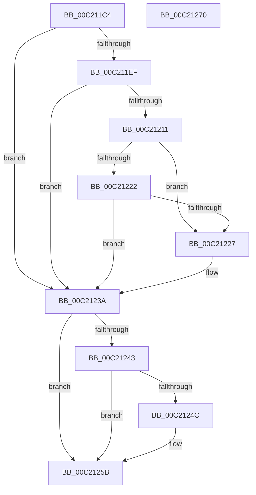

# HalpDmaInitializeCvmSupport

- RVA: `0x00C211C4`–`0x00C21271` (길이 `173` bytes)
- VA: `0x0000000140C211C4`
- 실행 섹션: `INIT`
- PDB 이름 있음: `예`; PDB Function 태그: `아니요`
- unwind 정보 RVA: `0x000AB2E4`
- 디코드: `44`개 명령, `173/173` bytes 표시
- 미해석 바이트: `0` (있으면 어셈블리에 `.byte`로 보존)

> 이 문서는 커널 이미지의 기계어와 PDB 기호를 분석해 생성했습니다. 4번과 5번은 함수 원형과 자료형을 바이너리 사용 방식에서 추정한 C 해석이며 원본 소스 복구 결과는 아닙니다.

## 1. Dependencies

- 직접 호출 지점: **4**; 고유 호출 대상: **4**
- 직접 호출자로 확인된 함수: **1**
- RIP 상대 이미지 참조: **6**

### Outgoing calls
- `0x00C211D9` → [HalpDmaCvmQueryRegistryKeys](HalpDmaCvmQueryRegistryKeys_function_00C20BD0.md) (function, `0x00C20BD0`)
- `0x00C211E6` → [HviIsHypervisorMicrosoftCompatible](../../text/66/HviIsHypervisorMicrosoftCompatible_function_006668C8.md) (function, `0x006668C8`)
- `0x00C2122E` → [HviGetSharedGpaBoundary](../../text/66/HviGetSharedGpaBoundary_function_00666844.md) (function, `0x00666844`)
- `0x00C21265` → [_security_check_cookie](../../text/6A/_security_check_cookie_function_006AC640.md) (function, `0x006AC640`)

### Direct callers
- [HalpDmaInit](HalpDmaInit_function_00C20D34.md) at `0x00C20D53`

### Static image references
- `0x00C211CA` → RVA `0x00E0A740` (`.data`; read)
- `0x00C21227` → RVA `0x00FC18A0` (`.data`; write)
- `0x00C21233` → RVA `0x00FC18A8` (`.data`; write)
- `0x00C2123A` → RVA `0x00FC18A0` (`.data`; read)
- `0x00C21243` → RVA `0x00FC18A1` (`.data`; read)
- `0x00C2124C` → RVA `0x00FC18A8` (`.data`; read/write)

## 2. Other-region calls and transfers

- 다른 실행 섹션으로 향하는 call: **3**
  - `0x00C211E6` → [HviIsHypervisorMicrosoftCompatible](../../text/66/HviIsHypervisorMicrosoftCompatible_function_006668C8.md) (`INIT` → `.text`)
  - `0x00C2122E` → [HviGetSharedGpaBoundary](../../text/66/HviGetSharedGpaBoundary_function_00666844.md) (`INIT` → `.text`)
  - `0x00C21265` → [_security_check_cookie](../../text/6A/_security_check_cookie_function_006AC640.md) (`INIT` → `.text`)
- 별도 외부 분기/꼬리 이동을 확인하지 못했습니다.

## 3. Assembly (complete function range)

```asm
00C211C4  40 53                           push rbx
00C211C6  48 83 EC 40                     sub rsp, 0x40
00C211CA  48 8B 05 6F 95 1E 00            mov rax, qword ptr [rip + 0x1e956f]
00C211D1  48 33 C4                        xor rax, rsp
00C211D4  48 89 44 24 30                  mov qword ptr [rsp + 0x30], rax
00C211D9  E8 F2 F9 FF FF                  call 0x140c20bd0
00C211DE  0F 57 C0                        xorps xmm0, xmm0
00C211E1  0F 11 44 24 20                  movups xmmword ptr [rsp + 0x20], xmm0
00C211E6  E8 DD 56 A4 FF                  call 0x1406668c8
00C211EB  84 C0                           test al, al
00C211ED  74 4B                           je 0x140c2123a
00C211EF  B8 03 00 00 40                  mov eax, 0x40000003
00C211F4  33 C9                           xor ecx, ecx
00C211F6  0F A2                           cpuid
00C211F8  89 44 24 20                     mov dword ptr [rsp + 0x20], eax
00C211FC  48 B8 00 00 00 00 00 00 40 00   movabs rax, 0x40000000000000
00C21206  89 5C 24 24                     mov dword ptr [rsp + 0x24], ebx
00C2120A  48 85 44 24 20                  test qword ptr [rsp + 0x20], rax
00C2120F  74 29                           je 0x140c2123a
00C21211  33 C9                           xor ecx, ecx
00C21213  B8 0C 00 00 40                  mov eax, 0x4000000c
00C21218  0F A2                           cpuid
00C2121A  83 E3 0F                        and ebx, 0xf
00C2121D  83 EB 02                        sub ebx, 2
00C21220  74 05                           je 0x140c21227
00C21222  83 FB 01                        cmp ebx, 1
00C21225  75 13                           jne 0x140c2123a
00C21227  C6 05 72 06 3A 00 01            mov byte ptr [rip + 0x3a0672], 1
00C2122E  E8 11 56 A4 FF                  call 0x140666844
00C21233  48 89 05 6E 06 3A 00            mov qword ptr [rip + 0x3a066e], rax
00C2123A  80 3D 5F 06 3A 00 00            cmp byte ptr [rip + 0x3a065f], 0
00C21241  75 18                           jne 0x140c2125b
00C21243  80 3D 57 06 3A 00 00            cmp byte ptr [rip + 0x3a0657], 0
00C2124A  74 0F                           je 0x140c2125b
00C2124C  48 83 25 54 06 3A 00 00         and qword ptr [rip + 0x3a0654], 0
00C21254  C6 05 45 06 3A 00 01            mov byte ptr [rip + 0x3a0645], 1
00C2125B  33 C0                           xor eax, eax
00C2125D  48 8B 4C 24 30                  mov rcx, qword ptr [rsp + 0x30]
00C21262  48 33 CC                        xor rcx, rsp
00C21265  E8 D6 B3 A8 FF                  call 0x1406ac640
00C2126A  48 83 C4 40                     add rsp, 0x40
00C2126E  5B                              pop rbx
00C2126F  C3                              ret
00C21270  CC                              int3
```

## 4. C-style interpretation (structured pseudocode)

```c
__int64 __fastcall HalpDmaInitializeCvmSupport(int a1)
{
    __int64 result;
    __int64 v_rbx;
    __int64 v_rsp;
    unsigned __int64 v_stack_m18;
    unsigned int v_stack_m24;
    unsigned __int64 v_stack_m28;

    v_rsp = (v_rsp) - (64);
    result = (*(unsigned __int64 *)(v_rip + 2004335)) ^ (v_rsp);
    v_stack_m18 = result;
    result = HalpDmaCvmQueryRegistryKeys(a1, a2, a3, a4);
    v_stack_m28 = v_xmm0;
    result = HviIsHypervisorMicrosoftCompatible(a1, a2, a3, a4);
    if ((unsigned __int8)(result) == 0) goto loc_00C2123A;
    a1 = 0;
    v_stack_m28 = (unsigned int)((unsigned int)(0x40000003ULL));
    v_stack_m24 = (unsigned int)(v_rbx);
    if (((v_stack_m28) & ((unsigned int)(0x40000003ULL))) == 0) goto loc_00C2123A;
    a1 = 0;
    v_rbx = (unsigned int)((v_rbx) & (15));
    v_rbx = (unsigned int)((v_rbx) - (2));
    if (condition_is_equal) goto loc_00C21227;
    result = (unsigned int)(0x4000000CULL);
    if (((unsigned int)(v_rbx)) == 1) {
        *(unsigned __int8 *)(v_rip + 3802738) = 1;
        result = HviGetSharedGpaBoundary(a1, a2, a3, a4);
        *(unsigned __int64 *)(v_rip + 3802734) = result;
    }
    if ((*(unsigned __int8 *)(v_rip + 3802719)) != 0) goto loc_00C2125B;
    if ((*(unsigned __int8 *)(v_rip + 3802711)) != 0) {
        *(unsigned __int8 *)(v_rip + 3802693) = 1;
    }
    result = 0;
    a1 = (v_stack_m18) ^ (v_rsp);
    result = _security_check_cookie(a1, a2, a3, a4);
    v_rsp = (v_rsp) + (64);
    return result;
}
```

## 5. (Beta) C Style

```c
int64_t HalpDmaInitializeCvmSupport(int32_t Arg1)
{
    int64_t result;
    int64_t local_rbx;
    int64_t local_rsp;
    uint64_t v_stack_m18;
    uint32_t v_stack_m24;
    uint64_t v_stack_m28;

    local_rsp = (local_rsp) - (64);
    result = (*(uint64_t *)(v_rip + 0x1E956F)) ^ (local_rsp);
    v_stack_m18 = result;
    result = HalpDmaCvmQueryRegistryKeys(Arg1, a2, a3, a4);
    v_stack_m28 = v_xmm0;
    result = HviIsHypervisorMicrosoftCompatible(Arg1, a2, a3, a4);
    if ((uint8_t)(result) == 0) goto loc_00C2123A;
    Arg1 = 0;
    v_stack_m28 = (uint32_t)((uint32_t)(0x40000003ULL));
    v_stack_m24 = (uint32_t)(local_rbx);
    if (((v_stack_m28) & ((uint32_t)(0x40000003ULL))) == 0) goto loc_00C2123A;
    Arg1 = 0;
    local_rbx = (uint32_t)((local_rbx) & (15));
    local_rbx = (uint32_t)((local_rbx) - (2));
    if (condition_is_equal) goto loc_00C21227;
    result = (uint32_t)(0x4000000CULL);
    if (((uint32_t)(local_rbx)) == 1) {
        *(uint8_t *)(v_rip + 0x3A0672) = 1;
        result = HviGetSharedGpaBoundary(Arg1, a2, a3, a4);
        *(uint64_t *)(v_rip + 0x3A066E) = result;
    }
    if ((*(uint8_t *)(v_rip + 0x3A065F)) != 0) goto loc_00C2125B;
    if ((*(uint8_t *)(v_rip + 0x3A0657)) != 0) {
        *(uint8_t *)(v_rip + 0x3A0645) = 1;
    }
    result = 0;
    Arg1 = (v_stack_m18) ^ (local_rsp);
    result = _security_check_cookie(Arg1, a2, a3, a4);
    local_rsp = (local_rsp) + (64);
    return result;
}
```

## 6. Execution-region graph

[열기: 2D/3D 그래프와 함수 탐색 컨트롤 패널](../../../control-panel.html?section=init&rva=0x00C211C4&view=graph)

- 2D 그래프는 위에서 아래로 흐르고, 3D 그래프는 빈 공간을 드래그해 회전합니다. Shift+드래그는 이동, 휠은 확대·축소, 함수 노드 선택은 대상 보고서 이동입니다.

### Static fallback


