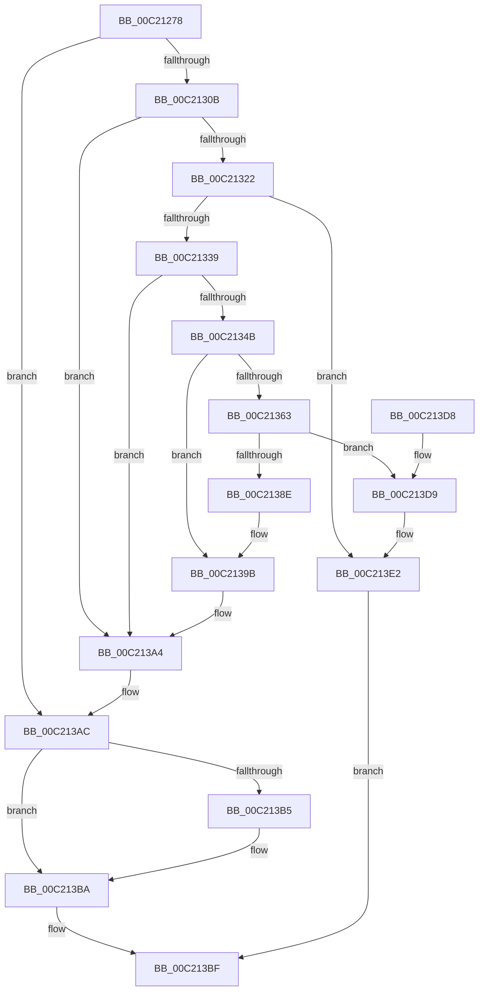

# HalpDmaInitializeMasterAdapter

- RVA: `0x00C21278`–`0x00C213E6` (길이 `366` bytes)
- VA: `0x0000000140C21278`
- 실행 섹션: `INIT`
- PDB 이름 있음: `예`; PDB Function 태그: `아니요`
- unwind 정보 RVA: `0x000C42D0`
- 디코드: `94`개 명령, `366/366` bytes 표시
- 미해석 바이트: `0` (있으면 어셈블리에 `.byte`로 보존)

> 이 문서는 커널 이미지의 기계어와 PDB 기호를 분석해 생성했습니다. 4번과 5번은 함수 원형과 자료형을 바이너리 사용 방식에서 추정한 C 해석이며 원본 소스 복구 결과는 아닙니다.

## 1. Dependencies

- 직접 호출 지점: **10**; 고유 호출 대상: **8**
- 직접 호출자로 확인된 함수: **1**
- RIP 상대 이미지 참조: **0**

### Outgoing calls
- `0x00C212FA` → [HalpMmAllocCtxAlloc](../../text/3E/HalpMmAllocCtxAlloc_function_003E10B8.md) (function, `0x003E10B8`)
- `0x00C21310` → [HalpMmAllocCtxAlloc](../../text/3E/HalpMmAllocCtxAlloc_function_003E10B8.md) (function, `0x003E10B8`)
- `0x00C2132C` → [RtlSetAllBits](../../text/36/RtlSetAllBits_function_00362490.md) (function, `0x00362490`)
- `0x00C2133D` → [HalpDmaAllocateTranslationBuffer](HalpDmaAllocateTranslationBuffer_function_00C20B48.md) (function, `0x00C20B48`)
- `0x00C21356` → [MmMapIoSpaceEx](../../text/32/MmMapIoSpaceEx_function_00327830.md) (function, `0x00327830`)
- `0x00C21384` → [HalpDmaCommitContiguousMapBuffers](../../text/55/HalpDmaCommitContiguousMapBuffers_function_00550A84.md) (function, `0x00550A84`)
- `0x00C21396` → [MiUnmapContiguousMemory](../../text/3F/MiUnmapContiguousMemory_function_003F7908.md) (function, `0x003F7908`)
- `0x00C2139F` → [HalpDmaFreeTranslationBuffer](HalpDmaFreeTranslationBuffer_function_00C20D0C.md) (function, `0x00C20D0C`)
- `0x00C213A7` → [HalpMmAllocCtxFree](../../text/3E/HalpMmAllocCtxFree_function_003E1904.md) (function, `0x003E1904`)
- `0x00C213B5` → [HalpMmAllocCtxFree](../../text/3E/HalpMmAllocCtxFree_function_003E1904.md) (function, `0x003E1904`)

### Direct callers
- [HalpDmaInit](HalpDmaInit_function_00C20D34.md) at `0x00C20D96`
- [HalpDmaInit](HalpDmaInit_function_00C20D34.md) at `0x00C20DD5`
- [HalpDmaInit](HalpDmaInit_function_00C20D34.md) at `0x00C20E10`
- [HalpDmaInit](HalpDmaInit_function_00C20D34.md) at `0x00C20E3B`
- [HalpDmaInit](HalpDmaInit_function_00C20D34.md) at `0x00C20E91`
- [HalpDmaInit](HalpDmaInit_function_00C20D34.md) at `0x00C20ED5`
- [HalpDmaInit](HalpDmaInit_function_00C20D34.md) at `0x00C20F15`

### Static image references
- 디코드된 RIP-relative 메모리 참조가 없습니다.

## 2. Other-region calls and transfers

- 다른 실행 섹션으로 향하는 call: **8**
  - `0x00C212FA` → [HalpMmAllocCtxAlloc](../../text/3E/HalpMmAllocCtxAlloc_function_003E10B8.md) (`INIT` → `.text`)
  - `0x00C21310` → [HalpMmAllocCtxAlloc](../../text/3E/HalpMmAllocCtxAlloc_function_003E10B8.md) (`INIT` → `.text`)
  - `0x00C2132C` → [RtlSetAllBits](../../text/36/RtlSetAllBits_function_00362490.md) (`INIT` → `.text`)
  - `0x00C21356` → [MmMapIoSpaceEx](../../text/32/MmMapIoSpaceEx_function_00327830.md) (`INIT` → `.text`)
  - `0x00C21384` → [HalpDmaCommitContiguousMapBuffers](../../text/55/HalpDmaCommitContiguousMapBuffers_function_00550A84.md) (`INIT` → `.text`)
  - `0x00C21396` → [MiUnmapContiguousMemory](../../text/3F/MiUnmapContiguousMemory_function_003F7908.md) (`INIT` → `.text`)
  - `0x00C213A7` → [HalpMmAllocCtxFree](../../text/3E/HalpMmAllocCtxFree_function_003E1904.md) (`INIT` → `.text`)
  - `0x00C213B5` → [HalpMmAllocCtxFree](../../text/3E/HalpMmAllocCtxFree_function_003E1904.md) (`INIT` → `.text`)
- 별도 외부 분기/꼬리 이동을 확인하지 못했습니다.

## 3. Assembly (complete function range)

```asm
00C21278  48 89 5C 24 08                  mov qword ptr [rsp + 8], rbx
00C2127D  48 89 6C 24 10                  mov qword ptr [rsp + 0x10], rbp
00C21282  48 89 74 24 18                  mov qword ptr [rsp + 0x18], rsi
00C21287  57                              push rdi
00C21288  41 56                           push r14
00C2128A  41 57                           push r15
00C2128C  48 83 EC 20                     sub rsp, 0x20
00C21290  48 83 A1 A0 00 00 00 00         and qword ptr [rcx + 0xa0], 0
00C21298  48 8D 81 A8 00 00 00            lea rax, [rcx + 0xa8]
00C2129F  8B 6C 24 68                     mov ebp, dword ptr [rsp + 0x68]
00C212A3  48 8B DA                        mov rbx, rdx
00C212A6  48 89 40 08                     mov qword ptr [rax + 8], rax
00C212AA  83 C5 1F                        add ebp, 0x1f
00C212AD  48 89 00                        mov qword ptr [rax], rax
00C212B0  83 E5 E0                        and ebp, 0xffffffe0
00C212B3  48 8D 81 B8 00 00 00            lea rax, [rcx + 0xb8]
00C212BA  8B D5                           mov edx, ebp
00C212BC  48 89 40 08                     mov qword ptr [rax + 8], rax
00C212C0  48 8B F9                        mov rdi, rcx
00C212C3  48 89 00                        mov qword ptr [rax], rax
00C212C6  8A 44 24 70                     mov al, byte ptr [rsp + 0x70]
00C212CA  48 83 A1 80 00 00 00 00         and qword ptr [rcx + 0x80], 0
00C212D2  48 83 A1 88 00 00 00 00         and qword ptr [rcx + 0x88], 0
00C212DA  48 83 61 18 00                  and qword ptr [rcx + 0x18], 0
00C212DF  48 C1 EA 03                     shr rdx, 3
00C212E3  41 8B F0                        mov esi, r8d
00C212E6  C7 41 10 48 44 6D 61            mov dword ptr [rcx + 0x10], 0x616d4448
00C212ED  C6 81 98 00 00 00 01            mov byte ptr [rcx + 0x98], 1
00C212F4  88 81 99 00 00 00               mov byte ptr [rcx + 0x99], al
00C212FA  E8 B9 FD 7B FF                  call 0x1403e10b8
00C212FF  4C 8B F8                        mov r15, rax
00C21302  48 85 C0                        test rax, rax
00C21305  0F 84 A1 00 00 00               je 0x140c213ac
00C2130B  BA 10 00 00 00                  mov edx, 0x10
00C21310  E8 A3 FD 7B FF                  call 0x1403e10b8
00C21315  48 89 47 18                     mov qword ptr [rdi + 0x18], rax
00C21319  48 85 C0                        test rax, rax
00C2131C  0F 84 82 00 00 00               je 0x140c213a4
00C21322  89 28                           mov dword ptr [rax], ebp
00C21324  4C 89 78 08                     mov qword ptr [rax + 8], r15
00C21328  48 8B 4F 18                     mov rcx, qword ptr [rdi + 0x18]
00C2132C  E8 5F 11 74 FF                  call 0x140362490
00C21331  85 F6                           test esi, esi
00C21333  0F 84 A9 00 00 00               je 0x140c213e2
00C21339  48 8D 57 40                     lea rdx, [rdi + 0x40]
00C2133D  E8 06 F8 FF FF                  call 0x140c20b48
00C21342  48 89 47 30                     mov qword ptr [rdi + 0x30], rax
00C21346  48 85 C0                        test rax, rax
00C21349  74 59                           je 0x140c213a4
00C2134B  41 B8 04 00 00 00               mov r8d, 4
00C21351  8B D6                           mov edx, esi
00C21353  48 8B CB                        mov rcx, rbx
00C21356  E8 D5 64 70 FF                  call 0x140327830
00C2135B  48 8B E8                        mov rbp, rax
00C2135E  48 85 C0                        test rax, rax
00C21361  74 38                           je 0x140c2139b
00C21363  41 B9 00 00 00 00               mov r9d, 0
00C21369  8B CE                           mov ecx, esi
00C2136B  F7 C6 FF 0F 00 00               test esi, 0xfff
00C21371  4C 8B C3                        mov r8, rbx
00C21374  48 8B D0                        mov rdx, rax
00C21377  41 0F 95 C1                     setne r9b
00C2137B  C1 E9 0C                        shr ecx, 0xc
00C2137E  44 03 C9                        add r9d, ecx
00C21381  48 8B CF                        mov rcx, rdi
00C21384  E8 FB F6 92 FF                  call 0x140550a84
00C21389  48 85 C0                        test rax, rax
00C2138C  75 4B                           jne 0x140c213d9
00C2138E  41 B0 01                        mov r8b, 1
00C21391  8B D6                           mov edx, esi
00C21393  48 8B CD                        mov rcx, rbp
00C21396  E8 6D 65 7D FF                  call 0x1403f7908
00C2139B  48 8B 4F 30                     mov rcx, qword ptr [rdi + 0x30]
00C2139F  E8 68 F9 FF FF                  call 0x140c20d0c
00C213A4  49 8B D7                        mov rdx, r15
00C213A7  E8 58 05 7C FF                  call 0x1403e1904
00C213AC  48 8B 57 18                     mov rdx, qword ptr [rdi + 0x18]
00C213B0  48 85 D2                        test rdx, rdx
00C213B3  74 05                           je 0x140c213ba
00C213B5  E8 4A 05 7C FF                  call 0x1403e1904
00C213BA  B8 9A 00 00 C0                  mov eax, 0xc000009a
00C213BF  48 8B 5C 24 40                  mov rbx, qword ptr [rsp + 0x40]
00C213C4  48 8B 6C 24 48                  mov rbp, qword ptr [rsp + 0x48]
00C213C9  48 8B 74 24 50                  mov rsi, qword ptr [rsp + 0x50]
00C213CE  48 83 C4 20                     add rsp, 0x20
00C213D2  41 5F                           pop r15
00C213D4  41 5E                           pop r14
00C213D6  5F                              pop rdi
00C213D7  C3                              ret
00C213D8  CC                              int3
00C213D9  C1 EE 0D                        shr esi, 0xd
00C213DC  89 B7 DC 00 00 00               mov dword ptr [rdi + 0xdc], esi
00C213E2  33 C0                           xor eax, eax
00C213E4  EB D9                           jmp 0x140c213bf
```

## 4. C-style interpretation (structured pseudocode)

```c
__int64 __fastcall HalpDmaInitializeMasterAdapter(__int64 a1, __int64 a2, int a3, __int64 a4, __int64 a5, unsigned int a6, unsigned __int8 a7)
{
    __int64 result;
    __int64 v_rbp;
    __int64 v_rsi;
    __int64 v_rsp;
    unsigned __int64 v_stack_p10;
    unsigned __int64 v_stack_p18;
    unsigned __int64 v_stack_p8;

    v_stack_p8 = v_rbx;
    v_stack_p10 = v_rbp;
    v_stack_p18 = v_rsi;
    v_rsp = (v_rsp) - (32);
    *(unsigned __int64 *)(a1 + 168 + 8) = a1 + 168;
    v_rbp = (unsigned int)(((unsigned int)(a6)) + (31));
    *(unsigned __int64 *)(a1 + 168) = a1 + 168;
    v_rbp = (unsigned int)((v_rbp) & (0xFFFFFFE0ULL));
    *(unsigned __int64 *)(a1 + 184 + 8) = a1 + 184;
    *(unsigned __int64 *)(a1 + 184) = a1 + 184;
    a2 = ((unsigned int)((unsigned int)(v_rbp))) >> (3);
    *(unsigned int *)(a1 + 16) = 0x616D4448ULL;
    *(unsigned __int8 *)(a1 + 152) = 1;
    *(unsigned __int8 *)(a1 + 153) = a7;
    result = HalpMmAllocCtxAlloc(a1, a2, a3, a4);
    if (result == 0) goto loc_00C213AC;
    result = HalpMmAllocCtxAlloc(a1, 16, a3, a4);
    *(unsigned __int64 *)(a1 + 24) = result;
    if (result == 0) goto loc_00C213A4;
    *(unsigned int *)(result) = (unsigned int)(v_rbp);
    *(unsigned __int64 *)(result + 8) = result;
    result = RtlSetAllBits(*(unsigned __int64 *)(a1 + 24), 16, a3, a4);
    if ((unsigned int)((unsigned int)(a3)) == 0) goto loc_00C213E2;
    result = HalpDmaAllocateTranslationBuffer(*(unsigned __int64 *)(a1 + 24), a1 + 64, a3, a4);
    *(unsigned __int64 *)(a1 + 48) = result;
    if (result == 0) goto loc_00C213A4;
    result = MmMapIoSpaceEx(a2, (unsigned int)((unsigned int)((unsigned int)(a3))), 4, a4);
    if (result == 0) goto loc_00C2139B;
    a4 = ((((unsigned int)((unsigned int)(a3))) & (0xFFFULL)) != 0) ? 1 : 0;
    a1 = (unsigned int)(((unsigned int)((unsigned int)((unsigned int)(a3)))) >> (12));
    a4 = (unsigned int)((a4) + ((unsigned int)(a1)));
    result = HalpDmaCommitContiguousMapBuffers(a1, result, a2, a4);
    if (result != 0) goto loc_00C213D9;
    result = MiUnmapContiguousMemory(result, (unsigned int)((unsigned int)((unsigned int)(a3))), 1, a4);
loc_00C2139B:
    result = HalpDmaFreeTranslationBuffer(*(unsigned __int64 *)(a1 + 48), (unsigned int)((unsigned int)((unsigned int)(a3))), 1, a4);
loc_00C213A4:
    result = HalpMmAllocCtxFree(*(unsigned __int64 *)(a1 + 48), result, 1, a4);
loc_00C213AC:
    if (*(unsigned __int64 *)(a1 + 24) != 0) {
        result = HalpMmAllocCtxFree(*(unsigned __int64 *)(a1 + 48), *(unsigned __int64 *)(a1 + 24), 1, a4);
    }
loc_00C213BF:
    v_rsp = (v_rsp) + (32);
    return (unsigned int)(0xC000009AULL);
loc_00C213D9:
    v_rsi = (unsigned int)((v_stack_p18) >> (13));
    *(unsigned int *)(a1 + 220) = (unsigned int)(v_rsi);
loc_00C213E2:
    result = 0;
    goto loc_00C213BF;
}
```

## 5. (Beta) C Style

```c
int64_t HalpDmaInitializeMasterAdapter(void *Arg1, int64_t Arg2, int32_t Arg3, int64_t Arg4, uint64_t Arg5, uint32_t Arg6, uint8_t Arg7)
{
    uint8_t *arg1 = (uint8_t *)Arg1;

    int64_t result;
    int64_t local_rbp;
    int64_t local_rsi;
    int64_t local_rsp;
    uint64_t v_stack_p10;
    uint64_t v_stack_p18;
    uint64_t v_stack_p8;

    v_stack_p8 = local_rbx;
    v_stack_p10 = local_rbp;
    v_stack_p18 = local_rsi;
    local_rsp = (local_rsp) - (32);
    *(void **)(arg1 + 0xA8 + 0x8) = Arg1 + 168;
    local_rbp = (uint32_t)(((uint32_t)(Arg6)) + (31));
    *(void **)(arg1 + 0xA8) = Arg1 + 168;
    local_rbp = (uint32_t)((local_rbp) & (0xFFFFFFE0ULL));
    *(void **)(arg1 + 0xB8 + 0x8) = Arg1 + 184;
    *(void **)(arg1 + 0xB8) = Arg1 + 184;
    Arg2 = ((uint32_t)((uint32_t)(local_rbp))) >> (3);
    *(uint32_t *)(arg1 + 0x10) = 0x616D4448ULL;
    *(uint8_t *)(arg1 + 0x98) = 1;
    *(uint8_t *)(arg1 + 0x99) = Arg7;
    result = HalpMmAllocCtxAlloc(Arg1, Arg2, Arg3, Arg4);
    if (result == 0) goto loc_00C213AC;
    result = HalpMmAllocCtxAlloc(Arg1, 16, Arg3, Arg4);
    *(uint64_t *)(arg1 + 0x18) = result;
    if (result == 0) goto loc_00C213A4;
    *(uint32_t *)(result) = (uint32_t)(local_rbp);
    *(uint64_t *)(result + 0x8) = result;
    result = RtlSetAllBits(*(uint64_t *)(arg1 + 0x18), 16, Arg3, Arg4);
    if ((uint32_t)((uint32_t)(Arg3)) == 0) goto loc_00C213E2;
    result = HalpDmaAllocateTranslationBuffer(*(uint64_t *)(arg1 + 0x18), Arg1 + 64, Arg3, Arg4);
    *(uint64_t *)(arg1 + 0x30) = result;
    if (result == 0) goto loc_00C213A4;
    result = MmMapIoSpaceEx(Arg2, (uint32_t)((uint32_t)((uint32_t)(Arg3))), 4, Arg4);
    if (result == 0) goto loc_00C2139B;
    Arg4 = ((((uint32_t)((uint32_t)(Arg3))) & (0xFFFULL)) != 0) ? 1 : 0;
    Arg1 = (uint32_t)(((uint32_t)((uint32_t)((uint32_t)(Arg3)))) >> (12));
    Arg4 = (uint32_t)((Arg4) + ((uint32_t)(Arg1)));
    result = HalpDmaCommitContiguousMapBuffers(Arg1, result, Arg2, Arg4);
    if (result != 0) goto loc_00C213D9;
    result = MiUnmapContiguousMemory(result, (uint32_t)((uint32_t)((uint32_t)(Arg3))), 1, Arg4);
loc_00C2139B:
    result = HalpDmaFreeTranslationBuffer(*(uint64_t *)(arg1 + 0x30), (uint32_t)((uint32_t)((uint32_t)(Arg3))), 1, Arg4);
loc_00C213A4:
    result = HalpMmAllocCtxFree(*(uint64_t *)(arg1 + 0x30), result, 1, Arg4);
loc_00C213AC:
    if (*(uint64_t *)(arg1 + 0x18) != 0) {
        result = HalpMmAllocCtxFree(*(uint64_t *)(arg1 + 0x30), *(uint64_t *)(arg1 + 0x18), 1, Arg4);
    }
loc_00C213BF:
    local_rsp = (local_rsp) + (32);
    return (uint32_t)(0xC000009AULL);
loc_00C213D9:
    local_rsi = (uint32_t)((v_stack_p18) >> (13));
    *(uint32_t *)(arg1 + 0xDC) = (uint32_t)(local_rsi);
loc_00C213E2:
    result = 0;
    goto loc_00C213BF;
}
```

### 관측된 메모리 오프셋

구조체 형식이 확인되지 않은 접근은 인자 기준의 오프셋으로만 기록했습니다.

| 기준 인자 | 오프셋 표현 | 폭 (bit) | 접근 |
|---|---:|---:|---|
| `Arg1` | `+ 0x0` | `64` | `W` |
| `Arg1` | `+ 0x8` | `64` | `W` |
| `Arg1` | `+ 0x10` | `32` | `W` |
| `Arg1` | `+ 0x18` | `64` | `R` |
| `Arg1` | `+ 0x18` | `64` | `R/W` |
| `Arg1` | `+ 0x18` | `64` | `W` |
| `Arg1` | `+ 0x30` | `64` | `R` |
| `Arg1` | `+ 0x30` | `64` | `W` |
| `Arg1` | `+ 0x40` | `64` | `R` |
| `Arg1` | `+ 0x80` | `64` | `R/W` |
| `Arg1` | `+ 0x88` | `64` | `R/W` |
| `Arg1` | `+ 0x98` | `8` | `W` |
| `Arg1` | `+ 0x99` | `8` | `W` |
| `Arg1` | `+ 0xA0` | `64` | `R/W` |
| `Arg1` | `+ 0xA8` | `64` | `R` |
| `Arg1` | `+ 0xB8` | `64` | `R` |
| `Arg1` | `+ 0xDC` | `32` | `W` |

## 6. Execution-region graph

[열기: 2D/3D 그래프와 함수 탐색 컨트롤 패널](../../../control-panel.html?section=init&rva=0x00C21278&view=graph)

- 2D 그래프는 위에서 아래로 흐르고, 3D 그래프는 빈 공간을 드래그해 회전합니다. Shift+드래그는 이동, 휠은 확대·축소, 함수 노드 선택은 대상 보고서 이동입니다.

### Static fallback


