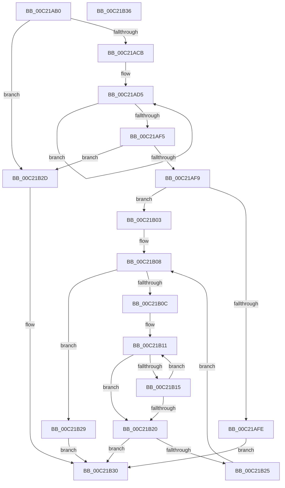

# HalpGetAvailableProximityId

- RVA: `0x00C21AB0`–`0x00C21B37` (길이 `135` bytes)
- VA: `0x0000000140C21AB0`
- 실행 섹션: `INIT`
- PDB 이름 있음: `예`; PDB Function 태그: `아니요`
- unwind 정보 RVA: `0x00071750`
- 디코드: `48`개 명령, `135/135` bytes 표시
- 미해석 바이트: `0` (있으면 어셈블리에 `.byte`로 보존)

> 이 문서는 커널 이미지의 기계어와 PDB 기호를 분석해 생성했습니다. 4번과 5번은 함수 원형과 자료형을 바이너리 사용 방식에서 추정한 C 해석이며 원본 소스 복구 결과는 아닙니다.

## 1. Dependencies

- 직접 호출 지점: **0**; 고유 호출 대상: **0**
- 직접 호출자로 확인된 함수: **1**
- RIP 상대 이미지 참조: **1**

### Outgoing calls
- 직접 디코드된 call 명령이 없습니다.

### Direct callers
- [HalpNumaInitializeStaticConfiguration](HalpNumaInitializeStaticConfiguration_function_00C220D8.md) at `0x00C22863`

### Static image references
- `0x00C21AB5` → RVA `0x00F90658` (`.data`; read)

## 2. Other-region calls and transfers

- 다른 실행 섹션으로 향하는 call: **0**
- 별도 외부 분기/꼬리 이동을 확인하지 못했습니다.

## 3. Assembly (complete function range)

```asm
00C21AB0  48 89 5C 24 08                  mov qword ptr [rsp + 8], rbx
00C21AB5  48 8B 05 9C EB 36 00            mov rax, qword ptr [rip + 0x36eb9c]
00C21ABC  45 33 C0                        xor r8d, r8d
00C21ABF  83 CA FF                        or edx, 0xffffffff
00C21AC2  44 8B 48 38                     mov r9d, dword ptr [rax + 0x38]
00C21AC6  45 85 C9                        test r9d, r9d
00C21AC9  74 62                           je 0x140c21b2d
00C21ACB  4C 8B 58 18                     mov r11, qword ptr [rax + 0x18]
00C21ACF  41 8B D9                        mov ebx, r9d
00C21AD2  4D 8B D3                        mov r10, r11
00C21AD5  41 8B 0A                        mov ecx, dword ptr [r10]
00C21AD8  3B D1                           cmp edx, ecx
00C21ADA  8B C1                           mov eax, ecx
00C21ADC  4D 8D 52 04                     lea r10, [r10 + 4]
00C21AE0  0F 46 C2                        cmovbe eax, edx
00C21AE3  44 3B C1                        cmp r8d, ecx
00C21AE6  8B D0                           mov edx, eax
00C21AE8  41 0F 43 C8                     cmovae ecx, r8d
00C21AEC  44 8B C1                        mov r8d, ecx
00C21AEF  48 83 EB 01                     sub rbx, 1
00C21AF3  75 E0                           jne 0x140c21ad5
00C21AF5  85 C0                           test eax, eax
00C21AF7  75 34                           jne 0x140c21b2d
00C21AF9  83 F9 FF                        cmp ecx, -1
00C21AFC  73 05                           jae 0x140c21b03
00C21AFE  8D 41 01                        lea eax, [rcx + 1]
00C21B01  EB 2D                           jmp 0x140c21b30
00C21B03  B8 FE FF FF FF                  mov eax, 0xfffffffe
00C21B08  85 C0                           test eax, eax
00C21B0A  74 1D                           je 0x140c21b29
00C21B0C  33 C9                           xor ecx, ecx
00C21B0E  49 8B D3                        mov rdx, r11
00C21B11  3B 02                           cmp eax, dword ptr [rdx]
00C21B13  74 0B                           je 0x140c21b20
00C21B15  FF C1                           inc ecx
00C21B17  48 83 C2 04                     add rdx, 4
00C21B1B  41 3B C9                        cmp ecx, r9d
00C21B1E  72 F1                           jb 0x140c21b11
00C21B20  41 3B C9                        cmp ecx, r9d
00C21B23  74 0B                           je 0x140c21b30
00C21B25  FF C8                           dec eax
00C21B27  EB DF                           jmp 0x140c21b08
00C21B29  33 C0                           xor eax, eax
00C21B2B  EB 03                           jmp 0x140c21b30
00C21B2D  8D 42 FF                        lea eax, [rdx - 1]
00C21B30  48 8B 5C 24 08                  mov rbx, qword ptr [rsp + 8]
00C21B35  C3                              ret
00C21B36  CC                              int3
```

## 4. C-style interpretation (structured pseudocode)

```c
__int64 __fastcall HalpGetAvailableProximityId(__int64 a1, int a2, int a3)
{
    __int64 result;
    __int64 v_rbx;
    unsigned __int64 v_stack_p8;

    v_stack_p8 = v_rbx;
    a3 = 0;
    a2 = (unsigned int)((a2) | (0xFFFFFFFFULL));
    if ((unsigned int)((unsigned int)(*(unsigned int *)(*(unsigned __int64 *)(v_rip + 3599260) + 56))) == 0) goto loc_00C21B2D;
loc_00C21AD5:
    result = (unsigned int)((unsigned int)((unsigned int)(*(unsigned int *)(*(unsigned __int64 *)(*(unsigned __int64 *)(v_rip + 3599260) + 24)))));
    if (a2 <= ((unsigned int)((unsigned int)(*(unsigned int *)(*(unsigned __int64 *)(*(unsigned __int64 *)(v_rip + 3599260) + 24)))))) { result = a2; }
    a1 = (unsigned int)(*(unsigned int *)(*(unsigned __int64 *)(*(unsigned __int64 *)(v_rip + 3599260) + 24)));
    if (0 >= ((unsigned int)((unsigned int)(*(unsigned int *)(*(unsigned __int64 *)(*(unsigned __int64 *)(v_rip + 3599260) + 24)))))) { a1 = 0; }
    v_rbx = ((unsigned int)((unsigned int)((unsigned int)(*(unsigned int *)(*(unsigned __int64 *)(v_rip + 3599260) + 56))))) - (1);
    if (condition_is_not_equal) goto loc_00C21AD5;
    if ((unsigned int)(result) != 0) goto loc_00C21B2D;
    if (((unsigned int)(a1)) >= -1) goto loc_00C21B03;
    goto loc_00C21B30;
loc_00C21B03:
loc_00C21B08:
    if ((unsigned int)((unsigned int)(0xFFFFFFFEULL)) == 0) goto loc_00C21B29;
    a1 = 0;
loc_00C21B11:
    if (((unsigned int)((unsigned int)(0xFFFFFFFEULL))) == (*(unsigned int *)(*(unsigned __int64 *)(*(unsigned __int64 *)(v_rip + 3599260) + 24)))) goto loc_00C21B20;
    a1 = (unsigned int)((a1) + 1);
    a2 = (*(unsigned __int64 *)(*(unsigned __int64 *)(v_rip + 3599260) + 24)) + (4);
    if (((unsigned int)(a1)) < ((unsigned int)((unsigned int)(*(unsigned int *)(*(unsigned __int64 *)(v_rip + 3599260) + 56))))) goto loc_00C21B11;
loc_00C21B20:
    if (((unsigned int)(a1)) == ((unsigned int)((unsigned int)(*(unsigned int *)(*(unsigned __int64 *)(v_rip + 3599260) + 56))))) goto loc_00C21B30;
    result = (unsigned int)(((unsigned int)(0xFFFFFFFEULL)) - 1);
    goto loc_00C21B08;
loc_00C21B29:
    result = 0;
    goto loc_00C21B30;
loc_00C21B2D:
loc_00C21B30:
    return a2 - 1;
}
```

## 5. (Beta) C Style

```c
int64_t HalpGetAvailableProximityId(int64_t Arg1, int32_t Arg2, int32_t Arg3)
{
    int64_t result;
    int64_t local_rbx;
    uint64_t v_stack_p8;

    v_stack_p8 = local_rbx;
    Arg3 = 0;
    Arg2 = (uint32_t)((Arg2) | (0xFFFFFFFFULL));
    if ((uint32_t)((uint32_t)(*(uint32_t *)(*(uint64_t *)(v_rip + 0x36EB9C) + 0x38))) == 0) goto loc_00C21B2D;
loc_00C21AD5:
    result = (uint32_t)((uint32_t)((uint32_t)(*(uint32_t *)(*(uint64_t *)(*(uint64_t *)(v_rip + 0x36EB9C) + 0x18)))));
    if (Arg2 <= ((uint32_t)((uint32_t)(*(uint32_t *)(*(uint64_t *)(*(uint64_t *)(v_rip + 0x36EB9C) + 0x18)))))) { result = Arg2; }
    Arg1 = (uint32_t)(*(uint32_t *)(*(uint64_t *)(*(uint64_t *)(v_rip + 0x36EB9C) + 0x18)));
    if (0 >= ((uint32_t)((uint32_t)(*(uint32_t *)(*(uint64_t *)(*(uint64_t *)(v_rip + 0x36EB9C) + 0x18)))))) { Arg1 = 0; }
    local_rbx = ((uint32_t)((uint32_t)((uint32_t)(*(uint32_t *)(*(uint64_t *)(v_rip + 0x36EB9C) + 0x38))))) - (1);
    if (condition_is_not_equal) goto loc_00C21AD5;
    if ((uint32_t)(result) != 0) goto loc_00C21B2D;
    if (((uint32_t)(Arg1)) >= -1) goto loc_00C21B03;
    goto loc_00C21B30;
loc_00C21B03:
loc_00C21B08:
    if ((uint32_t)((uint32_t)(0xFFFFFFFEULL)) == 0) goto loc_00C21B29;
    Arg1 = 0;
loc_00C21B11:
    if (((uint32_t)((uint32_t)(0xFFFFFFFEULL))) == (*(uint32_t *)(*(uint64_t *)(*(uint64_t *)(v_rip + 0x36EB9C) + 0x18)))) goto loc_00C21B20;
    Arg1 = (uint32_t)((Arg1) + 1);
    Arg2 = (*(uint64_t *)(*(uint64_t *)(v_rip + 0x36EB9C) + 0x18)) + (4);
    if (((uint32_t)(Arg1)) < ((uint32_t)((uint32_t)(*(uint32_t *)(*(uint64_t *)(v_rip + 0x36EB9C) + 0x38))))) goto loc_00C21B11;
loc_00C21B20:
    if (((uint32_t)(Arg1)) == ((uint32_t)((uint32_t)(*(uint32_t *)(*(uint64_t *)(v_rip + 0x36EB9C) + 0x38))))) goto loc_00C21B30;
    result = (uint32_t)(((uint32_t)(0xFFFFFFFEULL)) - 1);
    goto loc_00C21B08;
loc_00C21B29:
    result = 0;
    goto loc_00C21B30;
loc_00C21B2D:
loc_00C21B30:
    return Arg2 - 1;
}
```

## 6. Execution-region graph

[열기: 2D/3D 그래프와 함수 탐색 컨트롤 패널](../../../control-panel.html?section=init&rva=0x00C21AB0&view=graph)

- 2D 그래프는 위에서 아래로 흐르고, 3D 그래프는 빈 공간을 드래그해 회전합니다. Shift+드래그는 이동, 휠은 확대·축소, 함수 노드 선택은 대상 보고서 이동입니다.

### Static fallback


