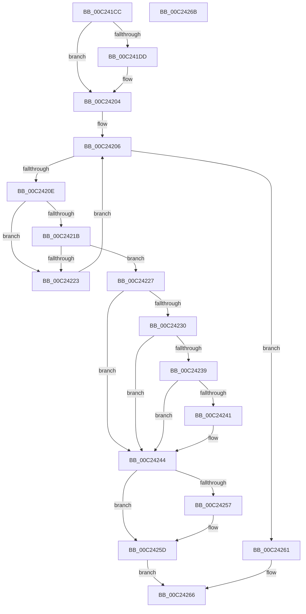

# HalpGetChipHacks

- RVA: `0x00C241CC`–`0x00C2426C` (길이 `160` bytes)
- VA: `0x0000000140C241CC`
- 실행 섹션: `INIT`
- PDB 이름 있음: `예`; PDB Function 태그: `아니요`
- unwind 정보 RVA: `0x0005D2F4`
- 디코드: `45`개 명령, `160/160` bytes 표시
- 미해석 바이트: `0` (있으면 어셈블리에 `.byte`로 보존)

> 이 문서는 커널 이미지의 기계어와 PDB 기호를 분석해 생성했습니다. 4번과 5번은 함수 원형과 자료형을 바이너리 사용 방식에서 추정한 C 해석이며 원본 소스 복구 결과는 아닙니다.

## 1. Dependencies

- 직접 호출 지점: **1**; 고유 호출 대상: **1**
- 직접 호출자로 확인된 함수: **1**
- RIP 상대 이미지 참조: **6**

### Outgoing calls
- `0x00C241FE` → [KeBugCheckEx](../../text/4F/KeBugCheckEx_function_004FD660.md) (function, `0x004FD660`)

### Direct callers
- [HalpPiix4Detect](../../pagelk/B7/HalpPiix4Detect_function_00B79E00.md) at `0x00B7A11E`

### Static image references
- `0x00C241D0` → RVA `0x00E1179C` (`.data`; read)
- `0x00C241DD` → RVA `0x00025F50` (`.rdata`; read)
- `0x00C241ED` → RVA `0x00025F78` (`.rdata`; read)
- `0x00C24206` → RVA `0x00E11798` (`.data`; read)
- `0x00C2420E` → RVA `0x00E117A0` (`.data`; read)
- `0x00C2424D` → RVA `0x00FC1ED4` (`.data`; read)

## 2. Other-region calls and transfers

- 다른 실행 섹션으로 향하는 call: **1**
  - `0x00C241FE` → [KeBugCheckEx](../../text/4F/KeBugCheckEx_function_004FD660.md) (`INIT` → `.text`)
- 별도 외부 분기/꼬리 이동을 확인하지 못했습니다.

## 3. Assembly (complete function range)

```asm
00C241CC  48 83 EC 38                     sub rsp, 0x38
00C241D0  80 3D C5 D5 1E 00 00            cmp byte ptr [rip + 0x1ed5c5], 0
00C241D7  44 0F B7 D2                     movzx r10d, dx
00C241DB  75 27                           jne 0x140c24204
00C241DD  4C 8D 0D 6C 1D 40 FF            lea r9, [rip - 0xbfe294]
00C241E4  48 C7 44 24 20 27 01 00 00      mov qword ptr [rsp + 0x20], 0x127
00C241ED  4C 8D 05 84 1D 40 FF            lea r8, [rip - 0xbfe27c]
00C241F4  BA 00 80 00 00                  mov edx, 0x8000
00C241F9  B9 5C 00 00 00                  mov ecx, 0x5c
00C241FE  E8 5D 94 8D FF                  call 0x1404fd660
00C24203  CC                              int3
00C24204  33 C0                           xor eax, eax
00C24206  3B 05 8C D5 1E 00               cmp eax, dword ptr [rip + 0x1ed58c]
00C2420C  73 53                           jae 0x140c24261
00C2420E  48 8B 15 8B D5 1E 00            mov rdx, qword ptr [rip + 0x1ed58b]
00C24215  66 39 0C C2                     cmp word ptr [rdx + rax*8], cx
00C24219  75 08                           jne 0x140c24223
00C2421B  66 44 39 54 C2 02               cmp word ptr [rdx + rax*8 + 2], r10w
00C24221  74 04                           je 0x140c24227
00C24223  FF C0                           inc eax
00C24225  EB DF                           jmp 0x140c24206
00C24227  8B 4C C2 04                     mov ecx, dword ptr [rdx + rax*8 + 4]
00C2422B  45 84 C0                        test r8b, r8b
00C2422E  74 14                           je 0x140c24244
00C24230  8B D1                           mov edx, ecx
00C24232  C1 EA 18                        shr edx, 0x18
00C24235  85 D2                           test edx, edx
00C24237  74 0B                           je 0x140c24244
00C24239  41 0F B6 C0                     movzx eax, r8b
00C2423D  3B C2                           cmp eax, edx
00C2423F  72 03                           jb 0x140c24244
00C24241  C1 E9 0C                        shr ecx, 0xc
00C24244  81 E1 FF 0F 00 00               and ecx, 0xfff
00C2424A  41 89 09                        mov dword ptr [r9], ecx
00C2424D  8B 05 81 DC 39 00               mov eax, dword ptr [rip + 0x39dc81]
00C24253  A8 02                           test al, 2
00C24255  74 06                           je 0x140c2425d
00C24257  83 E1 FE                        and ecx, 0xfffffffe
00C2425A  41 89 09                        mov dword ptr [r9], ecx
00C2425D  33 C0                           xor eax, eax
00C2425F  EB 05                           jmp 0x140c24266
00C24261  B8 25 02 00 C0                  mov eax, 0xc0000225
00C24266  48 83 C4 38                     add rsp, 0x38
00C2426A  C3                              ret
00C2426B  CC                              int3
```

## 4. C-style interpretation (structured pseudocode)

```c
__int64 __fastcall HalpGetChipHacks(__int64 a1, unsigned __int16 a2)
{
    __int64 result;
    __int64 v_rsp;
    unsigned __int64 v_stack_m18;

    v_rsp = (v_rsp) - (56);
    if ((*(unsigned __int8 *)(v_rip + 2020805)) == 0) {
        a4 = v_rip - 12575380;
        v_stack_m18 = 295;
        a3 = v_rip - 12575356;
        a2 = 0x8000ULL;
        a1 = 92;
        result = KeBugCheckEx(a1, a2, a3, a4);
    }
    result = 0;
loc_00C24206:
    if (0 >= (*(unsigned int *)(v_rip + 2020748))) goto loc_00C24261;
    if ((*(unsigned __int16 *)(*(unsigned __int64 *)(v_rip + 2020747) + result * 8)) != ((unsigned __int16)(a1))) goto loc_00C24223;
    if ((*(unsigned __int16 *)(*(unsigned __int64 *)(v_rip + 2020747) + result * 8 + 2)) == a2) goto loc_00C24227;
loc_00C24223:
    result = (unsigned int)((result) + 1);
    goto loc_00C24206;
loc_00C24227:
    if ((unsigned __int8)(a3) == 0) goto loc_00C24244;
    a2 = (unsigned int)(((unsigned int)((unsigned int)((unsigned int)(*(unsigned int *)(*(unsigned __int64 *)(v_rip + 2020747) + result * 8 + 4))))) >> (24));
    if (a2 == 0) goto loc_00C24244;
    if (((unsigned int)((unsigned __int8)(a3))) >= a2) {
        a1 = (unsigned int)(((unsigned int)(*(unsigned int *)(*(unsigned __int64 *)(v_rip + 2020747) + result * 8 + 4))) >> (12));
    }
    a1 = (unsigned int)((a1) & (0xFFFULL));
    *(unsigned int *)(a4) = (unsigned int)(a1);
    if ((((unsigned __int8)((unsigned int)(*(unsigned int *)(v_rip + 3792001)))) & (2)) != 0) {
        a1 = (unsigned int)((a1) & (0xFFFFFFFEULL));
        *(unsigned int *)(a4) = (unsigned int)(a1);
    }
    result = 0;
    goto loc_00C24266;
loc_00C24261:
loc_00C24266:
    v_rsp = (v_rsp) + (56);
    return (unsigned int)(0xC0000225ULL);
}
```

## 5. (Beta) C Style

```c
int64_t HalpGetChipHacks(int64_t Arg1, uint16_t Arg2)
{
    int64_t result;
    int64_t local_rsp;
    uint64_t v_stack_m18;

    local_rsp = (local_rsp) - (56);
    if ((*(uint8_t *)(v_rip + 0x1ED5C5)) == 0) {
        a4 = v_rip - 12575380;
        v_stack_m18 = 295;
        a3 = v_rip - 12575356;
        Arg2 = 0x8000ULL;
        Arg1 = 92;
        result = KeBugCheckEx(Arg1, Arg2, a3, a4);
    }
    result = 0;
loc_00C24206:
    if (0 >= (*(uint32_t *)(v_rip + 0x1ED58C))) goto loc_00C24261;
    if ((*(uint16_t *)(*(uint64_t *)(v_rip + 0x1ED58B) + result * 8)) != ((uint16_t)(Arg1))) goto loc_00C24223;
    if ((*(uint16_t *)(*(uint64_t *)(v_rip + 0x1ED58B) + result * 8 + 0x2)) == Arg2) goto loc_00C24227;
loc_00C24223:
    result = (uint32_t)((result) + 1);
    goto loc_00C24206;
loc_00C24227:
    if ((uint8_t)(a3) == 0) goto loc_00C24244;
    Arg2 = (uint32_t)(((uint32_t)((uint32_t)((uint32_t)(*(uint32_t *)(*(uint64_t *)(v_rip + 0x1ED58B) + result * 8 + 0x4))))) >> (24));
    if (Arg2 == 0) goto loc_00C24244;
    if (((uint32_t)((uint8_t)(a3))) >= Arg2) {
        Arg1 = (uint32_t)(((uint32_t)(*(uint32_t *)(*(uint64_t *)(v_rip + 0x1ED58B) + result * 8 + 0x4))) >> (12));
    }
    Arg1 = (uint32_t)((Arg1) & (0xFFFULL));
    *(uint32_t *)(a4) = (uint32_t)(Arg1);
    if ((((uint8_t)((uint32_t)(*(uint32_t *)(v_rip + 0x39DC81)))) & (2)) != 0) {
        Arg1 = (uint32_t)((Arg1) & (0xFFFFFFFEULL));
        *(uint32_t *)(a4) = (uint32_t)(Arg1);
    }
    result = 0;
    goto loc_00C24266;
loc_00C24261:
loc_00C24266:
    local_rsp = (local_rsp) + (56);
    return (uint32_t)(0xC0000225ULL);
}
```

## 6. Execution-region graph

[열기: 2D/3D 그래프와 함수 탐색 컨트롤 패널](../../../control-panel.html?section=init&rva=0x00C241CC&view=graph)

- 2D 그래프는 위에서 아래로 흐르고, 3D 그래프는 빈 공간을 드래그해 회전합니다. Shift+드래그는 이동, 휠은 확대·축소, 함수 노드 선택은 대상 보고서 이동입니다.

### Static fallback


