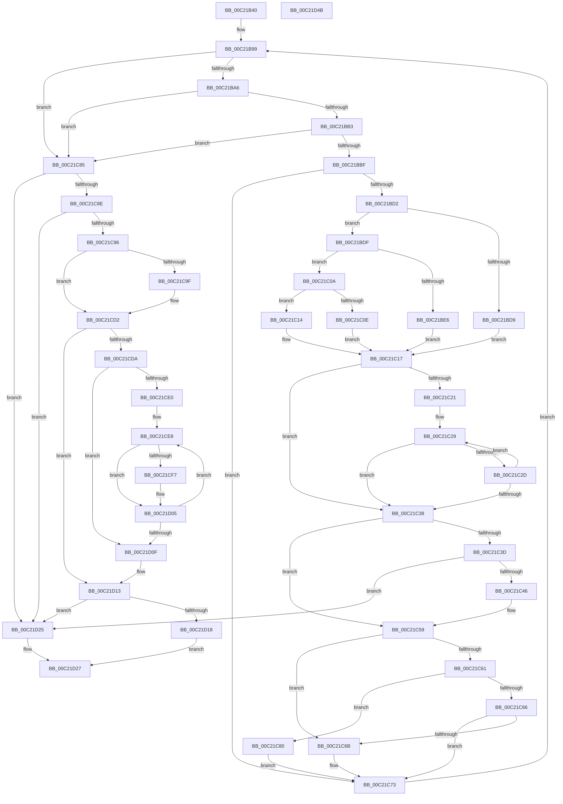

# HalpGetNumaProcMemoryCount

- RVA: `0x00C21B40`–`0x00C21D4C` (길이 `524` bytes)
- VA: `0x0000000140C21B40`
- 실행 섹션: `INIT`
- PDB 이름 있음: `예`; PDB Function 태그: `아니요`
- unwind 정보 RVA: `0x000C468C`
- 디코드: `159`개 명령, `524/524` bytes 표시
- 미해석 바이트: `0` (있으면 어셈블리에 `.byte`로 보존)

> 이 문서는 커널 이미지의 기계어와 PDB 기호를 분석해 생성했습니다. 4번과 5번은 함수 원형과 자료형을 바이너리 사용 방식에서 추정한 C 해석이며 원본 소스 복구 결과는 아닙니다.

## 1. Dependencies

- 직접 호출 지점: **4**; 고유 호출 대상: **4**
- 직접 호출자로 확인된 함수: **2**
- RIP 상대 이미지 참조: **5**

### Outgoing calls
- `0x00C21BC5` → [HalpVerifySratEntryLengthAndFlag](HalpVerifySratEntryLengthAndFlag_function_00C23158.md) (function, `0x00C23158`)
- `0x00C21CCD` → [HalpUpdateConfigurationFromMsct](HalpUpdateConfigurationFromMsct_function_00C22DB0.md) (function, `0x00C22DB0`)
- `0x00C21D18` → [HalpParseChannelCount](../../text/56/HalpParseChannelCount_function_005694B0.md) (function, `0x005694B0`)
- `0x00C21D32` → [_security_check_cookie](../../text/6A/_security_check_cookie_function_006AC640.md) (function, `0x006AC640`)

### Direct callers
- [HalpNumaSwapP0NodeToFront](../../text/55/HalpNumaSwapP0NodeToFront_function_00559D80.md) at `0x00559DC7`
- [HalpNumaInitializeStaticConfiguration](HalpNumaInitializeStaticConfiguration_function_00C220D8.md) at `0x00C2218C`

### Static image references
- `0x00C21B54` → RVA `0x00E0A740` (`.data`; read)
- `0x00C21B66` → RVA `0x00F90618` (`.data`; read)
- `0x00C21C96` → RVA `0x00F90670` (`.data`; read)
- `0x00C21CD2` → RVA `0x00E10462` (`.data`; read)
- `0x00C21CEB` → RVA `0x00E0A81C` (`.data`; read)

## 2. Other-region calls and transfers

- 다른 실행 섹션으로 향하는 call: **2**
  - `0x00C21D18` → [HalpParseChannelCount](../../text/56/HalpParseChannelCount_function_005694B0.md) (`INIT` → `.text`)
  - `0x00C21D32` → [_security_check_cookie](../../text/6A/_security_check_cookie_function_006AC640.md) (`INIT` → `.text`)
- 별도 외부 분기/꼬리 이동을 확인하지 못했습니다.

## 3. Assembly (complete function range)

```asm
00C21B40  40 53                           push rbx
00C21B42  55                              push rbp
00C21B43  56                              push rsi
00C21B44  57                              push rdi
00C21B45  41 54                           push r12
00C21B47  41 55                           push r13
00C21B49  41 56                           push r14
00C21B4B  41 57                           push r15
00C21B4D  48 81 EC 58 02 00 00            sub rsp, 0x258
00C21B54  48 8B 05 E5 8B 1E 00            mov rax, qword ptr [rip + 0x1e8be5]
00C21B5B  48 33 C4                        xor rax, rsp
00C21B5E  48 89 84 24 40 02 00 00         mov qword ptr [rsp + 0x240], rax
00C21B66  4C 8B 3D AB EA 36 00            mov r15, qword ptr [rip + 0x36eaab]
00C21B6D  33 DB                           xor ebx, ebx
00C21B6F  89 19                           mov dword ptr [rcx], ebx
00C21B71  4D 8B E1                        mov r12, r9
00C21B74  41 89 18                        mov dword ptr [r8], ebx
00C21B77  4D 8B F0                        mov r14, r8
00C21B7A  89 1A                           mov dword ptr [rdx], ebx
00C21B7C  48 8B F2                        mov rsi, rdx
00C21B7F  41 89 19                        mov dword ptr [r9], ebx
00C21B82  4D 8D 57 30                     lea r10, [r15 + 0x30]
00C21B86  41 80 7F 08 03                  cmp byte ptr [r15 + 8], 3
00C21B8B  48 8B F9                        mov rdi, rcx
00C21B8E  41 8B 6F 04                     mov ebp, dword ptr [r15 + 4]
00C21B92  41 0F 93 C5                     setae r13b
00C21B96  49 03 EF                        add rbp, r15
00C21B99  4D 8D 5A 02                     lea r11, [r10 + 2]
00C21B9D  4C 3B DD                        cmp r11, rbp
00C21BA0  0F 87 DF 00 00 00               ja 0x140c21c85
00C21BA6  41 0F B6 42 01                  movzx eax, byte ptr [r10 + 1]
00C21BAB  3C 02                           cmp al, 2
00C21BAD  0F 82 D2 00 00 00               jb 0x140c21c85
00C21BB3  49 03 C2                        add rax, r10
00C21BB6  48 3B C5                        cmp rax, rbp
00C21BB9  0F 87 C6 00 00 00               ja 0x140c21c85
00C21BBF  41 8A D5                        mov dl, r13b
00C21BC2  49 8B CA                        mov rcx, r10
00C21BC5  E8 8E 15 00 00                  call 0x140c23158
00C21BCA  84 C0                           test al, al
00C21BCC  0F 84 A1 00 00 00               je 0x140c21c73
00C21BD2  41 80 7F 08 01                  cmp byte ptr [r15 + 8], 1
00C21BD7  75 06                           jne 0x140c21bdf
00C21BD9  41 0F B6 0B                     movzx ecx, byte ptr [r11]
00C21BDD  EB 38                           jmp 0x140c21c17
00C21BDF  41 8A 02                        mov al, byte ptr [r10]
00C21BE2  84 C0                           test al, al
00C21BE4  75 24                           jne 0x140c21c0a
00C21BE6  41 0F B6 42 0A                  movzx eax, byte ptr [r10 + 0xa]
00C21BEB  41 0F B6 4A 0B                  movzx ecx, byte ptr [r10 + 0xb]
00C21BF0  C1 E1 08                        shl ecx, 8
00C21BF3  03 C8                           add ecx, eax
00C21BF5  41 0F B6 42 09                  movzx eax, byte ptr [r10 + 9]
00C21BFA  C1 E1 08                        shl ecx, 8
00C21BFD  03 C8                           add ecx, eax
00C21BFF  41 0F B6 03                     movzx eax, byte ptr [r11]
00C21C03  C1 E1 08                        shl ecx, 8
00C21C06  03 C8                           add ecx, eax
00C21C08  EB 0D                           jmp 0x140c21c17
00C21C0A  3C 02                           cmp al, 2
00C21C0C  75 06                           jne 0x140c21c14
00C21C0E  41 8B 4A 04                     mov ecx, dword ptr [r10 + 4]
00C21C12  EB 03                           jmp 0x140c21c17
00C21C14  41 8B 0B                        mov ecx, dword ptr [r11]
00C21C17  44 8B 07                        mov r8d, dword ptr [rdi]
00C21C1A  8B D3                           mov edx, ebx
00C21C1C  45 85 C0                        test r8d, r8d
00C21C1F  74 17                           je 0x140c21c38
00C21C21  48 8D 84 24 40 01 00 00         lea rax, [rsp + 0x140]
00C21C29  3B 08                           cmp ecx, dword ptr [rax]
00C21C2B  74 0B                           je 0x140c21c38
00C21C2D  FF C2                           inc edx
00C21C2F  48 83 C0 04                     add rax, 4
00C21C33  41 3B D0                        cmp edx, r8d
00C21C36  72 F1                           jb 0x140c21c29
00C21C38  41 3B D0                        cmp edx, r8d
00C21C3B  75 1C                           jne 0x140c21c59
00C21C3D  83 FA 40                        cmp edx, 0x40
00C21C40  0F 84 DF 00 00 00               je 0x140c21d25
00C21C46  8B C2                           mov eax, edx
00C21C48  89 8C 84 40 01 00 00            mov dword ptr [rsp + rax*4 + 0x140], ecx
00C21C4F  89 5C 84 40                     mov dword ptr [rsp + rax*4 + 0x40], ebx
00C21C53  41 8D 40 01                     lea eax, [r8 + 1]
00C21C57  89 07                           mov dword ptr [rdi], eax
00C21C59  41 0F B6 0A                     movzx ecx, byte ptr [r10]
00C21C5D  85 C9                           test ecx, ecx
00C21C5F  74 0A                           je 0x140c21c6b
00C21C61  83 E9 01                        sub ecx, 1
00C21C64  74 1A                           je 0x140c21c80
00C21C66  83 F9 01                        cmp ecx, 1
00C21C69  75 08                           jne 0x140c21c73
00C21C6B  FF 06                           inc dword ptr [rsi]
00C21C6D  8B C2                           mov eax, edx
00C21C6F  FF 44 84 40                     inc dword ptr [rsp + rax*4 + 0x40]
00C21C73  41 0F B6 42 01                  movzx eax, byte ptr [r10 + 1]
00C21C78  4C 03 D0                        add r10, rax
00C21C7B  E9 19 FF FF FF                  jmp 0x140c21b99
00C21C80  41 FF 06                        inc dword ptr [r14]
00C21C83  EB EE                           jmp 0x140c21c73
00C21C85  41 39 1E                        cmp dword ptr [r14], ebx
00C21C88  0F 84 97 00 00 00               je 0x140c21d25
00C21C8E  39 1E                           cmp dword ptr [rsi], ebx
00C21C90  0F 84 8F 00 00 00               je 0x140c21d25
00C21C96  48 39 1D D3 E9 36 00            cmp qword ptr [rip + 0x36e9d3], rbx
00C21C9D  74 33                           je 0x140c21cd2
00C21C9F  48 89 5C 24 38                  mov qword ptr [rsp + 0x38], rbx
00C21CA4  48 8D 44 24 40                  lea rax, [rsp + 0x40]
00C21CA9  48 89 44 24 30                  mov qword ptr [rsp + 0x30], rax
00C21CAE  45 33 C9                        xor r9d, r9d
00C21CB1  48 8D 84 24 40 01 00 00         lea rax, [rsp + 0x140]
00C21CB9  4C 8B C6                        mov r8, rsi
00C21CBC  48 89 44 24 28                  mov qword ptr [rsp + 0x28], rax
00C21CC1  48 8B CF                        mov rcx, rdi
00C21CC4  48 89 5C 24 20                  mov qword ptr [rsp + 0x20], rbx
00C21CC9  41 8D 51 40                     lea edx, [r9 + 0x40]
00C21CCD  E8 DE 10 00 00                  call 0x140c22db0
00C21CD2  38 1D 8A E7 1E 00               cmp byte ptr [rip + 0x1ee78a], bl
00C21CD8  74 39                           je 0x140c21d13
00C21CDA  8B 0F                           mov ecx, dword ptr [rdi]
00C21CDC  85 C9                           test ecx, ecx
00C21CDE  74 2F                           je 0x140c21d0f
00C21CE0  4C 8D 44 24 40                  lea r8, [rsp + 0x40]
00C21CE5  44 8B D1                        mov r10d, ecx
00C21CE8  41 8B 00                        mov eax, dword ptr [r8]
00C21CEB  44 8B 0D 2A 8B 1E 00            mov r9d, dword ptr [rip + 0x1e8b2a]
00C21CF2  41 3B C1                        cmp eax, r9d
00C21CF5  76 0E                           jbe 0x140c21d05
00C21CF7  FF C8                           dec eax
00C21CF9  33 D2                           xor edx, edx
00C21CFB  41 03 C1                        add eax, r9d
00C21CFE  FF CB                           dec ebx
00C21D00  41 F7 F1                        div r9d
00C21D03  03 D8                           add ebx, eax
00C21D05  49 83 C0 04                     add r8, 4
00C21D09  49 83 EA 01                     sub r10, 1
00C21D0D  75 D9                           jne 0x140c21ce8
00C21D0F  03 CB                           add ecx, ebx
00C21D11  89 0F                           mov dword ptr [rdi], ecx
00C21D13  83 3F 40                        cmp dword ptr [rdi], 0x40
00C21D16  77 0D                           ja 0x140c21d25
00C21D18  E8 93 77 94 FF                  call 0x1405694b0
00C21D1D  41 89 04 24                     mov dword ptr [r12], eax
00C21D21  B0 01                           mov al, 1
00C21D23  EB 02                           jmp 0x140c21d27
00C21D25  32 C0                           xor al, al
00C21D27  48 8B 8C 24 40 02 00 00         mov rcx, qword ptr [rsp + 0x240]
00C21D2F  48 33 CC                        xor rcx, rsp
00C21D32  E8 09 A9 A8 FF                  call 0x1406ac640
00C21D37  48 81 C4 58 02 00 00            add rsp, 0x258
00C21D3E  41 5F                           pop r15
00C21D40  41 5E                           pop r14
00C21D42  41 5D                           pop r13
00C21D44  41 5C                           pop r12
00C21D46  5F                              pop rdi
00C21D47  5E                              pop rsi
00C21D48  5D                              pop rbp
00C21D49  5B                              pop rbx
00C21D4A  C3                              ret
00C21D4B  CC                              int3
```

## 4. C-style interpretation (structured pseudocode)

```c
__int64 __fastcall HalpGetNumaProcMemoryCount(__int64 a1, __int64 a2, __int64 a3, __int64 a4)
{
    __int64 result;
    __int64 v_r10;
    __int64 v_r13;
    __int64 v_rbp;
    __int64 v_rbx;
    __int64 v_rsp;
    unsigned __int64 v_stack_m158;
    unsigned __int64 v_stack_m258;
    unsigned __int64 v_stack_m260;
    unsigned __int64 v_stack_m268;
    unsigned __int64 v_stack_m270;
    unsigned __int64 v_stack_m278;
    unsigned __int64 v_stack_m58;

    v_rsp = (v_rsp) - (600);
    result = (*(unsigned __int64 *)(v_rip + 2001893)) ^ (v_rsp);
    v_stack_m58 = result;
    v_rbx = 0;
    *(unsigned int *)(a1) = 0;
    *(unsigned int *)(a3) = 0;
    *(unsigned int *)(a2) = 0;
    *(unsigned int *)(a4) = 0;
    v_r13 = ((*(unsigned __int8 *)(*(unsigned __int64 *)(v_rip + 3599019) + 8)) >= 3) ? 1 : 0;
    v_rbp = ((unsigned int)(*(unsigned int *)(*(unsigned __int64 *)(v_rip + 3599019) + 4))) + (*(unsigned __int64 *)(v_rip + 3599019));
loc_00C21B99:
    if ((*(unsigned __int64 *)(v_rip + 3599019) + 48 + 2) > v_rbp) goto loc_00C21C85;
    if (((unsigned __int8)(*(unsigned __int8 *)(*(unsigned __int64 *)(v_rip + 3599019) + 48 + 1))) < 2) goto loc_00C21C85;
    result = (*(unsigned __int8 *)(*(unsigned __int64 *)(v_rip + 3599019) + 48 + 1)) + (*(unsigned __int64 *)(v_rip + 3599019) + 48);
    if (result > v_rbp) goto loc_00C21C85;
    result = HalpVerifySratEntryLengthAndFlag(*(unsigned __int64 *)(v_rip + 3599019) + 48, (unsigned __int8)(v_r13), a3, a4);
    if ((unsigned __int8)(result) == 0) goto loc_00C21C73;
    if ((*(unsigned __int8 *)(*(unsigned __int64 *)(v_rip + 3599019) + 8)) != 1) goto loc_00C21BDF;
    goto loc_00C21C17;
loc_00C21BDF:
    if ((unsigned __int8)(*(unsigned __int8 *)(*(unsigned __int64 *)(v_rip + 3599019) + 48)) != 0) goto loc_00C21C0A;
    a1 = (unsigned int)((*(unsigned __int8 *)(*(unsigned __int64 *)(v_rip + 3599019) + 48 + 11)) << (8));
    a1 = (unsigned int)((a1) + ((unsigned int)(*(unsigned __int8 *)(*(unsigned __int64 *)(v_rip + 3599019) + 48 + 10))));
    a1 = (unsigned int)((a1) << (8));
    a1 = (unsigned int)((a1) + ((unsigned int)(*(unsigned __int8 *)(*(unsigned __int64 *)(v_rip + 3599019) + 48 + 9))));
    a1 = (unsigned int)((a1) << (8));
    a1 = (unsigned int)((a1) + ((unsigned int)(*(unsigned __int8 *)(*(unsigned __int64 *)(v_rip + 3599019) + 48 + 2))));
    goto loc_00C21C17;
loc_00C21C0A:
    if (((unsigned __int8)(*(unsigned __int8 *)(*(unsigned __int64 *)(v_rip + 3599019) + 48 + 2))) != 2) goto loc_00C21C14;
    goto loc_00C21C17;
loc_00C21C14:
loc_00C21C17:
    if ((unsigned int)((unsigned int)(*(unsigned int *)(a1))) == 0) goto loc_00C21C38;
loc_00C21C29:
    if (((unsigned int)((unsigned int)(*(unsigned int *)(*(unsigned __int64 *)(v_rip + 3599019) + 48 + 2)))) == (*(unsigned int *)(v_stack_m158))) goto loc_00C21C38;
    a2 = (unsigned int)((0) + 1);
    result = (v_stack_m158) + (4);
    if (((unsigned int)(a2)) < ((unsigned int)((unsigned int)(*(unsigned int *)(a1))))) goto loc_00C21C29;
loc_00C21C38:
    if (((unsigned int)(a2)) != ((unsigned int)((unsigned int)(*(unsigned int *)(a1))))) goto loc_00C21C59;
    if (((unsigned int)(a2)) == 64) goto loc_00C21D25;
    *(unsigned int *)(v_rsp + (unsigned int)((unsigned int)(a2)) * 4 + 320) = (unsigned int)((unsigned int)(*(unsigned int *)(*(unsigned __int64 *)(v_rip + 3599019) + 48 + 2)));
    *(unsigned int *)(v_rsp + (unsigned int)((unsigned int)(a2)) * 4 + 64) = 0;
    *(unsigned int *)(a1) = (unsigned int)((unsigned int)(*(unsigned int *)(a1)) + 1);
loc_00C21C59:
    if ((unsigned int)(*(unsigned __int8 *)(*(unsigned __int64 *)(v_rip + 3599019) + 48)) == 0) goto loc_00C21C6B;
    a1 = (unsigned int)((*(unsigned __int8 *)(*(unsigned __int64 *)(v_rip + 3599019) + 48)) - (1));
    if (condition_is_equal) goto loc_00C21C80;
    result = (unsigned int)(*(unsigned int *)(a1)) + 1;
    if (((unsigned int)(a1)) == 1) {
        result = (unsigned int)(a2);
    }
    v_r10 = (*(unsigned __int64 *)(v_rip + 3599019) + 48) + (*(unsigned __int8 *)(*(unsigned __int64 *)(v_rip + 3599019) + 48 + 1));
    goto loc_00C21B99;
loc_00C21C80:
    goto loc_00C21C73;
loc_00C21C85:
    if ((*(unsigned int *)(a3)) == 0) goto loc_00C21D25;
    if ((*(unsigned int *)(a2)) == 0) goto loc_00C21D25;
    result = *(unsigned __int8 *)(*(unsigned __int64 *)(v_rip + 3599019) + 48 + 1);
    if ((*(unsigned __int64 *)(v_rip + 3598803)) != 0) {
        v_stack_m260 = 0;
        result = v_stack_m258;
        v_stack_m268 = result;
        a4 = 0;
        result = v_stack_m158;
        a3 = a2;
        v_stack_m270 = result;
        a1 = a1;
        v_stack_m278 = 0;
        a2 = a4 + 64;
        result = HalpUpdateConfigurationFromMsct(a1, a2, a3, a4);
    }
    if ((*(unsigned __int8 *)(v_rip + 2025354)) == 0) goto loc_00C21D13;
    if ((unsigned int)((unsigned int)(*(unsigned int *)(a1))) == 0) goto loc_00C21D0F;
loc_00C21CE8:
    result = (unsigned int)(*(unsigned int *)(v_stack_m258));
    if (((unsigned int)((unsigned int)(*(unsigned int *)(v_stack_m258)))) >= = ((unsigned int)((unsigned int)(*(unsigned int *)(v_rip + 2001706))))) {
        result = (unsigned int)(((unsigned int)(*(unsigned int *)(v_stack_m258))) - 1);
        a2 = 0;
        result = (unsigned int)((result) + ((unsigned int)((unsigned int)(*(unsigned int *)(v_rip + 2001706)))));
        v_rbx = (unsigned int)((v_rbx) - 1);
        v_rbx = (unsigned int)((v_rbx) + ((unsigned int)(result)));
    }
    a3 = (v_stack_m258) + (4);
    v_r10 = ((unsigned int)((unsigned int)((unsigned int)(*(unsigned int *)(a1))))) - (1);
    if (condition_is_not_equal) goto loc_00C21CE8;
loc_00C21D0F:
    a1 = (unsigned int)(((unsigned int)(*(unsigned int *)(a1))) + ((unsigned int)(v_rbx)));
    *(unsigned int *)(a1) = (unsigned int)(a1);
loc_00C21D13:
    if ((*(unsigned int *)(a1)) > 64) goto loc_00C21D25;
    result = HalpParseChannelCount(a1, a2, a3, (unsigned int)(*(unsigned int *)(v_rip + 2001706)));
    *(unsigned int *)(a4) = (unsigned int)(result);
    goto loc_00C21D27;
loc_00C21D25:
    result = 0;
loc_00C21D27:
    a1 = (v_stack_m58) ^ (v_rsp);
    result = _security_check_cookie(a1, a2, a3, (unsigned int)(*(unsigned int *)(v_rip + 2001706)));
    v_rsp = (v_rsp) + (600);
    return result;
}
```

## 5. (Beta) C Style

```c
int64_t HalpGetNumaProcMemoryCount(void *Arg1, void *Arg2, void *Arg3, void *Arg4)
{
    uint8_t *arg1 = (uint8_t *)Arg1;
    uint8_t *arg2 = (uint8_t *)Arg2;
    uint8_t *arg3 = (uint8_t *)Arg3;
    uint8_t *arg4 = (uint8_t *)Arg4;

    int64_t result;
    int64_t local_r10;
    int64_t local_r13;
    int64_t local_rbp;
    int64_t local_rbx;
    int64_t local_rsp;
    uint64_t v_stack_m158;
    uint64_t v_stack_m258;
    uint64_t v_stack_m260;
    uint64_t v_stack_m268;
    uint64_t v_stack_m270;
    uint64_t v_stack_m278;
    uint64_t v_stack_m58;

    local_rsp = (local_rsp) - (600);
    result = (*(uint64_t *)(v_rip + 0x1E8BE5)) ^ (local_rsp);
    v_stack_m58 = result;
    local_rbx = 0;
    *(uint32_t *)(arg1) = 0;
    *(uint32_t *)(arg3) = 0;
    *(uint32_t *)(arg2) = 0;
    *(uint32_t *)(arg4) = 0;
    local_r13 = ((*(uint8_t *)(*(uint64_t *)(v_rip + 0x36EAAB) + 0x8)) >= 3) ? 1 : 0;
    local_rbp = ((uint32_t)(*(uint32_t *)(*(uint64_t *)(v_rip + 0x36EAAB) + 0x4))) + (*(uint64_t *)(v_rip + 0x36EAAB));
loc_00C21B99:
    if ((*(uint64_t *)(v_rip + 0x36EAAB) + 48 + 2) > local_rbp) goto loc_00C21C85;
    if (((uint8_t)(*(uint8_t *)(*(uint64_t *)(v_rip + 0x36EAAB) + 0x30 + 0x1))) < 2) goto loc_00C21C85;
    result = (*(uint8_t *)(*(uint64_t *)(v_rip + 0x36EAAB) + 0x30 + 0x1)) + (*(uint64_t *)(v_rip + 0x36EAAB) + 48);
    if (result > local_rbp) goto loc_00C21C85;
    result = HalpVerifySratEntryLengthAndFlag(*(uint64_t *)(v_rip + 0x36EAAB) + 48, (uint8_t)(local_r13), Arg3, Arg4);
    if ((uint8_t)(result) == 0) goto loc_00C21C73;
    if ((*(uint8_t *)(*(uint64_t *)(v_rip + 0x36EAAB) + 0x8)) != 1) goto loc_00C21BDF;
    goto loc_00C21C17;
loc_00C21BDF:
    if ((uint8_t)(*(uint8_t *)(*(uint64_t *)(v_rip + 0x36EAAB) + 0x30)) != 0) goto loc_00C21C0A;
    Arg1 = (uint32_t)((*(uint8_t *)(*(uint64_t *)(v_rip + 0x36EAAB) + 0x30 + 0xB)) << (8));
    Arg1 = (uint32_t)((Arg1) + ((uint32_t)(*(uint8_t *)(*(uint64_t *)(v_rip + 0x36EAAB) + 0x30 + 0xA))));
    Arg1 = (uint32_t)((Arg1) << (8));
    Arg1 = (uint32_t)((Arg1) + ((uint32_t)(*(uint8_t *)(*(uint64_t *)(v_rip + 0x36EAAB) + 0x30 + 0x9))));
    Arg1 = (uint32_t)((Arg1) << (8));
    Arg1 = (uint32_t)((Arg1) + ((uint32_t)(*(uint8_t *)(*(uint64_t *)(v_rip + 0x36EAAB) + 0x30 + 0x2))));
    goto loc_00C21C17;
loc_00C21C0A:
    if (((uint8_t)(*(uint8_t *)(*(uint64_t *)(v_rip + 0x36EAAB) + 0x30 + 0x2))) != 2) goto loc_00C21C14;
    goto loc_00C21C17;
loc_00C21C14:
loc_00C21C17:
    if ((uint32_t)((uint32_t)(*(uint32_t *)(arg1))) == 0) goto loc_00C21C38;
loc_00C21C29:
    if (((uint32_t)((uint32_t)(*(uint32_t *)(*(uint64_t *)(v_rip + 0x36EAAB) + 0x30 + 0x2)))) == (*(uint32_t *)(v_stack_m158))) goto loc_00C21C38;
    Arg2 = (uint32_t)((0) + 1);
    result = (v_stack_m158) + (4);
    if (((uint32_t)(Arg2)) < ((uint32_t)((uint32_t)(*(uint32_t *)(arg1))))) goto loc_00C21C29;
loc_00C21C38:
    if (((uint32_t)(Arg2)) != ((uint32_t)((uint32_t)(*(uint32_t *)(arg1))))) goto loc_00C21C59;
    if (((uint32_t)(Arg2)) == 64) goto loc_00C21D25;
    *(uint32_t *)(local_rsp + (uint32_t)((uint32_t)(arg2)) * 4 + 0x140) = (uint32_t)((uint32_t)(*(uint32_t *)(*(uint64_t *)(v_rip + 0x36EAAB) + 0x30 + 0x2)));
    *(uint32_t *)(local_rsp + (uint32_t)((uint32_t)(arg2)) * 4 + 0x40) = 0;
    *(uint32_t *)(arg1) = (uint32_t)((uint32_t)(*(uint32_t *)(arg1)) + 1);
loc_00C21C59:
    if ((uint32_t)(*(uint8_t *)(*(uint64_t *)(v_rip + 0x36EAAB) + 0x30)) == 0) goto loc_00C21C6B;
    Arg1 = (uint32_t)((*(uint8_t *)(*(uint64_t *)(v_rip + 0x36EAAB) + 0x30)) - (1));
    if (condition_is_equal) goto loc_00C21C80;
    result = (uint32_t)(*(uint32_t *)(arg1)) + 1;
    if (((uint32_t)(Arg1)) == 1) {
        result = (uint32_t)(Arg2);
    }
    local_r10 = (*(uint64_t *)(v_rip + 0x36EAAB) + 48) + (*(uint8_t *)(*(uint64_t *)(v_rip + 0x36EAAB) + 0x30 + 0x1));
    goto loc_00C21B99;
loc_00C21C80:
    goto loc_00C21C73;
loc_00C21C85:
    if ((*(uint32_t *)(arg3)) == 0) goto loc_00C21D25;
    if ((*(uint32_t *)(arg2)) == 0) goto loc_00C21D25;
    result = *(uint8_t *)(*(uint64_t *)(v_rip + 0x36EAAB) + 0x30 + 0x1);
    if ((*(uint64_t *)(v_rip + 0x36E9D3)) != 0) {
        v_stack_m260 = 0;
        result = v_stack_m258;
        v_stack_m268 = result;
        Arg4 = 0;
        result = v_stack_m158;
        Arg3 = Arg2;
        v_stack_m270 = result;
        Arg1 = Arg1;
        v_stack_m278 = 0;
        Arg2 = Arg4 + 64;
        result = HalpUpdateConfigurationFromMsct(Arg1, Arg2, Arg3, Arg4);
    }
    if ((*(uint8_t *)(v_rip + 0x1EE78A)) == 0) goto loc_00C21D13;
    if ((uint32_t)((uint32_t)(*(uint32_t *)(arg1))) == 0) goto loc_00C21D0F;
loc_00C21CE8:
    result = (uint32_t)(*(uint32_t *)(v_stack_m258));
    if (((uint32_t)((uint32_t)(*(uint32_t *)(v_stack_m258)))) >= = ((uint32_t)((uint32_t)(*(uint32_t *)(v_rip + 0x1E8B2A))))) {
        result = (uint32_t)(((uint32_t)(*(uint32_t *)(v_stack_m258))) - 1);
        Arg2 = 0;
        result = (uint32_t)((result) + ((uint32_t)((uint32_t)(*(uint32_t *)(v_rip + 0x1E8B2A)))));
        local_rbx = (uint32_t)((local_rbx) - 1);
        local_rbx = (uint32_t)((local_rbx) + ((uint32_t)(result)));
    }
    Arg3 = (v_stack_m258) + (4);
    local_r10 = ((uint32_t)((uint32_t)((uint32_t)(*(uint32_t *)(arg1))))) - (1);
    if (condition_is_not_equal) goto loc_00C21CE8;
loc_00C21D0F:
    Arg1 = (uint32_t)(((uint32_t)(*(uint32_t *)(arg1))) + ((uint32_t)(local_rbx)));
    *(uint32_t *)(arg1) = (uint32_t)(Arg1);
loc_00C21D13:
    if ((*(uint32_t *)(arg1)) > 64) goto loc_00C21D25;
    result = HalpParseChannelCount(Arg1, Arg2, Arg3, (uint32_t)(*(uint32_t *)(v_rip + 0x1E8B2A)));
    *(uint32_t *)(arg4) = (uint32_t)(result);
    goto loc_00C21D27;
loc_00C21D25:
    result = 0;
loc_00C21D27:
    Arg1 = (v_stack_m58) ^ (local_rsp);
    result = _security_check_cookie(Arg1, Arg2, Arg3, (uint32_t)(*(uint32_t *)(v_rip + 0x1E8B2A)));
    local_rsp = (local_rsp) + (600);
    return result;
}
```

### 관측된 메모리 오프셋

구조체 형식이 확인되지 않은 접근은 인자 기준의 오프셋으로만 기록했습니다.

| 기준 인자 | 오프셋 표현 | 폭 (bit) | 접근 |
|---|---:|---:|---|
| `Arg1` | `+ 0x0` | `32` | `R` |
| `Arg1` | `+ 0x0` | `32` | `W` |
| `Arg2` | `+ 0x0` | `32` | `R` |
| `Arg2` | `+ 0x0` | `32` | `R/W` |
| `Arg2` | `+ 0x0` | `32` | `W` |
| `Arg3` | `+ 0x0` | `32` | `R` |
| `Arg3` | `+ 0x0` | `32` | `R/W` |
| `Arg3` | `+ 0x0` | `32` | `W` |
| `Arg4` | `+ 0x0` | `32` | `W` |

## 6. Execution-region graph

[열기: 2D/3D 그래프와 함수 탐색 컨트롤 패널](../../../control-panel.html?section=init&rva=0x00C21B40&view=graph)

- 2D 그래프는 위에서 아래로 흐르고, 3D 그래프는 빈 공간을 드래그해 회전합니다. Shift+드래그는 이동, 휠은 확대·축소, 함수 노드 선택은 대상 보고서 이동입니다.

### Static fallback


