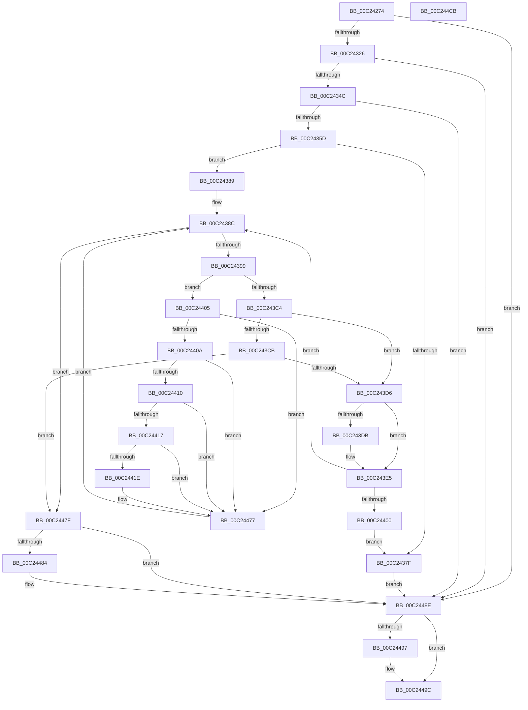

# HalpInitChipHacks

- RVA: `0x00C24274`–`0x00C244CC` (길이 `600` bytes)
- VA: `0x0000000140C24274`
- 실행 섹션: `INIT`
- PDB 이름 있음: `예`; PDB Function 태그: `아니요`
- unwind 정보 RVA: `0x000C4C20`
- 디코드: `150`개 명령, `600/600` bytes 표시
- 미해석 바이트: `0` (있으면 어셈블리에 `.byte`로 보존)

> 이 문서는 커널 이미지의 기계어와 PDB 기호를 분석해 생성했습니다. 4번과 5번은 함수 원형과 자료형을 바이너리 사용 방식에서 추정한 C 해석이며 원본 소스 복구 결과는 아닙니다.

## 1. Dependencies

- 직접 호출 지점: **11**; 고유 호출 대상: **8**
- 직접 호출자로 확인된 함수: **1**
- RIP 상대 이미지 참조: **7**

### Outgoing calls
- `0x00C24317` → [ZwOpenKey](../../text/6A/ZwOpenKey_function_006AD310.md) (function, `0x006AD310`)
- `0x00C2433D` → [ZwQueryKey](../../text/6A/ZwQueryKey_function_006AD390.md) (function, `0x006AD390`)
- `0x00C2436E` → [ExAllocatePool2](../../poolcode/B8/ExAllocatePool2_function_00B820F0.md) (function, `0x00B820F0`)
- `0x00C243B9` → [ZwEnumerateValueKey](../../text/6A/ZwEnumerateValueKey_function_006AD330.md) (function, `0x006AD330`)
- `0x00C243E0` → [ExFreePoolWithTag](../../poolcode/B8/ExFreePoolWithTag_function_00B82870.md) (function, `0x00B82870`)
- `0x00C243F3` → [ExAllocatePool2](../../poolcode/B8/ExAllocatePool2_function_00B820F0.md) (function, `0x00B820F0`)
- `0x00C2443E` → [wcstoul](../../text/50/wcstoul_function_005024A0.md) (function, `0x005024A0`)
- `0x00C24462` → [wcstoul](../../text/50/wcstoul_function_005024A0.md) (function, `0x005024A0`)
- `0x00C24489` → [ExFreePoolWithTag](../../poolcode/B8/ExFreePoolWithTag_function_00B82870.md) (function, `0x00B82870`)
- `0x00C24497` → [ZwClose](../../text/6A/ZwClose_function_006AD2B0.md) (function, `0x006AD2B0`)
- `0x00C244A5` → [_security_check_cookie](../../text/6A/_security_check_cookie_function_006AC640.md) (function, `0x006AC640`)

### Direct callers
- [HalpErrataInitSystem](../../pagelk/B5/HalpErrataInitSystem_function_00B5D310.md) at `0x00B5D331`

### Static image references
- `0x00C24297` → RVA `0x00E0A740` (`.data`; read)
- `0x00C242B7` → RVA `0x00024FE0` (`.rdata`; read)
- `0x00C242F0` → RVA `0x00E1179C` (`.data`; write)
- `0x00C2434F` → RVA `0x00E11798` (`.data`; write)
- `0x00C24373` → RVA `0x00E117A0` (`.data`; write)
- `0x00C2438C` → RVA `0x00E11798` (`.data`; read)
- `0x00C24443` → RVA `0x00E117A0` (`.data`; read)

## 2. Other-region calls and transfers

- 다른 실행 섹션으로 향하는 call: **11**
  - `0x00C24317` → [ZwOpenKey](../../text/6A/ZwOpenKey_function_006AD310.md) (`INIT` → `.text`)
  - `0x00C2433D` → [ZwQueryKey](../../text/6A/ZwQueryKey_function_006AD390.md) (`INIT` → `.text`)
  - `0x00C2436E` → [ExAllocatePool2](../../poolcode/B8/ExAllocatePool2_function_00B820F0.md) (`INIT` → `POOLCODE`)
  - `0x00C243B9` → [ZwEnumerateValueKey](../../text/6A/ZwEnumerateValueKey_function_006AD330.md) (`INIT` → `.text`)
  - `0x00C243E0` → [ExFreePoolWithTag](../../poolcode/B8/ExFreePoolWithTag_function_00B82870.md) (`INIT` → `POOLCODE`)
  - `0x00C243F3` → [ExAllocatePool2](../../poolcode/B8/ExAllocatePool2_function_00B820F0.md) (`INIT` → `POOLCODE`)
  - `0x00C2443E` → [wcstoul](../../text/50/wcstoul_function_005024A0.md) (`INIT` → `.text`)
  - `0x00C24462` → [wcstoul](../../text/50/wcstoul_function_005024A0.md) (`INIT` → `.text`)
  - `0x00C24489` → [ExFreePoolWithTag](../../poolcode/B8/ExFreePoolWithTag_function_00B82870.md) (`INIT` → `POOLCODE`)
  - `0x00C24497` → [ZwClose](../../text/6A/ZwClose_function_006AD2B0.md) (`INIT` → `.text`)
  - `0x00C244A5` → [_security_check_cookie](../../text/6A/_security_check_cookie_function_006AC640.md) (`INIT` → `.text`)
- 별도 외부 분기/꼬리 이동을 확인하지 못했습니다.

## 3. Assembly (complete function range)

```asm
00C24274  48 8B C4                        mov rax, rsp
00C24277  48 89 58 08                     mov qword ptr [rax + 8], rbx
00C2427B  48 89 70 10                     mov qword ptr [rax + 0x10], rsi
00C2427F  48 89 78 18                     mov qword ptr [rax + 0x18], rdi
00C24283  4C 89 60 20                     mov qword ptr [rax + 0x20], r12
00C24287  55                              push rbp
00C24288  41 56                           push r14
00C2428A  41 57                           push r15
00C2428C  48 8D 68 A1                     lea rbp, [rax - 0x5f]
00C24290  48 81 EC E0 00 00 00            sub rsp, 0xe0
00C24297  48 8B 05 A2 64 1E 00            mov rax, qword ptr [rip + 0x1e64a2]
00C2429E  48 33 C4                        xor rax, rsp
00C242A1  48 89 45 3F                     mov qword ptr [rbp + 0x3f], rax
00C242A5  45 33 E4                        xor r12d, r12d
00C242A8  48 C7 45 C7 30 00 00 00         mov qword ptr [rbp - 0x39], 0x30
00C242B0  0F 57 C0                        xorps xmm0, xmm0
00C242B3  44 89 65 A7                     mov dword ptr [rbp - 0x59], r12d
00C242B7  48 8D 05 22 0D 40 FF            lea rax, [rip - 0xbff2de]
00C242BE  4C 89 65 AF                     mov qword ptr [rbp - 0x51], r12
00C242C2  48 89 45 BF                     mov qword ptr [rbp - 0x41], rax
00C242C6  4C 8D 45 C7                     lea r8, [rbp - 0x39]
00C242CA  48 8D 45 B7                     lea rax, [rbp - 0x49]
00C242CE  48 C7 45 DF 40 00 00 00         mov qword ptr [rbp - 0x21], 0x40
00C242D6  BA 19 00 02 00                  mov edx, 0x20019
00C242DB  48 89 45 D7                     mov qword ptr [rbp - 0x29], rax
00C242DF  48 8D 4D 9F                     lea rcx, [rbp - 0x61]
00C242E3  48 C7 45 B7 6C 00 6E 00         mov qword ptr [rbp - 0x49], 0x6e006c
00C242EB  41 8D 5C 24 30                  lea ebx, [r12 + 0x30]
00C242F0  C6 05 A5 D4 1E 00 01            mov byte ptr [rip + 0x1ed4a5], 1
00C242F7  0F 11 45 F7                     movups xmmword ptr [rbp - 9], xmm0
00C242FB  4C 89 65 9F                     mov qword ptr [rbp - 0x61], r12
00C242FF  45 8B F4                        mov r14d, r12d
00C24302  0F 11 45 07                     movups xmmword ptr [rbp + 7], xmm0
00C24306  44 89 65 97                     mov dword ptr [rbp - 0x69], r12d
00C2430A  0F 11 45 17                     movups xmmword ptr [rbp + 0x17], xmm0
00C2430E  4C 89 65 CF                     mov qword ptr [rbp - 0x31], r12
00C24312  F3 0F 7F 45 E7                  movdqu xmmword ptr [rbp - 0x19], xmm0
00C24317  E8 F4 8F A8 FF                  call 0x1406ad310
00C2431C  8B F0                           mov esi, eax
00C2431E  85 C0                           test eax, eax
00C24320  0F 88 68 01 00 00               js 0x140c2448e
00C24326  48 8B 4D 9F                     mov rcx, qword ptr [rbp - 0x61]
00C2432A  48 8D 45 A7                     lea rax, [rbp - 0x59]
00C2432E  44 8B CB                        mov r9d, ebx
00C24331  48 89 44 24 20                  mov qword ptr [rsp + 0x20], rax
00C24336  4C 8D 45 F7                     lea r8, [rbp - 9]
00C2433A  8D 53 D2                        lea edx, [rbx - 0x2e]
00C2433D  E8 4E 90 A8 FF                  call 0x1406ad390
00C24342  8B F0                           mov esi, eax
00C24344  85 C0                           test eax, eax
00C24346  0F 88 42 01 00 00               js 0x140c2448e
00C2434C  8B 45 17                        mov eax, dword ptr [rbp + 0x17]
00C2434F  89 05 43 D4 1E 00               mov dword ptr [rip + 0x1ed443], eax
00C24355  85 C0                           test eax, eax
00C24357  0F 84 31 01 00 00               je 0x140c2448e
00C2435D  8B D0                           mov edx, eax
00C2435F  B9 00 01 00 00                  mov ecx, 0x100
00C24364  48 C1 E2 03                     shl rdx, 3
00C24368  41 B8 48 61 6C 45               mov r8d, 0x456c6148
00C2436E  E8 7D DD F5 FF                  call 0x140b820f0
00C24373  48 89 05 26 D4 1E 00            mov qword ptr [rip + 0x1ed426], rax
00C2437A  48 85 C0                        test rax, rax
00C2437D  75 0A                           jne 0x140c24389
00C2437F  BE 9A 00 00 C0                  mov esi, 0xc000009a
00C24384  E9 05 01 00 00                  jmp 0x140c2448e
00C24389  45 8B FC                        mov r15d, r12d
00C2438C  44 3B 3D 05 D4 1E 00            cmp r15d, dword ptr [rip + 0x1ed405]
00C24393  0F 83 E6 00 00 00               jae 0x140c2447f
00C24399  48 8B 4D 9F                     mov rcx, qword ptr [rbp - 0x61]
00C2439D  48 8D 45 97                     lea rax, [rbp - 0x69]
00C243A1  48 89 44 24 28                  mov qword ptr [rsp + 0x28], rax
00C243A6  4D 8B CE                        mov r9, r14
00C243A9  8B 45 97                        mov eax, dword ptr [rbp - 0x69]
00C243AC  41 B8 01 00 00 00               mov r8d, 1
00C243B2  41 8B D7                        mov edx, r15d
00C243B5  89 44 24 20                     mov dword ptr [rsp + 0x20], eax
00C243B9  E8 72 8F A8 FF                  call 0x1406ad330
00C243BE  8B F0                           mov esi, eax
00C243C0  85 C0                           test eax, eax
00C243C2  79 41                           jns 0x140c24405
00C243C4  3D 05 00 00 80                  cmp eax, 0x80000005
00C243C9  74 0B                           je 0x140c243d6
00C243CB  3D 23 00 00 C0                  cmp eax, 0xc0000023
00C243D0  0F 85 A9 00 00 00               jne 0x140c2447f
00C243D6  4D 85 F6                        test r14, r14
00C243D9  74 0A                           je 0x140c243e5
00C243DB  33 D2                           xor edx, edx
00C243DD  49 8B CE                        mov rcx, r14
00C243E0  E8 8B E4 F5 FF                  call 0x140b82870
00C243E5  8B 55 97                        mov edx, dword ptr [rbp - 0x69]
00C243E8  B9 00 01 00 00                  mov ecx, 0x100
00C243ED  41 B8 48 61 6C 45               mov r8d, 0x456c6148
00C243F3  E8 F8 DC F5 FF                  call 0x140b820f0
00C243F8  4C 8B F0                        mov r14, rax
00C243FB  48 85 C0                        test rax, rax
00C243FE  75 8C                           jne 0x140c2438c
00C24400  E9 7A FF FF FF                  jmp 0x140c2437f
00C24405  4D 85 F6                        test r14, r14
00C24408  74 6D                           je 0x140c24477
00C2440A  83 7D 97 14                     cmp dword ptr [rbp - 0x69], 0x14
00C2440E  72 67                           jb 0x140c24477
00C24410  41 83 7E 0C 04                  cmp dword ptr [r14 + 0xc], 4
00C24415  75 60                           jne 0x140c24477
00C24417  41 83 7E 10 10                  cmp dword ptr [r14 + 0x10], 0x10
00C2441C  72 59                           jb 0x140c24477
00C2441E  41 0F 10 46 14                  movups xmm0, xmmword ptr [r14 + 0x14]
00C24423  41 B8 10 00 00 00               mov r8d, 0x10
00C24429  66 44 89 65 37                  mov word ptr [rbp + 0x37], r12w
00C2442E  48 8D 55 AF                     lea rdx, [rbp - 0x51]
00C24432  41 8B FF                        mov edi, r15d
00C24435  48 8D 4D 2F                     lea rcx, [rbp + 0x2f]
00C24439  F3 0F 7F 45 27                  movdqu xmmword ptr [rbp + 0x27], xmm0
00C2443E  E8 5D E0 8D FF                  call 0x1405024a0
00C24443  48 8B 1D 56 D3 1E 00            mov rbx, qword ptr [rip + 0x1ed356]
00C2444A  48 8D 55 AF                     lea rdx, [rbp - 0x51]
00C2444E  41 B8 10 00 00 00               mov r8d, 0x10
00C24454  48 8D 4D 27                     lea rcx, [rbp + 0x27]
00C24458  66 89 44 FB 02                  mov word ptr [rbx + rdi*8 + 2], ax
00C2445D  66 44 89 65 2F                  mov word ptr [rbp + 0x2f], r12w
00C24462  E8 39 E0 8D FF                  call 0x1405024a0
00C24467  66 89 04 FB                     mov word ptr [rbx + rdi*8], ax
00C2446B  41 8B 46 08                     mov eax, dword ptr [r14 + 8]
00C2446F  42 8B 0C 30                     mov ecx, dword ptr [rax + r14]
00C24473  89 4C FB 04                     mov dword ptr [rbx + rdi*8 + 4], ecx
00C24477  41 FF C7                        inc r15d
00C2447A  E9 0D FF FF FF                  jmp 0x140c2438c
00C2447F  4D 85 F6                        test r14, r14
00C24482  74 0A                           je 0x140c2448e
00C24484  33 D2                           xor edx, edx
00C24486  49 8B CE                        mov rcx, r14
00C24489  E8 E2 E3 F5 FF                  call 0x140b82870
00C2448E  48 8B 4D 9F                     mov rcx, qword ptr [rbp - 0x61]
00C24492  48 85 C9                        test rcx, rcx
00C24495  74 05                           je 0x140c2449c
00C24497  E8 14 8E A8 FF                  call 0x1406ad2b0
00C2449C  8B C6                           mov eax, esi
00C2449E  48 8B 4D 3F                     mov rcx, qword ptr [rbp + 0x3f]
00C244A2  48 33 CC                        xor rcx, rsp
00C244A5  E8 96 81 A8 FF                  call 0x1406ac640
00C244AA  4C 8D 9C 24 E0 00 00 00         lea r11, [rsp + 0xe0]
00C244B2  49 8B 5B 20                     mov rbx, qword ptr [r11 + 0x20]
00C244B6  49 8B 73 28                     mov rsi, qword ptr [r11 + 0x28]
00C244BA  49 8B 7B 30                     mov rdi, qword ptr [r11 + 0x30]
00C244BE  4D 8B 63 38                     mov r12, qword ptr [r11 + 0x38]
00C244C2  49 8B E3                        mov rsp, r11
00C244C5  41 5F                           pop r15
00C244C7  41 5E                           pop r14
00C244C9  5D                              pop rbp
00C244CA  C3                              ret
00C244CB  CC                              int3
```

## 4. C-style interpretation (structured pseudocode)

```c
__int64 __fastcall HalpInitChipHacks(void)
{
    __int64 result;
    __int64 v_r12;
    __int64 v_r15;
    __int64 v_rbx;
    __int64 v_rdi;
    __int64 v_rsp;
    unsigned __int64 v_stack_m18;
    unsigned __int64 v_stack_mD0;
    unsigned __int64 v_stack_mD8;

    *(unsigned __int64 *)(v_rsp + 8) = v_rbx;
    *(unsigned __int64 *)(v_rsp + 16) = v_rsi;
    *(unsigned __int64 *)(v_rsp + 24) = v_rdi;
    *(unsigned __int64 *)(v_rsp + 32) = v_r12;
    v_rsp = (v_rsp) - (224);
    result = (*(unsigned __int64 *)(v_rip + 1991842)) ^ (v_rsp);
    *(unsigned __int64 *)(v_rsp - 95 + 63) = result;
    v_r12 = 0;
    *(unsigned __int64 *)(v_rsp - 95 - 57) = 48;
    *(unsigned int *)(v_rsp - 95 - 89) = 0;
    *(unsigned __int64 *)(v_rsp - 95 - 81) = 0;
    *(unsigned __int64 *)(v_rsp - 95 - 65) = v_rip - 12579550;
    *(unsigned __int64 *)(v_rsp - 95 - 33) = 64;
    *(unsigned __int64 *)(v_rsp - 95 - 41) = v_rsp - 95 - 73;
    *(unsigned __int64 *)(v_rsp - 95 - 73) = 0x6E006CULL;
    *(unsigned __int8 *)(v_rip + 2020517) = 1;
    *(unsigned __int64 *)(v_rsp - 95 - 9) = v_xmm0;
    *(unsigned __int64 *)(v_rsp - 95 - 97) = 0;
    *(unsigned __int64 *)(v_rsp - 95 + 7) = v_xmm0;
    *(unsigned int *)(v_rsp - 95 - 105) = 0;
    *(unsigned __int64 *)(v_rsp - 95 + 23) = v_xmm0;
    *(unsigned __int64 *)(v_rsp - 95 - 49) = 0;
    *(unsigned __int64 *)(v_rsp - 95 - 25) = v_xmm0;
    result = ZwOpenKey(v_rsp - 95 - 97, (unsigned int)(0x20019ULL), v_rsp - 95 - 57, a4);
    if (sign_flag) goto loc_00C2448E;
    v_stack_mD8 = v_rsp - 95 - 89;
    result = ZwQueryKey(*(unsigned __int64 *)(v_rsp - 95 - 97), v_r12 + 48 - 46, v_rsp - 95 - 9, (unsigned int)((unsigned int)(v_r12 + 48)));
    if (sign_flag) goto loc_00C2448E;
    *(unsigned int *)(v_rip + 2020419) = (unsigned int)((unsigned int)(*(unsigned int *)(v_rsp - 95 + 23)));
    if ((unsigned int)((unsigned int)(*(unsigned int *)(v_rsp - 95 + 23))) == 0) goto loc_00C2448E;
    a2 = ((unsigned int)((unsigned int)((unsigned int)(*(unsigned int *)(v_rsp - 95 + 23))))) << (3);
    result = ExAllocatePool2(256, a2, (unsigned int)(0x456C6148ULL), (unsigned int)((unsigned int)(v_r12 + 48)));
    *(unsigned __int64 *)(v_rip + 2020390) = result;
    if (result != 0) goto loc_00C24389;
loc_00C2437F:
    goto loc_00C2448E;
loc_00C24389:
loc_00C2438C:
    if (0 >= (*(unsigned int *)(v_rip + 2020357))) goto loc_00C2447F;
    v_stack_mD0 = v_rsp - 95 - 105;
    v_stack_mD8 = (unsigned int)((unsigned int)(*(unsigned int *)(v_rsp - 95 - 105)));
    result = ZwEnumerateValueKey(*(unsigned __int64 *)(v_rsp - 95 - 97), 0, 1, 0);
    if (!sign_flag) goto loc_00C24405;
    if (((unsigned int)(result)) == 0x80000005ULL) goto loc_00C243D6;
    if (((unsigned int)(result)) != 0xC0000023ULL) goto loc_00C2447F;
loc_00C243D6:
    if (0 != 0) {
        a2 = 0;
        a1 = 0;
        result = ExFreePoolWithTag(a1, a2, 1, 0);
    }
    result = ExAllocatePool2(256, (unsigned int)(*(unsigned int *)(v_rsp - 95 - 105)), (unsigned int)(0x456C6148ULL), 0);
    if (result != 0) goto loc_00C2438C;
    goto loc_00C2437F;
loc_00C24405:
    if (result == 0) goto loc_00C24477;
    if ((*(unsigned int *)(v_rsp - 95 - 105)) < 20) goto loc_00C24477;
    if ((*(unsigned int *)(result + 12)) != 4) goto loc_00C24477;
    v_rbx = v_r12 + 48;
    if ((*(unsigned int *)(result + 16)) >= 16) {
        a3 = 16;
        *(unsigned __int16 *)(v_rsp - 95 + 55) = 0;
        a2 = v_rsp - 95 - 81;
        v_rdi = 0;
        a1 = v_rsp - 95 + 47;
        *(unsigned __int64 *)(v_rsp - 95 + 39) = v_xmm0;
        result = wcstoul(a1, a2, a3, 0);
        v_rbx = *(unsigned __int64 *)(v_rip + 2020182);
        a2 = v_rsp - 95 - 81;
        a3 = 16;
        a1 = v_rsp - 95 + 39;
        *(unsigned __int16 *)(v_rbx + v_rdi * 8 + 2) = (unsigned __int16)(result);
        *(unsigned __int16 *)(v_rsp - 95 + 47) = 0;
        result = wcstoul(a1, a2, a3, 0);
        *(unsigned __int16 *)(v_rbx + v_rdi * 8) = (unsigned __int16)(result);
        result = *(unsigned int *)(result + 8);
        a1 = *(unsigned int *)(result + result * 1);
        *(unsigned int *)(v_rbx + v_rdi * 8 + 4) = (unsigned int)(a1);
    }
    v_r15 = (unsigned int)((0) + 1);
    goto loc_00C2438C;
loc_00C2447F:
    if (result != 0) {
        a2 = 0;
        a1 = result;
        result = ExFreePoolWithTag(a1, a2, a3, 0);
    }
    if (*(unsigned __int64 *)(v_rsp - 95 - 97) != 0) {
        result = ZwClose(*(unsigned __int64 *)(v_rsp - 95 - 97), a2, a3, 0);
    }
    a1 = (*(unsigned __int64 *)(v_rsp - 95 + 63)) ^ (v_rsp);
    result = _security_check_cookie(a1, a2, a3, 0);
    return result;
}
```

## 5. (Beta) C Style

```c
void HalpInitChipHacks(void)
{
    int64_t result;
    int64_t local_r12;
    int64_t local_r15;
    int64_t local_rbx;
    int64_t local_rdi;
    int64_t local_rsp;
    uint64_t v_stack_m18;
    uint64_t v_stack_mD0;
    uint64_t v_stack_mD8;

    *(uint64_t *)(local_rsp + 0x8) = local_rbx;
    *(uint64_t *)(local_rsp + 0x10) = local_rsi;
    *(uint64_t *)(local_rsp + 0x18) = local_rdi;
    *(uint64_t *)(local_rsp + 0x20) = local_r12;
    local_rsp = (local_rsp) - (224);
    result = (*(uint64_t *)(v_rip + 0x1E64A2)) ^ (local_rsp);
    *(uint64_t *)(local_rsp - 0x5F + 0x3F) = result;
    local_r12 = 0;
    *(uint64_t *)(local_rsp - 0x5F - 0x39) = 48;
    *(uint32_t *)(local_rsp - 0x5F - 0x59) = 0;
    *(uint64_t *)(local_rsp - 0x5F - 0x51) = 0;
    *(uint64_t *)(local_rsp - 0x5F - 0x41) = v_rip - 12579550;
    *(uint64_t *)(local_rsp - 0x5F - 0x21) = 64;
    *(uint64_t *)(local_rsp - 0x5F - 0x29) = local_rsp - 95 - 73;
    *(uint64_t *)(local_rsp - 0x5F - 0x49) = 0x6E006CULL;
    *(uint8_t *)(v_rip + 0x1ED4A5) = 1;
    *(uint64_t *)(local_rsp - 0x5F - 0x9) = v_xmm0;
    *(uint64_t *)(local_rsp - 0x5F - 0x61) = 0;
    *(uint64_t *)(local_rsp - 0x5F + 0x7) = v_xmm0;
    *(uint32_t *)(local_rsp - 0x5F - 0x69) = 0;
    *(uint64_t *)(local_rsp - 0x5F + 0x17) = v_xmm0;
    *(uint64_t *)(local_rsp - 0x5F - 0x31) = 0;
    *(uint64_t *)(local_rsp - 0x5F - 0x19) = v_xmm0;
    result = ZwOpenKey(local_rsp - 95 - 97, (uint32_t)(0x20019ULL), local_rsp - 95 - 57, a4);
    if (sign_flag) goto loc_00C2448E;
    v_stack_mD8 = local_rsp - 95 - 89;
    result = ZwQueryKey(*(uint64_t *)(local_rsp - 0x5F - 0x61), local_r12 + 48 - 46, local_rsp - 95 - 9, (uint32_t)((uint32_t)(local_r12 + 48)));
    if (sign_flag) goto loc_00C2448E;
    *(uint32_t *)(v_rip + 0x1ED443) = (uint32_t)((uint32_t)(*(uint32_t *)(local_rsp - 0x5F + 0x17)));
    if ((uint32_t)((uint32_t)(*(uint32_t *)(local_rsp - 0x5F + 0x17))) == 0) goto loc_00C2448E;
    a2 = ((uint32_t)((uint32_t)((uint32_t)(*(uint32_t *)(local_rsp - 0x5F + 0x17))))) << (3);
    result = ExAllocatePool2(256, a2, (uint32_t)(0x456C6148ULL), (uint32_t)((uint32_t)(local_r12 + 48)));
    *(uint64_t *)(v_rip + 0x1ED426) = result;
    if (result != 0) goto loc_00C24389;
loc_00C2437F:
    goto loc_00C2448E;
loc_00C24389:
loc_00C2438C:
    if (0 >= (*(uint32_t *)(v_rip + 0x1ED405))) goto loc_00C2447F;
    v_stack_mD0 = local_rsp - 95 - 105;
    v_stack_mD8 = (uint32_t)((uint32_t)(*(uint32_t *)(local_rsp - 0x5F - 0x69)));
    result = ZwEnumerateValueKey(*(uint64_t *)(local_rsp - 0x5F - 0x61), 0, 1, 0);
    if (!sign_flag) goto loc_00C24405;
    if (((uint32_t)(result)) == 0x80000005ULL) goto loc_00C243D6;
    if (((uint32_t)(result)) != 0xC0000023ULL) goto loc_00C2447F;
loc_00C243D6:
    if (0 != 0) {
        a2 = 0;
        a1 = 0;
        result = ExFreePoolWithTag(a1, a2, 1, 0);
    }
    result = ExAllocatePool2(256, (uint32_t)(*(uint32_t *)(local_rsp - 0x5F - 0x69)), (uint32_t)(0x456C6148ULL), 0);
    if (result != 0) goto loc_00C2438C;
    goto loc_00C2437F;
loc_00C24405:
    if (result == 0) goto loc_00C24477;
    if ((*(uint32_t *)(local_rsp - 0x5F - 0x69)) < 20) goto loc_00C24477;
    if ((*(uint32_t *)(result + 0xC)) != 4) goto loc_00C24477;
    local_rbx = local_r12 + 48;
    if ((*(uint32_t *)(result + 0x10)) >= 16) {
        a3 = 16;
        *(uint16_t *)(local_rsp - 0x5F + 0x37) = 0;
        a2 = local_rsp - 95 - 81;
        local_rdi = 0;
        a1 = local_rsp - 95 + 47;
        *(uint64_t *)(local_rsp - 0x5F + 0x27) = v_xmm0;
        result = wcstoul(a1, a2, a3, 0);
        local_rbx = *(uint64_t *)(v_rip + 0x1ED356);
        a2 = local_rsp - 95 - 81;
        a3 = 16;
        a1 = local_rsp - 95 + 39;
        *(uint16_t *)(local_rbx + local_rdi * 8 + 0x2) = (uint16_t)(result);
        *(uint16_t *)(local_rsp - 0x5F + 0x2F) = 0;
        result = wcstoul(a1, a2, a3, 0);
        *(uint16_t *)(local_rbx + local_rdi * 8) = (uint16_t)(result);
        result = *(uint32_t *)(result + 0x8);
        a1 = *(uint32_t *)(result + result * 1);
        *(uint32_t *)(local_rbx + local_rdi * 8 + 0x4) = (uint32_t)(a1);
    }
    local_r15 = (uint32_t)((0) + 1);
    goto loc_00C2438C;
loc_00C2447F:
    if (result != 0) {
        a2 = 0;
        a1 = result;
        result = ExFreePoolWithTag(a1, a2, a3, 0);
    }
    if (*(uint64_t *)(local_rsp - 0x5F - 0x61) != 0) {
        result = ZwClose(*(uint64_t *)(local_rsp - 0x5F - 0x61), a2, a3, 0);
    }
    a1 = (*(uint64_t *)(local_rsp - 0x5F + 0x3F)) ^ (local_rsp);
    result = _security_check_cookie(a1, a2, a3, 0);
    return result;
}
```

## 6. Execution-region graph

[열기: 2D/3D 그래프와 함수 탐색 컨트롤 패널](../../../control-panel.html?section=init&rva=0x00C24274&view=graph)

- 2D 그래프는 위에서 아래로 흐르고, 3D 그래프는 빈 공간을 드래그해 회전합니다. Shift+드래그는 이동, 휠은 확대·축소, 함수 노드 선택은 대상 보고서 이동입니다.

### Static fallback


