# HalpInitializeConfigurationFromMadt

- RVA: `0x00C21D54`–`0x00C2201D` (길이 `713` bytes)
- VA: `0x0000000140C21D54`
- 실행 섹션: `INIT`
- PDB 이름 있음: `예`; PDB Function 태그: `아니요`
- unwind 정보 RVA: `0x0005FEF8`
- 디코드: `216`개 명령, `713/713` bytes 표시
- 미해석 바이트: `0` (있으면 어셈블리에 `.byte`로 보존)

> 이 문서는 커널 이미지의 기계어와 PDB 기호를 분석해 생성했습니다. 4번과 5번은 함수 원형과 자료형을 바이너리 사용 방식에서 추정한 C 해석이며 원본 소스 복구 결과는 아닙니다.

## 1. Dependencies

- 직접 호출 지점: **6**; 고유 호출 대상: **5**
- 직접 호출자로 확인된 함수: **1**
- RIP 상대 이미지 참조: **3**

### Outgoing calls
- `0x00C21D82` → [HalpAcpiGetTable](../../text/3F/HalpAcpiGetTable_function_003F6BF8.md) (function, `0x003F6BF8`)
- `0x00C21E27` → [HalpParseChannelCount](../../text/56/HalpParseChannelCount_function_005694B0.md) (function, `0x005694B0`)
- `0x00C21E36` → [HalpAllocateNumaConfigData](HalpAllocateNumaConfigData_function_00C2190C.md) (function, `0x00C2190C`)
- `0x00C21ED4` → [memset](../../text/6C/memset_function_006C6C40.md) (function, `0x006C6C40`)
- `0x00C21EE6` → [memset](../../text/6C/memset_function_006C6C40.md) (function, `0x006C6C40`)
- `0x00C21FF8` → [HalpChannelInitializeStaticConfiguration](HalpChannelInitializeStaticConfiguration_function_00C25318.md) (function, `0x00C25318`)

### Direct callers
- [HalpNumaInitializeStaticConfiguration](HalpNumaInitializeStaticConfiguration_function_00C220D8.md) at `0x00C22166`

### Static image references
- `0x00C21DF9` → RVA `0x00E10462` (`.data`; read)
- `0x00C21E07` → RVA `0x00E0A81C` (`.data`; read)
- `0x00C21E3B` → RVA `0x00F90658` (`.data`; read)

## 2. Other-region calls and transfers

- 다른 실행 섹션으로 향하는 call: **4**
  - `0x00C21D82` → [HalpAcpiGetTable](../../text/3F/HalpAcpiGetTable_function_003F6BF8.md) (`INIT` → `.text`)
  - `0x00C21E27` → [HalpParseChannelCount](../../text/56/HalpParseChannelCount_function_005694B0.md) (`INIT` → `.text`)
  - `0x00C21ED4` → [memset](../../text/6C/memset_function_006C6C40.md) (`INIT` → `.text`)
  - `0x00C21EE6` → [memset](../../text/6C/memset_function_006C6C40.md) (`INIT` → `.text`)
- 별도 외부 분기/꼬리 이동을 확인하지 못했습니다.

## 3. Assembly (complete function range)

```asm
00C21D54  48 8B C4                        mov rax, rsp
00C21D57  48 89 58 08                     mov qword ptr [rax + 8], rbx
00C21D5B  48 89 68 10                     mov qword ptr [rax + 0x10], rbp
00C21D5F  48 89 70 18                     mov qword ptr [rax + 0x18], rsi
00C21D63  48 89 78 20                     mov qword ptr [rax + 0x20], rdi
00C21D67  41 54                           push r12
00C21D69  41 56                           push r14
00C21D6B  41 57                           push r15
00C21D6D  48 83 EC 20                     sub rsp, 0x20
00C21D71  45 33 FF                        xor r15d, r15d
00C21D74  45 33 C9                        xor r9d, r9d
00C21D77  45 33 C0                        xor r8d, r8d
00C21D7A  BA 41 50 49 43                  mov edx, 0x43495041
00C21D7F  41 8B FF                        mov edi, r15d
00C21D82  E8 71 4E 7D FF                  call 0x1403f6bf8
00C21D87  48 85 C0                        test rax, rax
00C21D8A  0F 84 6D 02 00 00               je 0x140c21ffd
00C21D90  44 8B 40 04                     mov r8d, dword ptr [rax + 4]
00C21D94  48 8D 48 2C                     lea rcx, [rax + 0x2c]
00C21D98  4C 03 C0                        add r8, rax
00C21D9B  45 8D 67 01                     lea r12d, [r15 + 1]
00C21D9F  48 8D 41 02                     lea rax, [rcx + 2]
00C21DA3  BE 00 08 00 00                  mov esi, 0x800
00C21DA8  49 3B C0                        cmp rax, r8
00C21DAB  77 4C                           ja 0x140c21df9
00C21DAD  0F B6 51 01                     movzx edx, byte ptr [rcx + 1]
00C21DB1  80 FA 02                        cmp dl, 2
00C21DB4  72 3E                           jb 0x140c21df4
00C21DB6  4C 8D 0C 11                     lea r9, [rcx + rdx]
00C21DBA  4D 3B C8                        cmp r9, r8
00C21DBD  77 35                           ja 0x140c21df4
00C21DBF  48 8B C1                        mov rax, rcx
00C21DC2  49 8B C9                        mov rcx, r9
00C21DC5  44 8A 08                        mov r9b, byte ptr [rax]
00C21DC8  45 84 C9                        test r9b, r9b
00C21DCB  75 05                           jne 0x140c21dd2
00C21DCD  80 FA 08                        cmp dl, 8
00C21DD0  74 16                           je 0x140c21de8
00C21DD2  41 80 F9 09                     cmp r9b, 9
00C21DD6  75 05                           jne 0x140c21ddd
00C21DD8  80 FA 10                        cmp dl, 0x10
00C21DDB  74 0B                           je 0x140c21de8
00C21DDD  41 80 F9 0B                     cmp r9b, 0xb
00C21DE1  75 08                           jne 0x140c21deb
00C21DE3  80 FA 28                        cmp dl, 0x28
00C21DE6  72 03                           jb 0x140c21deb
00C21DE8  41 03 FC                        add edi, r12d
00C21DEB  48 8D 41 02                     lea rax, [rcx + 2]
00C21DEF  49 3B C0                        cmp rax, r8
00C21DF2  76 B9                           jbe 0x140c21dad
00C21DF4  3B FE                           cmp edi, esi
00C21DF6  0F 47 FE                        cmova edi, esi
00C21DF9  44 38 3D 62 E6 1E 00            cmp byte ptr [rip + 0x1ee662], r15b
00C21E00  75 05                           jne 0x140c21e07
00C21E02  41 8B DC                        mov ebx, r12d
00C21E05  EB 20                           jmp 0x140c21e27
00C21E07  8B 35 0F 8A 1E 00               mov esi, dword ptr [rip + 0x1e8a0f]
00C21E0D  33 D2                           xor edx, edx
00C21E0F  8D 46 FF                        lea eax, [rsi - 1]
00C21E12  03 C7                           add eax, edi
00C21E14  F7 F6                           div esi
00C21E16  8B D8                           mov ebx, eax
00C21E18  83 F8 40                        cmp eax, 0x40
00C21E1B  76 0A                           jbe 0x140c21e27
00C21E1D  8B FE                           mov edi, esi
00C21E1F  BB 40 00 00 00                  mov ebx, 0x40
00C21E24  C1 E7 06                        shl edi, 6
00C21E27  E8 84 76 94 FF                  call 0x1405694b0
00C21E2C  44 8B C8                        mov r9d, eax
00C21E2F  45 33 C0                        xor r8d, r8d
00C21E32  8B D7                           mov edx, edi
00C21E34  8B CB                           mov ecx, ebx
00C21E36  E8 D1 FA FF FF                  call 0x140c2190c
00C21E3B  48 8B 15 16 E8 36 00            mov rdx, qword ptr [rip + 0x36e816]
00C21E42  48 85 D2                        test rdx, rdx
00C21E45  0F 84 B2 01 00 00               je 0x140c21ffd
00C21E4B  89 7A 3C                        mov dword ptr [rdx + 0x3c], edi
00C21E4E  45 8B C7                        mov r8d, r15d
00C21E51  89 5A 38                        mov dword ptr [rdx + 0x38], ebx
00C21E54  85 FF                           test edi, edi
00C21E56  0F 84 C8 00 00 00               je 0x140c21f24
00C21E5C  83 FF 04                        cmp edi, 4
00C21E5F  0F 82 8D 00 00 00               jb 0x140c21ef2
00C21E65  4C 8B 12                        mov r10, qword ptr [rdx]
00C21E68  8D 47 FF                        lea eax, [rdi - 1]
00C21E6B  8B C8                           mov ecx, eax
00C21E6D  4C 8D 4A 08                     lea r9, [rdx + 8]
00C21E71  4D 8B 31                        mov r14, qword ptr [r9]
00C21E74  4D 8D 1C 8A                     lea r11, [r10 + rcx*4]
00C21E78  49 8D 04 86                     lea rax, [r14 + rax*4]
00C21E7C  4D 3B F3                        cmp r14, r11
00C21E7F  77 05                           ja 0x140c21e86
00C21E81  49 3B C2                        cmp rax, r10
00C21E84  73 6C                           jae 0x140c21ef2
00C21E86  4C 3B F2                        cmp r14, rdx
00C21E89  77 05                           ja 0x140c21e90
00C21E8B  48 3B C2                        cmp rax, rdx
00C21E8E  73 62                           jae 0x140c21ef2
00C21E90  4D 3B F1                        cmp r14, r9
00C21E93  77 05                           ja 0x140c21e9a
00C21E95  49 3B C1                        cmp rax, r9
00C21E98  73 58                           jae 0x140c21ef2
00C21E9A  4C 3B D2                        cmp r10, rdx
00C21E9D  77 05                           ja 0x140c21ea4
00C21E9F  4C 3B DA                        cmp r11, rdx
00C21EA2  73 4E                           jae 0x140c21ef2
00C21EA4  4D 3B D1                        cmp r10, r9
00C21EA7  77 05                           ja 0x140c21eae
00C21EA9  4D 3B D9                        cmp r11, r9
00C21EAC  73 44                           jae 0x140c21ef2
00C21EAE  8B C7                           mov eax, edi
00C21EB0  83 E0 FC                        and eax, 0xfffffffc
00C21EB3  41 83 C0 04                     add r8d, 4
00C21EB7  41 8B E8                        mov ebp, r8d
00C21EBA  44 3B C0                        cmp r8d, eax
00C21EBD  72 F4                           jb 0x140c21eb3
00C21EBF  48 8D 1C 85 00 00 00 00         lea rbx, [rax*4]
00C21EC7  83 CA FF                        or edx, 0xffffffff
00C21ECA  4C 8B C3                        mov r8, rbx
00C21ECD  49 8B CA                        mov rcx, r10
00C21ED0  49 83 E0 FC                     and r8, 0xfffffffffffffffc
00C21ED4  E8 67 4D AA FF                  call 0x1406c6c40
00C21ED9  48 83 E3 FC                     and rbx, 0xfffffffffffffffc
00C21EDD  83 CA FF                        or edx, 0xffffffff
00C21EE0  4C 8B C3                        mov r8, rbx
00C21EE3  49 8B CE                        mov rcx, r14
00C21EE6  E8 55 4D AA FF                  call 0x1406c6c40
00C21EEB  44 8B C5                        mov r8d, ebp
00C21EEE  3B EF                           cmp ebp, edi
00C21EF0  73 32                           jae 0x140c21f24
00C21EF2  48 8B 15 5F E7 36 00            mov rdx, qword ptr [rip + 0x36e75f]
00C21EF9  41 8B C0                        mov eax, r8d
00C21EFC  48 8D 0C 85 00 00 00 00         lea rcx, [rax*4]
00C21F04  8B C7                           mov eax, edi
00C21F06  41 2B C0                        sub eax, r8d
00C21F09  44 8B C0                        mov r8d, eax
00C21F0C  48 8B 02                        mov rax, qword ptr [rdx]
00C21F0F  83 0C 01 FF                     or dword ptr [rcx + rax], 0xffffffff
00C21F13  48 8B 42 08                     mov rax, qword ptr [rdx + 8]
00C21F17  83 0C 01 FF                     or dword ptr [rcx + rax], 0xffffffff
00C21F1B  48 8D 49 04                     lea rcx, [rcx + 4]
00C21F1F  4D 2B C4                        sub r8, r12
00C21F22  75 E8                           jne 0x140c21f0c
00C21F24  48 8B 15 2D E7 36 00            mov rdx, qword ptr [rip + 0x36e72d]
00C21F2B  45 0F B7 C7                     movzx r8d, r15w
00C21F2F  44 39 7A 38                     cmp dword ptr [rdx + 0x38], r15d
00C21F33  76 2C                           jbe 0x140c21f61
00C21F35  45 8B CF                        mov r9d, r15d
00C21F38  48 8B 42 18                     mov rax, qword ptr [rdx + 0x18]
00C21F3C  41 0F B7 C8                     movzx ecx, r8w
00C21F40  66 45 03 C4                     add r8w, r12w
00C21F44  44 89 0C 88                     mov dword ptr [rax + rcx*4], r9d
00C21F48  48 8B 42 20                     mov rax, qword ptr [rdx + 0x20]
00C21F4C  45 0F B7 C8                     movzx r9d, r8w
00C21F50  44 89 3C 88                     mov dword ptr [rax + rcx*4], r15d
00C21F54  48 8B 42 28                     mov rax, qword ptr [rdx + 0x28]
00C21F58  89 34 88                        mov dword ptr [rax + rcx*4], esi
00C21F5B  44 3B 4A 38                     cmp r9d, dword ptr [rdx + 0x38]
00C21F5F  72 D7                           jb 0x140c21f38
00C21F61  4C 8B 15 F0 E6 36 00            mov r10, qword ptr [rip + 0x36e6f0]
00C21F68  8B D7                           mov edx, edi
00C21F6A  41 0F B7 C8                     movzx ecx, r8w
00C21F6E  45 8B C7                        mov r8d, r15d
00C21F71  8D 41 FF                        lea eax, [rcx - 1]
00C21F74  0F AF C6                        imul eax, esi
00C21F77  2B D0                           sub edx, eax
00C21F79  49 8B 42 28                     mov rax, qword ptr [r10 + 0x28]
00C21F7D  89 54 88 FC                     mov dword ptr [rax + rcx*4 - 4], edx
00C21F81  85 FF                           test edi, edi
00C21F83  74 1E                           je 0x140c21fa3
00C21F85  4D 8B CF                        mov r9, r15
00C21F88  49 8B 4A 10                     mov rcx, qword ptr [r10 + 0x10]
00C21F8C  33 D2                           xor edx, edx
00C21F8E  41 8B C0                        mov eax, r8d
00C21F91  45 03 C4                        add r8d, r12d
00C21F94  F7 F6                           div esi
00C21F96  41 89 04 09                     mov dword ptr [r9 + rcx], eax
00C21F9A  4D 8D 49 04                     lea r9, [r9 + 4]
00C21F9E  44 3B C7                        cmp r8d, edi
00C21FA1  72 E5                           jb 0x140c21f88
00C21FA3  4C 8B 15 AE E6 36 00            mov r10, qword ptr [rip + 0x36e6ae]
00C21FAA  41 0F B7 D7                     movzx edx, r15w
00C21FAE  41 8B 42 38                     mov eax, dword ptr [r10 + 0x38]
00C21FB2  85 C0                           test eax, eax
00C21FB4  74 42                           je 0x140c21ff8
00C21FB6  45 8B CF                        mov r9d, r15d
00C21FB9  45 8B C7                        mov r8d, r15d
00C21FBC  8B C8                           mov ecx, eax
00C21FBE  85 C0                           test eax, eax
00C21FC0  74 27                           je 0x140c21fe9
00C21FC2  4C 8B 1D 8F E6 36 00            mov r11, qword ptr [rip + 0x36e68f]
00C21FC9  49 8B 43 30                     mov rax, qword ptr [r11 + 0x30]
00C21FCD  41 8B C9                        mov ecx, r9d
00C21FD0  41 0F AF 4B 40                  imul ecx, dword ptr [r11 + 0x40]
00C21FD5  41 03 C8                        add ecx, r8d
00C21FD8  45 03 C4                        add r8d, r12d
00C21FDB  66 44 89 3C 48                  mov word ptr [rax + rcx*2], r15w
00C21FE0  41 8B 4A 38                     mov ecx, dword ptr [r10 + 0x38]
00C21FE4  44 3B C1                        cmp r8d, ecx
00C21FE7  72 E0                           jb 0x140c21fc9
00C21FE9  66 41 03 D4                     add dx, r12w
00C21FED  8B C1                           mov eax, ecx
00C21FEF  44 0F B7 CA                     movzx r9d, dx
00C21FF3  44 3B C9                        cmp r9d, ecx
00C21FF6  72 C1                           jb 0x140c21fb9
00C21FF8  E8 1B 33 00 00                  call 0x140c25318
00C21FFD  48 8B 5C 24 40                  mov rbx, qword ptr [rsp + 0x40]
00C22002  48 8B 6C 24 48                  mov rbp, qword ptr [rsp + 0x48]
00C22007  48 8B 74 24 50                  mov rsi, qword ptr [rsp + 0x50]
00C2200C  48 8B 7C 24 58                  mov rdi, qword ptr [rsp + 0x58]
00C22011  48 83 C4 20                     add rsp, 0x20
00C22015  41 5F                           pop r15
00C22017  41 5E                           pop r14
00C22019  41 5C                           pop r12
00C2201B  C3                              ret
00C2201C  CC                              int3
```

## 4. C-style interpretation (structured pseudocode)

```c
__int64 __fastcall HalpInitializeConfigurationFromMadt(__int64 a1, __int64 a2, int a3, int a4)
{
    __int64 result;
    __int64 v_r15;
    __int64 v_rbx;
    __int64 v_rdi;
    __int64 v_rsp;
    unsigned __int64 v_stack_p10;
    unsigned __int64 v_stack_p18;
    unsigned __int64 v_stack_p20;
    unsigned __int64 v_stack_p8;

    *(unsigned __int64 *)(v_rsp + 8) = v_rbx;
    *(unsigned __int64 *)(v_rsp + 16) = v_rbp;
    *(unsigned __int64 *)(v_rsp + 24) = v_rsi;
    *(unsigned __int64 *)(v_rsp + 32) = v_rdi;
    v_rsp = (v_rsp) - (32);
    v_r15 = 0;
    a4 = 0;
    a3 = 0;
    result = HalpAcpiGetTable(a1, (unsigned int)(0x43495041ULL), a3, a4);
    if (result == 0) goto loc_00C21FFD;
    a3 = ((unsigned int)(*(unsigned int *)(result + 4))) + (result);
    if ((result + 44 + 2) > a3) goto loc_00C21DF9;
loc_00C21DAD:
    if (((unsigned __int8)(*(unsigned __int8 *)(result + 44 + 1))) < 2) goto loc_00C21DF4;
    if ((result + 44 + *(unsigned __int8 *)(result + 44 + 1) * 1) > a3) goto loc_00C21DF4;
    if ((unsigned __int8)(*(unsigned __int8 *)(result + 44)) != 0) goto loc_00C21DD2;
    if (((unsigned __int8)(*(unsigned __int8 *)(result + 44 + 1))) == 8) goto loc_00C21DE8;
loc_00C21DD2:
    if (((unsigned __int8)(*(unsigned __int8 *)(result + 44))) != 9) goto loc_00C21DDD;
    if (((unsigned __int8)(*(unsigned __int8 *)(result + 44 + 1))) == 16) goto loc_00C21DE8;
loc_00C21DDD:
    if (((unsigned __int8)(*(unsigned __int8 *)(result + 44))) != 11) goto loc_00C21DEB;
    v_rdi = 0;
    if (((unsigned __int8)(*(unsigned __int8 *)(result + 44 + 1))) >= 40) {
        v_rdi = (unsigned int)((0) + ((unsigned int)(v_r15 + 1)));
    }
    if ((result + 44 + *(unsigned __int8 *)(result + 44 + 1) * 1 + 2) <= a3) goto loc_00C21DAD;
loc_00C21DF4:
    if (((unsigned int)(v_rdi)) > ((unsigned int)((unsigned int)(0x800ULL)))) { v_rdi = (unsigned int)((unsigned int)(0x800ULL)); }
loc_00C21DF9:
    if ((*(unsigned __int8 *)(v_rip + 2025058)) != 0) goto loc_00C21E07;
    goto loc_00C21E27;
loc_00C21E07:
    a2 = 0;
    result = (unsigned int)(((unsigned int)(*(unsigned int *)(v_rip + 2001423)) - 1) + ((unsigned int)(v_rdi)));
    v_rbx = (unsigned int)((unsigned int)(result));
    if (((unsigned int)(result)) >= = 64) {
        v_rdi = (unsigned int)((unsigned int)(*(unsigned int *)(v_rip + 2001423)));
        v_rbx = 64;
        v_rdi = (unsigned int)((v_rdi) << (6));
    }
    result = HalpParseChannelCount(result + 44 + *(unsigned __int8 *)(result + 44 + 1) * 1, a2, a3, *(unsigned __int8 *)(result + 44));
    a3 = 0;
    result = HalpAllocateNumaConfigData((unsigned int)((unsigned int)(v_rbx)), (unsigned int)((unsigned int)(v_rdi)), a3, (unsigned int)((unsigned int)(result)));
    if (*(unsigned __int64 *)(v_rip + 3598358) == 0) goto loc_00C21FFD;
    *(unsigned int *)(*(unsigned __int64 *)(v_rip + 3598358) + 60) = (unsigned int)(v_rdi);
    *(unsigned int *)(*(unsigned __int64 *)(v_rip + 3598358) + 56) = (unsigned int)(v_rbx);
    if ((unsigned int)(v_rdi) == 0) goto loc_00C21F24;
    if (((unsigned int)(v_rdi)) < 4) goto loc_00C21EF2;
    if ((*(unsigned __int64 *)(*(unsigned __int64 *)(v_rip + 3598358) + 8)) > (*(unsigned __int64 *)(*(unsigned __int64 *)(v_rip + 3598358)) + (unsigned int)((unsigned int)(v_rdi - 1)) * 4)) goto loc_00C21E86;
    if ((*(unsigned __int64 *)(*(unsigned __int64 *)(v_rip + 3598358) + 8) + v_rdi - 1 * 4) >= (*(unsigned __int64 *)(*(unsigned __int64 *)(v_rip + 3598358)))) goto loc_00C21EF2;
loc_00C21E86:
    if ((*(unsigned __int64 *)(*(unsigned __int64 *)(v_rip + 3598358) + 8)) > (*(unsigned __int64 *)(v_rip + 3598358))) goto loc_00C21E90;
    if ((*(unsigned __int64 *)(*(unsigned __int64 *)(v_rip + 3598358) + 8) + v_rdi - 1 * 4) >= (*(unsigned __int64 *)(v_rip + 3598358))) goto loc_00C21EF2;
loc_00C21E90:
    if ((*(unsigned __int64 *)(*(unsigned __int64 *)(v_rip + 3598358) + 8)) > (*(unsigned __int64 *)(v_rip + 3598358) + 8)) goto loc_00C21E9A;
    if ((*(unsigned __int64 *)(*(unsigned __int64 *)(v_rip + 3598358) + 8) + v_rdi - 1 * 4) >= (*(unsigned __int64 *)(v_rip + 3598358) + 8)) goto loc_00C21EF2;
loc_00C21E9A:
    if ((*(unsigned __int64 *)(*(unsigned __int64 *)(v_rip + 3598358))) > (*(unsigned __int64 *)(v_rip + 3598358))) goto loc_00C21EA4;
    if ((*(unsigned __int64 *)(*(unsigned __int64 *)(v_rip + 3598358)) + (unsigned int)((unsigned int)(v_rdi - 1)) * 4) >= (*(unsigned __int64 *)(v_rip + 3598358))) goto loc_00C21EF2;
loc_00C21EA4:
    if ((*(unsigned __int64 *)(*(unsigned __int64 *)(v_rip + 3598358))) > (*(unsigned __int64 *)(v_rip + 3598358) + 8)) goto loc_00C21EAE;
    if ((*(unsigned __int64 *)(*(unsigned __int64 *)(v_rip + 3598358)) + (unsigned int)((unsigned int)(v_rdi - 1)) * 4) >= (*(unsigned __int64 *)(v_rip + 3598358) + 8)) goto loc_00C21EF2;
loc_00C21EAE:
    result = (unsigned int)(((unsigned int)((unsigned int)(v_rdi))) & (0xFFFFFFFCULL));
loc_00C21EB3:
    a3 = (unsigned int)((0) + (4));
    if (a3 < ((unsigned int)(result))) goto loc_00C21EB3;
    a2 = (unsigned int)((*(unsigned __int64 *)(v_rip + 3598358)) | (0xFFFFFFFFULL));
    a3 = (result * 4) & (-4);
    result = memset(*(unsigned __int64 *)(*(unsigned __int64 *)(v_rip + 3598358)), a2, a3, *(unsigned __int64 *)(v_rip + 3598358) + 8);
    v_rbx = (result * 4) & (-4);
    a2 = (unsigned int)((a2) | (0xFFFFFFFFULL));
    result = memset(*(unsigned __int64 *)(*(unsigned __int64 *)(v_rip + 3598358) + 8), a2, v_rbx, *(unsigned __int64 *)(v_rip + 3598358) + 8);
    if (((unsigned int)((unsigned int)(a3))) >= ((unsigned int)(v_rdi))) goto loc_00C21F24;
loc_00C21EF2:
    result = (unsigned int)(((unsigned int)((unsigned int)(v_rdi))) - ((unsigned int)((unsigned int)((unsigned int)((unsigned int)(a3))))));
loc_00C21F0C:
    a3 = ((unsigned int)((unsigned int)(result))) - (v_r15 + 1);
    if (condition_is_not_equal) goto loc_00C21F0C;
loc_00C21F24:
    if ((*(unsigned int *)(*(unsigned __int64 *)(v_rip + 3598125) + 56)) <= 0) goto loc_00C21F61;
loc_00C21F38:
    a3 = (unsigned __int16)((0) + ((unsigned __int16)(v_r15 + 1)));
    *(unsigned int *)(*(unsigned __int64 *)(*(unsigned __int64 *)(v_rip + 3598125) + 24) + 0 * 4) = 0;
    *(unsigned int *)(*(unsigned __int64 *)(*(unsigned __int64 *)(v_rip + 3598125) + 32) + 0 * 4) = 0;
    *(unsigned int *)(*(unsigned __int64 *)(*(unsigned __int64 *)(v_rip + 3598125) + 40) + 0 * 4) = (unsigned int)((unsigned int)(*(unsigned int *)(v_rip + 2001423)));
    if (((unsigned int)((unsigned __int16)(a3))) < (*(unsigned int *)(*(unsigned __int64 *)(v_rip + 3598125) + 56))) goto loc_00C21F38;
loc_00C21F61:
    result = (unsigned int)(((unsigned __int16)(a3) - 1) * ((unsigned int)((unsigned int)(*(unsigned int *)(v_rip + 2001423)))));
    a2 = (unsigned int)(((unsigned int)((unsigned int)(v_rdi))) - ((unsigned int)(result)));
    *(unsigned int *)(*(unsigned __int64 *)(*(unsigned __int64 *)(v_rip + 3598064) + 40) + (unsigned __int16)(a3) * 4 - 4) = (unsigned int)(a2);
    if ((unsigned int)(v_rdi) == 0) goto loc_00C21FA3;
loc_00C21F88:
    a2 = 0;
    a3 = (unsigned int)((0) + ((unsigned int)(v_r15 + 1)));
    *(unsigned int *)(0 + *(unsigned __int64 *)(*(unsigned __int64 *)(v_rip + 3598064) + 16) * 1) = 0;
    if (a3 < ((unsigned int)(v_rdi))) goto loc_00C21F88;
loc_00C21FA3:
    if ((unsigned int)((unsigned int)(*(unsigned int *)(*(unsigned __int64 *)(v_rip + 3597998) + 56))) == 0) goto loc_00C21FF8;
loc_00C21FB9:
    if ((unsigned int)((unsigned int)(*(unsigned int *)(*(unsigned __int64 *)(v_rip + 3597998) + 56))) == 0) goto loc_00C21FE9;
loc_00C21FC9:
    a1 = (unsigned int)((0) * (*(unsigned int *)(*(unsigned __int64 *)(v_rip + 3597967) + 64)));
    a1 = (unsigned int)((a1) + (0));
    a3 = (unsigned int)((0) + ((unsigned int)(v_r15 + 1)));
    *(unsigned __int16 *)(*(unsigned __int64 *)(*(unsigned __int64 *)(v_rip + 3597967) + 48) + a1 * 2) = 0;
    if (a3 < ((unsigned int)((unsigned int)(*(unsigned int *)(*(unsigned __int64 *)(v_rip + 3597998) + 56))))) goto loc_00C21FC9;
loc_00C21FE9:
    a2 = (unsigned __int16)((0) + ((unsigned __int16)(v_r15 + 1)));
    if (((unsigned int)((unsigned __int16)(a2))) < ((unsigned int)((unsigned int)(*(unsigned int *)(*(unsigned __int64 *)(v_rip + 3597998) + 56))))) goto loc_00C21FB9;
loc_00C21FF8:
    result = HalpChannelInitializeStaticConfiguration((unsigned int)(*(unsigned int *)(*(unsigned __int64 *)(v_rip + 3597998) + 56)), a2, a3, (unsigned __int16)(a2));
loc_00C21FFD:
    v_rsp = (v_rsp) + (32);
    return result;
}
```

## 5. (Beta) C Style

```c
int64_t HalpInitializeConfigurationFromMadt(int64_t Arg1, int64_t Arg2, int32_t Arg3, int32_t Arg4)
{
    int64_t result;
    int64_t local_r15;
    int64_t local_rbx;
    int64_t local_rdi;
    int64_t local_rsp;
    uint64_t v_stack_p10;
    uint64_t v_stack_p18;
    uint64_t v_stack_p20;
    uint64_t v_stack_p8;

    *(uint64_t *)(local_rsp + 0x8) = local_rbx;
    *(uint64_t *)(local_rsp + 0x10) = local_rbp;
    *(uint64_t *)(local_rsp + 0x18) = local_rsi;
    *(uint64_t *)(local_rsp + 0x20) = local_rdi;
    local_rsp = (local_rsp) - (32);
    local_r15 = 0;
    Arg4 = 0;
    Arg3 = 0;
    result = HalpAcpiGetTable(Arg1, (uint32_t)(0x43495041ULL), Arg3, Arg4);
    if (result == 0) goto loc_00C21FFD;
    Arg3 = ((uint32_t)(*(uint32_t *)(result + 0x4))) + (result);
    if ((result + 44 + 2) > Arg3) goto loc_00C21DF9;
loc_00C21DAD:
    if (((uint8_t)(*(uint8_t *)(result + 0x2C + 0x1))) < 2) goto loc_00C21DF4;
    if ((result + 44 + *(uint8_t *)(result + 0x2C + 0x1) * 1) > Arg3) goto loc_00C21DF4;
    if ((uint8_t)(*(uint8_t *)(result + 0x2C)) != 0) goto loc_00C21DD2;
    if (((uint8_t)(*(uint8_t *)(result + 0x2C + 0x1))) == 8) goto loc_00C21DE8;
loc_00C21DD2:
    if (((uint8_t)(*(uint8_t *)(result + 0x2C))) != 9) goto loc_00C21DDD;
    if (((uint8_t)(*(uint8_t *)(result + 0x2C + 0x1))) == 16) goto loc_00C21DE8;
loc_00C21DDD:
    if (((uint8_t)(*(uint8_t *)(result + 0x2C))) != 11) goto loc_00C21DEB;
    local_rdi = 0;
    if (((uint8_t)(*(uint8_t *)(result + 0x2C + 0x1))) >= 40) {
        local_rdi = (uint32_t)((0) + ((uint32_t)(local_r15 + 1)));
    }
    if ((result + 44 + *(uint8_t *)(result + 0x2C + 0x1) * 1 + 2) <= Arg3) goto loc_00C21DAD;
loc_00C21DF4:
    if (((uint32_t)(local_rdi)) > ((uint32_t)((uint32_t)(0x800ULL)))) { local_rdi = (uint32_t)((uint32_t)(0x800ULL)); }
loc_00C21DF9:
    if ((*(uint8_t *)(v_rip + 0x1EE662)) != 0) goto loc_00C21E07;
    goto loc_00C21E27;
loc_00C21E07:
    Arg2 = 0;
    result = (uint32_t)(((uint32_t)(*(uint32_t *)(v_rip + 0x1E8A0F)) - 1) + ((uint32_t)(local_rdi)));
    local_rbx = (uint32_t)((uint32_t)(result));
    if (((uint32_t)(result)) >= = 64) {
        local_rdi = (uint32_t)((uint32_t)(*(uint32_t *)(v_rip + 0x1E8A0F)));
        local_rbx = 64;
        local_rdi = (uint32_t)((local_rdi) << (6));
    }
    result = HalpParseChannelCount(result + 44 + *(uint8_t *)(result + 0x2C + 0x1) * 1, Arg2, Arg3, *(uint8_t *)(result + 0x2C));
    Arg3 = 0;
    result = HalpAllocateNumaConfigData((uint32_t)((uint32_t)(local_rbx)), (uint32_t)((uint32_t)(local_rdi)), Arg3, (uint32_t)((uint32_t)(result)));
    if (*(uint64_t *)(v_rip + 0x36E816) == 0) goto loc_00C21FFD;
    *(uint32_t *)(*(uint64_t *)(v_rip + 0x36E816) + 0x3C) = (uint32_t)(local_rdi);
    *(uint32_t *)(*(uint64_t *)(v_rip + 0x36E816) + 0x38) = (uint32_t)(local_rbx);
    if ((uint32_t)(local_rdi) == 0) goto loc_00C21F24;
    if (((uint32_t)(local_rdi)) < 4) goto loc_00C21EF2;
    if ((*(uint64_t *)(*(uint64_t *)(v_rip + 0x36E816) + 0x8)) > (*(uint64_t *)(*(uint64_t *)(v_rip + 0x36E816)) + (uint32_t)((uint32_t)(local_rdi - 1)) * 4)) goto loc_00C21E86;
    if ((*(uint64_t *)(*(uint64_t *)(v_rip + 0x36E816) + 0x8) + local_rdi - 1 * 4) >= (*(uint64_t *)(*(uint64_t *)(v_rip + 0x36E816)))) goto loc_00C21EF2;
loc_00C21E86:
    if ((*(uint64_t *)(*(uint64_t *)(v_rip + 0x36E816) + 0x8)) > (*(uint64_t *)(v_rip + 0x36E816))) goto loc_00C21E90;
    if ((*(uint64_t *)(*(uint64_t *)(v_rip + 0x36E816) + 0x8) + local_rdi - 1 * 4) >= (*(uint64_t *)(v_rip + 0x36E816))) goto loc_00C21EF2;
loc_00C21E90:
    if ((*(uint64_t *)(*(uint64_t *)(v_rip + 0x36E816) + 0x8)) > (*(uint64_t *)(v_rip + 0x36E816) + 8)) goto loc_00C21E9A;
    if ((*(uint64_t *)(*(uint64_t *)(v_rip + 0x36E816) + 0x8) + local_rdi - 1 * 4) >= (*(uint64_t *)(v_rip + 0x36E816) + 8)) goto loc_00C21EF2;
loc_00C21E9A:
    if ((*(uint64_t *)(*(uint64_t *)(v_rip + 0x36E816))) > (*(uint64_t *)(v_rip + 0x36E816))) goto loc_00C21EA4;
    if ((*(uint64_t *)(*(uint64_t *)(v_rip + 0x36E816)) + (uint32_t)((uint32_t)(local_rdi - 1)) * 4) >= (*(uint64_t *)(v_rip + 0x36E816))) goto loc_00C21EF2;
loc_00C21EA4:
    if ((*(uint64_t *)(*(uint64_t *)(v_rip + 0x36E816))) > (*(uint64_t *)(v_rip + 0x36E816) + 8)) goto loc_00C21EAE;
    if ((*(uint64_t *)(*(uint64_t *)(v_rip + 0x36E816)) + (uint32_t)((uint32_t)(local_rdi - 1)) * 4) >= (*(uint64_t *)(v_rip + 0x36E816) + 8)) goto loc_00C21EF2;
loc_00C21EAE:
    result = (uint32_t)(((uint32_t)((uint32_t)(local_rdi))) & (0xFFFFFFFCULL));
loc_00C21EB3:
    Arg3 = (uint32_t)((0) + (4));
    if (Arg3 < ((uint32_t)(result))) goto loc_00C21EB3;
    Arg2 = (uint32_t)((*(uint64_t *)(v_rip + 0x36E816)) | (0xFFFFFFFFULL));
    Arg3 = (result * 4) & (-4);
    result = memset(*(uint64_t *)(*(uint64_t *)(v_rip + 0x36E816)), Arg2, Arg3, *(uint64_t *)(v_rip + 0x36E816) + 8);
    local_rbx = (result * 4) & (-4);
    Arg2 = (uint32_t)((Arg2) | (0xFFFFFFFFULL));
    result = memset(*(uint64_t *)(*(uint64_t *)(v_rip + 0x36E816) + 0x8), Arg2, local_rbx, *(uint64_t *)(v_rip + 0x36E816) + 8);
    if (((uint32_t)((uint32_t)(Arg3))) >= ((uint32_t)(local_rdi))) goto loc_00C21F24;
loc_00C21EF2:
    result = (uint32_t)(((uint32_t)((uint32_t)(local_rdi))) - ((uint32_t)((uint32_t)((uint32_t)((uint32_t)(Arg3))))));
loc_00C21F0C:
    Arg3 = ((uint32_t)((uint32_t)(result))) - (local_r15 + 1);
    if (condition_is_not_equal) goto loc_00C21F0C;
loc_00C21F24:
    if ((*(uint32_t *)(*(uint64_t *)(v_rip + 0x36E72D) + 0x38)) <= 0) goto loc_00C21F61;
loc_00C21F38:
    Arg3 = (uint16_t)((0) + ((uint16_t)(local_r15 + 1)));
    *(uint32_t *)(*(uint64_t *)(*(uint64_t *)(v_rip + 0x36E72D) + 0x18) + 0x0 * 4) = 0;
    *(uint32_t *)(*(uint64_t *)(*(uint64_t *)(v_rip + 0x36E72D) + 0x20) + 0x0 * 4) = 0;
    *(uint32_t *)(*(uint64_t *)(*(uint64_t *)(v_rip + 0x36E72D) + 0x28) + 0x0 * 4) = (uint32_t)((uint32_t)(*(uint32_t *)(v_rip + 0x1E8A0F)));
    if (((uint32_t)((uint16_t)(Arg3))) < (*(uint32_t *)(*(uint64_t *)(v_rip + 0x36E72D) + 0x38))) goto loc_00C21F38;
loc_00C21F61:
    result = (uint32_t)(((uint16_t)(Arg3) - 1) * ((uint32_t)((uint32_t)(*(uint32_t *)(v_rip + 0x1E8A0F)))));
    Arg2 = (uint32_t)(((uint32_t)((uint32_t)(local_rdi))) - ((uint32_t)(result)));
    *(uint32_t *)(*(uint64_t *)(*(uint64_t *)(v_rip + 0x36E6F0) + 0x28) + (uint16_t)(Arg3) * 4 - 0x4) = (uint32_t)(Arg2);
    if ((uint32_t)(local_rdi) == 0) goto loc_00C21FA3;
loc_00C21F88:
    Arg2 = 0;
    Arg3 = (uint32_t)((0) + ((uint32_t)(local_r15 + 1)));
    *(uint32_t *)(0 + *(uint64_t *)(*(uint64_t *)(v_rip + 0x36E6F0) + 0x10) * 1) = 0;
    if (Arg3 < ((uint32_t)(local_rdi))) goto loc_00C21F88;
loc_00C21FA3:
    if ((uint32_t)((uint32_t)(*(uint32_t *)(*(uint64_t *)(v_rip + 0x36E6AE) + 0x38))) == 0) goto loc_00C21FF8;
loc_00C21FB9:
    if ((uint32_t)((uint32_t)(*(uint32_t *)(*(uint64_t *)(v_rip + 0x36E6AE) + 0x38))) == 0) goto loc_00C21FE9;
loc_00C21FC9:
    Arg1 = (uint32_t)((0) * (*(uint32_t *)(*(uint64_t *)(v_rip + 0x36E68F) + 0x40)));
    Arg1 = (uint32_t)((Arg1) + (0));
    Arg3 = (uint32_t)((0) + ((uint32_t)(local_r15 + 1)));
    *(uint16_t *)(*(uint64_t *)(*(uint64_t *)(v_rip + 0x36E68F) + 0x30) + Arg1 * 2) = 0;
    if (Arg3 < ((uint32_t)((uint32_t)(*(uint32_t *)(*(uint64_t *)(v_rip + 0x36E6AE) + 0x38))))) goto loc_00C21FC9;
loc_00C21FE9:
    Arg2 = (uint16_t)((0) + ((uint16_t)(local_r15 + 1)));
    if (((uint32_t)((uint16_t)(Arg2))) < ((uint32_t)((uint32_t)(*(uint32_t *)(*(uint64_t *)(v_rip + 0x36E6AE) + 0x38))))) goto loc_00C21FB9;
loc_00C21FF8:
    result = HalpChannelInitializeStaticConfiguration((uint32_t)(*(uint32_t *)(*(uint64_t *)(v_rip + 0x36E6AE) + 0x38)), Arg2, Arg3, (uint16_t)(Arg2));
loc_00C21FFD:
    local_rsp = (local_rsp) + (32);
    return result;
}
```

## 6. Execution-region graph

[열기: 2D/3D 그래프와 함수 탐색 컨트롤 패널](../../../control-panel.html?section=init&rva=0x00C21D54&view=graph)

- 2D 그래프는 위에서 아래로 흐르고, 3D 그래프는 빈 공간을 드래그해 회전합니다. Shift+드래그는 이동, 휠은 확대·축소, 함수 노드 선택은 대상 보고서 이동입니다.

### Static fallback

```mermaid
flowchart TD
  bb_00C21D54[BB_00C21D54]
  bb_00C21D90[BB_00C21D90]
  bb_00C21DAD[BB_00C21DAD]
  bb_00C21DB6[BB_00C21DB6]
  bb_00C21DBF[BB_00C21DBF]
  bb_00C21DCD[BB_00C21DCD]
  bb_00C21DD2[BB_00C21DD2]
  bb_00C21DD8[BB_00C21DD8]
  bb_00C21DDD[BB_00C21DDD]
  bb_00C21DE3[BB_00C21DE3]
  bb_00C21DE8[BB_00C21DE8]
  bb_00C21DEB[BB_00C21DEB]
  bb_00C21DF4[BB_00C21DF4]
  bb_00C21DF9[BB_00C21DF9]
  bb_00C21E02[BB_00C21E02]
  bb_00C21E07[BB_00C21E07]
  bb_00C21E1D[BB_00C21E1D]
  bb_00C21E27[BB_00C21E27]
  bb_00C21E4B[BB_00C21E4B]
  bb_00C21E5C[BB_00C21E5C]
  bb_00C21E65[BB_00C21E65]
  bb_00C21E81[BB_00C21E81]
  bb_00C21E86[BB_00C21E86]
  bb_00C21E8B[BB_00C21E8B]
  bb_00C21E90[BB_00C21E90]
  bb_00C21E95[BB_00C21E95]
  bb_00C21E9A[BB_00C21E9A]
  bb_00C21E9F[BB_00C21E9F]
  bb_00C21EA4[BB_00C21EA4]
  bb_00C21EA9[BB_00C21EA9]
  bb_00C21EAE[BB_00C21EAE]
  bb_00C21EB3[BB_00C21EB3]
  bb_00C21EBF[BB_00C21EBF]
  bb_00C21EF2[BB_00C21EF2]
  bb_00C21F0C[BB_00C21F0C]
  bb_00C21F24[BB_00C21F24]
  bb_00C21F35[BB_00C21F35]
  bb_00C21F38[BB_00C21F38]
  bb_00C21F61[BB_00C21F61]
  bb_00C21F85[BB_00C21F85]
  bb_00C21F88[BB_00C21F88]
  bb_00C21FA3[BB_00C21FA3]
  bb_00C21FB6[BB_00C21FB6]
  bb_00C21FB9[BB_00C21FB9]
  bb_00C21FC2[BB_00C21FC2]
  bb_00C21FC9[BB_00C21FC9]
  bb_00C21FE9[BB_00C21FE9]
  bb_00C21FF8[BB_00C21FF8]
  bb_00C21FFD[BB_00C21FFD]
  bb_00C2201C[BB_00C2201C]
  bb_00C21D54 -->|branch| bb_00C21FFD
  bb_00C21D54 -->|fallthrough| bb_00C21D90
  bb_00C21D90 -->|branch| bb_00C21DF9
  bb_00C21D90 -->|fallthrough| bb_00C21DAD
  bb_00C21DAD -->|branch| bb_00C21DF4
  bb_00C21DAD -->|fallthrough| bb_00C21DB6
  bb_00C21DB6 -->|branch| bb_00C21DF4
  bb_00C21DB6 -->|fallthrough| bb_00C21DBF
  bb_00C21DBF -->|branch| bb_00C21DD2
  bb_00C21DBF -->|fallthrough| bb_00C21DCD
  bb_00C21DCD -->|branch| bb_00C21DE8
  bb_00C21DCD -->|fallthrough| bb_00C21DD2
  bb_00C21DD2 -->|branch| bb_00C21DDD
  bb_00C21DD2 -->|fallthrough| bb_00C21DD8
  bb_00C21DD8 -->|branch| bb_00C21DE8
  bb_00C21DD8 -->|fallthrough| bb_00C21DDD
  bb_00C21DDD -->|branch| bb_00C21DEB
  bb_00C21DDD -->|fallthrough| bb_00C21DE3
  bb_00C21DE3 -->|branch| bb_00C21DEB
  bb_00C21DE3 -->|fallthrough| bb_00C21DE8
  bb_00C21DE8 -->|flow| bb_00C21DEB
  bb_00C21DEB -->|branch| bb_00C21DAD
  bb_00C21DEB -->|fallthrough| bb_00C21DF4
  bb_00C21DF4 -->|flow| bb_00C21DF9
  bb_00C21DF9 -->|branch| bb_00C21E07
  bb_00C21DF9 -->|fallthrough| bb_00C21E02
  bb_00C21E02 -->|branch| bb_00C21E27
  bb_00C21E07 -->|branch| bb_00C21E27
  bb_00C21E07 -->|fallthrough| bb_00C21E1D
  bb_00C21E1D -->|flow| bb_00C21E27
  bb_00C21E27 -->|branch| bb_00C21FFD
  bb_00C21E27 -->|fallthrough| bb_00C21E4B
  bb_00C21E4B -->|branch| bb_00C21F24
  bb_00C21E4B -->|fallthrough| bb_00C21E5C
  bb_00C21E5C -->|branch| bb_00C21EF2
  bb_00C21E5C -->|fallthrough| bb_00C21E65
  bb_00C21E65 -->|branch| bb_00C21E86
  bb_00C21E65 -->|fallthrough| bb_00C21E81
  bb_00C21E81 -->|branch| bb_00C21EF2
  bb_00C21E81 -->|fallthrough| bb_00C21E86
  bb_00C21E86 -->|branch| bb_00C21E90
  bb_00C21E86 -->|fallthrough| bb_00C21E8B
  bb_00C21E8B -->|branch| bb_00C21EF2
  bb_00C21E8B -->|fallthrough| bb_00C21E90
  bb_00C21E90 -->|branch| bb_00C21E9A
  bb_00C21E90 -->|fallthrough| bb_00C21E95
  bb_00C21E95 -->|branch| bb_00C21EF2
  bb_00C21E95 -->|fallthrough| bb_00C21E9A
  bb_00C21E9A -->|branch| bb_00C21EA4
  bb_00C21E9A -->|fallthrough| bb_00C21E9F
  bb_00C21E9F -->|branch| bb_00C21EF2
  bb_00C21E9F -->|fallthrough| bb_00C21EA4
  bb_00C21EA4 -->|branch| bb_00C21EAE
  bb_00C21EA4 -->|fallthrough| bb_00C21EA9
  bb_00C21EA9 -->|branch| bb_00C21EF2
  bb_00C21EA9 -->|fallthrough| bb_00C21EAE
  bb_00C21EAE -->|flow| bb_00C21EB3
  bb_00C21EB3 -->|branch| bb_00C21EB3
  bb_00C21EB3 -->|fallthrough| bb_00C21EBF
  bb_00C21EBF -->|branch| bb_00C21F24
  bb_00C21EBF -->|fallthrough| bb_00C21EF2
  bb_00C21EF2 -->|flow| bb_00C21F0C
  bb_00C21F0C -->|branch| bb_00C21F0C
  bb_00C21F0C -->|fallthrough| bb_00C21F24
  bb_00C21F24 -->|branch| bb_00C21F61
  bb_00C21F24 -->|fallthrough| bb_00C21F35
  bb_00C21F35 -->|flow| bb_00C21F38
  bb_00C21F38 -->|branch| bb_00C21F38
  bb_00C21F38 -->|fallthrough| bb_00C21F61
  bb_00C21F61 -->|branch| bb_00C21FA3
  bb_00C21F61 -->|fallthrough| bb_00C21F85
  bb_00C21F85 -->|flow| bb_00C21F88
  bb_00C21F88 -->|branch| bb_00C21F88
  bb_00C21F88 -->|fallthrough| bb_00C21FA3
  bb_00C21FA3 -->|branch| bb_00C21FF8
  bb_00C21FA3 -->|fallthrough| bb_00C21FB6
  bb_00C21FB6 -->|flow| bb_00C21FB9
  bb_00C21FB9 -->|branch| bb_00C21FE9
  bb_00C21FB9 -->|fallthrough| bb_00C21FC2
  bb_00C21FC2 -->|flow| bb_00C21FC9
  bb_00C21FC9 -->|branch| bb_00C21FC9
  bb_00C21FC9 -->|fallthrough| bb_00C21FE9
  bb_00C21FE9 -->|branch| bb_00C21FB9
  bb_00C21FE9 -->|fallthrough| bb_00C21FF8
  bb_00C21FF8 -->|flow| bb_00C21FFD
```


