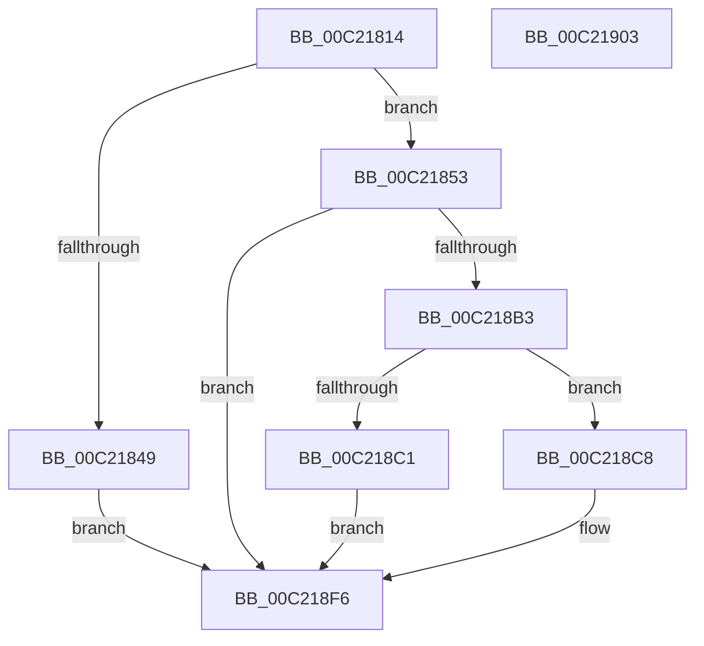

# HalpInitializeSecondaryInterruptServices

- RVA: `0x00C21814`–`0x00C21904` (길이 `240` bytes)
- VA: `0x0000000140C21814`
- 실행 섹션: `INIT`
- PDB 이름 있음: `예`; PDB Function 태그: `아니요`
- unwind 정보 RVA: `0x00068D5C`
- 디코드: `51`개 명령, `240/240` bytes 표시
- 미해석 바이트: `0` (있으면 어셈블리에 `.byte`로 보존)

> 이 문서는 커널 이미지의 기계어와 PDB 기호를 분석해 생성했습니다. 4번과 5번은 함수 원형과 자료형을 바이너리 사용 방식에서 추정한 C 해석이며 원본 소스 복구 결과는 아닙니다.

## 1. Dependencies

- 직접 호출 지점: **3**; 고유 호출 대상: **3**
- 직접 호출자로 확인된 함수: **1**
- RIP 상대 이미지 참조: **19**

### Outgoing calls
- `0x00C21840` → [HalpCheckSecondaryInterruptSupported](../../page/70/HalpCheckSecondaryInterruptSupported_function_0070A480.md) (function, `0x0070A480`)
- `0x00C218A8` → [HalpQueryMaximumGsiv](../../page/70/HalpQueryMaximumGsiv_function_0070AFA8.md) (function, `0x0070AFA8`)
- `0x00C218EA` → [HalpRecordSecondaryGsivRange](../../page/70/HalpRecordSecondaryGsivRange_function_0070A4F8.md) (function, `0x0070A4F8`)

### Direct callers
- [HalpAddDevice](../../page/70/HalpAddDevice_function_00708060.md) at `0x007082B4`

### Static image references
- `0x00C2181E` → RVA `0x00F909C0` (`.data`; read)
- `0x00C2182B` → RVA `0x00F909C8` (`.data`; write)
- `0x00C21832` → RVA `0x00F909C0` (`.data`; write)
- `0x00C21839` → RVA `0x00F909D0` (`.data`; write)
- `0x00C21853` → RVA `0x00F90A20` (`.data`; read)
- `0x00C2185A` → RVA `0x00F909E0` (`.data`; write)
- `0x00C21864` → RVA `0x00F90A28` (`.data`; write)
- `0x00C21870` → RVA `0x00F90A20` (`.data`; write)
- `0x00C21877` → RVA `0x00557160` (`HalpProcessSecondarySignalList`; read)
- `0x00C2187E` → RVA `0x00F909F8` (`.data`; write)
- `0x00C21885` → RVA `0x00F90A00` (`.data`; write)
- `0x00C2188C` → RVA `0x00F90A18` (`.data`; write)
- `0x00C21893` → RVA `0x00F909F0` (`.data`; write)
- `0x00C2189A` → RVA `0x00F90A38` (`.data`; write)
- `0x00C218A1` → RVA `0x00F909D8` (`.data`; write)
- `0x00C218CA` → RVA `0x00F90A30` (`.data`; write)
- `0x00C218D9` → RVA `0x00F90A34` (`.data`; write)
- `0x00C218E4` → RVA `0x00F909DC` (`.data`; write)
- `0x00C218EF` → RVA `0x00E10424` (`.data`; write)

## 2. Other-region calls and transfers

- 다른 실행 섹션으로 향하는 call: **3**
  - `0x00C21840` → [HalpCheckSecondaryInterruptSupported](../../page/70/HalpCheckSecondaryInterruptSupported_function_0070A480.md) (`INIT` → `PAGE`)
  - `0x00C218A8` → [HalpQueryMaximumGsiv](../../page/70/HalpQueryMaximumGsiv_function_0070AFA8.md) (`INIT` → `PAGE`)
  - `0x00C218EA` → [HalpRecordSecondaryGsivRange](../../page/70/HalpRecordSecondaryGsivRange_function_0070A4F8.md) (`INIT` → `PAGE`)
- 별도 외부 분기/꼬리 이동을 확인하지 못했습니다.

## 3. Assembly (complete function range)

```asm
00C21814  48 89 5C 24 10                  mov qword ptr [rsp + 0x10], rbx
00C21819  57                              push rdi
00C2181A  48 83 EC 20                     sub rsp, 0x20
00C2181E  48 8D 05 9B F1 36 00            lea rax, [rip + 0x36f19b]
00C21825  33 FF                           xor edi, edi
00C21827  89 7C 24 30                     mov dword ptr [rsp + 0x30], edi
00C2182B  48 89 05 96 F1 36 00            mov qword ptr [rip + 0x36f196], rax
00C21832  48 89 05 87 F1 36 00            mov qword ptr [rip + 0x36f187], rax
00C21839  48 89 3D 90 F1 36 00            mov qword ptr [rip + 0x36f190], rdi
00C21840  E8 3B 8C AE FF                  call 0x14070a480
00C21845  84 C0                           test al, al
00C21847  75 0A                           jne 0x140c21853
00C21849  BB BB 00 00 C0                  mov ebx, 0xc00000bb
00C2184E  E9 A3 00 00 00                  jmp 0x140c218f6
00C21853  48 8D 05 C6 F1 36 00            lea rax, [rip + 0x36f1c6]
00C2185A  C7 05 7C F1 36 00 13 01 00 00   mov dword ptr [rip + 0x36f17c], 0x113
00C21864  48 89 05 BD F1 36 00            mov qword ptr [rip + 0x36f1bd], rax
00C2186B  48 8D 4C 24 30                  lea rcx, [rsp + 0x30]
00C21870  48 89 05 A9 F1 36 00            mov qword ptr [rip + 0x36f1a9], rax
00C21877  48 8D 05 E2 58 93 FF            lea rax, [rip - 0x6ca71e]
00C2187E  48 89 05 73 F1 36 00            mov qword ptr [rip + 0x36f173], rax
00C21885  48 89 3D 74 F1 36 00            mov qword ptr [rip + 0x36f174], rdi
00C2188C  48 89 3D 85 F1 36 00            mov qword ptr [rip + 0x36f185], rdi
00C21893  48 89 3D 56 F1 36 00            mov qword ptr [rip + 0x36f156], rdi
00C2189A  48 89 3D 97 F1 36 00            mov qword ptr [rip + 0x36f197], rdi
00C218A1  40 88 3D 30 F1 36 00            mov byte ptr [rip + 0x36f130], dil
00C218A8  E8 FB 96 AE FF                  call 0x14070afa8
00C218AD  8B D8                           mov ebx, eax
00C218AF  85 C0                           test eax, eax
00C218B1  78 43                           js 0x140c218f6
00C218B3  8B 44 24 30                     mov eax, dword ptr [rsp + 0x30]
00C218B7  8D 88 01 02 00 00               lea ecx, [rax + 0x201]
00C218BD  3B C8                           cmp ecx, eax
00C218BF  73 07                           jae 0x140c218c8
00C218C1  BB 01 00 00 C0                  mov ebx, 0xc0000001
00C218C6  EB 2E                           jmp 0x140c218f6
00C218C8  FF C0                           inc eax
00C218CA  C7 05 5C F1 36 00 00 02 00 00   mov dword ptr [rip + 0x36f15c], 0x200
00C218D4  B9 00 04 00 00                  mov ecx, 0x400
00C218D9  89 3D 55 F1 36 00               mov dword ptr [rip + 0x36f155], edi
00C218DF  3B C1                           cmp eax, ecx
00C218E1  0F 47 C8                        cmova ecx, eax
00C218E4  89 0D F2 F0 36 00               mov dword ptr [rip + 0x36f0f2], ecx
00C218EA  E8 09 8C AE FF                  call 0x14070a4f8
00C218EF  C6 05 2E EB 1E 00 01            mov byte ptr [rip + 0x1eeb2e], 1
00C218F6  8B C3                           mov eax, ebx
00C218F8  48 8B 5C 24 38                  mov rbx, qword ptr [rsp + 0x38]
00C218FD  48 83 C4 20                     add rsp, 0x20
00C21901  5F                              pop rdi
00C21902  C3                              ret
00C21903  CC                              int3
```

## 4. C-style interpretation (structured pseudocode)

```c
__int64 __fastcall HalpInitializeSecondaryInterruptServices(void)
{
    __int64 result;
    __int64 v_rdi;
    __int64 v_rsp;
    unsigned __int64 v_stack_p10;
    unsigned int v_stack_p8;

    v_stack_p10 = v_rbx;
    v_rsp = (v_rsp) - (32);
    v_rdi = 0;
    v_stack_p8 = 0;
    *(unsigned __int64 *)(v_rip + 3600790) = v_rip + 3600795;
    *(unsigned __int64 *)(v_rip + 3600775) = v_rip + 3600795;
    *(unsigned __int64 *)(v_rip + 3600784) = 0;
    result = HalpCheckSecondaryInterruptSupported(a1, a2, a3, a4);
    if ((unsigned __int8)(result) != 0) goto loc_00C21853;
    goto loc_00C218F6;
loc_00C21853:
    *(unsigned int *)(v_rip + 3600764) = 275;
    *(unsigned __int64 *)(v_rip + 3600829) = v_rip + 3600838;
    *(unsigned __int64 *)(v_rip + 3600809) = v_rip + 3600838;
    *(unsigned __int64 *)(v_rip + 3600755) = v_rip - 7120670;
    *(unsigned __int64 *)(v_rip + 3600756) = 0;
    *(unsigned __int64 *)(v_rip + 3600773) = 0;
    *(unsigned __int64 *)(v_rip + 3600726) = 0;
    *(unsigned __int64 *)(v_rip + 3600791) = 0;
    *(unsigned __int8 *)(v_rip + 3600688) = 0;
    result = HalpQueryMaximumGsiv(v_stack_p8, a2, a3, a4);
    if (sign_flag) goto loc_00C218F6;
    if (((unsigned int)((unsigned int)(v_stack_p8) + 513)) >= ((unsigned int)((unsigned int)(v_stack_p8)))) goto loc_00C218C8;
    goto loc_00C218F6;
loc_00C218C8:
    result = (unsigned int)(((unsigned int)(v_stack_p8)) + 1);
    *(unsigned int *)(v_rip + 3600732) = 512;
    *(unsigned int *)(v_rip + 3600725) = 0;
    a1 = (unsigned int)(0x400ULL);
    if (((unsigned int)(result)) > ((unsigned int)((unsigned int)(0x400ULL)))) { a1 = (unsigned int)(result); }
    *(unsigned int *)(v_rip + 3600626) = (unsigned int)(a1);
    result = HalpRecordSecondaryGsivRange(a1, a2, a3, a4);
    *(unsigned __int8 *)(v_rip + 2026286) = 1;
loc_00C218F6:
    v_rsp = (v_rsp) + (32);
    return (unsigned int)((unsigned int)((unsigned int)(0xC0000001ULL)));
}
```

## 5. (Beta) C Style

```c
void HalpInitializeSecondaryInterruptServices(void)
{
    int64_t result;
    int64_t local_rdi;
    int64_t local_rsp;
    uint64_t v_stack_p10;
    uint32_t v_stack_p8;

    v_stack_p10 = local_rbx;
    local_rsp = (local_rsp) - (32);
    local_rdi = 0;
    v_stack_p8 = 0;
    *(uint64_t *)(v_rip + 0x36F196) = v_rip + 3600795;
    *(uint64_t *)(v_rip + 0x36F187) = v_rip + 3600795;
    *(uint64_t *)(v_rip + 0x36F190) = 0;
    result = HalpCheckSecondaryInterruptSupported(a1, a2, a3, a4);
    if ((uint8_t)(result) != 0) goto loc_00C21853;
    goto loc_00C218F6;
loc_00C21853:
    *(uint32_t *)(v_rip + 0x36F17C) = 275;
    *(uint64_t *)(v_rip + 0x36F1BD) = v_rip + 3600838;
    *(uint64_t *)(v_rip + 0x36F1A9) = v_rip + 3600838;
    *(uint64_t *)(v_rip + 0x36F173) = v_rip - 7120670;
    *(uint64_t *)(v_rip + 0x36F174) = 0;
    *(uint64_t *)(v_rip + 0x36F185) = 0;
    *(uint64_t *)(v_rip + 0x36F156) = 0;
    *(uint64_t *)(v_rip + 0x36F197) = 0;
    *(uint8_t *)(v_rip + 0x36F130) = 0;
    result = HalpQueryMaximumGsiv(v_stack_p8, a2, a3, a4);
    if (sign_flag) goto loc_00C218F6;
    if (((uint32_t)((uint32_t)(v_stack_p8) + 513)) >= ((uint32_t)((uint32_t)(v_stack_p8)))) goto loc_00C218C8;
    goto loc_00C218F6;
loc_00C218C8:
    result = (uint32_t)(((uint32_t)(v_stack_p8)) + 1);
    *(uint32_t *)(v_rip + 0x36F15C) = 512;
    *(uint32_t *)(v_rip + 0x36F155) = 0;
    a1 = (uint32_t)(0x400ULL);
    if (((uint32_t)(result)) > ((uint32_t)((uint32_t)(0x400ULL)))) { a1 = (uint32_t)(result); }
    *(uint32_t *)(v_rip + 0x36F0F2) = (uint32_t)(a1);
    result = HalpRecordSecondaryGsivRange(a1, a2, a3, a4);
    *(uint8_t *)(v_rip + 0x1EEB2E) = 1;
loc_00C218F6:
    local_rsp = (local_rsp) + (32);
    return (uint32_t)((uint32_t)((uint32_t)(0xC0000001ULL)));
}
```

## 6. Execution-region graph

[열기: 2D/3D 그래프와 함수 탐색 컨트롤 패널](../../../control-panel.html?section=init&rva=0x00C21814&view=graph)

- 2D 그래프는 위에서 아래로 흐르고, 3D 그래프는 빈 공간을 드래그해 회전합니다. Shift+드래그는 이동, 휠은 확대·축소, 함수 노드 선택은 대상 보고서 이동입니다.

### Static fallback


