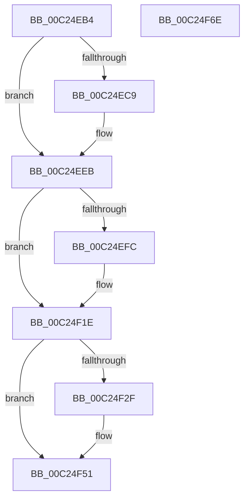

# HalpInitializeWheaPhysicalMappings

- RVA: `0x00C24EB4`–`0x00C24F6F` (길이 `187` bytes)
- VA: `0x0000000140C24EB4`
- 실행 섹션: `INIT`
- PDB 이름 있음: `예`; PDB Function 태그: `아니요`
- unwind 정보 RVA: `0x0005D2F4`
- 디코드: `40`개 명령, `187/187` bytes 표시
- 미해석 바이트: `0` (있으면 어셈블리에 `.byte`로 보존)

> 이 문서는 커널 이미지의 기계어와 PDB 기호를 분석해 생성했습니다. 4번과 5번은 함수 원형과 자료형을 바이너리 사용 방식에서 추정한 C 해석이며 원본 소스 복구 결과는 아닙니다.

## 1. Dependencies

- 직접 호출 지점: **6**; 고유 호출 대상: **2**
- 직접 호출자로 확인된 함수: **1**
- RIP 상대 이미지 참조: **7**

### Outgoing calls
- `0x00C24EB8` → [HalpReserveHalPtes](../C1/HalpReserveHalPtes_function_00C1EAE8.md) (function, `0x00C1EAE8`)
- `0x00C24EE5` → [KeBugCheckEx](../../text/4F/KeBugCheckEx_function_004FD660.md) (function, `0x004FD660`)
- `0x00C24EEB` → [HalpReserveHalPtes](../C1/HalpReserveHalPtes_function_00C1EAE8.md) (function, `0x00C1EAE8`)
- `0x00C24F18` → [KeBugCheckEx](../../text/4F/KeBugCheckEx_function_004FD660.md) (function, `0x004FD660`)
- `0x00C24F1E` → [HalpReserveHalPtes](../C1/HalpReserveHalPtes_function_00C1EAE8.md) (function, `0x00C1EAE8`)
- `0x00C24F4B` → [KeBugCheckEx](../../text/4F/KeBugCheckEx_function_004FD660.md) (function, `0x004FD660`)

### Direct callers
- [HalpWheaInitDiscard](HalpWheaInitDiscard_function_00C202B4.md) at `0x00C20383`

### Static image references
- `0x00C24EBD` → RVA `0x00F8FB38` (`.data`; write)
- `0x00C24EC9` → RVA `0x00026000` (`.rdata`; read)
- `0x00C24EF0` → RVA `0x00F8FB28` (`.data`; write)
- `0x00C24F23` → RVA `0x00F8FB48` (`.data`; write)
- `0x00C24F51` → RVA `0x00F8FB30` (`.data`; read/write)
- `0x00C24F59` → RVA `0x00F8FB40` (`.data`; read/write)
- `0x00C24F61` → RVA `0x00F8FB20` (`.data`; read/write)

## 2. Other-region calls and transfers

- 다른 실행 섹션으로 향하는 call: **3**
  - `0x00C24EE5` → [KeBugCheckEx](../../text/4F/KeBugCheckEx_function_004FD660.md) (`INIT` → `.text`)
  - `0x00C24F18` → [KeBugCheckEx](../../text/4F/KeBugCheckEx_function_004FD660.md) (`INIT` → `.text`)
  - `0x00C24F4B` → [KeBugCheckEx](../../text/4F/KeBugCheckEx_function_004FD660.md) (`INIT` → `.text`)
- 별도 외부 분기/꼬리 이동을 확인하지 못했습니다.

## 3. Assembly (complete function range)

```asm
00C24EB4  48 83 EC 38                     sub rsp, 0x38
00C24EB8  E8 2B 9C FF FF                  call 0x140c1eae8
00C24EBD  48 89 05 74 AC 36 00            mov qword ptr [rip + 0x36ac74], rax
00C24EC4  48 85 C0                        test rax, rax
00C24EC7  75 22                           jne 0x140c24eeb
00C24EC9  4C 8D 0D 30 11 40 FF            lea r9, [rip - 0xbfeed0]
00C24ED0  48 C7 44 24 20 B3 00 00 00      mov qword ptr [rsp + 0x20], 0xb3
00C24ED9  BA 00 81 00 00                  mov edx, 0x8100
00C24EDE  8D 48 5C                        lea ecx, [rax + 0x5c]
00C24EE1  44 8D 40 01                     lea r8d, [rax + 1]
00C24EE5  E8 76 87 8D FF                  call 0x1404fd660
00C24EEA  CC                              int3
00C24EEB  E8 F8 9B FF FF                  call 0x140c1eae8
00C24EF0  48 89 05 31 AC 36 00            mov qword ptr [rip + 0x36ac31], rax
00C24EF7  48 85 C0                        test rax, rax
00C24EFA  75 22                           jne 0x140c24f1e
00C24EFC  4C 8D 0D FD 10 40 FF            lea r9, [rip - 0xbfef03]
00C24F03  48 C7 44 24 20 BE 00 00 00      mov qword ptr [rsp + 0x20], 0xbe
00C24F0C  BA 00 81 00 00                  mov edx, 0x8100
00C24F11  8D 48 5C                        lea ecx, [rax + 0x5c]
00C24F14  44 8D 40 01                     lea r8d, [rax + 1]
00C24F18  E8 43 87 8D FF                  call 0x1404fd660
00C24F1D  CC                              int3
00C24F1E  E8 C5 9B FF FF                  call 0x140c1eae8
00C24F23  48 89 05 1E AC 36 00            mov qword ptr [rip + 0x36ac1e], rax
00C24F2A  48 85 C0                        test rax, rax
00C24F2D  75 22                           jne 0x140c24f51
00C24F2F  4C 8D 0D CA 10 40 FF            lea r9, [rip - 0xbfef36]
00C24F36  48 C7 44 24 20 C7 00 00 00      mov qword ptr [rsp + 0x20], 0xc7
00C24F3F  BA 00 81 00 00                  mov edx, 0x8100
00C24F44  8D 48 5C                        lea ecx, [rax + 0x5c]
00C24F47  44 8D 40 01                     lea r8d, [rax + 1]
00C24F4B  E8 10 87 8D FF                  call 0x1404fd660
00C24F50  CC                              int3
00C24F51  48 83 25 D7 AB 36 00 00         and qword ptr [rip + 0x36abd7], 0
00C24F59  48 83 25 DF AB 36 00 00         and qword ptr [rip + 0x36abdf], 0
00C24F61  48 83 25 B7 AB 36 00 00         and qword ptr [rip + 0x36abb7], 0
00C24F69  48 83 C4 38                     add rsp, 0x38
00C24F6D  C3                              ret
00C24F6E  CC                              int3
```

## 4. C-style interpretation (structured pseudocode)

```c
__int64 __fastcall HalpInitializeWheaPhysicalMappings(void)
{
    __int64 result;
    __int64 v_rsp;
    unsigned __int64 v_stack_m18;

    v_rsp = (v_rsp) - (56);
    result = HalpReserveHalPtes(a1, a2, a3, a4);
    *(unsigned __int64 *)(v_rip + 3583092) = result;
    if (result == 0) {
        a4 = v_rip - 12578512;
        v_stack_m18 = 179;
        a2 = 0x8100ULL;
        a1 = result + 92;
        a3 = result + 1;
        result = KeBugCheckEx(a1, a2, a3, a4);
    }
    result = HalpReserveHalPtes(a1, a2, a3, a4);
    *(unsigned __int64 *)(v_rip + 3583025) = result;
    if (result == 0) {
        a4 = v_rip - 12578563;
        v_stack_m18 = 190;
        a2 = 0x8100ULL;
        a1 = result + 92;
        a3 = result + 1;
        result = KeBugCheckEx(a1, a2, a3, a4);
    }
    result = HalpReserveHalPtes(a1, a2, a3, a4);
    *(unsigned __int64 *)(v_rip + 3583006) = result;
    if (result == 0) {
        a4 = v_rip - 12578614;
        v_stack_m18 = 199;
        a2 = 0x8100ULL;
        a1 = result + 92;
        a3 = result + 1;
        result = KeBugCheckEx(a1, a2, a3, a4);
    }
    v_rsp = (v_rsp) + (56);
    return result;
}
```

## 5. (Beta) C Style

```c
void HalpInitializeWheaPhysicalMappings(void)
{
    int64_t result;
    int64_t local_rsp;
    uint64_t v_stack_m18;

    local_rsp = (local_rsp) - (56);
    result = HalpReserveHalPtes(a1, a2, a3, a4);
    *(uint64_t *)(v_rip + 0x36AC74) = result;
    if (result == 0) {
        a4 = v_rip - 12578512;
        v_stack_m18 = 179;
        a2 = 0x8100ULL;
        a1 = result + 92;
        a3 = result + 1;
        result = KeBugCheckEx(a1, a2, a3, a4);
    }
    result = HalpReserveHalPtes(a1, a2, a3, a4);
    *(uint64_t *)(v_rip + 0x36AC31) = result;
    if (result == 0) {
        a4 = v_rip - 12578563;
        v_stack_m18 = 190;
        a2 = 0x8100ULL;
        a1 = result + 92;
        a3 = result + 1;
        result = KeBugCheckEx(a1, a2, a3, a4);
    }
    result = HalpReserveHalPtes(a1, a2, a3, a4);
    *(uint64_t *)(v_rip + 0x36AC1E) = result;
    if (result == 0) {
        a4 = v_rip - 12578614;
        v_stack_m18 = 199;
        a2 = 0x8100ULL;
        a1 = result + 92;
        a3 = result + 1;
        result = KeBugCheckEx(a1, a2, a3, a4);
    }
    local_rsp = (local_rsp) + (56);
    return result;
}
```

## 6. Execution-region graph

[열기: 2D/3D 그래프와 함수 탐색 컨트롤 패널](../../../control-panel.html?section=init&rva=0x00C24EB4&view=graph)

- 2D 그래프는 위에서 아래로 흐르고, 3D 그래프는 빈 공간을 드래그해 회전합니다. Shift+드래그는 이동, 휠은 확대·축소, 함수 노드 선택은 대상 보고서 이동입니다.

### Static fallback


