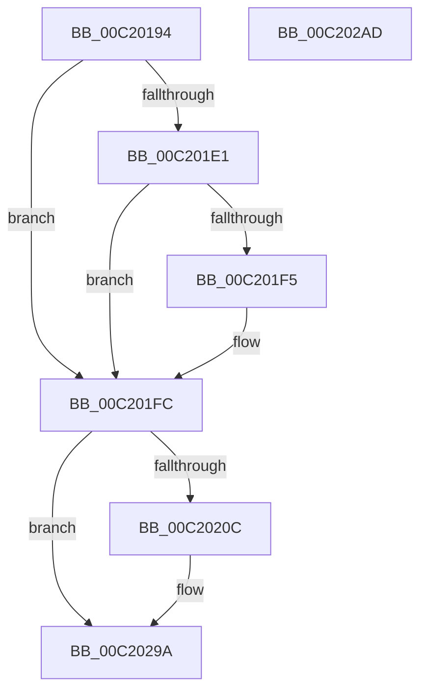

# HalpInterruptInitDiscard

- RVA: `0x00C20194`–`0x00C202AE` (길이 `282` bytes)
- VA: `0x0000000140C20194`
- 실행 섹션: `INIT`
- PDB 이름 있음: `예`; PDB Function 태그: `아니요`
- unwind 정보 RVA: `0x000AB2E4`
- 디코드: `52`개 명령, `282/282` bytes 표시
- 미해석 바이트: `0` (있으면 어셈블리에 `.byte`로 보존)

> 이 문서는 커널 이미지의 기계어와 PDB 기호를 분석해 생성했습니다. 4번과 5번은 함수 원형과 자료형을 바이너리 사용 방식에서 추정한 C 해석이며 원본 소스 복구 결과는 아닙니다.

## 1. Dependencies

- 직접 호출 지점: **3**; 고유 호출 대상: **3**
- 직접 호출자로 확인된 함수: **1**
- RIP 상대 이미지 참조: **28**

### Outgoing calls
- `0x00C201E6` → [HviGetHardwareFeatures](../../text/4A/HviGetHardwareFeatures_function_004ADBC0.md) (function, `0x004ADBC0`)
- `0x00C201FF` → [HalpInitializeInterrupts](../C1/HalpInitializeInterrupts_function_00C1E4F8.md) (function, `0x00C1E4F8`)
- `0x00C202A2` → [_security_check_cookie](../../text/6A/_security_check_cookie_function_006AC640.md) (function, `0x006AC640`)

### Direct callers
- [HalpInterruptInitSystem](../../pagelk/B5/HalpInterruptInitSystem_function_00B5D550.md) at `0x00B5D58C`

### Static image references
- `0x00C2019A` → RVA `0x00E0A740` (`.data`; read)
- `0x00C201A9` → RVA `0x010086A8` (`INITDATA`; read)
- `0x00C201B3` → RVA `0x00FC19A8` (`.data`; read/write)
- `0x00C201BE` → RVA `0x00FC1ED0` (`.data`; read)
- `0x00C201C5` → RVA `0x010081A0` (`INITDATA`; write)
- `0x00C201CC` → RVA `0x010081A0` (`INITDATA`; read)
- `0x00C201D3` → RVA `0x010086A8` (`INITDATA`; write)
- `0x00C201F5` → RVA `0x00E10204` (`.data`; write)
- `0x00C2020C` → RVA `0x002D1DB0` (`HalpMaskInterrupt`; read)
- `0x00C20213` → RVA `0x00E009D0` (`.data`; write)
- `0x00C2021A` → RVA `0x002D1EE0` (`HalpUnmaskInterrupt`; read)
- `0x00C20221` → RVA `0x00E009D8` (`.data`; write)
- `0x00C20228` → RVA `0x00544460` (`HalpInterruptRequestInterrupt`; read)
- `0x00C2022F` → RVA `0x00E00A70` (`.data`; write)
- `0x00C20236` → RVA `0x00542590` (`HalpInterruptEnumerateUnmaskedInterrupts`; read)
- `0x00C2023D` → RVA `0x00E00A78` (`.data`; write)
- `0x00C20244` → RVA `0x0070CB60` (`HaliGetInterruptTranslator`; read)
- `0x00C2024B` → RVA `0x00E006A8` (`.data`; write)
- `0x00C20252` → RVA `0x00AB8830` (`HalpSecondaryInterruptQueryPrimaryInformation`; read)
- `0x00C20259` → RVA `0x00E009C8` (`.data`; write)
- `0x00C20260` → RVA `0x002D2510` (`HalpIsInterruptTypeSecondary`; read)
- `0x00C20267` → RVA `0x00E009E0` (`.data`; write)
- `0x00C2026E` → RVA `0x00556CE0` (`HalpAllocateGsivForSecondaryInterrupt`; read)
- `0x00C20275` → RVA `0x00E009E8` (`.data`; write)
- `0x00C2027C` → RVA `0x004C1FF0` (`HalpInterruptVectorDataToGsiv`; read)
- `0x00C20283` → RVA `0x00E00B40` (`.data`; write)
- `0x00C2028A` → RVA `0x00543F90` (`HalpInterruptGetHighestPriorityInterrupt`; read)
- `0x00C20291` → RVA `0x00E00B48` (`.data`; write)

## 2. Other-region calls and transfers

- 다른 실행 섹션으로 향하는 call: **2**
  - `0x00C201E6` → [HviGetHardwareFeatures](../../text/4A/HviGetHardwareFeatures_function_004ADBC0.md) (`INIT` → `.text`)
  - `0x00C202A2` → [_security_check_cookie](../../text/6A/_security_check_cookie_function_006AC640.md) (`INIT` → `.text`)
- 별도 외부 분기/꼬리 이동을 확인하지 못했습니다.

## 3. Assembly (complete function range)

```asm
00C20194  40 53                           push rbx
00C20196  48 83 EC 40                     sub rsp, 0x40
00C2019A  48 8B 05 9F A5 1E 00            mov rax, qword ptr [rip + 0x1ea59f]
00C201A1  48 33 C4                        xor rax, rsp
00C201A4  48 89 44 24 30                  mov qword ptr [rsp + 0x30], rax
00C201A9  48 8B 05 F8 84 3E 00            mov rax, qword ptr [rip + 0x3e84f8]
00C201B0  0F 57 C0                        xorps xmm0, xmm0
00C201B3  48 83 25 ED 17 3A 00 00         and qword ptr [rip + 0x3a17ed], 0
00C201BB  48 8B D9                        mov rbx, rcx
00C201BE  80 3D 0B 1D 3A 00 00            cmp byte ptr [rip + 0x3a1d0b], 0
00C201C5  48 89 05 D4 7F 3E 00            mov qword ptr [rip + 0x3e7fd4], rax
00C201CC  48 8D 05 CD 7F 3E 00            lea rax, [rip + 0x3e7fcd]
00C201D3  48 89 05 CE 84 3E 00            mov qword ptr [rip + 0x3e84ce], rax
00C201DA  0F 11 44 24 20                  movups xmmword ptr [rsp + 0x20], xmm0
00C201DF  74 1B                           je 0x140c201fc
00C201E1  48 8D 4C 24 20                  lea rcx, [rsp + 0x20]
00C201E6  E8 D5 D9 88 FF                  call 0x1404adbc0
00C201EB  F7 44 24 20 00 40 00 00         test dword ptr [rsp + 0x20], 0x4000
00C201F3  74 07                           je 0x140c201fc
00C201F5  C6 05 08 00 1F 00 01            mov byte ptr [rip + 0x1f0008], 1
00C201FC  48 8B CB                        mov rcx, rbx
00C201FF  E8 F4 E2 FF FF                  call 0x140c1e4f8
00C20204  85 C0                           test eax, eax
00C20206  0F 88 8E 00 00 00               js 0x140c2029a
00C2020C  48 8D 05 9D 1B 6B FF            lea rax, [rip - 0x94e463]
00C20213  48 89 05 B6 07 1E 00            mov qword ptr [rip + 0x1e07b6], rax
00C2021A  48 8D 05 BF 1C 6B FF            lea rax, [rip - 0x94e341]
00C20221  48 89 05 B0 07 1E 00            mov qword ptr [rip + 0x1e07b0], rax
00C20228  48 8D 05 31 42 92 FF            lea rax, [rip - 0x6dbdcf]
00C2022F  48 89 05 3A 08 1E 00            mov qword ptr [rip + 0x1e083a], rax
00C20236  48 8D 05 53 23 92 FF            lea rax, [rip - 0x6ddcad]
00C2023D  48 89 05 34 08 1E 00            mov qword ptr [rip + 0x1e0834], rax
00C20244  48 8D 05 15 C9 AE FF            lea rax, [rip - 0x5136eb]
00C2024B  48 89 05 56 04 1E 00            mov qword ptr [rip + 0x1e0456], rax
00C20252  48 8D 05 D7 85 E9 FF            lea rax, [rip - 0x167a29]
00C20259  48 89 05 68 07 1E 00            mov qword ptr [rip + 0x1e0768], rax
00C20260  48 8D 05 A9 22 6B FF            lea rax, [rip - 0x94dd57]
00C20267  48 89 05 72 07 1E 00            mov qword ptr [rip + 0x1e0772], rax
00C2026E  48 8D 05 6B 6A 93 FF            lea rax, [rip - 0x6c9595]
00C20275  48 89 05 6C 07 1E 00            mov qword ptr [rip + 0x1e076c], rax
00C2027C  48 8D 05 6D 1D 8A FF            lea rax, [rip - 0x75e293]
00C20283  48 89 05 B6 08 1E 00            mov qword ptr [rip + 0x1e08b6], rax
00C2028A  48 8D 05 FF 3C 92 FF            lea rax, [rip - 0x6dc301]
00C20291  48 89 05 B0 08 1E 00            mov qword ptr [rip + 0x1e08b0], rax
00C20298  33 C0                           xor eax, eax
00C2029A  48 8B 4C 24 30                  mov rcx, qword ptr [rsp + 0x30]
00C2029F  48 33 CC                        xor rcx, rsp
00C202A2  E8 99 C3 A8 FF                  call 0x1406ac640
00C202A7  48 83 C4 40                     add rsp, 0x40
00C202AB  5B                              pop rbx
00C202AC  C3                              ret
00C202AD  CC                              int3
```

## 4. C-style interpretation (structured pseudocode)

```c
__int64 __fastcall HalpInterruptInitDiscard(__int64 a1)
{
    __int64 result;
    __int64 v_rsp;
    unsigned __int64 v_stack_m18;
    unsigned __int64 v_stack_m28;

    v_rsp = (v_rsp) - (64);
    result = (*(unsigned __int64 *)(v_rip + 2008479)) ^ (v_rsp);
    v_stack_m18 = result;
    *(unsigned __int64 *)(v_rip + 4095956) = *(unsigned __int64 *)(v_rip + 4097272);
    *(unsigned __int64 *)(v_rip + 4097230) = v_rip + 4095949;
    v_stack_m28 = v_xmm0;
    if ((*(unsigned __int8 *)(v_rip + 3808523)) == 0) goto loc_00C201FC;
    result = HviGetHardwareFeatures(v_stack_m28, a2, a3, a4);
    if (((v_stack_m28) & (0x4000ULL)) != 0) {
        *(unsigned __int8 *)(v_rip + 2031624) = 1;
    }
    result = HalpInitializeInterrupts(a1, a2, a3, a4);
    if (!(sign_flag)) {
        result = v_rip - 9757795;
        *(unsigned __int64 *)(v_rip + 1968054) = result;
        result = v_rip - 9757505;
        *(unsigned __int64 *)(v_rip + 1968048) = result;
        result = v_rip - 7192015;
        *(unsigned __int64 *)(v_rip + 1968186) = result;
        result = v_rip - 7199917;
        *(unsigned __int64 *)(v_rip + 1968180) = result;
        result = v_rip - 5322475;
        *(unsigned __int64 *)(v_rip + 1967190) = result;
        result = v_rip - 1473065;
        *(unsigned __int64 *)(v_rip + 1967976) = result;
        result = v_rip - 9755991;
        *(unsigned __int64 *)(v_rip + 1967986) = result;
        result = v_rip - 7116181;
        *(unsigned __int64 *)(v_rip + 1967980) = result;
        result = v_rip - 7725715;
        *(unsigned __int64 *)(v_rip + 1968310) = result;
        result = v_rip - 7193345;
        *(unsigned __int64 *)(v_rip + 1968304) = result;
        result = 0;
    }
    a1 = (v_stack_m18) ^ (v_rsp);
    result = _security_check_cookie(a1, a2, a3, a4);
    v_rsp = (v_rsp) + (64);
    return result;
}
```

## 5. (Beta) C Style

```c
int64_t HalpInterruptInitDiscard(int64_t Arg1)
{
    int64_t result;
    int64_t local_rsp;
    uint64_t v_stack_m18;
    uint64_t v_stack_m28;

    local_rsp = (local_rsp) - (64);
    result = (*(uint64_t *)(v_rip + 0x1EA59F)) ^ (local_rsp);
    v_stack_m18 = result;
    *(uint64_t *)(v_rip + 0x3E7FD4) = *(uint64_t *)(v_rip + 0x3E84F8);
    *(uint64_t *)(v_rip + 0x3E84CE) = v_rip + 4095949;
    v_stack_m28 = v_xmm0;
    if ((*(uint8_t *)(v_rip + 0x3A1D0B)) == 0) goto loc_00C201FC;
    result = HviGetHardwareFeatures(v_stack_m28, a2, a3, a4);
    if (((v_stack_m28) & (0x4000ULL)) != 0) {
        *(uint8_t *)(v_rip + 0x1F0008) = 1;
    }
    result = HalpInitializeInterrupts(Arg1, a2, a3, a4);
    if (!(sign_flag)) {
        result = v_rip - 9757795;
        *(uint64_t *)(v_rip + 0x1E07B6) = result;
        result = v_rip - 9757505;
        *(uint64_t *)(v_rip + 0x1E07B0) = result;
        result = v_rip - 7192015;
        *(uint64_t *)(v_rip + 0x1E083A) = result;
        result = v_rip - 7199917;
        *(uint64_t *)(v_rip + 0x1E0834) = result;
        result = v_rip - 5322475;
        *(uint64_t *)(v_rip + 0x1E0456) = result;
        result = v_rip - 1473065;
        *(uint64_t *)(v_rip + 0x1E0768) = result;
        result = v_rip - 9755991;
        *(uint64_t *)(v_rip + 0x1E0772) = result;
        result = v_rip - 7116181;
        *(uint64_t *)(v_rip + 0x1E076C) = result;
        result = v_rip - 7725715;
        *(uint64_t *)(v_rip + 0x1E08B6) = result;
        result = v_rip - 7193345;
        *(uint64_t *)(v_rip + 0x1E08B0) = result;
        result = 0;
    }
    Arg1 = (v_stack_m18) ^ (local_rsp);
    result = _security_check_cookie(Arg1, a2, a3, a4);
    local_rsp = (local_rsp) + (64);
    return result;
}
```

## 6. Execution-region graph

[열기: 2D/3D 그래프와 함수 탐색 컨트롤 패널](../../../control-panel.html?section=init&rva=0x00C20194&view=graph)

- 2D 그래프는 위에서 아래로 흐르고, 3D 그래프는 빈 공간을 드래그해 회전합니다. Shift+드래그는 이동, 휠은 확대·축소, 함수 노드 선택은 대상 보고서 이동입니다.

### Static fallback


