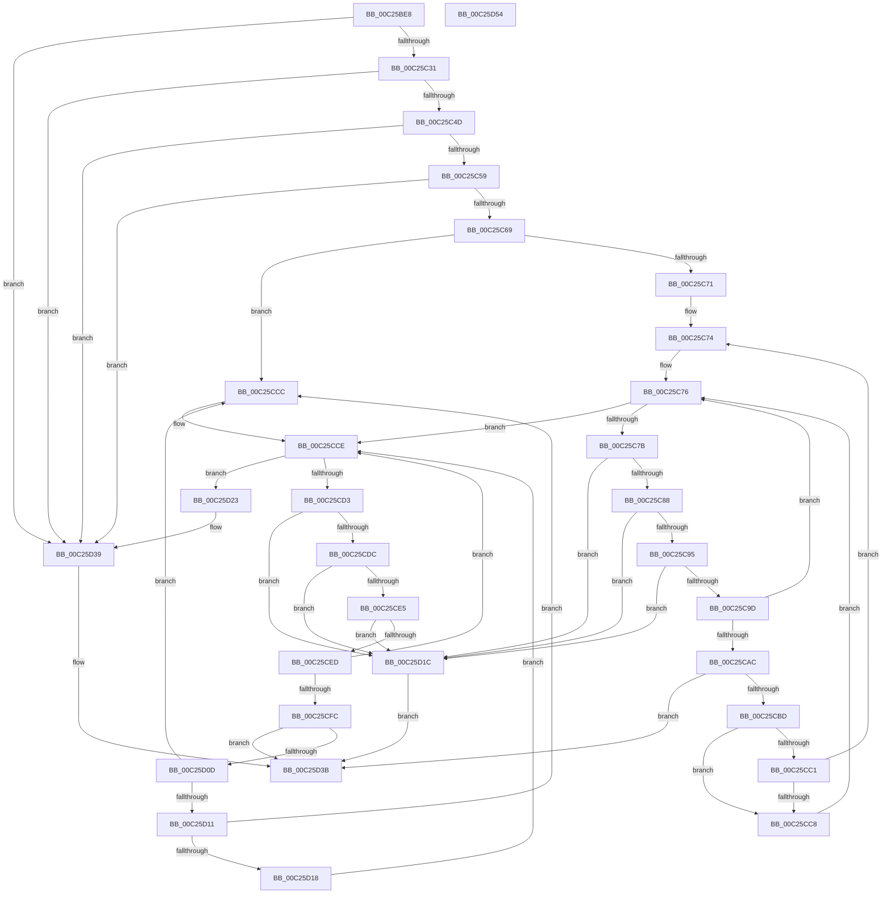

# HalpIommuHsaDiscover

- RVA: `0x00C25BE8`–`0x00C25D55` (길이 `365` bytes)
- VA: `0x0000000140C25BE8`
- 실행 섹션: `INIT`
- PDB 이름 있음: `예`; PDB Function 태그: `아니요`
- unwind 정보 RVA: `0x0006B074`
- 디코드: `109`개 명령, `365/365` bytes 표시
- 미해석 바이트: `0` (있으면 어셈블리에 `.byte`로 보존)

> 이 문서는 커널 이미지의 기계어와 PDB 기호를 분석해 생성했습니다. 4번과 5번은 함수 원형과 자료형을 바이너리 사용 방식에서 추정한 C 해석이며 원본 소스 복구 결과는 아닙니다.

## 1. Dependencies

- 직접 호출 지점: **3**; 고유 호출 대상: **2**
- 직접 호출자로 확인된 함수: **1**
- RIP 상대 이미지 참조: **4**

### Outgoing calls
- `0x00C25C3C` → [HalpAcpiGetTable](../../text/3F/HalpAcpiGetTable_function_003F6BF8.md) (function, `0x003F6BF8`)
- `0x00C25CB4` → [HalpIommuProcessIvhdEntry](../../text/57/HalpIommuProcessIvhdEntry_function_00572F38.md) (function, `0x00572F38`)
- `0x00C25D04` → [HalpIommuProcessIvhdEntry](../../text/57/HalpIommuProcessIvhdEntry_function_00572F38.md) (function, `0x00572F38`)

### Direct callers
- [HalpIommuRegisterBuiltinPlugins](../../text/56/HalpIommuRegisterBuiltinPlugins_function_005689EC.md) at `0x00568A13`

### Static image references
- `0x00C25C04` → RVA `0x00F8F7A0` (`.data`; read)
- `0x00C25C0E` → RVA `0x00F8F7A8` (`.data`; write)
- `0x00C25C15` → RVA `0x00FC1A20` (`.data`; read)
- `0x00C25C1C` → RVA `0x00F8F7A0` (`.data`; write)

## 2. Other-region calls and transfers

- 다른 실행 섹션으로 향하는 call: **3**
  - `0x00C25C3C` → [HalpAcpiGetTable](../../text/3F/HalpAcpiGetTable_function_003F6BF8.md) (`INIT` → `.text`)
  - `0x00C25CB4` → [HalpIommuProcessIvhdEntry](../../text/57/HalpIommuProcessIvhdEntry_function_00572F38.md) (`INIT` → `.text`)
  - `0x00C25D04` → [HalpIommuProcessIvhdEntry](../../text/57/HalpIommuProcessIvhdEntry_function_00572F38.md) (`INIT` → `.text`)
- 별도 외부 분기/꼬리 이동을 확인하지 못했습니다.

## 3. Assembly (complete function range)

```asm
00C25BE8  48 89 5C 24 10                  mov qword ptr [rsp + 0x10], rbx
00C25BED  48 89 6C 24 18                  mov qword ptr [rsp + 0x18], rbp
00C25BF2  48 89 74 24 20                  mov qword ptr [rsp + 0x20], rsi
00C25BF7  57                              push rdi
00C25BF8  41 56                           push r14
00C25BFA  41 57                           push r15
00C25BFC  48 83 EC 20                     sub rsp, 0x20
00C25C00  48 83 21 00                     and qword ptr [rcx], 0
00C25C04  48 8D 05 95 9B 36 00            lea rax, [rip + 0x369b95]
00C25C0B  4C 8B F9                        mov r15, rcx
00C25C0E  48 89 05 93 9B 36 00            mov qword ptr [rip + 0x369b93], rax
00C25C15  48 8B 0D 04 BE 39 00            mov rcx, qword ptr [rip + 0x39be04]
00C25C1C  48 89 05 7D 9B 36 00            mov qword ptr [rip + 0x369b7d], rax
00C25C23  C6 44 24 40 00                  mov byte ptr [rsp + 0x40], 0
00C25C28  48 85 C9                        test rcx, rcx
00C25C2B  0F 84 08 01 00 00               je 0x140c25d39
00C25C31  45 33 C9                        xor r9d, r9d
00C25C34  45 33 C0                        xor r8d, r8d
00C25C37  BA 49 56 52 53                  mov edx, 0x53525649
00C25C3C  E8 B7 0F 7D FF                  call 0x1403f6bf8
00C25C41  4C 8B F0                        mov r14, rax
00C25C44  48 85 C0                        test rax, rax
00C25C47  0F 84 EC 00 00 00               je 0x140c25d39
00C25C4D  8B 40 04                        mov eax, dword ptr [rax + 4]
00C25C50  83 F8 5A                        cmp eax, 0x5a
00C25C53  0F 82 E0 00 00 00               jb 0x140c25d39
00C25C59  49 8D 2C 06                     lea rbp, [r14 + rax]
00C25C5D  41 8B 46 24                     mov eax, dword ptr [r14 + 0x24]
00C25C61  A8 01                           test al, 1
00C25C63  0F 84 D0 00 00 00               je 0x140c25d39
00C25C69  49 8D 7E 30                     lea rdi, [r14 + 0x30]
00C25C6D  A8 02                           test al, 2
00C25C6F  74 5B                           je 0x140c25ccc
00C25C71  48 8B F7                        mov rsi, rdi
00C25C74  B3 01                           mov bl, 1
00C25C76  48 3B F5                        cmp rsi, rbp
00C25C79  73 53                           jae 0x140c25cce
00C25C7B  48 8D 46 04                     lea rax, [rsi + 4]
00C25C7F  48 3B C5                        cmp rax, rbp
00C25C82  0F 87 94 00 00 00               ja 0x140c25d1c
00C25C88  0F B7 46 02                     movzx eax, word ptr [rsi + 2]
00C25C8C  83 F8 04                        cmp eax, 4
00C25C8F  0F 82 87 00 00 00               jb 0x140c25d1c
00C25C95  48 03 C6                        add rax, rsi
00C25C98  48 3B C5                        cmp rax, rbp
00C25C9B  77 7F                           ja 0x140c25d1c
00C25C9D  0F B7 46 02                     movzx eax, word ptr [rsi + 2]
00C25CA1  48 8B D6                        mov rdx, rsi
00C25CA4  48 03 F0                        add rsi, rax
00C25CA7  80 3A 40                        cmp byte ptr [rdx], 0x40
00C25CAA  75 CA                           jne 0x140c25c76
00C25CAC  4C 8D 44 24 40                  lea r8, [rsp + 0x40]
00C25CB1  49 8B CE                        mov rcx, r14
00C25CB4  E8 7F D2 94 FF                  call 0x140572f38
00C25CB9  85 C0                           test eax, eax
00C25CBB  78 7E                           js 0x140c25d3b
00C25CBD  84 DB                           test bl, bl
00C25CBF  74 07                           je 0x140c25cc8
00C25CC1  80 7C 24 40 00                  cmp byte ptr [rsp + 0x40], 0
00C25CC6  74 AC                           je 0x140c25c74
00C25CC8  32 DB                           xor bl, bl
00C25CCA  EB AA                           jmp 0x140c25c76
00C25CCC  32 DB                           xor bl, bl
00C25CCE  48 3B FD                        cmp rdi, rbp
00C25CD1  73 50                           jae 0x140c25d23
00C25CD3  48 8D 47 04                     lea rax, [rdi + 4]
00C25CD7  48 3B C5                        cmp rax, rbp
00C25CDA  77 40                           ja 0x140c25d1c
00C25CDC  0F B7 47 02                     movzx eax, word ptr [rdi + 2]
00C25CE0  83 F8 04                        cmp eax, 4
00C25CE3  72 37                           jb 0x140c25d1c
00C25CE5  48 03 C7                        add rax, rdi
00C25CE8  48 3B C5                        cmp rax, rbp
00C25CEB  77 2F                           ja 0x140c25d1c
00C25CED  0F B7 47 02                     movzx eax, word ptr [rdi + 2]
00C25CF1  48 8B D7                        mov rdx, rdi
00C25CF4  48 03 F8                        add rdi, rax
00C25CF7  80 3A 11                        cmp byte ptr [rdx], 0x11
00C25CFA  75 D2                           jne 0x140c25cce
00C25CFC  4C 8D 44 24 40                  lea r8, [rsp + 0x40]
00C25D01  49 8B CE                        mov rcx, r14
00C25D04  E8 2F D2 94 FF                  call 0x140572f38
00C25D09  85 C0                           test eax, eax
00C25D0B  78 2E                           js 0x140c25d3b
00C25D0D  84 DB                           test bl, bl
00C25D0F  74 BB                           je 0x140c25ccc
00C25D11  80 7C 24 40 00                  cmp byte ptr [rsp + 0x40], 0
00C25D16  75 B4                           jne 0x140c25ccc
00C25D18  B3 01                           mov bl, 1
00C25D1A  EB B2                           jmp 0x140c25cce
00C25D1C  B8 0D 00 00 C0                  mov eax, 0xc000000d
00C25D21  EB 18                           jmp 0x140c25d3b
00C25D23  0F B6 C3                        movzx eax, bl
00C25D26  48 03 C0                        add rax, rax
00C25D29  48 8B C8                        mov rcx, rax
00C25D2C  49 33 0F                        xor rcx, qword ptr [r15]
00C25D2F  48 83 E1 FD                     and rcx, 0xfffffffffffffffd
00C25D33  48 33 C8                        xor rcx, rax
00C25D36  49 89 0F                        mov qword ptr [r15], rcx
00C25D39  33 C0                           xor eax, eax
00C25D3B  48 8B 5C 24 48                  mov rbx, qword ptr [rsp + 0x48]
00C25D40  48 8B 6C 24 50                  mov rbp, qword ptr [rsp + 0x50]
00C25D45  48 8B 74 24 58                  mov rsi, qword ptr [rsp + 0x58]
00C25D4A  48 83 C4 20                     add rsp, 0x20
00C25D4E  41 5F                           pop r15
00C25D50  41 5E                           pop r14
00C25D52  5F                              pop rdi
00C25D53  C3                              ret
00C25D54  CC                              int3
```

## 4. C-style interpretation (structured pseudocode)

```c
__int64 __fastcall HalpIommuHsaDiscover(__int64 a1, __int64 a2, int a3, int a4)
{
    __int64 result;
    __int64 v_rbx;
    __int64 v_rdi;
    __int64 v_rsi;
    __int64 v_rsp;
    unsigned __int64 v_stack_p10;
    unsigned __int64 v_stack_p18;
    unsigned __int64 v_stack_p20;
    unsigned __int8 v_stack_p8;

    v_stack_p10 = v_rbx;
    v_stack_p18 = v_rbp;
    v_stack_p20 = v_rsi;
    v_rsp = (v_rsp) - (32);
    *(unsigned __int64 *)(v_rip + 3578771) = v_rip + 3578773;
    *(unsigned __int64 *)(v_rip + 3578749) = v_rip + 3578773;
    v_stack_p8 = 0;
    if (*(unsigned __int64 *)(v_rip + 3784196) == 0) goto loc_00C25D39;
    a4 = 0;
    a3 = 0;
    result = HalpAcpiGetTable(*(unsigned __int64 *)(v_rip + 3784196), (unsigned int)(0x53525649ULL), a3, a4);
    if (result == 0) goto loc_00C25D39;
    if (((unsigned int)((unsigned int)(*(unsigned int *)(result + 4)))) < 90) goto loc_00C25D39;
    if ((((unsigned __int8)((unsigned int)(*(unsigned int *)(result + 36)))) & (1)) == 0) goto loc_00C25D39;
    if ((((unsigned __int8)((unsigned int)(*(unsigned int *)(result + 36)))) & (2)) == 0) goto loc_00C25CCC;
loc_00C25C74:
loc_00C25C76:
    if ((result + 48) >= (result + (unsigned int)(*(unsigned int *)(result + 4)) * 1)) goto loc_00C25CCE;
    if ((result + 48 + 4) > (result + (unsigned int)(*(unsigned int *)(result + 4)) * 1)) goto loc_00C25D1C;
    if (((unsigned int)(*(unsigned __int16 *)(result + 48 + 2))) < 4) goto loc_00C25D1C;
    result = (*(unsigned __int16 *)(result + 48 + 2)) + (result + 48);
    if (result > (result + (unsigned int)(*(unsigned int *)(result + 4)) * 1)) goto loc_00C25D1C;
    v_rsi = (result + 48) + (*(unsigned __int16 *)(result + 48 + 2));
    if ((*(unsigned __int8 *)(result + 48)) != 64) goto loc_00C25C76;
    result = HalpIommuProcessIvhdEntry(result, result + 48, v_stack_p8, a4);
    if (sign_flag) goto loc_00C25D3B;
    if (1 == 0) goto loc_00C25CC8;
    if (v_stack_p8 == 0) goto loc_00C25C74;
loc_00C25CC8:
    v_rbx = 0;
    goto loc_00C25C76;
loc_00C25CCC:
    v_rbx = 0;
loc_00C25CCE:
    if ((result + 48) >= (result + (unsigned int)(*(unsigned int *)(result + 4)) * 1)) goto loc_00C25D23;
    if ((result + 48 + 4) > (result + (unsigned int)(*(unsigned int *)(result + 4)) * 1)) goto loc_00C25D1C;
    if (((unsigned int)(*(unsigned __int16 *)(result + 48 + 2))) < 4) goto loc_00C25D1C;
    result = (*(unsigned __int16 *)(result + 48 + 2)) + (result + 48);
    if (result > (result + (unsigned int)(*(unsigned int *)(result + 4)) * 1)) goto loc_00C25D1C;
    v_rdi = (result + 48) + (*(unsigned __int16 *)(result + 48 + 2));
    if ((*(unsigned __int8 *)(result + 48)) != 17) goto loc_00C25CCE;
    result = HalpIommuProcessIvhdEntry(result, result + 48, v_stack_p8, a4);
    if (sign_flag) goto loc_00C25D3B;
    if (0 == 0) goto loc_00C25CCC;
    if (v_stack_p8 != 0) goto loc_00C25CCC;
    goto loc_00C25CCE;
loc_00C25D1C:
    goto loc_00C25D3B;
loc_00C25D23:
    result = (1) + (1);
    a1 = (result) ^ (*(unsigned __int64 *)(a1));
    a1 = (a1) & (-3);
    a1 = (a1) ^ (result);
    *(unsigned __int64 *)(a1) = a1;
loc_00C25D39:
    result = 0;
loc_00C25D3B:
    v_rsp = (v_rsp) + (32);
    return result;
}
```

## 5. (Beta) C Style

```c
int64_t HalpIommuHsaDiscover(void *Arg1, int64_t Arg2, int32_t Arg3, int32_t Arg4)
{
    uint8_t *arg1 = (uint8_t *)Arg1;

    int64_t result;
    int64_t local_rbx;
    int64_t local_rdi;
    int64_t local_rsi;
    int64_t local_rsp;
    uint64_t v_stack_p10;
    uint64_t v_stack_p18;
    uint64_t v_stack_p20;
    uint8_t v_stack_p8;

    v_stack_p10 = local_rbx;
    v_stack_p18 = local_rbp;
    v_stack_p20 = local_rsi;
    local_rsp = (local_rsp) - (32);
    *(uint64_t *)(v_rip + 0x369B93) = v_rip + 3578773;
    *(uint64_t *)(v_rip + 0x369B7D) = v_rip + 3578773;
    v_stack_p8 = 0;
    if (*(uint64_t *)(v_rip + 0x39BE04) == 0) goto loc_00C25D39;
    Arg4 = 0;
    Arg3 = 0;
    result = HalpAcpiGetTable(*(uint64_t *)(v_rip + 0x39BE04), (uint32_t)(0x53525649ULL), Arg3, Arg4);
    if (result == 0) goto loc_00C25D39;
    if (((uint32_t)((uint32_t)(*(uint32_t *)(result + 0x4)))) < 90) goto loc_00C25D39;
    if ((((uint8_t)((uint32_t)(*(uint32_t *)(result + 0x24)))) & (1)) == 0) goto loc_00C25D39;
    if ((((uint8_t)((uint32_t)(*(uint32_t *)(result + 0x24)))) & (2)) == 0) goto loc_00C25CCC;
loc_00C25C74:
loc_00C25C76:
    if ((result + 48) >= (result + (uint32_t)(*(uint32_t *)(result + 0x4)) * 1)) goto loc_00C25CCE;
    if ((result + 48 + 4) > (result + (uint32_t)(*(uint32_t *)(result + 0x4)) * 1)) goto loc_00C25D1C;
    if (((uint32_t)(*(uint16_t *)(result + 0x30 + 0x2))) < 4) goto loc_00C25D1C;
    result = (*(uint16_t *)(result + 0x30 + 0x2)) + (result + 48);
    if (result > (result + (uint32_t)(*(uint32_t *)(result + 0x4)) * 1)) goto loc_00C25D1C;
    local_rsi = (result + 48) + (*(uint16_t *)(result + 0x30 + 0x2));
    if ((*(uint8_t *)(result + 0x30)) != 64) goto loc_00C25C76;
    result = HalpIommuProcessIvhdEntry(result, result + 48, v_stack_p8, Arg4);
    if (sign_flag) goto loc_00C25D3B;
    if (1 == 0) goto loc_00C25CC8;
    if (v_stack_p8 == 0) goto loc_00C25C74;
loc_00C25CC8:
    local_rbx = 0;
    goto loc_00C25C76;
loc_00C25CCC:
    local_rbx = 0;
loc_00C25CCE:
    if ((result + 48) >= (result + (uint32_t)(*(uint32_t *)(result + 0x4)) * 1)) goto loc_00C25D23;
    if ((result + 48 + 4) > (result + (uint32_t)(*(uint32_t *)(result + 0x4)) * 1)) goto loc_00C25D1C;
    if (((uint32_t)(*(uint16_t *)(result + 0x30 + 0x2))) < 4) goto loc_00C25D1C;
    result = (*(uint16_t *)(result + 0x30 + 0x2)) + (result + 48);
    if (result > (result + (uint32_t)(*(uint32_t *)(result + 0x4)) * 1)) goto loc_00C25D1C;
    local_rdi = (result + 48) + (*(uint16_t *)(result + 0x30 + 0x2));
    if ((*(uint8_t *)(result + 0x30)) != 17) goto loc_00C25CCE;
    result = HalpIommuProcessIvhdEntry(result, result + 48, v_stack_p8, Arg4);
    if (sign_flag) goto loc_00C25D3B;
    if (0 == 0) goto loc_00C25CCC;
    if (v_stack_p8 != 0) goto loc_00C25CCC;
    goto loc_00C25CCE;
loc_00C25D1C:
    goto loc_00C25D3B;
loc_00C25D23:
    result = (1) + (1);
    Arg1 = (result) ^ (*(uint64_t *)(arg1));
    Arg1 = (Arg1) & (-3);
    Arg1 = (Arg1) ^ (result);
    *(void **)(arg1) = Arg1;
loc_00C25D39:
    result = 0;
loc_00C25D3B:
    local_rsp = (local_rsp) + (32);
    return result;
}
```

### 관측된 메모리 오프셋

구조체 형식이 확인되지 않은 접근은 인자 기준의 오프셋으로만 기록했습니다.

| 기준 인자 | 오프셋 표현 | 폭 (bit) | 접근 |
|---|---:|---:|---|
| `Arg1` | `+ 0x0` | `64` | `R` |
| `Arg1` | `+ 0x0` | `64` | `R/W` |
| `Arg1` | `+ 0x0` | `64` | `W` |

## 6. Execution-region graph

[열기: 2D/3D 그래프와 함수 탐색 컨트롤 패널](../../../control-panel.html?section=init&rva=0x00C25BE8&view=graph)

- 2D 그래프는 위에서 아래로 흐르고, 3D 그래프는 빈 공간을 드래그해 회전합니다. Shift+드래그는 이동, 휠은 확대·축소, 함수 노드 선택은 대상 보고서 이동입니다.

### Static fallback


