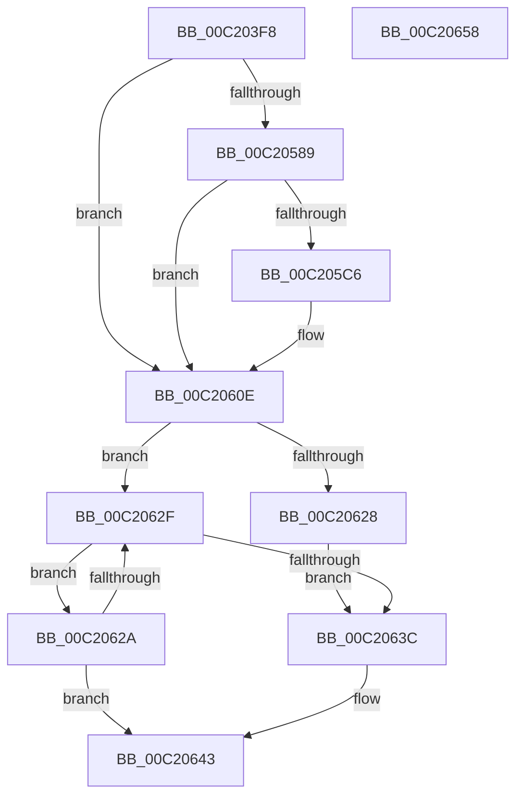

# HalpIommuInitDiscard

- RVA: `0x00C203F8`–`0x00C20659` (길이 `609` bytes)
- VA: `0x0000000140C203F8`
- 실행 섹션: `INIT`
- PDB 이름 있음: `예`; PDB Function 태그: `아니요`
- unwind 정보 RVA: `0x000606C0`
- 디코드: `115`개 명령, `609/609` bytes 표시
- 미해석 바이트: `0` (있으면 어셈블리에 `.byte`로 보존)

> 이 문서는 커널 이미지의 기계어와 PDB 기호를 분석해 생성했습니다. 4번과 5번은 함수 원형과 자료형을 바이너리 사용 방식에서 추정한 C 해석이며 원본 소스 복구 결과는 아닙니다.

## 1. Dependencies

- 직접 호출 지점: **3**; 고유 호출 대상: **3**
- 직접 호출자로 확인된 함수: **1**
- RIP 상대 이미지 참조: **49**

### Outgoing calls
- `0x00C205BA` → [HviGetHardwareFeatures](../../text/4A/HviGetHardwareFeatures_function_004ADBC0.md) (function, `0x004ADBC0`)
- `0x00C2060E` → [HalpIommuRegisterBuiltinPlugins](../../text/56/HalpIommuRegisterBuiltinPlugins_function_005689EC.md) (function, `0x005689EC`)
- `0x00C2064D` → [_security_check_cookie](../../text/6A/_security_check_cookie_function_006AC640.md) (function, `0x006AC640`)

### Direct callers
- [HalpIommuInitSystem](../../pagelk/B5/HalpIommuInitSystem_function_00B5D7E0.md) at `0x00B5D98B`

### Static image references
- `0x00C203FE` → RVA `0x00E0A740` (`.data`; read)
- `0x00C2040D` → RVA `0x00F8FAC0` (`.data`; read/write)
- `0x00C20415` → RVA `0x00F8FAB0` (`.data`; read)
- `0x00C2041C` → RVA `0x00FC18B8` (`.data`; read/write)
- `0x00C20424` → RVA `0x00C24F80` (`IommuGetConfiguration`; read)
- `0x00C2042B` → RVA `0x00FC18C0` (`.data`; read/write)
- `0x00C20436` → RVA `0x00F8FA98` (`.data`; read/write)
- `0x00C2043E` → RVA `0x00FC1ED0` (`.data`; read)
- `0x00C20445` → RVA `0x00F8FAB8` (`.data`; write)
- `0x00C2044C` → RVA `0x00F8FAB0` (`.data`; write)
- `0x00C20453` → RVA `0x00FC18D0` (`.data`; read)
- `0x00C2045A` → RVA `0x00FC18D8` (`.data`; write)
- `0x00C20461` → RVA `0x00FC18D0` (`.data`; write)
- `0x00C20468` → RVA `0x00FC1970` (`.data`; read)
- `0x00C2046F` → RVA `0x00FC1978` (`.data`; write)
- `0x00C20476` → RVA `0x00FC1970` (`.data`; write)
- `0x00C2047D` → RVA `0x00F8FAA0` (`.data`; read)
- `0x00C20484` → RVA `0x00F8FAA8` (`.data`; write)
- `0x00C2048B` → RVA `0x00F8FAA0` (`.data`; write)
- `0x00C20492` → RVA `0x00E06D28` (`.data`; read)
- `0x00C2049E` → RVA `0x00FC1711` (`.data`; write)
- `0x00C204A5` → RVA `0x00FC1730` (`.data`; write)
- `0x00C204B0` → RVA `0x00565990` (`IommuGetLibraryContext`; read)
- `0x00C204BB` → RVA `0x00565AB0` (`IommuMapDevice`; read)
- `0x00C204C6` → RVA `0x00565150` (`IommuEnableDevicePasid`; read)
- `0x00C204D1` → RVA `0x00566060` (`IommuSetAddressSpace`; read)
- `0x00C204DC` → RVA `0x00564E80` (`IommuDisableDevicePasid`; read)
- `0x00C204E7` → RVA `0x00566200` (`IommuUnmapDevice`; read)
- `0x00C204F2` → RVA `0x005656B0` (`IommuFlushTb`; read)
- `0x00C204FD` → RVA `0x005655C0` (`IommuFlushAllPasid`; read)
- `0x00C20508` → RVA `0x00565BA0` (`IommuProcessPageRequestQueue`; read)
- `0x00C20513` → RVA `0x00564DB0` (`IommuDevicePowerChange`; read)
- `0x00C20521` → RVA `0x00564A60` (`IommuBeginDeviceReset`; read)
- `0x00C2052F` → RVA `0x005653F0` (`IommuFinalizeDeviceReset`; read)
- `0x00C2053D` → RVA `0x00565860` (`IommuGetAtsSettings`; read)
- `0x00C2054B` → RVA `0x00564BB0` (`IommuCreateAtsDevice`; read)
- `0x00C20559` → RVA `0x00564D30` (`IommuDeleteAtsDevice`; read)
- `0x00C20567` → RVA `0x00FC1900` (`.data`; read)
- `0x00C2056E` → RVA `0x00FC1908` (`.data`; write)
- `0x00C20575` → RVA `0x00FC1900` (`.data`; write)
- `0x00C2057C` → RVA `0x00FC1710` (`.data`; write)
- `0x00C205A1` → RVA `0x00FC1712` (`.data`; write)
- `0x00C205CD` → RVA `0x00C24FD0` (`IommuHvGetConfiguration`; read)
- `0x00C205DF` → RVA `0x00566A50` (`IommuHvSetAddressSpace`; read)
- `0x00C205EA` → RVA `0x004CF9A0` (`IommuHvFlushTb`; read)
- `0x00C205F5` → RVA `0x004AE850` (`IommuHvFlushAllPasid`; read)
- `0x00C20600` → RVA `0x005669C0` (`IommuHvDevicePowerChange`; read)
- `0x00C20613` → RVA `0x00FC1740` (`.data`; read)
- `0x00C2063C` → RVA `0x00E0A80C` (`.data`; write)

## 2. Other-region calls and transfers

- 다른 실행 섹션으로 향하는 call: **3**
  - `0x00C205BA` → [HviGetHardwareFeatures](../../text/4A/HviGetHardwareFeatures_function_004ADBC0.md) (`INIT` → `.text`)
  - `0x00C2060E` → [HalpIommuRegisterBuiltinPlugins](../../text/56/HalpIommuRegisterBuiltinPlugins_function_005689EC.md) (`INIT` → `.text`)
  - `0x00C2064D` → [_security_check_cookie](../../text/6A/_security_check_cookie_function_006AC640.md) (`INIT` → `.text`)
- 별도 외부 분기/꼬리 이동을 확인하지 못했습니다.

## 3. Assembly (complete function range)

```asm
00C203F8  40 53                           push rbx
00C203FA  48 83 EC 50                     sub rsp, 0x50
00C203FE  48 8B 05 3B A3 1E 00            mov rax, qword ptr [rip + 0x1ea33b]
00C20405  48 33 C4                        xor rax, rsp
00C20408  48 89 44 24 40                  mov qword ptr [rsp + 0x40], rax
00C2040D  48 83 25 AB F6 36 00 00         and qword ptr [rip + 0x36f6ab], 0
00C20415  48 8D 05 94 F6 36 00            lea rax, [rip + 0x36f694]
00C2041C  48 83 25 94 14 3A 00 00         and qword ptr [rip + 0x3a1494], 0
00C20424  48 8D 0D 55 4B 00 00            lea rcx, [rip + 0x4b55]
00C2042B  48 83 25 8D 14 3A 00 00         and qword ptr [rip + 0x3a148d], 0
00C20433  0F 57 C0                        xorps xmm0, xmm0
00C20436  48 83 25 5A F6 36 00 00         and qword ptr [rip + 0x36f65a], 0
00C2043E  80 3D 8B 1A 3A 00 00            cmp byte ptr [rip + 0x3a1a8b], 0
00C20445  48 89 05 6C F6 36 00            mov qword ptr [rip + 0x36f66c], rax
00C2044C  48 89 05 5D F6 36 00            mov qword ptr [rip + 0x36f65d], rax
00C20453  48 8D 05 76 14 3A 00            lea rax, [rip + 0x3a1476]
00C2045A  48 89 05 77 14 3A 00            mov qword ptr [rip + 0x3a1477], rax
00C20461  48 89 05 68 14 3A 00            mov qword ptr [rip + 0x3a1468], rax
00C20468  48 8D 05 01 15 3A 00            lea rax, [rip + 0x3a1501]
00C2046F  48 89 05 02 15 3A 00            mov qword ptr [rip + 0x3a1502], rax
00C20476  48 89 05 F3 14 3A 00            mov qword ptr [rip + 0x3a14f3], rax
00C2047D  48 8D 05 1C F6 36 00            lea rax, [rip + 0x36f61c]
00C20484  48 89 05 1D F6 36 00            mov qword ptr [rip + 0x36f61d], rax
00C2048B  48 89 05 0E F6 36 00            mov qword ptr [rip + 0x36f60e], rax
00C20492  48 8B 05 8F 68 1E 00            mov rax, qword ptr [rip + 0x1e688f]
00C20499  0F 11 44 24 30                  movups xmmword ptr [rsp + 0x30], xmm0
00C2049E  C6 05 6C 12 3A 00 00            mov byte ptr [rip + 0x3a126c], 0
00C204A5  C6 05 84 12 3A 00 00            mov byte ptr [rip + 0x3a1284], 0
00C204AC  48 89 48 08                     mov qword ptr [rax + 8], rcx
00C204B0  48 8D 0D D9 54 94 FF            lea rcx, [rip - 0x6bab27]
00C204B7  48 89 48 10                     mov qword ptr [rax + 0x10], rcx
00C204BB  48 8D 0D EE 55 94 FF            lea rcx, [rip - 0x6baa12]
00C204C2  48 89 48 18                     mov qword ptr [rax + 0x18], rcx
00C204C6  48 8D 0D 83 4C 94 FF            lea rcx, [rip - 0x6bb37d]
00C204CD  48 89 48 20                     mov qword ptr [rax + 0x20], rcx
00C204D1  48 8D 0D 88 5B 94 FF            lea rcx, [rip - 0x6ba478]
00C204D8  48 89 48 28                     mov qword ptr [rax + 0x28], rcx
00C204DC  48 8D 0D 9D 49 94 FF            lea rcx, [rip - 0x6bb663]
00C204E3  48 89 48 30                     mov qword ptr [rax + 0x30], rcx
00C204E7  48 8D 0D 12 5D 94 FF            lea rcx, [rip - 0x6ba2ee]
00C204EE  48 89 48 38                     mov qword ptr [rax + 0x38], rcx
00C204F2  48 8D 0D B7 51 94 FF            lea rcx, [rip - 0x6bae49]
00C204F9  48 89 48 48                     mov qword ptr [rax + 0x48], rcx
00C204FD  48 8D 0D BC 50 94 FF            lea rcx, [rip - 0x6baf44]
00C20504  48 89 48 50                     mov qword ptr [rax + 0x50], rcx
00C20508  48 8D 0D 91 56 94 FF            lea rcx, [rip - 0x6ba96f]
00C2050F  48 89 48 58                     mov qword ptr [rax + 0x58], rcx
00C20513  48 8D 0D 96 48 94 FF            lea rcx, [rip - 0x6bb76a]
00C2051A  48 89 88 80 00 00 00            mov qword ptr [rax + 0x80], rcx
00C20521  48 8D 0D 38 45 94 FF            lea rcx, [rip - 0x6bbac8]
00C20528  48 89 88 88 00 00 00            mov qword ptr [rax + 0x88], rcx
00C2052F  48 8D 0D BA 4E 94 FF            lea rcx, [rip - 0x6bb146]
00C20536  48 89 88 90 00 00 00            mov qword ptr [rax + 0x90], rcx
00C2053D  48 8D 0D 1C 53 94 FF            lea rcx, [rip - 0x6bace4]
00C20544  48 89 88 98 00 00 00            mov qword ptr [rax + 0x98], rcx
00C2054B  48 8D 0D 5E 46 94 FF            lea rcx, [rip - 0x6bb9a2]
00C20552  48 89 88 A0 00 00 00            mov qword ptr [rax + 0xa0], rcx
00C20559  48 8D 0D D0 47 94 FF            lea rcx, [rip - 0x6bb830]
00C20560  48 89 88 A8 00 00 00            mov qword ptr [rax + 0xa8], rcx
00C20567  48 8D 05 92 13 3A 00            lea rax, [rip + 0x3a1392]
00C2056E  48 89 05 93 13 3A 00            mov qword ptr [rip + 0x3a1393], rax
00C20575  48 89 05 84 13 3A 00            mov qword ptr [rip + 0x3a1384], rax
00C2057C  C6 05 8D 11 3A 00 00            mov byte ptr [rip + 0x3a118d], 0
00C20583  0F 84 85 00 00 00               je 0x140c2060e
00C20589  33 C9                           xor ecx, ecx
00C2058B  41 B8 03 00 00 40               mov r8d, 0x40000003
00C20591  41 8B C0                        mov eax, r8d
00C20594  0F A2                           cpuid
00C20596  C1 EA 18                        shr edx, 0x18
00C20599  33 C9                           xor ecx, ecx
00C2059B  80 E2 01                        and dl, 1
00C2059E  41 8B C0                        mov eax, r8d
00C205A1  88 15 6B 11 3A 00               mov byte ptr [rip + 0x3a116b], dl
00C205A7  0F A2                           cpuid
00C205A9  C1 EA 19                        shr edx, 0x19
00C205AC  48 8D 4C 24 30                  lea rcx, [rsp + 0x30]
00C205B1  80 E2 01                        and dl, 1
00C205B4  88 15 57 11 3A 00               mov byte ptr [rip + 0x3a1157], dl
00C205BA  E8 01 D6 88 FF                  call 0x1404adbc0
00C205BF  F6 44 24 30 20                  test byte ptr [rsp + 0x30], 0x20
00C205C4  74 48                           je 0x140c2060e
00C205C6  48 8B 05 5B 67 1E 00            mov rax, qword ptr [rip + 0x1e675b]
00C205CD  48 8D 0D FC 49 00 00            lea rcx, [rip + 0x49fc]
00C205D4  C6 05 35 11 3A 00 01            mov byte ptr [rip + 0x3a1135], 1
00C205DB  48 89 48 08                     mov qword ptr [rax + 8], rcx
00C205DF  48 8D 0D 6A 64 94 FF            lea rcx, [rip - 0x6b9b96]
00C205E6  48 89 48 28                     mov qword ptr [rax + 0x28], rcx
00C205EA  48 8D 0D AF F3 8A FF            lea rcx, [rip - 0x750c51]
00C205F1  48 89 48 48                     mov qword ptr [rax + 0x48], rcx
00C205F5  48 8D 0D 54 E2 88 FF            lea rcx, [rip - 0x771dac]
00C205FC  48 89 48 50                     mov qword ptr [rax + 0x50], rcx
00C20600  48 8D 0D B9 63 94 FF            lea rcx, [rip - 0x6b9c47]
00C20607  48 89 88 80 00 00 00            mov qword ptr [rax + 0x80], rcx
00C2060E  E8 D9 83 94 FF                  call 0x1405689ec
00C20613  48 8B 0D 26 11 3A 00            mov rcx, qword ptr [rip + 0x3a1126]
00C2061A  48 8D 1D 1F 11 3A 00            lea rbx, [rip + 0x3a111f]
00C20621  8B D0                           mov edx, eax
00C20623  48 3B CB                        cmp rcx, rbx
00C20626  75 07                           jne 0x140c2062f
00C20628  EB 12                           jmp 0x140c2063c
00C2062A  48 3B CB                        cmp rcx, rbx
00C2062D  74 14                           je 0x140c20643
00C2062F  8B 81 D8 01 00 00               mov eax, dword ptr [rcx + 0x1d8]
00C20635  48 8B 09                        mov rcx, qword ptr [rcx]
00C20638  A8 40                           test al, 0x40
00C2063A  75 EE                           jne 0x140c2062a
00C2063C  C6 05 C9 A1 1E 00 00            mov byte ptr [rip + 0x1ea1c9], 0
00C20643  8B C2                           mov eax, edx
00C20645  48 8B 4C 24 40                  mov rcx, qword ptr [rsp + 0x40]
00C2064A  48 33 CC                        xor rcx, rsp
00C2064D  E8 EE BF A8 FF                  call 0x1406ac640
00C20652  48 83 C4 50                     add rsp, 0x50
00C20656  5B                              pop rbx
00C20657  C3                              ret
00C20658  CC                              int3
```

## 4. C-style interpretation (structured pseudocode)

```c
__int64 __fastcall HalpIommuInitDiscard(__int64 a1, int a2)
{
    __int64 result;
    __int64 v_rsp;
    unsigned __int64 v_stack_m18;
    unsigned __int64 v_stack_m28;

    v_rsp = (v_rsp) - (80);
    result = (*(unsigned __int64 *)(v_rip + 2007867)) ^ (v_rsp);
    v_stack_m18 = result;
    *(unsigned __int64 *)(v_rip + 3602028) = v_rip + 3602068;
    *(unsigned __int64 *)(v_rip + 3602013) = v_rip + 3602068;
    *(unsigned __int64 *)(v_rip + 3806327) = v_rip + 3806326;
    *(unsigned __int64 *)(v_rip + 3806312) = v_rip + 3806326;
    *(unsigned __int64 *)(v_rip + 3806466) = v_rip + 3806465;
    *(unsigned __int64 *)(v_rip + 3806451) = v_rip + 3806465;
    *(unsigned __int64 *)(v_rip + 3601949) = v_rip + 3601948;
    *(unsigned __int64 *)(v_rip + 3601934) = v_rip + 3601948;
    v_stack_m28 = v_xmm0;
    *(unsigned __int8 *)(v_rip + 3805804) = 0;
    *(unsigned __int8 *)(v_rip + 3805828) = 0;
    *(unsigned __int64 *)(*(unsigned __int64 *)(v_rip + 1992847) + 8) = v_rip + 19285;
    *(unsigned __int64 *)(*(unsigned __int64 *)(v_rip + 1992847) + 16) = v_rip - 7056167;
    *(unsigned __int64 *)(*(unsigned __int64 *)(v_rip + 1992847) + 24) = v_rip - 7055890;
    *(unsigned __int64 *)(*(unsigned __int64 *)(v_rip + 1992847) + 32) = v_rip - 7058301;
    *(unsigned __int64 *)(*(unsigned __int64 *)(v_rip + 1992847) + 40) = v_rip - 7054456;
    *(unsigned __int64 *)(*(unsigned __int64 *)(v_rip + 1992847) + 48) = v_rip - 7059043;
    *(unsigned __int64 *)(*(unsigned __int64 *)(v_rip + 1992847) + 56) = v_rip - 7054062;
    *(unsigned __int64 *)(*(unsigned __int64 *)(v_rip + 1992847) + 72) = v_rip - 7056969;
    *(unsigned __int64 *)(*(unsigned __int64 *)(v_rip + 1992847) + 80) = v_rip - 7057220;
    *(unsigned __int64 *)(*(unsigned __int64 *)(v_rip + 1992847) + 88) = v_rip - 7055727;
    *(unsigned __int64 *)(*(unsigned __int64 *)(v_rip + 1992847) + 128) = v_rip - 7059306;
    *(unsigned __int64 *)(*(unsigned __int64 *)(v_rip + 1992847) + 136) = v_rip - 7060168;
    *(unsigned __int64 *)(*(unsigned __int64 *)(v_rip + 1992847) + 144) = v_rip - 7057734;
    *(unsigned __int64 *)(*(unsigned __int64 *)(v_rip + 1992847) + 152) = v_rip - 7056612;
    *(unsigned __int64 *)(*(unsigned __int64 *)(v_rip + 1992847) + 160) = v_rip - 7059874;
    *(unsigned __int64 *)(*(unsigned __int64 *)(v_rip + 1992847) + 168) = v_rip - 7059504;
    *(unsigned __int64 *)(v_rip + 3806099) = v_rip + 3806098;
    *(unsigned __int64 *)(v_rip + 3806084) = v_rip + 3806098;
    *(unsigned __int8 *)(v_rip + 3805581) = 0;
    if ((*(unsigned __int8 *)(v_rip + 3807883)) == 0) goto loc_00C2060E;
    a1 = 0;
    a2 = (unsigned int)((a2) >> (24));
    a1 = 0;
    a2 = (unsigned __int8)((a2) & (1));
    *(unsigned __int8 *)(v_rip + 3805547) = (unsigned __int8)(a2);
    a2 = (unsigned int)((a2) >> (25));
    a2 = (unsigned __int8)((a2) & (1));
    *(unsigned __int8 *)(v_rip + 3805527) = (unsigned __int8)(a2);
    result = HviGetHardwareFeatures(v_stack_m28, a2, (unsigned int)(0x40000003ULL), a4);
    if (((v_stack_m28) & (32)) != 0) {
        result = *(unsigned __int64 *)(v_rip + 1992539);
        a1 = v_rip + 18940;
        *(unsigned __int8 *)(v_rip + 3805493) = 1;
        *(unsigned __int64 *)(result + 8) = a1;
        a1 = v_rip - 7052182;
        *(unsigned __int64 *)(result + 40) = a1;
        a1 = v_rip - 7670865;
        *(unsigned __int64 *)(result + 72) = a1;
        a1 = v_rip - 7806380;
        *(unsigned __int64 *)(result + 80) = a1;
        a1 = v_rip - 7052359;
        *(unsigned __int64 *)(result + 128) = a1;
    }
    result = HalpIommuRegisterBuiltinPlugins(a1, a2, (unsigned int)(0x40000003ULL), a4);
    if ((*(unsigned __int64 *)(v_rip + 3805478)) != (v_rip + 3805471)) goto loc_00C2062F;
    goto loc_00C2063C;
loc_00C2062A:
    if ((*(unsigned __int64 *)(v_rip + 3805478)) == (v_rip + 3805471)) goto loc_00C20643;
loc_00C2062F:
    if ((((unsigned __int8)((unsigned int)(*(unsigned int *)(*(unsigned __int64 *)(v_rip + 3805478) + 472)))) & (64)) != 0) goto loc_00C2062A;
loc_00C2063C:
    *(unsigned __int8 *)(v_rip + 2007497) = 0;
loc_00C20643:
    a1 = (v_stack_m18) ^ (v_rsp);
    result = _security_check_cookie(a1, (unsigned int)((unsigned int)(result)), (unsigned int)(0x40000003ULL), a4);
    v_rsp = (v_rsp) + (80);
    return result;
}
```

## 5. (Beta) C Style

```c
int64_t HalpIommuInitDiscard(int64_t Arg1, int32_t Arg2)
{
    int64_t result;
    int64_t local_rsp;
    uint64_t v_stack_m18;
    uint64_t v_stack_m28;

    local_rsp = (local_rsp) - (80);
    result = (*(uint64_t *)(v_rip + 0x1EA33B)) ^ (local_rsp);
    v_stack_m18 = result;
    *(uint64_t *)(v_rip + 0x36F66C) = v_rip + 3602068;
    *(uint64_t *)(v_rip + 0x36F65D) = v_rip + 3602068;
    *(uint64_t *)(v_rip + 0x3A1477) = v_rip + 3806326;
    *(uint64_t *)(v_rip + 0x3A1468) = v_rip + 3806326;
    *(uint64_t *)(v_rip + 0x3A1502) = v_rip + 3806465;
    *(uint64_t *)(v_rip + 0x3A14F3) = v_rip + 3806465;
    *(uint64_t *)(v_rip + 0x36F61D) = v_rip + 3601948;
    *(uint64_t *)(v_rip + 0x36F60E) = v_rip + 3601948;
    v_stack_m28 = v_xmm0;
    *(uint8_t *)(v_rip + 0x3A126C) = 0;
    *(uint8_t *)(v_rip + 0x3A1284) = 0;
    *(uint64_t *)(*(uint64_t *)(v_rip + 0x1E688F) + 0x8) = v_rip + 19285;
    *(uint64_t *)(*(uint64_t *)(v_rip + 0x1E688F) + 0x10) = v_rip - 7056167;
    *(uint64_t *)(*(uint64_t *)(v_rip + 0x1E688F) + 0x18) = v_rip - 7055890;
    *(uint64_t *)(*(uint64_t *)(v_rip + 0x1E688F) + 0x20) = v_rip - 7058301;
    *(uint64_t *)(*(uint64_t *)(v_rip + 0x1E688F) + 0x28) = v_rip - 7054456;
    *(uint64_t *)(*(uint64_t *)(v_rip + 0x1E688F) + 0x30) = v_rip - 7059043;
    *(uint64_t *)(*(uint64_t *)(v_rip + 0x1E688F) + 0x38) = v_rip - 7054062;
    *(uint64_t *)(*(uint64_t *)(v_rip + 0x1E688F) + 0x48) = v_rip - 7056969;
    *(uint64_t *)(*(uint64_t *)(v_rip + 0x1E688F) + 0x50) = v_rip - 7057220;
    *(uint64_t *)(*(uint64_t *)(v_rip + 0x1E688F) + 0x58) = v_rip - 7055727;
    *(uint64_t *)(*(uint64_t *)(v_rip + 0x1E688F) + 0x80) = v_rip - 7059306;
    *(uint64_t *)(*(uint64_t *)(v_rip + 0x1E688F) + 0x88) = v_rip - 7060168;
    *(uint64_t *)(*(uint64_t *)(v_rip + 0x1E688F) + 0x90) = v_rip - 7057734;
    *(uint64_t *)(*(uint64_t *)(v_rip + 0x1E688F) + 0x98) = v_rip - 7056612;
    *(uint64_t *)(*(uint64_t *)(v_rip + 0x1E688F) + 0xA0) = v_rip - 7059874;
    *(uint64_t *)(*(uint64_t *)(v_rip + 0x1E688F) + 0xA8) = v_rip - 7059504;
    *(uint64_t *)(v_rip + 0x3A1393) = v_rip + 3806098;
    *(uint64_t *)(v_rip + 0x3A1384) = v_rip + 3806098;
    *(uint8_t *)(v_rip + 0x3A118D) = 0;
    if ((*(uint8_t *)(v_rip + 0x3A1A8B)) == 0) goto loc_00C2060E;
    Arg1 = 0;
    Arg2 = (uint32_t)((Arg2) >> (24));
    Arg1 = 0;
    Arg2 = (uint8_t)((Arg2) & (1));
    *(uint8_t *)(v_rip + 0x3A116B) = (uint8_t)(Arg2);
    Arg2 = (uint32_t)((Arg2) >> (25));
    Arg2 = (uint8_t)((Arg2) & (1));
    *(uint8_t *)(v_rip + 0x3A1157) = (uint8_t)(Arg2);
    result = HviGetHardwareFeatures(v_stack_m28, Arg2, (uint32_t)(0x40000003ULL), a4);
    if (((v_stack_m28) & (32)) != 0) {
        result = *(uint64_t *)(v_rip + 0x1E675B);
        Arg1 = v_rip + 18940;
        *(uint8_t *)(v_rip + 0x3A1135) = 1;
        *(uint64_t *)(result + 0x8) = Arg1;
        Arg1 = v_rip - 7052182;
        *(uint64_t *)(result + 0x28) = Arg1;
        Arg1 = v_rip - 7670865;
        *(uint64_t *)(result + 0x48) = Arg1;
        Arg1 = v_rip - 7806380;
        *(uint64_t *)(result + 0x50) = Arg1;
        Arg1 = v_rip - 7052359;
        *(uint64_t *)(result + 0x80) = Arg1;
    }
    result = HalpIommuRegisterBuiltinPlugins(Arg1, Arg2, (uint32_t)(0x40000003ULL), a4);
    if ((*(uint64_t *)(v_rip + 0x3A1126)) != (v_rip + 3805471)) goto loc_00C2062F;
    goto loc_00C2063C;
loc_00C2062A:
    if ((*(uint64_t *)(v_rip + 0x3A1126)) == (v_rip + 3805471)) goto loc_00C20643;
loc_00C2062F:
    if ((((uint8_t)((uint32_t)(*(uint32_t *)(*(uint64_t *)(v_rip + 0x3A1126) + 0x1D8)))) & (64)) != 0) goto loc_00C2062A;
loc_00C2063C:
    *(uint8_t *)(v_rip + 0x1EA1C9) = 0;
loc_00C20643:
    Arg1 = (v_stack_m18) ^ (local_rsp);
    result = _security_check_cookie(Arg1, (uint32_t)((uint32_t)(result)), (uint32_t)(0x40000003ULL), a4);
    local_rsp = (local_rsp) + (80);
    return result;
}
```

## 6. Execution-region graph

[열기: 2D/3D 그래프와 함수 탐색 컨트롤 패널](../../../control-panel.html?section=init&rva=0x00C203F8&view=graph)

- 2D 그래프는 위에서 아래로 흐르고, 3D 그래프는 빈 공간을 드래그해 회전합니다. Shift+드래그는 이동, 휠은 확대·축소, 함수 노드 선택은 대상 보고서 이동입니다.

### Static fallback


