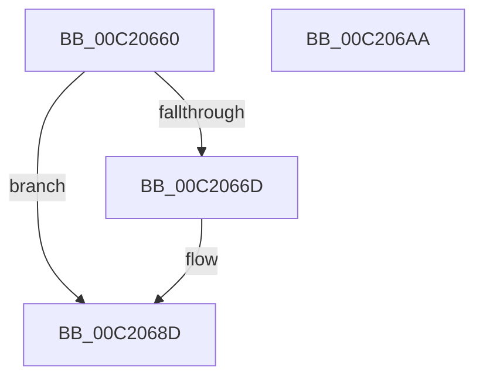

# HalpIommuRegisterDispatchTable

- RVA: `0x00C20660`–`0x00C206AB` (길이 `75` bytes)
- VA: `0x0000000140C20660`
- 실행 섹션: `INIT`
- PDB 이름 있음: `예`; PDB Function 태그: `아니요`
- unwind 정보 RVA: `0x0005D2F4`
- 디코드: `17`개 명령, `75/75` bytes 표시
- 미해석 바이트: `0` (있으면 어셈블리에 `.byte`로 보존)

> 이 문서는 커널 이미지의 기계어와 PDB 기호를 분석해 생성했습니다. 4번과 5번은 함수 원형과 자료형을 바이너리 사용 방식에서 추정한 C 해석이며 원본 소스 복구 결과는 아닙니다.

## 1. Dependencies

- 직접 호출 지점: **1**; 고유 호출 대상: **1**
- 직접 호출자로 확인된 함수: **0**
- RIP 상대 이미지 참조: **4**

### Outgoing calls
- `0x00C20687` → [KeBugCheckEx](../../text/4F/KeBugCheckEx_function_004FD660.md) (function, `0x004FD660`)

### Direct callers
- 이 함수 시작 RVA로 연결되는 직접 call은 확인되지 않았습니다. 간접 호출은 완전히 역산할 수 없습니다.

### Static image references
- `0x00C20664` → RVA `0x00FC18F4` (`.data`; read)
- `0x00C20676` → RVA `0x00E06D28` (`.data`; read)
- `0x00C20694` → RVA `0x00553920` (`HalpIommuSupportEnabled`; read)
- `0x00C2069B` → RVA `0x00FC18F4` (`.data`; write)

## 2. Other-region calls and transfers

- 다른 실행 섹션으로 향하는 call: **1**
  - `0x00C20687` → [KeBugCheckEx](../../text/4F/KeBugCheckEx_function_004FD660.md) (`INIT` → `.text`)
- 별도 외부 분기/꼬리 이동을 확인하지 못했습니다.

## 3. Assembly (complete function range)

```asm
00C20660  48 83 EC 38                     sub rsp, 0x38
00C20664  80 3D 89 12 3A 00 00            cmp byte ptr [rip + 0x3a1289], 0
00C2066B  74 20                           je 0x140c2068d
00C2066D  48 83 64 24 20 00               and qword ptr [rsp + 0x20], 0
00C20673  4C 8B C1                        mov r8, rcx
00C20676  4C 8B 0D AB 66 1E 00            mov r9, qword ptr [rip + 0x1e66ab]
00C2067D  B9 5C 00 00 00                  mov ecx, 0x5c
00C20682  BA 00 A0 00 00                  mov edx, 0xa000
00C20687  E8 D4 CF 8D FF                  call 0x1404fd660
00C2068C  CC                              int3
00C2068D  48 8B 05 94 66 1E 00            mov rax, qword ptr [rip + 0x1e6694]
00C20694  48 8D 0D 85 32 93 FF            lea rcx, [rip - 0x6ccd7b]
00C2069B  C6 05 52 12 3A 00 01            mov byte ptr [rip + 0x3a1252], 1
00C206A2  48 89 08                        mov qword ptr [rax], rcx
00C206A5  48 83 C4 38                     add rsp, 0x38
00C206A9  C3                              ret
00C206AA  CC                              int3
```

## 4. C-style interpretation (structured pseudocode)

```c
__int64 __fastcall HalpIommuRegisterDispatchTable(__int64 a1)
{
    __int64 result;
    __int64 v_rsp;
    unsigned __int64 v_stack_m18;

    v_rsp = (v_rsp) - (56);
    if ((*(unsigned __int8 *)(v_rip + 3805833)) != 0) {
        a3 = a1;
        a4 = *(unsigned __int64 *)(v_rip + 1992363);
        a1 = 92;
        a2 = 0xA000ULL;
        result = KeBugCheckEx(a1, a2, a3, a4);
    }
    *(unsigned __int8 *)(v_rip + 3805778) = 1;
    *(unsigned __int64 *)(*(unsigned __int64 *)(v_rip + 1992340)) = v_rip - 7130491;
    v_rsp = (v_rsp) + (56);
    return *(unsigned __int64 *)(v_rip + 1992340);
}
```

## 5. (Beta) C Style

```c
int64_t HalpIommuRegisterDispatchTable(int64_t Arg1)
{
    int64_t result;
    int64_t local_rsp;
    uint64_t v_stack_m18;

    local_rsp = (local_rsp) - (56);
    if ((*(uint8_t *)(v_rip + 0x3A1289)) != 0) {
        a3 = Arg1;
        a4 = *(uint64_t *)(v_rip + 0x1E66AB);
        Arg1 = 92;
        a2 = 0xA000ULL;
        result = KeBugCheckEx(Arg1, a2, a3, a4);
    }
    *(uint8_t *)(v_rip + 0x3A1252) = 1;
    *(uint64_t *)(*(uint64_t *)(v_rip + 0x1E6694)) = v_rip - 7130491;
    local_rsp = (local_rsp) + (56);
    return *(uint64_t *)(v_rip + 0x1E6694);
}
```

## 6. Execution-region graph

[열기: 2D/3D 그래프와 함수 탐색 컨트롤 패널](../../../control-panel.html?section=init&rva=0x00C20660&view=graph)

- 2D 그래프는 위에서 아래로 흐르고, 3D 그래프는 빈 공간을 드래그해 회전합니다. Shift+드래그는 이동, 휠은 확대·축소, 함수 노드 선택은 대상 보고서 이동입니다.

### Static fallback


