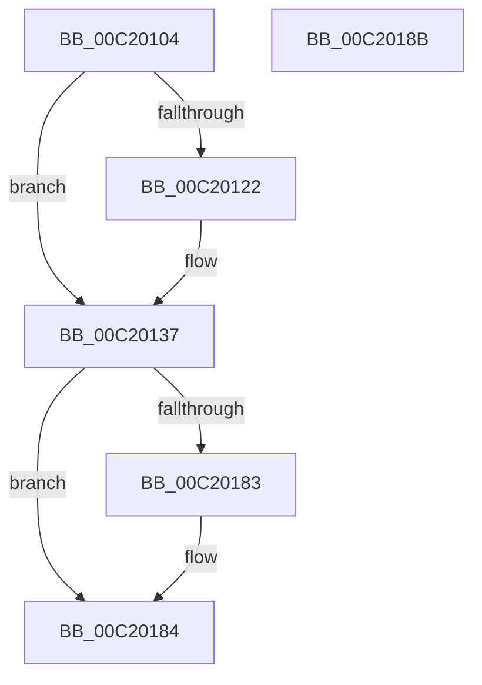

# HalpMiscInitDiscard

- RVA: `0x00C20104`–`0x00C2018C` (길이 `136` bytes)
- VA: `0x0000000140C20104`
- 실행 섹션: `INIT`
- PDB 이름 있음: `예`; PDB Function 태그: `아니요`
- unwind 정보 RVA: `0x0005D2F4`
- 디코드: `29`개 명령, `136/136` bytes 표시
- 미해석 바이트: `0` (있으면 어셈블리에 `.byte`로 보존)

> 이 문서는 커널 이미지의 기계어와 PDB 기호를 분석해 생성했습니다. 4번과 5번은 함수 원형과 자료형을 바이너리 사용 방식에서 추정한 C 해석이며 원본 소스 복구 결과는 아닙니다.

## 1. Dependencies

- 직접 호출 지점: **2**; 고유 호출 대상: **2**
- 직접 호출자로 확인된 함수: **1**
- RIP 상대 이미지 참조: **9**

### Outgoing calls
- `0x00C20131` → [KeBugCheckEx](../../text/4F/KeBugCheckEx_function_004FD660.md) (function, `0x004FD660`)
- `0x00C20175` → [KeRegisterBugCheckReasonCallback](../../text/47/KeRegisterBugCheckReasonCallback_function_004720A0.md) (function, `0x004720A0`)

### Direct callers
- [HalpMiscInitSystem](../../pagelk/B5/HalpMiscInitSystem_function_00B5D510.md) at `0x00B5D533`

### Static image references
- `0x00C20137` → RVA `0x00B7A990` (`HaliQuerySystemInformation`; read)
- `0x00C2013E` → RVA `0x00FC19EC` (`.data`; write)
- `0x00C20145` → RVA `0x00E00638` (`.data`; write)
- `0x00C2014C` → RVA `0x00024334` (`.rdata`; read)
- `0x00C20153` → RVA `0x00AB0850` (`HalpSetSystemInformation`; read)
- `0x00C20160` → RVA `0x0054E9A0` (`HalpMiscBugCheckCallback`; read)
- `0x00C20167` → RVA `0x00E00640` (`.data`; write)
- `0x00C2016E` → RVA `0x00FC19C0` (`.data`; read)
- `0x00C2017A` → RVA `0x00FC19B9` (`.data`; read)

## 2. Other-region calls and transfers

- 다른 실행 섹션으로 향하는 call: **2**
  - `0x00C20131` → [KeBugCheckEx](../../text/4F/KeBugCheckEx_function_004FD660.md) (`INIT` → `.text`)
  - `0x00C20175` → [KeRegisterBugCheckReasonCallback](../../text/47/KeRegisterBugCheckReasonCallback_function_004720A0.md) (`INIT` → `.text`)
- 별도 외부 분기/꼬리 이동을 확인하지 못했습니다.

## 3. Assembly (complete function range)

```asm
00C20104  48 83 EC 38                     sub rsp, 0x38
00C20108  65 48 8B 04 25 20 00 00 00      mov rax, qword ptr gs:[0x20]
00C20111  BA 01 00 00 00                  mov edx, 1
00C20116  0F B7 88 8A 00 00 00            movzx ecx, word ptr [rax + 0x8a]
00C2011D  66 3B CA                        cmp cx, dx
00C20120  74 15                           je 0x140c20137
00C20122  48 83 64 24 20 00               and qword ptr [rsp + 0x20], 0
00C20128  44 8B C1                        mov r8d, ecx
00C2012B  8D 4A 78                        lea ecx, [rdx + 0x78]
00C2012E  44 8B CA                        mov r9d, edx
00C20131  E8 2A D5 8D FF                  call 0x1404fd660
00C20136  CC                              int3
00C20137  48 8D 05 52 A8 F5 FF            lea rax, [rip - 0xa57ae]
00C2013E  C6 05 A7 18 3A 00 00            mov byte ptr [rip + 0x3a18a7], 0
00C20145  48 89 05 EC 04 1E 00            mov qword ptr [rip + 0x1e04ec], rax
00C2014C  4C 8D 0D E1 41 40 FF            lea r9, [rip - 0xbfbe1f]
00C20153  48 8D 05 F6 06 E9 FF            lea rax, [rip - 0x16f90a]
00C2015A  41 B8 09 00 00 00               mov r8d, 9
00C20160  48 8D 15 39 E8 92 FF            lea rdx, [rip - 0x6d17c7]
00C20167  48 89 05 D2 04 1E 00            mov qword ptr [rip + 0x1e04d2], rax
00C2016E  48 8D 0D 4B 18 3A 00            lea rcx, [rip + 0x3a184b]
00C20175  E8 26 1F 85 FF                  call 0x1404720a0
00C2017A  80 3D 38 18 3A 00 00            cmp byte ptr [rip + 0x3a1838], 0
00C20181  74 01                           je 0x140c20184
00C20183  CC                              int3
00C20184  33 C0                           xor eax, eax
00C20186  48 83 C4 38                     add rsp, 0x38
00C2018A  C3                              ret
00C2018B  CC                              int3
```

## 4. C-style interpretation (structured pseudocode)

```c
__int64 __fastcall HalpMiscInitDiscard(void)
{
    __int64 result;
    __int64 v_rsp;
    unsigned __int64 v_stack_m18;

    v_rsp = (v_rsp) - (56);
    result = *(unsigned __int64 *)(gs_base + (0 + 32));
    if (((unsigned __int16)(*(unsigned __int16 *)(*(unsigned __int64 *)(gs_base + (0 + 32)) + 138))) != 1) {
        a3 = (unsigned int)(*(unsigned __int16 *)(*(unsigned __int64 *)(gs_base + (0 + 32)) + 138));
        a1 = 1 + 120;
        a4 = 1;
        result = KeBugCheckEx(a1, 1, a3, a4);
    }
    *(unsigned __int8 *)(v_rip + 3807399) = 0;
    *(unsigned __int64 *)(v_rip + 1967340) = v_rip - 677806;
    *(unsigned __int64 *)(v_rip + 1967314) = v_rip - 1505546;
    result = KeRegisterBugCheckReasonCallback(v_rip + 3807307, v_rip - 7149511, 9, v_rip - 12566047);
    if ((*(unsigned __int8 *)(v_rip + 3807288)) != 0) {
    }
    result = 0;
    v_rsp = (v_rsp) + (56);
    return result;
}
```

## 5. (Beta) C Style

```c
void HalpMiscInitDiscard(void)
{
    int64_t result;
    int64_t local_rsp;
    uint64_t v_stack_m18;

    local_rsp = (local_rsp) - (56);
    result = *(uint64_t *)(gs_base + (0 + 0x20));
    if (((uint16_t)(*(uint16_t *)(*(uint64_t *)(gs_base + (0 + 0x20)) + 0x8A))) != 1) {
        a3 = (uint32_t)(*(uint16_t *)(*(uint64_t *)(gs_base + (0 + 0x20)) + 0x8A));
        a1 = 1 + 120;
        a4 = 1;
        result = KeBugCheckEx(a1, 1, a3, a4);
    }
    *(uint8_t *)(v_rip + 0x3A18A7) = 0;
    *(uint64_t *)(v_rip + 0x1E04EC) = v_rip - 677806;
    *(uint64_t *)(v_rip + 0x1E04D2) = v_rip - 1505546;
    result = KeRegisterBugCheckReasonCallback(v_rip + 3807307, v_rip - 7149511, 9, v_rip - 12566047);
    if ((*(uint8_t *)(v_rip + 0x3A1838)) != 0) {
    }
    result = 0;
    local_rsp = (local_rsp) + (56);
    return result;
}
```

## 6. Execution-region graph

[열기: 2D/3D 그래프와 함수 탐색 컨트롤 패널](../../../control-panel.html?section=init&rva=0x00C20104&view=graph)

- 2D 그래프는 위에서 아래로 흐르고, 3D 그래프는 빈 공간을 드래그해 회전합니다. Shift+드래그는 이동, 휠은 확대·축소, 함수 노드 선택은 대상 보고서 이동입니다.

### Static fallback


