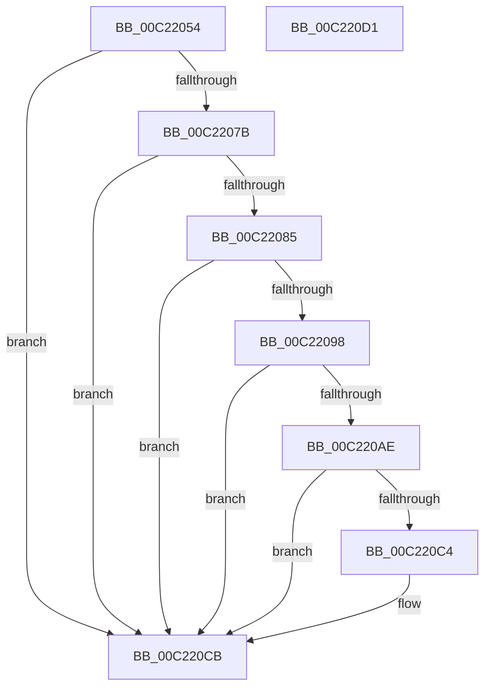

# HalpNumaInitializeHmaConfiguration

- RVA: `0x00C22054`–`0x00C220D2` (길이 `126` bytes)
- VA: `0x0000000140C22054`
- 실행 섹션: `INIT`
- PDB 이름 있음: `예`; PDB Function 태그: `아니요`
- unwind 정보 RVA: `0x0005CF00`
- 디코드: `35`개 명령, `126/126` bytes 표시
- 미해석 바이트: `0` (있으면 어셈블리에 `.byte`로 보존)

> 이 문서는 커널 이미지의 기계어와 PDB 기호를 분석해 생성했습니다. 4번과 5번은 함수 원형과 자료형을 바이너리 사용 방식에서 추정한 C 해석이며 원본 소스 복구 결과는 아닙니다.

## 1. Dependencies

- 직접 호출 지점: **4**; 고유 호출 대상: **3**
- 직접 호출자로 확인된 함수: **1**
- RIP 상대 이미지 참조: **3**

### Outgoing calls
- `0x00C2206A` → [HalpAcpiGetTable](../../text/3F/HalpAcpiGetTable_function_003F6BF8.md) (function, `0x003F6BF8`)
- `0x00C2208F` → [HalpNumaParseHmat](HalpNumaParseHmat_function_00C22980.md) (function, `0x00C22980`)
- `0x00C220A1` → [HalpMmAllocateMemoryInternal](../../text/54/HalpMmAllocateMemoryInternal_function_00544990.md) (function, `0x00544990`)
- `0x00C220BB` → [HalpNumaParseHmat](HalpNumaParseHmat_function_00C22980.md) (function, `0x00C22980`)

### Direct callers
- [HalpSetupAcpiPhase0](HalpSetupAcpiPhase0_function_00C23EDC.md) at `0x00C24004`

### Static image references
- `0x00C2206F` → RVA `0x00F90648` (`.data`; write)
- `0x00C2207B` → RVA `0x00F90618` (`.data`; read)
- `0x00C220C4` → RVA `0x00F90640` (`.data`; write)

## 2. Other-region calls and transfers

- 다른 실행 섹션으로 향하는 call: **2**
  - `0x00C2206A` → [HalpAcpiGetTable](../../text/3F/HalpAcpiGetTable_function_003F6BF8.md) (`INIT` → `.text`)
  - `0x00C220A1` → [HalpMmAllocateMemoryInternal](../../text/54/HalpMmAllocateMemoryInternal_function_00544990.md) (`INIT` → `.text`)
- 별도 외부 분기/꼬리 이동을 확인하지 못했습니다.

## 3. Assembly (complete function range)

```asm
00C22054  40 53                           push rbx
00C22056  48 83 EC 20                     sub rsp, 0x20
00C2205A  83 64 24 38 00                  and dword ptr [rsp + 0x38], 0
00C2205F  45 33 C9                        xor r9d, r9d
00C22062  45 33 C0                        xor r8d, r8d
00C22065  BA 48 4D 41 54                  mov edx, 0x54414d48
00C2206A  E8 89 4B 7D FF                  call 0x1403f6bf8
00C2206F  48 89 05 D2 E5 36 00            mov qword ptr [rip + 0x36e5d2], rax
00C22076  48 85 C0                        test rax, rax
00C22079  74 50                           je 0x140c220cb
00C2207B  48 83 3D 95 E5 36 00 00         cmp qword ptr [rip + 0x36e595], 0
00C22083  74 46                           je 0x140c220cb
00C22085  4C 8D 4C 24 38                  lea r9, [rsp + 0x38]
00C2208A  45 33 C0                        xor r8d, r8d
00C2208D  33 D2                           xor edx, edx
00C2208F  E8 EC 08 00 00                  call 0x140c22980
00C22094  85 C0                           test eax, eax
00C22096  78 33                           js 0x140c220cb
00C22098  8B 4C 24 38                     mov ecx, dword ptr [rsp + 0x38]
00C2209C  BA 01 00 00 00                  mov edx, 1
00C220A1  E8 EA 28 92 FF                  call 0x140544990
00C220A6  48 8B D8                        mov rbx, rax
00C220A9  48 85 C0                        test rax, rax
00C220AC  74 1D                           je 0x140c220cb
00C220AE  44 8B 44 24 38                  mov r8d, dword ptr [rsp + 0x38]
00C220B3  4C 8D 4C 24 38                  lea r9, [rsp + 0x38]
00C220B8  48 8B D0                        mov rdx, rax
00C220BB  E8 C0 08 00 00                  call 0x140c22980
00C220C0  85 C0                           test eax, eax
00C220C2  78 07                           js 0x140c220cb
00C220C4  48 89 1D 75 E5 36 00            mov qword ptr [rip + 0x36e575], rbx
00C220CB  48 83 C4 20                     add rsp, 0x20
00C220CF  5B                              pop rbx
00C220D0  C3                              ret
00C220D1  CC                              int3
```

## 4. C-style interpretation (structured pseudocode)

```c
__int64 __fastcall HalpNumaInitializeHmaConfiguration(__int64 a1, __int64 a2, int a3, int a4)
{
    __int64 result;
    __int64 v_rsp;
    unsigned int v_stack_p10;

    v_rsp = (v_rsp) - (32);
    a4 = 0;
    a3 = 0;
    result = HalpAcpiGetTable(a1, (unsigned int)(0x54414D48ULL), a3, a4);
    *(unsigned __int64 *)(v_rip + 3597778) = result;
    if (result == 0) goto loc_00C220CB;
    if ((*(unsigned __int64 *)(v_rip + 3597717)) == 0) goto loc_00C220CB;
    a3 = 0;
    a2 = 0;
    result = HalpNumaParseHmat(a1, a2, a3, v_stack_p10);
    if (sign_flag) goto loc_00C220CB;
    result = HalpMmAllocateMemoryInternal((unsigned int)(v_stack_p10), 1, a3, v_stack_p10);
    if (result == 0) goto loc_00C220CB;
    result = HalpNumaParseHmat((unsigned int)(v_stack_p10), result, (unsigned int)(v_stack_p10), v_stack_p10);
    if (!(sign_flag)) {
        *(unsigned __int64 *)(v_rip + 3597685) = result;
    }
    v_rsp = (v_rsp) + (32);
    return result;
}
```

## 5. (Beta) C Style

```c
int64_t HalpNumaInitializeHmaConfiguration(int64_t Arg1, int64_t Arg2, int32_t Arg3, int32_t Arg4)
{
    int64_t result;
    int64_t local_rsp;
    uint32_t v_stack_p10;

    local_rsp = (local_rsp) - (32);
    Arg4 = 0;
    Arg3 = 0;
    result = HalpAcpiGetTable(Arg1, (uint32_t)(0x54414D48ULL), Arg3, Arg4);
    *(uint64_t *)(v_rip + 0x36E5D2) = result;
    if (result == 0) goto loc_00C220CB;
    if ((*(uint64_t *)(v_rip + 0x36E595)) == 0) goto loc_00C220CB;
    Arg3 = 0;
    Arg2 = 0;
    result = HalpNumaParseHmat(Arg1, Arg2, Arg3, v_stack_p10);
    if (sign_flag) goto loc_00C220CB;
    result = HalpMmAllocateMemoryInternal((uint32_t)(v_stack_p10), 1, Arg3, v_stack_p10);
    if (result == 0) goto loc_00C220CB;
    result = HalpNumaParseHmat((uint32_t)(v_stack_p10), result, (uint32_t)(v_stack_p10), v_stack_p10);
    if (!(sign_flag)) {
        *(uint64_t *)(v_rip + 0x36E575) = result;
    }
    local_rsp = (local_rsp) + (32);
    return result;
}
```

## 6. Execution-region graph

[열기: 2D/3D 그래프와 함수 탐색 컨트롤 패널](../../../control-panel.html?section=init&rva=0x00C22054&view=graph)

- 2D 그래프는 위에서 아래로 흐르고, 3D 그래프는 빈 공간을 드래그해 회전합니다. Shift+드래그는 이동, 휠은 확대·축소, 함수 노드 선택은 대상 보고서 이동입니다.

### Static fallback


