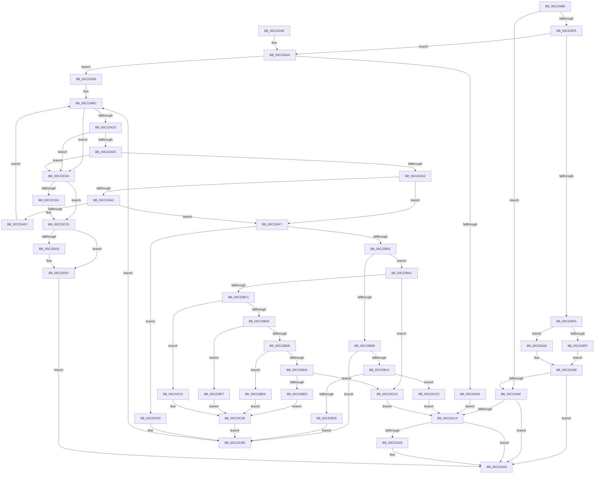

# HalpNumaParseHmat

- RVA: `0x00C22980`–`0x00C22D0E` (길이 `910` bytes)
- VA: `0x0000000140C22980`
- 실행 섹션: `INIT`
- PDB 이름 있음: `예`; PDB Function 태그: `아니요`
- unwind 정보 RVA: `0x000C46D0`
- 디코드: `257`개 명령, `910/910` bytes 표시
- 미해석 바이트: `0` (있으면 어셈블리에 `.byte`로 보존)

> 이 문서는 커널 이미지의 기계어와 PDB 기호를 분석해 생성했습니다. 4번과 5번은 함수 원형과 자료형을 바이너리 사용 방식에서 추정한 C 해석이며 원본 소스 복구 결과는 아닙니다.

## 1. Dependencies

- 직접 호출 지점: **7**; 고유 호출 대상: **6**
- 직접 호출자로 확인된 함수: **1**
- RIP 상대 이미지 참조: **2**

### Outgoing calls
- `0x00C229EA` → [HalpNumaGetHmatConfigSize](../../text/55/HalpNumaGetHmatConfigSize_function_00559230.md) (function, `0x00559230`)
- `0x00C22A1C` → [memset](../../text/6C/memset_function_006C6C40.md) (function, `0x006C6C40`)
- `0x00C22A61` → [memset](../../text/6C/memset_function_006C6C40.md) (function, `0x006C6C40`)
- `0x00C22B1B` → [HalpNumaQueryProximityNode](../../text/55/HalpNumaQueryProximityNode_function_00559790.md) (function, `0x00559790`)
- `0x00C22BB4` → [HalpNumaCalculateSllbiSize](../../text/55/HalpNumaCalculateSllbiSize_function_005591C0.md) (function, `0x005591C0`)
- `0x00C22C58` → [memcpy](../../text/6C/memcpy_function_006C6840.md) (function, `0x006C6840`)
- `0x00C22CF8` → [qsort](../../text/50/qsort_function_005009F0.md) (function, `0x005009F0`)

### Direct callers
- [HalpNumaInitializeHmaConfiguration](HalpNumaInitializeHmaConfiguration_function_00C22054.md) at `0x00C2208F`
- [HalpNumaInitializeHmaConfiguration](HalpNumaInitializeHmaConfiguration_function_00C22054.md) at `0x00C220BB`

### Static image references
- `0x00C229A3` → RVA `0x00F90648` (`.data`; read)
- `0x00C22CE8` → RVA `0x00C22030` (`HalpNumaCompareMemorySideCacheEntries`; read)

## 2. Other-region calls and transfers

- 다른 실행 섹션으로 향하는 call: **7**
  - `0x00C229EA` → [HalpNumaGetHmatConfigSize](../../text/55/HalpNumaGetHmatConfigSize_function_00559230.md) (`INIT` → `.text`)
  - `0x00C22A1C` → [memset](../../text/6C/memset_function_006C6C40.md) (`INIT` → `.text`)
  - `0x00C22A61` → [memset](../../text/6C/memset_function_006C6C40.md) (`INIT` → `.text`)
  - `0x00C22B1B` → [HalpNumaQueryProximityNode](../../text/55/HalpNumaQueryProximityNode_function_00559790.md) (`INIT` → `.text`)
  - `0x00C22BB4` → [HalpNumaCalculateSllbiSize](../../text/55/HalpNumaCalculateSllbiSize_function_005591C0.md) (`INIT` → `.text`)
  - `0x00C22C58` → [memcpy](../../text/6C/memcpy_function_006C6840.md) (`INIT` → `.text`)
  - `0x00C22CF8` → [qsort](../../text/50/qsort_function_005009F0.md) (`INIT` → `.text`)
- 별도 외부 분기/꼬리 이동을 확인하지 못했습니다.

## 3. Assembly (complete function range)

```asm
00C22980  4C 8B DC                        mov r11, rsp
00C22983  49 89 5B 10                     mov qword ptr [r11 + 0x10], rbx
00C22987  49 89 73 18                     mov qword ptr [r11 + 0x18], rsi
00C2298B  49 89 7B 20                     mov qword ptr [r11 + 0x20], rdi
00C2298F  49 89 4B 08                     mov qword ptr [r11 + 8], rcx
00C22993  55                              push rbp
00C22994  41 54                           push r12
00C22996  41 55                           push r13
00C22998  41 56                           push r14
00C2299A  41 57                           push r15
00C2299C  48 8B EC                        mov rbp, rsp
00C2299F  48 83 EC 70                     sub rsp, 0x70
00C229A3  4C 8B 25 9E DC 36 00            mov r12, qword ptr [rip + 0x36dc9e]
00C229AA  48 8D 45 C8                     lea rax, [rbp - 0x38]
00C229AE  45 33 ED                        xor r13d, r13d
00C229B1  45 8B F8                        mov r15d, r8d
00C229B4  49 8B F1                        mov rsi, r9
00C229B7  4C 89 65 E8                     mov qword ptr [rbp - 0x18], r12
00C229BB  48 8B FA                        mov rdi, rdx
00C229BE  44 89 6D C8                     mov dword ptr [rbp - 0x38], r13d
00C229C2  49 8B CC                        mov rcx, r12
00C229C5  44 89 6D C4                     mov dword ptr [rbp - 0x3c], r13d
00C229C9  4C 8D 4D CC                     lea r9, [rbp - 0x34]
00C229CD  44 89 6D CC                     mov dword ptr [rbp - 0x34], r13d
00C229D1  4C 8D 45 C0                     lea r8, [rbp - 0x40]
00C229D5  66 44 89 6D 30                  mov word ptr [rbp + 0x30], r13w
00C229DA  48 8D 55 C4                     lea rdx, [rbp - 0x3c]
00C229DE  44 89 6D D0                     mov dword ptr [rbp - 0x30], r13d
00C229E2  44 89 6D C0                     mov dword ptr [rbp - 0x40], r13d
00C229E6  49 89 43 88                     mov qword ptr [r11 - 0x78], rax
00C229EA  E8 41 68 93 FF                  call 0x140559230
00C229EF  8B D8                           mov ebx, eax
00C229F1  85 C0                           test eax, eax
00C229F3  78 1A                           js 0x140c22a0f
00C229F5  45 85 FF                        test r15d, r15d
00C229F8  75 50                           jne 0x140c22a4a
00C229FA  48 85 F6                        test rsi, rsi
00C229FD  74 07                           je 0x140c22a06
00C229FF  8B 4D C8                        mov ecx, dword ptr [rbp - 0x38]
00C22A02  89 0E                           mov dword ptr [rsi], ecx
00C22A04  EB 05                           jmp 0x140c22a0b
00C22A06  BB 0D 00 00 C0                  mov ebx, 0xc000000d
00C22A0B  85 DB                           test ebx, ebx
00C22A0D  79 1A                           jns 0x140c22a29
00C22A0F  45 85 FF                        test r15d, r15d
00C22A12  74 15                           je 0x140c22a29
00C22A14  4D 8B C7                        mov r8, r15
00C22A17  33 D2                           xor edx, edx
00C22A19  48 8B CF                        mov rcx, rdi
00C22A1C  E8 1F 42 AA FF                  call 0x1406c6c40
00C22A21  48 85 F6                        test rsi, rsi
00C22A24  74 03                           je 0x140c22a29
00C22A26  44 89 3E                        mov dword ptr [rsi], r15d
00C22A29  4C 8D 5C 24 70                  lea r11, [rsp + 0x70]
00C22A2E  8B C3                           mov eax, ebx
00C22A30  49 8B 5B 38                     mov rbx, qword ptr [r11 + 0x38]
00C22A34  49 8B 73 40                     mov rsi, qword ptr [r11 + 0x40]
00C22A38  49 8B 7B 48                     mov rdi, qword ptr [r11 + 0x48]
00C22A3C  49 8B E3                        mov rsp, r11
00C22A3F  41 5F                           pop r15
00C22A41  41 5E                           pop r14
00C22A43  41 5D                           pop r13
00C22A45  41 5C                           pop r12
00C22A47  5D                              pop rbp
00C22A48  C3                              ret
00C22A49  CC                              int3
00C22A4A  8B 45 C8                        mov eax, dword ptr [rbp - 0x38]
00C22A4D  44 3B F8                        cmp r15d, eax
00C22A50  73 07                           jae 0x140c22a59
00C22A52  BB 23 00 00 C0                  mov ebx, 0xc0000023
00C22A57  EB BB                           jmp 0x140c22a14
00C22A59  4C 8B C0                        mov r8, rax
00C22A5C  33 D2                           xor edx, edx
00C22A5E  48 8B CF                        mov rcx, rdi
00C22A61  E8 DA 41 AA FF                  call 0x1406c6c40
00C22A66  8B 55 C4                        mov edx, dword ptr [rbp - 0x3c]
00C22A69  4C 8D 47 18                     lea r8, [rdi + 0x18]
00C22A6D  8B 4D C0                        mov ecx, dword ptr [rbp - 0x40]
00C22A70  49 8D 5C 24 28                  lea rbx, [r12 + 0x28]
00C22A75  83 C2 18                        add edx, 0x18
00C22A78  C7 47 0C 18 00 00 00            mov dword ptr [rdi + 0xc], 0x18
00C22A7F  03 CA                           add ecx, edx
00C22A81  44 8B F2                        mov r14d, edx
00C22A84  89 4F 14                        mov dword ptr [rdi + 0x14], ecx
00C22A87  4C 03 F7                        add r14, rdi
00C22A8A  48 03 CF                        add rcx, rdi
00C22A8D  89 57 10                        mov dword ptr [rdi + 0x10], edx
00C22A90  41 8B 54 24 04                  mov edx, dword ptr [r12 + 4]
00C22A95  45 8B CD                        mov r9d, r13d
00C22A98  49 03 D4                        add rdx, r12
00C22A9B  48 89 4D F0                     mov qword ptr [rbp - 0x10], rcx
00C22A9F  4C 89 45 D8                     mov qword ptr [rbp - 0x28], r8
00C22AA3  45 8B D5                        mov r10d, r13d
00C22AA6  4C 8D 61 08                     lea r12, [rcx + 8]
00C22AAA  44 89 6D C4                     mov dword ptr [rbp - 0x3c], r13d
00C22AAE  44 89 6D C0                     mov dword ptr [rbp - 0x40], r13d
00C22AB2  41 BB 01 00 00 00               mov r11d, 1
00C22AB8  48 89 55 E0                     mov qword ptr [rbp - 0x20], rdx
00C22ABC  48 8D 43 08                     lea rax, [rbx + 8]
00C22AC0  48 3B C2                        cmp rax, rdx
00C22AC3  0F 87 0B 02 00 00               ja 0x140c22cd4
00C22AC9  8B 43 04                        mov eax, dword ptr [rbx + 4]
00C22ACC  83 F8 08                        cmp eax, 8
00C22ACF  0F 82 FF 01 00 00               jb 0x140c22cd4
00C22AD5  48 8D 0C 03                     lea rcx, [rbx + rax]
00C22AD9  48 3B CA                        cmp rcx, rdx
00C22ADC  0F 87 F2 01 00 00               ja 0x140c22cd4
00C22AE2  48 8B 45 E8                     mov rax, qword ptr [rbp - 0x18]
00C22AE6  80 78 08 02                     cmp byte ptr [rax + 8], 2
00C22AEA  73 0B                           jae 0x140c22af7
00C22AEC  66 44 39 1B                     cmp word ptr [rbx], r11w
00C22AF0  77 05                           ja 0x140c22af7
00C22AF2  48 8B D9                        mov rbx, rcx
00C22AF5  EB C5                           jmp 0x140c22abc
00C22AF7  0F B7 0B                        movzx ecx, word ptr [rbx]
00C22AFA  85 C9                           test ecx, ecx
00C22AFC  0F 84 80 01 00 00               je 0x140c22c82
00C22B02  83 E9 01                        sub ecx, 1
00C22B05  0F 84 96 00 00 00               je 0x140c22ba1
00C22B0B  83 F9 01                        cmp ecx, 1
00C22B0E  0F 85 A1 01 00 00               jne 0x140c22cb5
00C22B14  8B 4B 08                        mov ecx, dword ptr [rbx + 8]
00C22B17  48 8D 55 30                     lea rdx, [rbp + 0x30]
00C22B1B  E8 70 6C 93 FF                  call 0x140559790
00C22B20  85 C0                           test eax, eax
00C22B22  0F 88 98 01 00 00               js 0x140c22cc0
00C22B28  0F B7 45 30                     movzx eax, word ptr [rbp + 0x30]
00C22B2C  41 BB 01 00 00 00               mov r11d, 1
00C22B32  4C 8B 45 D8                     mov r8, qword ptr [rbp - 0x28]
00C22B36  45 03 EB                        add r13d, r11d
00C22B39  48 8B 55 E0                     mov rdx, qword ptr [rbp - 0x20]
00C22B3D  44 8B 4D C4                     mov r9d, dword ptr [rbp - 0x3c]
00C22B41  44 8B 55 C0                     mov r10d, dword ptr [rbp - 0x40]
00C22B45  41 89 44 24 F8                  mov dword ptr [r12 - 8], eax
00C22B4A  8B 43 08                        mov eax, dword ptr [rbx + 8]
00C22B4D  41 89 44 24 FC                  mov dword ptr [r12 - 4], eax
00C22B52  48 8B 43 10                     mov rax, qword ptr [rbx + 0x10]
00C22B56  49 89 04 24                     mov qword ptr [r12], rax
00C22B5A  8B 43 18                        mov eax, dword ptr [rbx + 0x18]
00C22B5D  83 E0 0F                        and eax, 0xf
00C22B60  41 89 44 24 08                  mov dword ptr [r12 + 8], eax
00C22B65  8B 43 18                        mov eax, dword ptr [rbx + 0x18]
00C22B68  C1 E8 04                        shr eax, 4
00C22B6B  83 E0 0F                        and eax, 0xf
00C22B6E  41 89 44 24 0C                  mov dword ptr [r12 + 0xc], eax
00C22B73  8B 43 18                        mov eax, dword ptr [rbx + 0x18]
00C22B76  C1 E8 08                        shr eax, 8
00C22B79  83 E0 0F                        and eax, 0xf
00C22B7C  41 89 44 24 10                  mov dword ptr [r12 + 0x10], eax
00C22B81  8B 43 18                        mov eax, dword ptr [rbx + 0x18]
00C22B84  C1 E8 0C                        shr eax, 0xc
00C22B87  83 E0 0F                        and eax, 0xf
00C22B8A  41 89 44 24 14                  mov dword ptr [r12 + 0x14], eax
00C22B8F  0F B7 43 1A                     movzx eax, word ptr [rbx + 0x1a]
00C22B93  41 89 44 24 18                  mov dword ptr [r12 + 0x18], eax
00C22B98  49 83 C4 28                     add r12, 0x28
00C22B9C  E9 14 01 00 00                  jmp 0x140c22cb5
00C22BA1  8B 43 10                        mov eax, dword ptr [rbx + 0x10]
00C22BA4  4C 8D 45 D0                     lea r8, [rbp - 0x30]
00C22BA8  44 8B 5B 0C                     mov r11d, dword ptr [rbx + 0xc]
00C22BAC  8B D0                           mov edx, eax
00C22BAE  41 8B CB                        mov ecx, r11d
00C22BB1  89 45 CC                        mov dword ptr [rbp - 0x34], eax
00C22BB4  E8 07 66 93 FF                  call 0x1405591c0
00C22BB9  85 C0                           test eax, eax
00C22BBB  0F 88 09 01 00 00               js 0x140c22cca
00C22BC1  8B 55 D0                        mov edx, dword ptr [rbp - 0x30]
00C22BC4  41 89 16                        mov dword ptr [r14], edx
00C22BC7  0F B6 4B 08                     movzx ecx, byte ptr [rbx + 8]
00C22BCB  83 E1 0F                        and ecx, 0xf
00C22BCE  74 31                           je 0x140c22c01
00C22BD0  83 E9 01                        sub ecx, 1
00C22BD3  74 22                           je 0x140c22bf7
00C22BD5  83 E9 01                        sub ecx, 1
00C22BD8  74 13                           je 0x140c22bed
00C22BDA  83 F9 01                        cmp ecx, 1
00C22BDD  0F 85 E7 00 00 00               jne 0x140c22cca
00C22BE3  41 C7 46 04 03 00 00 00         mov dword ptr [r14 + 4], 3
00C22BEB  EB 19                           jmp 0x140c22c06
00C22BED  41 C7 46 04 02 00 00 00         mov dword ptr [r14 + 4], 2
00C22BF5  EB 0F                           jmp 0x140c22c06
00C22BF7  41 C7 46 04 01 00 00 00         mov dword ptr [r14 + 4], 1
00C22BFF  EB 05                           jmp 0x140c22c06
00C22C01  41 83 66 04 00                  and dword ptr [r14 + 4], 0
00C22C06  8A 43 09                        mov al, byte ptr [rbx + 9]
00C22C09  4C 8D 42 D8                     lea r8, [rdx - 0x28]
00C22C0D  41 88 46 09                     mov byte ptr [r14 + 9], al
00C22C11  48 8D 53 20                     lea rdx, [rbx + 0x20]
00C22C15  8A 4B 08                        mov cl, byte ptr [rbx + 8]
00C22C18  41 8A 46 08                     mov al, byte ptr [r14 + 8]
00C22C1C  C0 E9 04                        shr cl, 4
00C22C1F  32 C8                           xor cl, al
00C22C21  80 E1 01                        and cl, 1
00C22C24  32 C8                           xor cl, al
00C22C26  41 88 4E 08                     mov byte ptr [r14 + 8], cl
00C22C2A  8A 43 08                        mov al, byte ptr [rbx + 8]
00C22C2D  C0 E8 04                        shr al, 4
00C22C30  32 C1                           xor al, cl
00C22C32  24 02                           and al, 2
00C22C34  32 C1                           xor al, cl
00C22C36  49 8D 4E 20                     lea rcx, [r14 + 0x20]
00C22C3A  41 88 46 08                     mov byte ptr [r14 + 8], al
00C22C3E  8A 43 0A                        mov al, byte ptr [rbx + 0xa]
00C22C41  41 88 46 0A                     mov byte ptr [r14 + 0xa], al
00C22C45  8B 45 CC                        mov eax, dword ptr [rbp - 0x34]
00C22C48  41 89 46 10                     mov dword ptr [r14 + 0x10], eax
00C22C4C  45 89 5E 0C                     mov dword ptr [r14 + 0xc], r11d
00C22C50  48 8B 43 18                     mov rax, qword ptr [rbx + 0x18]
00C22C54  49 89 46 18                     mov qword ptr [r14 + 0x18], rax
00C22C58  E8 E3 3B AA FF                  call 0x1406c6840
00C22C5D  44 8B 55 C0                     mov r10d, dword ptr [rbp - 0x40]
00C22C61  41 BB 01 00 00 00               mov r11d, 1
00C22C67  41 8B 06                        mov eax, dword ptr [r14]
00C22C6A  45 03 D3                        add r10d, r11d
00C22C6D  4C 8B 45 D8                     mov r8, qword ptr [rbp - 0x28]
00C22C71  4C 03 F0                        add r14, rax
00C22C74  48 8B 55 E0                     mov rdx, qword ptr [rbp - 0x20]
00C22C78  44 8B 4D C4                     mov r9d, dword ptr [rbp - 0x3c]
00C22C7C  44 89 55 C0                     mov dword ptr [rbp - 0x40], r10d
00C22C80  EB 33                           jmp 0x140c22cb5
00C22C82  41 0F B7 00                     movzx eax, word ptr [r8]
00C22C86  45 03 CB                        add r9d, r11d
00C22C89  0F B7 C8                        movzx ecx, ax
00C22C8C  44 89 4D C4                     mov dword ptr [rbp - 0x3c], r9d
00C22C90  66 33 4B 08                     xor cx, word ptr [rbx + 8]
00C22C94  66 41 23 CB                     and cx, r11w
00C22C98  66 33 C8                        xor cx, ax
00C22C9B  66 41 89 08                     mov word ptr [r8], cx
00C22C9F  8B 43 0C                        mov eax, dword ptr [rbx + 0xc]
00C22CA2  41 89 40 04                     mov dword ptr [r8 + 4], eax
00C22CA6  8B 43 10                        mov eax, dword ptr [rbx + 0x10]
00C22CA9  41 89 40 08                     mov dword ptr [r8 + 8], eax
00C22CAD  49 83 C0 0C                     add r8, 0xc
00C22CB1  4C 89 45 D8                     mov qword ptr [rbp - 0x28], r8
00C22CB5  8B 43 04                        mov eax, dword ptr [rbx + 4]
00C22CB8  48 03 D8                        add rbx, rax
00C22CBB  E9 FC FD FF FF                  jmp 0x140c22abc
00C22CC0  BB 60 02 00 C0                  mov ebx, 0xc0000260
00C22CC5  E9 4A FD FF FF                  jmp 0x140c22a14
00C22CCA  BB 0F 00 14 C0                  mov ebx, 0xc014000f
00C22CCF  E9 40 FD FF FF                  jmp 0x140c22a14
00C22CD4  44 89 0F                        mov dword ptr [rdi], r9d
00C22CD7  44 89 57 04                     mov dword ptr [rdi + 4], r10d
00C22CDB  44 89 6F 08                     mov dword ptr [rdi + 8], r13d
00C22CDF  45 3B EB                        cmp r13d, r11d
00C22CE2  76 19                           jbe 0x140c22cfd
00C22CE4  48 8B 4D F0                     mov rcx, qword ptr [rbp - 0x10]
00C22CE8  4C 8D 0D 41 F3 FF FF            lea r9, [rip - 0xcbf]
00C22CEF  41 8B D5                        mov edx, r13d
00C22CF2  41 B8 28 00 00 00               mov r8d, 0x28
00C22CF8  E8 F3 DC 8D FF                  call 0x1405009f0
00C22CFD  48 85 F6                        test rsi, rsi
00C22D00  74 05                           je 0x140c22d07
00C22D02  8B 45 C8                        mov eax, dword ptr [rbp - 0x38]
00C22D05  89 06                           mov dword ptr [rsi], eax
00C22D07  33 DB                           xor ebx, ebx
00C22D09  E9 1B FD FF FF                  jmp 0x140c22a29
```

## 4. C-style interpretation (structured pseudocode)

```c
__int64 __fastcall HalpNumaParseHmat(__int64 a1, __int64 a2, int a3, __int64 a4)
{
    __int64 result;
    __int64 v_r10;
    __int64 v_r12;
    __int64 v_r13;
    __int64 v_r14;
    __int64 v_rbx;
    __int64 v_rsp;
    unsigned __int64 v_stack_m28;
    unsigned __int64 v_stack_m38;
    unsigned __int64 v_stack_m40;
    unsigned __int64 v_stack_m48;
    unsigned __int64 v_stack_m50;
    unsigned int v_stack_m58;
    unsigned __int64 v_stack_m5C;
    unsigned __int64 v_stack_m60;
    unsigned int v_stack_m64;
    unsigned __int64 v_stack_m68;
    unsigned __int16 v_stack_p8;

    *(unsigned __int64 *)(v_rsp + 16) = v_rbx;
    *(unsigned __int64 *)(v_rsp + 24) = v_rsi;
    *(unsigned __int64 *)(v_rsp + 32) = v_rdi;
    *(unsigned __int64 *)(v_rsp + 8) = a1;
    v_rsp = (v_rsp) - (112);
    v_r13 = 0;
    v_stack_m40 = *(unsigned __int64 *)(v_rip + 3595422);
    v_stack_m60 = 0;
    v_stack_m64 = 0;
    v_stack_m5C = 0;
    v_stack_p8 = 0;
    v_stack_m58 = 0;
    v_stack_m68 = 0;
    *(unsigned __int64 *)(v_rsp - 120) = v_stack_m60;
    result = HalpNumaGetHmatConfigSize(*(unsigned __int64 *)(v_rip + 3595422), v_stack_m64, v_stack_m68, v_stack_m5C);
    if (sign_flag) goto loc_00C22A0F;
    if ((unsigned int)((unsigned int)(a3)) != 0) goto loc_00C22A4A;
    if (a4 == 0) goto loc_00C22A06;
    *(unsigned int *)(a4) = (unsigned int)((unsigned int)(v_stack_m60));
    goto loc_00C22A0B;
loc_00C22A06:
loc_00C22A0B:
    if (!sign_flag) goto loc_00C22A29;
loc_00C22A0F:
    if ((unsigned int)((unsigned int)(a3)) == 0) goto loc_00C22A29;
loc_00C22A14:
    a2 = 0;
    result = memset(0, a2, (unsigned int)(a3), v_stack_m5C);
    if (a4 != 0) {
        *(unsigned int *)(a4) = (unsigned int)((unsigned int)(a3));
    }
    return (unsigned int)((unsigned int)((unsigned int)(0xC000000DULL)));
loc_00C22A4A:
    if (((unsigned int)((unsigned int)(a3))) >= ((unsigned int)((unsigned int)(v_stack_m60)))) goto loc_00C22A59;
    goto loc_00C22A14;
loc_00C22A59:
    a2 = 0;
    result = memset(*(unsigned __int64 *)(v_stack_m28 + 72), a2, (unsigned int)(v_stack_m60), v_stack_m5C);
    a2 = (unsigned int)(((unsigned int)(v_stack_m64)) + (24));
    *(unsigned int *)(*(unsigned __int64 *)(v_stack_m28 + 72) + 12) = 24;
    a1 = (unsigned int)(((unsigned int)(v_stack_m68)) + ((unsigned int)(a2)));
    *(unsigned int *)(*(unsigned __int64 *)(v_stack_m28 + 72) + 20) = (unsigned int)(a1);
    v_r14 = ((unsigned int)((unsigned int)(a2))) + (*(unsigned __int64 *)(v_stack_m28 + 72));
    a1 = (a1) + (*(unsigned __int64 *)(v_stack_m28 + 72));
    *(unsigned int *)(*(unsigned __int64 *)(v_stack_m28 + 72) + 16) = (unsigned int)(a2);
    a2 = ((unsigned int)(*(unsigned int *)(*(unsigned __int64 *)(v_rip + 3595422) + 4))) + (*(unsigned __int64 *)(v_rip + 3595422));
    v_stack_m38 = a1;
    v_stack_m50 = *(unsigned __int64 *)(v_stack_m28 + 72) + 24;
    v_stack_m64 = 0;
    v_stack_m68 = 0;
    v_stack_m48 = a2;
loc_00C22ABC:
    if ((*(unsigned __int64 *)(v_rip + 3595422) + 40 + 8) > a2) goto loc_00C22CD4;
    if (((unsigned int)((unsigned int)(*(unsigned int *)(*(unsigned __int64 *)(v_rip + 3595422) + 40 + 4)))) < 8) goto loc_00C22CD4;
    if ((*(unsigned __int64 *)(v_rip + 3595422) + 40 + (unsigned int)(*(unsigned int *)(*(unsigned __int64 *)(v_rip + 3595422) + 40 + 4)) * 1) > a2) goto loc_00C22CD4;
    if ((*(unsigned __int8 *)(v_stack_m40 + 8)) >= 2) goto loc_00C22AF7;
    if ((*(unsigned __int16 *)(*(unsigned __int64 *)(v_rip + 3595422) + 40)) > 1) goto loc_00C22AF7;
    goto loc_00C22ABC;
loc_00C22AF7:
    if ((unsigned int)(*(unsigned __int16 *)(*(unsigned __int64 *)(v_rip + 3595422) + 40 + (unsigned int)(*(unsigned int *)(*(unsigned __int64 *)(v_rip + 3595422) + 40 + 4)) * 1)) == 0) goto loc_00C22C82;
    a1 = (unsigned int)((*(unsigned __int16 *)(*(unsigned __int64 *)(v_rip + 3595422) + 40 + (unsigned int)(*(unsigned int *)(*(unsigned __int64 *)(v_rip + 3595422) + 40 + 4)) * 1)) - (1));
    if (condition_is_equal) goto loc_00C22BA1;
    if (((unsigned int)(a1)) != 1) goto loc_00C22CB5;
    result = HalpNumaQueryProximityNode((unsigned int)(*(unsigned int *)(*(unsigned __int64 *)(v_rip + 3595422) + 40 + (unsigned int)(*(unsigned int *)(*(unsigned __int64 *)(v_rip + 3595422) + 40 + 4)) * 1 + 8)), v_stack_p8, *(unsigned __int64 *)(v_stack_m28 + 72) + 24, 0);
    if (sign_flag) goto loc_00C22CC0;
    v_r13 = (unsigned int)((v_r13) + (1));
    *(unsigned int *)(a1 + 8 - 8) = (unsigned int)(v_stack_p8);
    *(unsigned int *)(a1 + 8 - 4) = (unsigned int)((unsigned int)(*(unsigned int *)(*(unsigned __int64 *)(v_rip + 3595422) + 40 + (unsigned int)(*(unsigned int *)(*(unsigned __int64 *)(v_rip + 3595422) + 40 + 4)) * 1 + 8)));
    *(unsigned __int64 *)(a1 + 8) = *(unsigned __int64 *)(*(unsigned __int64 *)(v_rip + 3595422) + 40 + (unsigned int)(*(unsigned int *)(*(unsigned __int64 *)(v_rip + 3595422) + 40 + 4)) * 1 + 16);
    result = (unsigned int)(((unsigned int)(*(unsigned int *)(*(unsigned __int64 *)(v_rip + 3595422) + 40 + (unsigned int)(*(unsigned int *)(*(unsigned __int64 *)(v_rip + 3595422) + 40 + 4)) * 1 + 24))) & (15));
    *(unsigned int *)(a1 + 8 + 8) = (unsigned int)(result);
    result = (unsigned int)(((unsigned int)(*(unsigned int *)(*(unsigned __int64 *)(v_rip + 3595422) + 40 + (unsigned int)(*(unsigned int *)(*(unsigned __int64 *)(v_rip + 3595422) + 40 + 4)) * 1 + 24))) >> (4));
    result = (unsigned int)((result) & (15));
    *(unsigned int *)(a1 + 8 + 12) = (unsigned int)(result);
    result = (unsigned int)(((unsigned int)(*(unsigned int *)(*(unsigned __int64 *)(v_rip + 3595422) + 40 + (unsigned int)(*(unsigned int *)(*(unsigned __int64 *)(v_rip + 3595422) + 40 + 4)) * 1 + 24))) >> (8));
    result = (unsigned int)((result) & (15));
    *(unsigned int *)(a1 + 8 + 16) = (unsigned int)(result);
    result = (unsigned int)(((unsigned int)(*(unsigned int *)(*(unsigned __int64 *)(v_rip + 3595422) + 40 + (unsigned int)(*(unsigned int *)(*(unsigned __int64 *)(v_rip + 3595422) + 40 + 4)) * 1 + 24))) >> (12));
    result = (unsigned int)((result) & (15));
    *(unsigned int *)(a1 + 8 + 20) = (unsigned int)(result);
    *(unsigned int *)(a1 + 8 + 24) = (unsigned int)(*(unsigned __int16 *)(*(unsigned __int64 *)(v_rip + 3595422) + 40 + (unsigned int)(*(unsigned int *)(*(unsigned __int64 *)(v_rip + 3595422) + 40 + 4)) * 1 + 26));
    v_r12 = (a1 + 8) + (40);
    goto loc_00C22CB5;
loc_00C22BA1:
    v_stack_m5C = (unsigned int)((unsigned int)(*(unsigned int *)(*(unsigned __int64 *)(v_rip + 3595422) + 40 + (unsigned int)(*(unsigned int *)(*(unsigned __int64 *)(v_rip + 3595422) + 40 + 4)) * 1 + 16)));
    result = HalpNumaCalculateSllbiSize((unsigned int)((unsigned int)((unsigned int)(*(unsigned int *)(*(unsigned __int64 *)(v_rip + 3595422) + 40 + (unsigned int)(*(unsigned int *)(*(unsigned __int64 *)(v_rip + 3595422) + 40 + 4)) * 1 + 12)))), (unsigned int)((unsigned int)((unsigned int)(*(unsigned int *)(*(unsigned __int64 *)(v_rip + 3595422) + 40 + (unsigned int)(*(unsigned int *)(*(unsigned __int64 *)(v_rip + 3595422) + 40 + 4)) * 1 + 16)))), v_stack_m58, (unsigned int)(v_stack_m64));
    if (sign_flag) goto loc_00C22CCA;
    *(unsigned int *)(v_r14) = (unsigned int)((unsigned int)(v_stack_m58));
    a1 = (unsigned int)((*(unsigned __int8 *)(*(unsigned __int64 *)(v_rip + 3595422) + 40 + (unsigned int)(*(unsigned int *)(*(unsigned __int64 *)(v_rip + 3595422) + 40 + 4)) * 1 + 8)) & (15));
    if (condition_is_equal) goto loc_00C22C01;
    a1 = (unsigned int)((a1) - (1));
    if (condition_is_equal) goto loc_00C22BF7;
    a1 = (unsigned int)((a1) - (1));
    if (condition_is_equal) goto loc_00C22BED;
    if (((unsigned int)(a1)) != 1) goto loc_00C22CCA;
    *(unsigned int *)(v_r14 + 4) = 3;
    goto loc_00C22C06;
loc_00C22BED:
    *(unsigned int *)(v_r14 + 4) = 2;
    goto loc_00C22C06;
loc_00C22BF7:
    *(unsigned int *)(v_r14 + 4) = 1;
    goto loc_00C22C06;
loc_00C22C01:
loc_00C22C06:
    *(unsigned __int8 *)(v_r14 + 9) = (unsigned __int8)(*(unsigned __int8 *)(*(unsigned __int64 *)(v_rip + 3595422) + 40 + (unsigned int)(*(unsigned int *)(*(unsigned __int64 *)(v_rip + 3595422) + 40 + 4)) * 1 + 9));
    a1 = (unsigned __int8)((*(unsigned __int8 *)(*(unsigned __int64 *)(v_rip + 3595422) + 40 + (unsigned int)(*(unsigned int *)(*(unsigned __int64 *)(v_rip + 3595422) + 40 + 4)) * 1 + 8)) >> (4));
    a1 = (unsigned __int8)((a1) ^ ((unsigned __int8)(*(unsigned __int8 *)(v_r14 + 8))));
    a1 = (unsigned __int8)((a1) & (1));
    a1 = (unsigned __int8)((a1) ^ ((unsigned __int8)(*(unsigned __int8 *)(v_r14 + 8))));
    *(unsigned __int8 *)(v_r14 + 8) = (unsigned __int8)(a1);
    result = (unsigned __int8)((*(unsigned __int8 *)(*(unsigned __int64 *)(v_rip + 3595422) + 40 + (unsigned int)(*(unsigned int *)(*(unsigned __int64 *)(v_rip + 3595422) + 40 + 4)) * 1 + 8)) >> (4));
    result = (unsigned __int8)((result) ^ ((unsigned __int8)(a1)));
    result = (unsigned __int8)((result) & (2));
    result = (unsigned __int8)((result) ^ ((unsigned __int8)(a1)));
    *(unsigned __int8 *)(v_r14 + 8) = (unsigned __int8)(result);
    *(unsigned __int8 *)(v_r14 + 10) = (unsigned __int8)(*(unsigned __int8 *)(*(unsigned __int64 *)(v_rip + 3595422) + 40 + (unsigned int)(*(unsigned int *)(*(unsigned __int64 *)(v_rip + 3595422) + 40 + 4)) * 1 + 10));
    *(unsigned int *)(v_r14 + 16) = (unsigned int)((unsigned int)(v_stack_m5C));
    *(unsigned int *)(v_r14 + 12) = (unsigned int)((unsigned int)(*(unsigned int *)(*(unsigned __int64 *)(v_rip + 3595422) + 40 + (unsigned int)(*(unsigned int *)(*(unsigned __int64 *)(v_rip + 3595422) + 40 + 4)) * 1 + 12)));
    *(unsigned __int64 *)(v_r14 + 24) = *(unsigned __int64 *)(*(unsigned __int64 *)(v_rip + 3595422) + 40 + (unsigned int)(*(unsigned int *)(*(unsigned __int64 *)(v_rip + 3595422) + 40 + 4)) * 1 + 24);
    result = memcpy(v_r14 + 32, *(unsigned __int64 *)(v_rip + 3595422) + 40 + (unsigned int)(*(unsigned int *)(*(unsigned __int64 *)(v_rip + 3595422) + 40 + 4)) * 1 + 32, (unsigned int)(v_stack_m58) - 40, (unsigned int)(v_stack_m64));
    v_r10 = (unsigned int)(((unsigned int)(v_stack_m68)) + (1));
    v_r14 = (v_r14) + ((unsigned int)(*(unsigned int *)(v_r14)));
    v_stack_m68 = (unsigned int)(v_r10);
    goto loc_00C22CB5;
loc_00C22C82:
    a4 = (unsigned int)(((unsigned int)(v_stack_m64)) + (1));
    v_stack_m64 = (unsigned int)(a4);
    a1 = (unsigned __int16)(((unsigned __int16)(*(unsigned __int16 *)(v_stack_m50))) ^ (*(unsigned __int16 *)(*(unsigned __int64 *)(v_rip + 3595422) + 40 + (unsigned int)(*(unsigned int *)(*(unsigned __int64 *)(v_rip + 3595422) + 40 + 4)) * 1 + 8)));
    a1 = (unsigned __int16)((a1) & (1));
    a1 = (unsigned __int16)((a1) ^ ((unsigned __int16)(*(unsigned __int16 *)(v_stack_m50))));
    *(unsigned __int16 *)(v_stack_m50) = (unsigned __int16)(a1);
    *(unsigned int *)(v_stack_m50 + 4) = (unsigned int)((unsigned int)(*(unsigned int *)(*(unsigned __int64 *)(v_rip + 3595422) + 40 + (unsigned int)(*(unsigned int *)(*(unsigned __int64 *)(v_rip + 3595422) + 40 + 4)) * 1 + 12)));
    *(unsigned int *)(v_stack_m50 + 8) = (unsigned int)((unsigned int)(*(unsigned int *)(*(unsigned __int64 *)(v_rip + 3595422) + 40 + (unsigned int)(*(unsigned int *)(*(unsigned __int64 *)(v_rip + 3595422) + 40 + 4)) * 1 + 16)));
    a3 = (v_stack_m50) + (12);
    v_stack_m50 = a3;
loc_00C22CB5:
    v_rbx = (*(unsigned __int64 *)(v_rip + 3595422) + 40 + (unsigned int)(*(unsigned int *)(*(unsigned __int64 *)(v_rip + 3595422) + 40 + 4)) * 1) + ((unsigned int)(*(unsigned int *)(*(unsigned __int64 *)(v_rip + 3595422) + 40 + (unsigned int)(*(unsigned int *)(*(unsigned __int64 *)(v_rip + 3595422) + 40 + 4)) * 1 + 4)));
    goto loc_00C22ABC;
loc_00C22CC0:
    goto loc_00C22A14;
loc_00C22CCA:
    goto loc_00C22A14;
loc_00C22CD4:
    *(unsigned int *)(*(unsigned __int64 *)(v_stack_m28 + 72)) = (unsigned int)(a4);
    *(unsigned int *)(*(unsigned __int64 *)(v_stack_m28 + 72) + 4) = (unsigned int)(v_r10);
    *(unsigned int *)(*(unsigned __int64 *)(v_stack_m28 + 72) + 8) = (unsigned int)(v_r13);
    result = (unsigned int)(*(unsigned int *)(*(unsigned __int64 *)(v_rip + 3595422) + 40 + (unsigned int)(*(unsigned int *)(*(unsigned __int64 *)(v_rip + 3595422) + 40 + 4)) * 1 + 4));
    if (((unsigned int)(v_r13)) >= = 1) {
        a1 = v_stack_m38;
        a4 = v_rip - 3263;
        a2 = (unsigned int)(v_r13);
        a3 = 40;
        result = qsort(a1, a2, a3, a4);
    }
    if (*(unsigned __int64 *)(v_stack_m28 + 64) != 0) {
        result = v_stack_m60;
        *(unsigned int *)(*(unsigned __int64 *)(v_stack_m28 + 64)) = (unsigned int)(result);
    }
    v_rbx = 0;
    goto loc_00C22A29;
}
```

## 5. (Beta) C Style

```c
int64_t HalpNumaParseHmat(int64_t Arg1, void *Arg2, int32_t Arg3, int64_t Arg4)
{
    uint8_t *arg2 = (uint8_t *)Arg2;

    int64_t result;
    int64_t local_r10;
    int64_t local_r12;
    int64_t local_r13;
    int64_t local_r14;
    int64_t local_rbx;
    int64_t local_rsp;
    uint64_t v_stack_m28;
    uint64_t v_stack_m38;
    uint64_t v_stack_m40;
    uint64_t v_stack_m48;
    uint64_t v_stack_m50;
    uint32_t v_stack_m58;
    uint64_t v_stack_m5C;
    uint64_t v_stack_m60;
    uint32_t v_stack_m64;
    uint64_t v_stack_m68;
    uint16_t v_stack_p8;

    *(uint64_t *)(local_rsp + 0x10) = local_rbx;
    *(uint64_t *)(local_rsp + 0x18) = local_rsi;
    *(uint64_t *)(local_rsp + 0x20) = local_rdi;
    *(uint64_t *)(local_rsp + 0x8) = Arg1;
    local_rsp = (local_rsp) - (112);
    local_r13 = 0;
    v_stack_m40 = *(uint64_t *)(v_rip + 0x36DC9E);
    v_stack_m60 = 0;
    v_stack_m64 = 0;
    v_stack_m5C = 0;
    v_stack_p8 = 0;
    v_stack_m58 = 0;
    v_stack_m68 = 0;
    *(uint64_t *)(local_rsp - 0x78) = v_stack_m60;
    result = HalpNumaGetHmatConfigSize(*(uint64_t *)(v_rip + 0x36DC9E), v_stack_m64, v_stack_m68, v_stack_m5C);
    if (sign_flag) goto loc_00C22A0F;
    if ((uint32_t)((uint32_t)(Arg3)) != 0) goto loc_00C22A4A;
    if (Arg4 == 0) goto loc_00C22A06;
    *(uint32_t *)(Arg4) = (uint32_t)((uint32_t)(v_stack_m60));
    goto loc_00C22A0B;
loc_00C22A06:
loc_00C22A0B:
    if (!sign_flag) goto loc_00C22A29;
loc_00C22A0F:
    if ((uint32_t)((uint32_t)(Arg3)) == 0) goto loc_00C22A29;
loc_00C22A14:
    Arg2 = 0;
    result = memset(0, Arg2, (uint32_t)(Arg3), v_stack_m5C);
    if (Arg4 != 0) {
        *(uint32_t *)(Arg4) = (uint32_t)((uint32_t)(Arg3));
    }
    return (uint32_t)((uint32_t)((uint32_t)(0xC000000DULL)));
loc_00C22A4A:
    if (((uint32_t)((uint32_t)(Arg3))) >= ((uint32_t)((uint32_t)(v_stack_m60)))) goto loc_00C22A59;
    goto loc_00C22A14;
loc_00C22A59:
    Arg2 = 0;
    result = memset(*(uint64_t *)(v_stack_m28 + 0x48), Arg2, (uint32_t)(v_stack_m60), v_stack_m5C);
    Arg2 = (uint32_t)(((uint32_t)(v_stack_m64)) + (24));
    *(uint32_t *)(*(uint64_t *)(v_stack_m28 + 0x48) + 0xC) = 24;
    Arg1 = (uint32_t)(((uint32_t)(v_stack_m68)) + ((uint32_t)(Arg2)));
    *(uint32_t *)(*(uint64_t *)(v_stack_m28 + 0x48) + 0x14) = (uint32_t)(Arg1);
    local_r14 = ((uint32_t)((uint32_t)(Arg2))) + (*(uint64_t *)(v_stack_m28 + 0x48));
    Arg1 = (Arg1) + (*(uint64_t *)(v_stack_m28 + 0x48));
    *(uint32_t *)(*(uint64_t *)(v_stack_m28 + 0x48) + 0x10) = (uint32_t)(Arg2);
    Arg2 = ((uint32_t)(*(uint32_t *)(*(uint64_t *)(v_rip + 0x36DC9E) + 0x4))) + (*(uint64_t *)(v_rip + 0x36DC9E));
    v_stack_m38 = Arg1;
    v_stack_m50 = *(uint64_t *)(v_stack_m28 + 0x48) + 24;
    v_stack_m64 = 0;
    v_stack_m68 = 0;
    v_stack_m48 = Arg2;
loc_00C22ABC:
    if ((*(uint64_t *)(v_rip + 0x36DC9E) + 40 + 8) > Arg2) goto loc_00C22CD4;
    if (((uint32_t)((uint32_t)(*(uint32_t *)(*(uint64_t *)(v_rip + 0x36DC9E) + 0x28 + 0x4)))) < 8) goto loc_00C22CD4;
    if ((*(uint64_t *)(v_rip + 0x36DC9E) + 40 + (uint32_t)(*(uint32_t *)(*(uint64_t *)(v_rip + 0x36DC9E) + 0x28 + 0x4)) * 1) > Arg2) goto loc_00C22CD4;
    if ((*(uint8_t *)(v_stack_m40 + 0x8)) >= 2) goto loc_00C22AF7;
    if ((*(uint16_t *)(*(uint64_t *)(v_rip + 0x36DC9E) + 0x28)) > 1) goto loc_00C22AF7;
    goto loc_00C22ABC;
loc_00C22AF7:
    if ((uint32_t)(*(uint16_t *)(*(uint64_t *)(v_rip + 0x36DC9E) + 0x28 + (uint32_t)(*(uint32_t *)(*(uint64_t *)(v_rip + 0x36DC9E) + 0x28 + 0x4)) * 1)) == 0) goto loc_00C22C82;
    Arg1 = (uint32_t)((*(uint16_t *)(*(uint64_t *)(v_rip + 0x36DC9E) + 0x28 + (uint32_t)(*(uint32_t *)(*(uint64_t *)(v_rip + 0x36DC9E) + 0x28 + 0x4)) * 1)) - (1));
    if (condition_is_equal) goto loc_00C22BA1;
    if (((uint32_t)(Arg1)) != 1) goto loc_00C22CB5;
    result = HalpNumaQueryProximityNode((uint32_t)(*(uint32_t *)(*(uint64_t *)(v_rip + 0x36DC9E) + 0x28 + (uint32_t)(*(uint32_t *)(*(uint64_t *)(v_rip + 0x36DC9E) + 0x28 + 0x4)) * 1 + 0x8)), v_stack_p8, *(uint64_t *)(v_stack_m28 + 0x48) + 24, 0);
    if (sign_flag) goto loc_00C22CC0;
    local_r13 = (uint32_t)((local_r13) + (1));
    *(uint32_t *)(Arg1 + 0x8 - 0x8) = (uint32_t)(v_stack_p8);
    *(uint32_t *)(Arg1 + 0x8 - 0x4) = (uint32_t)((uint32_t)(*(uint32_t *)(*(uint64_t *)(v_rip + 0x36DC9E) + 0x28 + (uint32_t)(*(uint32_t *)(*(uint64_t *)(v_rip + 0x36DC9E) + 0x28 + 0x4)) * 1 + 0x8)));
    *(uint64_t *)(Arg1 + 0x8) = *(uint64_t *)(*(uint64_t *)(v_rip + 0x36DC9E) + 0x28 + (uint32_t)(*(uint32_t *)(*(uint64_t *)(v_rip + 0x36DC9E) + 0x28 + 0x4)) * 1 + 0x10);
    result = (uint32_t)(((uint32_t)(*(uint32_t *)(*(uint64_t *)(v_rip + 0x36DC9E) + 0x28 + (uint32_t)(*(uint32_t *)(*(uint64_t *)(v_rip + 0x36DC9E) + 0x28 + 0x4)) * 1 + 0x18))) & (15));
    *(uint32_t *)(Arg1 + 0x8 + 0x8) = (uint32_t)(result);
    result = (uint32_t)(((uint32_t)(*(uint32_t *)(*(uint64_t *)(v_rip + 0x36DC9E) + 0x28 + (uint32_t)(*(uint32_t *)(*(uint64_t *)(v_rip + 0x36DC9E) + 0x28 + 0x4)) * 1 + 0x18))) >> (4));
    result = (uint32_t)((result) & (15));
    *(uint32_t *)(Arg1 + 0x8 + 0xC) = (uint32_t)(result);
    result = (uint32_t)(((uint32_t)(*(uint32_t *)(*(uint64_t *)(v_rip + 0x36DC9E) + 0x28 + (uint32_t)(*(uint32_t *)(*(uint64_t *)(v_rip + 0x36DC9E) + 0x28 + 0x4)) * 1 + 0x18))) >> (8));
    result = (uint32_t)((result) & (15));
    *(uint32_t *)(Arg1 + 0x8 + 0x10) = (uint32_t)(result);
    result = (uint32_t)(((uint32_t)(*(uint32_t *)(*(uint64_t *)(v_rip + 0x36DC9E) + 0x28 + (uint32_t)(*(uint32_t *)(*(uint64_t *)(v_rip + 0x36DC9E) + 0x28 + 0x4)) * 1 + 0x18))) >> (12));
    result = (uint32_t)((result) & (15));
    *(uint32_t *)(Arg1 + 0x8 + 0x14) = (uint32_t)(result);
    *(uint32_t *)(Arg1 + 0x8 + 0x18) = (uint32_t)(*(uint16_t *)(*(uint64_t *)(v_rip + 0x36DC9E) + 0x28 + (uint32_t)(*(uint32_t *)(*(uint64_t *)(v_rip + 0x36DC9E) + 0x28 + 0x4)) * 1 + 0x1A));
    local_r12 = (Arg1 + 8) + (40);
    goto loc_00C22CB5;
loc_00C22BA1:
    v_stack_m5C = (uint32_t)((uint32_t)(*(uint32_t *)(*(uint64_t *)(v_rip + 0x36DC9E) + 0x28 + (uint32_t)(*(uint32_t *)(*(uint64_t *)(v_rip + 0x36DC9E) + 0x28 + 0x4)) * 1 + 0x10)));
    result = HalpNumaCalculateSllbiSize((uint32_t)((uint32_t)((uint32_t)(*(uint32_t *)(*(uint64_t *)(v_rip + 0x36DC9E) + 0x28 + (uint32_t)(*(uint32_t *)(*(uint64_t *)(v_rip + 0x36DC9E) + 0x28 + 0x4)) * 1 + 0xC)))), (uint32_t)((uint32_t)((uint32_t)(*(uint32_t *)(*(uint64_t *)(v_rip + 0x36DC9E) + 0x28 + (uint32_t)(*(uint32_t *)(*(uint64_t *)(v_rip + 0x36DC9E) + 0x28 + 0x4)) * 1 + 0x10)))), v_stack_m58, (uint32_t)(v_stack_m64));
    if (sign_flag) goto loc_00C22CCA;
    *(uint32_t *)(local_r14) = (uint32_t)((uint32_t)(v_stack_m58));
    Arg1 = (uint32_t)((*(uint8_t *)(*(uint64_t *)(v_rip + 0x36DC9E) + 0x28 + (uint32_t)(*(uint32_t *)(*(uint64_t *)(v_rip + 0x36DC9E) + 0x28 + 0x4)) * 1 + 0x8)) & (15));
    if (condition_is_equal) goto loc_00C22C01;
    Arg1 = (uint32_t)((Arg1) - (1));
    if (condition_is_equal) goto loc_00C22BF7;
    Arg1 = (uint32_t)((Arg1) - (1));
    if (condition_is_equal) goto loc_00C22BED;
    if (((uint32_t)(Arg1)) != 1) goto loc_00C22CCA;
    *(uint32_t *)(local_r14 + 0x4) = 3;
    goto loc_00C22C06;
loc_00C22BED:
    *(uint32_t *)(local_r14 + 0x4) = 2;
    goto loc_00C22C06;
loc_00C22BF7:
    *(uint32_t *)(local_r14 + 0x4) = 1;
    goto loc_00C22C06;
loc_00C22C01:
loc_00C22C06:
    *(uint8_t *)(local_r14 + 0x9) = (uint8_t)(*(uint8_t *)(*(uint64_t *)(v_rip + 0x36DC9E) + 0x28 + (uint32_t)(*(uint32_t *)(*(uint64_t *)(v_rip + 0x36DC9E) + 0x28 + 0x4)) * 1 + 0x9));
    Arg1 = (uint8_t)((*(uint8_t *)(*(uint64_t *)(v_rip + 0x36DC9E) + 0x28 + (uint32_t)(*(uint32_t *)(*(uint64_t *)(v_rip + 0x36DC9E) + 0x28 + 0x4)) * 1 + 0x8)) >> (4));
    Arg1 = (uint8_t)((Arg1) ^ ((uint8_t)(*(uint8_t *)(local_r14 + 0x8))));
    Arg1 = (uint8_t)((Arg1) & (1));
    Arg1 = (uint8_t)((Arg1) ^ ((uint8_t)(*(uint8_t *)(local_r14 + 0x8))));
    *(uint8_t *)(local_r14 + 0x8) = (uint8_t)(Arg1);
    result = (uint8_t)((*(uint8_t *)(*(uint64_t *)(v_rip + 0x36DC9E) + 0x28 + (uint32_t)(*(uint32_t *)(*(uint64_t *)(v_rip + 0x36DC9E) + 0x28 + 0x4)) * 1 + 0x8)) >> (4));
    result = (uint8_t)((result) ^ ((uint8_t)(Arg1)));
    result = (uint8_t)((result) & (2));
    result = (uint8_t)((result) ^ ((uint8_t)(Arg1)));
    *(uint8_t *)(local_r14 + 0x8) = (uint8_t)(result);
    *(uint8_t *)(local_r14 + 0xA) = (uint8_t)(*(uint8_t *)(*(uint64_t *)(v_rip + 0x36DC9E) + 0x28 + (uint32_t)(*(uint32_t *)(*(uint64_t *)(v_rip + 0x36DC9E) + 0x28 + 0x4)) * 1 + 0xA));
    *(uint32_t *)(local_r14 + 0x10) = (uint32_t)((uint32_t)(v_stack_m5C));
    *(uint32_t *)(local_r14 + 0xC) = (uint32_t)((uint32_t)(*(uint32_t *)(*(uint64_t *)(v_rip + 0x36DC9E) + 0x28 + (uint32_t)(*(uint32_t *)(*(uint64_t *)(v_rip + 0x36DC9E) + 0x28 + 0x4)) * 1 + 0xC)));
    *(uint64_t *)(local_r14 + 0x18) = *(uint64_t *)(*(uint64_t *)(v_rip + 0x36DC9E) + 0x28 + (uint32_t)(*(uint32_t *)(*(uint64_t *)(v_rip + 0x36DC9E) + 0x28 + 0x4)) * 1 + 0x18);
    result = memcpy(local_r14 + 32, *(uint64_t *)(v_rip + 0x36DC9E) + 40 + (uint32_t)(*(uint32_t *)(*(uint64_t *)(v_rip + 0x36DC9E) + 0x28 + 0x4)) * 1 + 32, (uint32_t)(v_stack_m58) - 40, (uint32_t)(v_stack_m64));
    local_r10 = (uint32_t)(((uint32_t)(v_stack_m68)) + (1));
    local_r14 = (local_r14) + ((uint32_t)(*(uint32_t *)(local_r14)));
    v_stack_m68 = (uint32_t)(local_r10);
    goto loc_00C22CB5;
loc_00C22C82:
    Arg4 = (uint32_t)(((uint32_t)(v_stack_m64)) + (1));
    v_stack_m64 = (uint32_t)(Arg4);
    Arg1 = (uint16_t)(((uint16_t)(*(uint16_t *)(v_stack_m50))) ^ (*(uint16_t *)(*(uint64_t *)(v_rip + 0x36DC9E) + 0x28 + (uint32_t)(*(uint32_t *)(*(uint64_t *)(v_rip + 0x36DC9E) + 0x28 + 0x4)) * 1 + 0x8)));
    Arg1 = (uint16_t)((Arg1) & (1));
    Arg1 = (uint16_t)((Arg1) ^ ((uint16_t)(*(uint16_t *)(v_stack_m50))));
    *(uint16_t *)(v_stack_m50) = (uint16_t)(Arg1);
    *(uint32_t *)(v_stack_m50 + 0x4) = (uint32_t)((uint32_t)(*(uint32_t *)(*(uint64_t *)(v_rip + 0x36DC9E) + 0x28 + (uint32_t)(*(uint32_t *)(*(uint64_t *)(v_rip + 0x36DC9E) + 0x28 + 0x4)) * 1 + 0xC)));
    *(uint32_t *)(v_stack_m50 + 0x8) = (uint32_t)((uint32_t)(*(uint32_t *)(*(uint64_t *)(v_rip + 0x36DC9E) + 0x28 + (uint32_t)(*(uint32_t *)(*(uint64_t *)(v_rip + 0x36DC9E) + 0x28 + 0x4)) * 1 + 0x10)));
    Arg3 = (v_stack_m50) + (12);
    v_stack_m50 = Arg3;
loc_00C22CB5:
    local_rbx = (*(uint64_t *)(v_rip + 0x36DC9E) + 40 + (uint32_t)(*(uint32_t *)(*(uint64_t *)(v_rip + 0x36DC9E) + 0x28 + 0x4)) * 1) + ((uint32_t)(*(uint32_t *)(*(uint64_t *)(v_rip + 0x36DC9E) + 0x28 + (uint32_t)(*(uint32_t *)(*(uint64_t *)(v_rip + 0x36DC9E) + 0x28 + 0x4)) * 1 + 0x4)));
    goto loc_00C22ABC;
loc_00C22CC0:
    goto loc_00C22A14;
loc_00C22CCA:
    goto loc_00C22A14;
loc_00C22CD4:
    *(uint32_t *)(*(uint64_t *)(v_stack_m28 + 0x48)) = (uint32_t)(Arg4);
    *(uint32_t *)(*(uint64_t *)(v_stack_m28 + 0x48) + 0x4) = (uint32_t)(local_r10);
    *(uint32_t *)(*(uint64_t *)(v_stack_m28 + 0x48) + 0x8) = (uint32_t)(local_r13);
    result = (uint32_t)(*(uint32_t *)(*(uint64_t *)(v_rip + 0x36DC9E) + 0x28 + (uint32_t)(*(uint32_t *)(*(uint64_t *)(v_rip + 0x36DC9E) + 0x28 + 0x4)) * 1 + 0x4));
    if (((uint32_t)(local_r13)) >= = 1) {
        Arg1 = v_stack_m38;
        Arg4 = v_rip - 3263;
        Arg2 = (uint32_t)(local_r13);
        Arg3 = 40;
        result = qsort(Arg1, Arg2, Arg3, Arg4);
    }
    if (*(uint64_t *)(v_stack_m28 + 0x40) != 0) {
        result = v_stack_m60;
        *(uint32_t *)(*(uint64_t *)(v_stack_m28 + 0x40)) = (uint32_t)(result);
    }
    local_rbx = 0;
    goto loc_00C22A29;
}
```

### 관측된 메모리 오프셋

구조체 형식이 확인되지 않은 접근은 인자 기준의 오프셋으로만 기록했습니다.

| 기준 인자 | 오프셋 표현 | 폭 (bit) | 접근 |
|---|---:|---:|---|
| `Arg2` | `+ 0x0` | `32` | `W` |
| `Arg2` | `+ 0x4` | `32` | `W` |
| `Arg2` | `+ 0x8` | `32` | `W` |
| `Arg2` | `+ 0xC` | `32` | `W` |
| `Arg2` | `+ 0x10` | `32` | `W` |
| `Arg2` | `+ 0x14` | `32` | `W` |
| `Arg2` | `+ 0x18` | `64` | `R` |

## 6. Execution-region graph

[열기: 2D/3D 그래프와 함수 탐색 컨트롤 패널](../../../control-panel.html?section=init&rva=0x00C22980&view=graph)

- 2D 그래프는 위에서 아래로 흐르고, 3D 그래프는 빈 공간을 드래그해 회전합니다. Shift+드래그는 이동, 휠은 확대·축소, 함수 노드 선택은 대상 보고서 이동입니다.

### Static fallback


